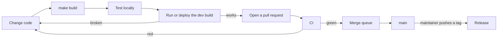

# Contributing to Aether

How to build Aether from source, run your build beside an installed release,
test it, put it on a test server, and get it merged. Aether has a Linux
server (`aether-server`) that runs coding agents in containers, a client CLI
(`aether`) for Linux, macOS and Windows, and a web dashboard built into both
binaries. Terms such as run, workspace and environment are explained in the
[glossary](docs/README.md#concepts).



## Toolchain

| Tool | Version | Used for |
| --- | --- | --- |
| Go | 1.26 (`go.mod` pins toolchain go1.26.9) | Server, CLI, edge |
| GNU make | any recent | Builds and checks |
| Bun | 1.3+ (`web/.bun-version`) | Dashboard dependencies and tests |
| Node.js | 22+ (22.13+ for `make test-native-hooks`) | Dashboard build and dev server, desktop shell |
| git | recent | Builds, integration tests |
| Docker | recent | Integration and end-to-end suites, the server's runtime, the Android build |
| ShellCheck | any | `make lint-workflows` |
| OpenSSL 3 | 3.x | `make test-scripts`; on macOS, `brew install openssl@3` and put its `bin` first on `PATH` |

The binaries are pure Go (`CGO_ENABLED=0`) and need no Node.js or Bun at run
time.

## Build from source

```sh
git clone https://github.com/3xDevOps/Aether
cd Aether
make build
```

`make build` builds the dashboard into `web/dist` (Bun installs the
dependencies, Node runs the Next build), then the Go binaries for the
machine you are on:

| File | What it is |
| --- | --- |
| `dist/aether` | The client CLI, which serves the dashboard with `aether gui` |
| `dist/aether-server` | The server, Linux only. It serves the dashboard on its tailnet web port |
| `dist/aether-edge` | The edge relay ([docs/edge.md](docs/edge.md)), Linux only |

`web/embed.go` embeds `web/dist` when Go compiles, so rebuild the binaries
after a dashboard change. A binary compiled without `make dashboard` answers
every page with `dashboard not built: this server binary embeds no web/dist`.

Every build is stamped with `git describe --tags --always --dirty`:

```console
$ ./dist/aether version
aether v0.7.1-beta.1-12-gabc1234-dirty (abc1234)
```

That is 12 commits past the release `v0.7.1-beta.1`, at commit `abc1234`,
with uncommitted changes. Aether ranks it above that release and below the
next one. A checkout without tags stamps a bare commit hash (run
`git fetch --tags`), and a plain `go build` reports `dev`. Neither compares
with a release, so update checks and version gates never count them as
behind.

`make release-binaries` builds the ten release binaries into `dist/`: server
and edge for Linux, the CLI for Linux, macOS and Windows, each on amd64 and
arm64. `SERVER_PLATFORMS`, `EDGE_PLATFORMS` and `CLI_PLATFORMS` pick the
targets, for example `make release-binaries SERVER_PLATFORMS=linux/arm64
EDGE_PLATFORMS= CLI_PLATFORMS=` for one server binary.

## Run a development build

`./dist/aether` does not replace the `aether` on your `PATH`. Call it by its
path; `aether` keeps meaning the installed release.

The two share everything a client stores: the link config
(`~/.config/aether/config.json` on Linux,
`~/Library/Application Support/aether/config.json` on macOS,
`%AppData%\aether\config.json` on Windows), the SSH key `~/.ssh/id_ed25519`
and `~/.ssh/known_hosts`. So `./dist/aether link` changes what the installed
CLI and a running desktop app connect to. Ports do not clash: every
`aether gui`, the desktop app's included, binds a free port on 127.0.0.1
unless you pass `--port`, and a taken `--port` fails with
`aether: localgw: listen: listen tcp 127.0.0.1:8080: bind: address already in use`.

To give the dev CLI its own key and links on Linux or macOS, point `HOME` and
`AETHER_CONFIG_DIR` at an empty directory. The server then sees a new person,
so join with an invite code ([docs/teams.md](docs/teams.md)):

```sh
devhome=$(mktemp -d)
HOME=$devhome AETHER_CONFIG_DIR=$devhome ./dist/aether link <server>:2222 --invite <code>
HOME=$devhome AETHER_CONFIG_DIR=$devhome ./dist/aether gui
```

> [!WARNING]
> `aether gui` checks for a newer release when it starts, and the dashboard
> offers it ([update prompts](docs/dashboard-frontend.md#update-prompts)).
> Accepting it, or running `./dist/aether update`, replaces `dist/aether`
> (and `dist/aether-server` on Linux) with the release and rebuilds an
> installed desktop app against it. `AETHER_NO_UPDATE_CHECK=1` turns the
> checks off.

### The desktop app

`./dist/aether gui build` replaces your installed desktop app, builds it from
source, and ties it to the absolute path of `dist/aether`. If `dist/` is then
deleted or moved, the app stops with `The CLI that installed this app is no
longer executable at <path>`. Run `aether gui build` with the released CLI to
go back. To try the shell on the dev CLI without touching the installed app:

```sh
cd desktop && npm ci && AETHER_BIN="$PWD/../dist/aether" npm start
```

### The dashboard with hot reload

Run Next's dev server against a local gateway
([details](docs/dashboard-frontend.md#runtime-boundary-and-commands)):

```sh
./dist/aether gui --port 8080 --url          # terminal 1: prints a URL with ?token=
cd web && AETHER_DASHBOARD=http://127.0.0.1:8080 \
  bun run dev -- --port 3000 --hostname 127.0.0.1   # terminal 2
```

Open `http://127.0.0.1:3000/?token=<token>` with the token from terminal 1;
it works until that `aether gui` exits. Edits in `web/src` reload in the
browser. Gateway or server changes need `make build` and a restart.

The server needs Linux, Docker and systemd; see
[Deploy a development build to a test server](#deploy-a-development-build-to-a-test-server).

## Test your change

Run these before you open a pull request:

| Command | Catches |
| --- | --- |
| `make fmt-check` | Go files gofmt would change |
| `make vet` | `go vet` findings |
| `make lint` | golangci-lint findings, under `go.mod`'s toolchain (no install needed) |
| `make lint-workflows` | Workflow mistakes (actionlint, with ShellCheck on embedded scripts) |
| `make test` | Go unit tests, with the race detector |
| `make test-scripts` | Installer, deploy, release and CI script tests, with every outside command stubbed |
| `make public-audit` | Private data that must not enter the public tree |
| `cd web && bun run typecheck && bun run test` | Dashboard type errors and component tests (`bun install --frozen-lockfile` first) |

`make fmt-check` uses the `gofmt` on your `PATH`, and a Go newer than the
pinned toolchain can flag files CI accepts. Check with the pinned one:
`"$(GOTOOLCHAIN=go1.26.9 go env GOROOT)/bin/gofmt" -l .`

Then run the suites for what you changed: `make test-integration` (real
Docker and git) for server work that touches containers, git or storage, and
`make test-e2e` for dashboard flows.
[docs/testing.md](docs/testing.md#which-suite-to-run) maps each kind of
change (Go, dashboard, scripts, desktop, Android, edge) to its suite.

CI runs on every pull request. One that changes only `docs/` or root-level
`*.md` files runs the public audit and nothing else, and the edge image and
Windows desktop jobs run only when their paths change
([How CI runs the suites](docs/testing.md#how-ci-runs-the-suites)). Inside an
Aether run, unset the run's `AETHER_*` variables before testing, or some
tests fail
([how](docs/testing.md#running-the-docker-suites-inside-a-run)).

## Deploy a development build to a test server

`make deploy` puts your server build on a Linux machine with systemd and
Docker. It skips tests and CI.

```sh
DEPLOY_HOST=user@host make deploy   # over SSH
make deploy                         # this machine
```

1. It builds the dashboard and cross-compiles `aether-server` for the
   target (amd64 or arm64).
2. It installs it as `/usr/local/bin/aether-server`, with one SSH
   connection and at most one `sudo` password prompt.
3. It installs and enables `packaging/systemd/aether-server.service` only if
   the target has no `aether-server` unit.
4. It restarts the service and checks the new version is running, or fails
   with `deploy: aether-server is not running after restart; check
   journalctl -u aether-server`.

It leaves alone the `aether` CLI on the target, `/etc/aether/`, the data
directory (`/var/lib/aether` by default) and Docker images. Environments
without a saved image start from the standard image of the release the build
descends from (`ghcr.io/3xdevops/aether-standard:v0.7.1-beta.1` for
`v0.7.1-beta.1-12-gabc1234`), or `:latest` without a release tag. A run's
Browser tab needs `aether/browser:test`, which the server never pulls, and
fails with `runtime: image aether/browser:test is built locally and is
missing from the daemon` until you run `make browser-image` on the target or
`sudo aether-server config set browser-image ghcr.io/3xdevops/aether-browser:<tag>`
and restart.

### On a server that runs a release

> [!WARNING]
> Deploy development builds to a separate test server. A server your team
> uses may not be able to go back to a release afterwards.

The database moves forward when the dev build starts, with no backup.
Migrations (`internal/store/migrate.go`) never run backwards, so if your
branch adds one, the release then refuses to start:

```text
store: database schema version N is newer than this binary supports (M)
```

Migrations are tracked by number only. If yours later ships in a different
form, a release will not apply it again.

The server accepts clients at or past the release it descends from. An older
client is refused with:

```text
rpc error -32005: this aether is <client> and the server runs <server>; update this client first: run `aether update` (desktop: Update in the app; Android: install the latest aether-android.apk), then retry
```

A server stamped `dev` or a bare hash refuses no client. The rule works the
other way too: a release server refuses a dev CLI built from an older
release.

Once a newer release exists, `sudo aether-server update` and the dashboard's
server update prompt offer it, and installing it replaces your dev build and
the `aether` beside it. Nothing installs on its own: the server only checks,
about every six hours. Add `AETHER_NO_UPDATE_CHECK=1` to
`/etc/aether/aether-server.env` to stop the check.

If the server has data you want to keep, copy its data directory while it is
stopped, then deploy:

```sh
sudo aether-server config show              # the data-dir row
sudo systemctl stop aether-server
sudo cp -a /var/lib/aether /var/lib/aether.bak
```

### Test the latest main

No nightly or main-branch release is published: the installer, `aether
update` and `aether-server update` install only published releases, by
default the newest that is not a prerelease. Build `main` yourself:

```sh
git fetch --tags origin
git switch --detach origin/main
make build                          # or: DEPLOY_HOST=user@host make deploy
```

CI also keeps the binaries of each push to `main` for seven days, as
`binaries-go` (Linux and macOS) and `binaries-go-windows`. They are unsigned,
come with no checksums, and nothing installs them for you:

```sh
gh run list --workflow ci.yml --branch main --event push --status success --limit 1
gh run download <run-id> --name binaries-go --dir aether-main
```

## Go back to a release

On the server, if your branch added no migration:

```sh
sudo aether-server update --version <tag>
```

`<tag>` is the release your build descends from or a newer one. The update
checks the release's signature, keeps the old binary as
`/usr/local/bin/aether-server.prev`, rolls back a start that fails, and
refuses a database the release cannot open:

```text
refusing to downgrade: this database is at schema N and <tag> only knows schema M; it could not open it
```

An older release needs `aether server update --version <tag>
--allow-downgrade` from an admin's client, with the same database check.

If your branch added a migration, restore your copy, then install the
release. Without a copy, no release can open that database.

```sh
sudo systemctl stop aether-server
sudo rm -rf /var/lib/aether && sudo cp -a /var/lib/aether.bak /var/lib/aether
curl -fsSL https://raw.githubusercontent.com/3xDevOps/Aether/main/scripts/install.sh \
  | sh -s -- --server --role none --version <tag>
sudo systemctl start aether-server
```

On a client the installed `aether` was never replaced. If you ran
`./dist/aether gui build`, run `aether gui build` to tie the desktop app to
the release again. `make clean` deletes `dist/`.

## Desktop shell

`desktop/` is an Electron window around `aether gui`. It bundles no CLI: it
starts the one named by `AETHER_BIN`, else the one recorded by the
`aether gui build` that installed it, else `aether` on `PATH`. Users install
it with `aether gui build`, which unpacks the sources embedded by
`desktop/embed.go` ([docs/install.md](docs/install.md#desktop-app)), so a new
file the shell needs at run time goes in both `desktop/embed.go` and the
`files` list in `desktop/electron-builder.yml`. `make test-scripts` runs its
tests (`cd desktop && node --test`). To build an installer for this machine:

```sh
cd desktop && npm ci && npm run dist   # into desktop/dist/
```

<details>
<summary>Installers for other platforms</summary>

| Artifact | On Linux | On macOS | On Windows |
| --- | --- | --- | --- |
| Linux `.AppImage`, `.deb` | `npm run dist -- --linux` | Docker image | Docker image |
| Windows `.exe` (NSIS) | Docker image | native tooling | `npm run dist -- --win` |
| macOS `.zip` | `npm run dist -- --mac zip` | `npm run dist -- --mac` | Docker image |
| macOS `.dmg` | macOS only | `npm run dist -- --mac` | macOS only |

The Docker image is electron-builder's Wine image. Run it as your own user
with a writable cache, or it leaves root-owned files in `dist/`:

```sh
mkdir -p ~/.cache/aether-desktop-build
docker run --rm --user "$(id -u):$(id -g)" -e HOME=/home/builder \
  -v "$PWD:/project" \
  -v "$HOME/.cache/aether-desktop-build:/home/builder" \
  electronuserland/builder:wine \
  npx electron-builder --win --publish never
```

Cross-built Windows and macOS artifacts are unsigned: SmartScreen and
Gatekeeper warn, and auto-update refuses them. Treat them as test builds.

</details>

Every icon Aether ships is generated from `web/public/aether-mark.png`. After
changing it, run `python3 scripts/make-icons.py` (needs `pillow` and
`fonttools[woff]`) and commit what it writes.

## Android shell

`android/` is a Kotlin WebView app that loads a server's dashboard or, in
Aether Edge mode, the local gateway of the `aether` CLI it carries
([docs/install.md](docs/install.md#android-app)). It builds in containers
pinned by digest, so it needs Docker and no Android SDK:

```sh
make android         # JUnit tests, then dist/aether-android-unsigned.apk and .aab
make android-debug   # dist/aether-android-debug.apk, without the tests
adb install -r dist/aether-android-debug.apk
```

`make android` first builds the dashboard and the CLI into
`android/app/src/main/jniLibs/<abi>/libaether.so`. A debug or unsigned APK
and a release never install over each other. Android Studio opens
`android/` directly. A change to what the app stores or sends also changes
the Play listing in `android/listing/` and [docs/privacy.md](docs/privacy.md).

<details>
<summary>Signing, version codes and pinned dependencies</summary>

With signing variables set, `make android` writes `dist/aether-android.apk`
and `.aab` and fails unless both carry the keystore's certificate. Keep the
keystore outside the checkout:

```sh
keytool -genkeypair -keyalg RSA -keysize 2048 -validity 10950 \
  -keystore /path/outside/the/checkout/throwaway.jks -alias throwaway
ANDROID_KEYSTORE_FILE=/path/outside/the/checkout/throwaway.jks \
ANDROID_KEYSTORE_PASSWORD=... ANDROID_KEY_ALIAS=throwaway ANDROID_KEY_PASSWORD=... \
  make android
```

`keytool` defaults to 90 days, and Google Play refuses an upload key that
expires before 22 October 2033. A PKCS12 keystore has one password, so
`ANDROID_KEY_PASSWORD` equals `ANDROID_KEYSTORE_PASSWORD`. A signed build
needs a release tag: `scripts/android-version-code.sh` derives the
versionCode from it, so every release outranks the one before. An untagged
or dirty tree builds versionCode 1.

`ANDROID_IMAGE` in the `Makefile` (a Cirrus Labs image, published unsigned)
moves together with `compileSdk` and `buildToolsVersion` in
`android/app/build.gradle.kts`.

`android/gradle/verification-metadata.xml` pins a sha256 for every
dependency. After changing `android/gradle/libs.versions.toml`, regenerate it
from a cold cache, then run `make android` and `make android-debug` with
`ANDROID_GRADLE_HOME` set to an empty directory:

```sh
rm -rf android/build android/app/build android/.gradle
GRADLE=$(mktemp -d) && docker run --rm -u "$(id -u):$(id -g)" \
  -v "$PWD/android":/src -w /src -v "$GRADLE":/gradle \
  -e HOME=/gradle -e GRADLE_USER_HOME=/gradle \
  ghcr.io/cirruslabs/android-sdk@sha256:f9b3ea9ed2b5fc9522adae82c7b4622ab7aa54207ef532c8e615a347dca08f31 \
  ./gradlew --write-verification-metadata sha256 \
    test assembleRelease bundleRelease assembleDebug
```

</details>

## Edge image

`images/edge/Dockerfile` builds the edge's container image. CI builds and
smoke-tests it on amd64 and arm64 when a pull request touches what the image
contains, and always on `main`. [docs/testing.md](docs/testing.md#the-edge-image)
has the local check and how to force the CI jobs on a branch.

## Commits and pull requests

Commit messages, pull request titles and code style follow
[AGENTS.md](AGENTS.md#commits). Update the guide in `docs/` that a change
affects in the same pull request. An agent working inside an Aether run ends
every pull request description with `Opened from Aether run <run id>`, using
the `run_id` that `aether-internal status` reports.

AI tools are welcome under the [AI contributions policy](AI_POLICY.md): you
own what you submit, you add `This PR was made with the help of <name of
tool>.` to the pull request description, and you never list an AI tool as a
commit or pull request co-author.

## Security

Do not report a security problem in a public issue or pull request, and
never put live credentials in a report.

## Releases

Maintainers release by pushing a tag: `vMAJOR.MINOR.PATCH` with an optional
`-alpha.N`, `-beta.N` or `-rc.N`. The tag's exact commit needs a successful
`CI` run from a push to `main`; a pull request run, a merge queue run or
another commit's run does not count. From a `main` checkout with `gh` and
`jq`:

```sh
git tag -a v0.8.0 -m v0.8.0 <commit>
sh scripts/release-ci-check.sh 3xDevOps/aether "$(git rev-parse 'v0.8.0^{commit}')" &&
git push origin v0.8.0
```

Push tags one at a time: GitHub starts no workflow when more than three are
pushed at once. Do not create the GitHub release yourself.
`.github/workflows/release.yml` runs only when the tag's pusher is a
repository admin and `AETHER_RELEASE_SIGNING_KEY` is set. It builds every
binary, the Windows desktop zips, the signed Android app and the browser,
edge and standard images from the tag's commit, runs the edge upgrade
qualification and a Defender scan, and uploads the assets to a draft. After
checking them against the signed manifest it publishes a normal release,
never a GitHub prerelease, because the installers and update checks read
`/releases/latest`, which skips prereleases. The highest published version
becomes Latest.

Besides the binaries, the Windows desktop zips and the Android APK and AAB,
a release carries `checksums.txt` and a manifest signed with Ed25519
(`aether-release.json` and `.sig`) that both update commands verify, and the
installer too when OpenSSL 3 is present. Images carry Sigstore build
attestations. Windows and macOS binaries are not code-signed.

A failure before publishing leaves at most a draft: fix the cause and run
`gh run rerun <run-id> --failed`. Published assets are never replaced, so a
bad published release needs a new tag.

<details>
<summary>Edge releases and the signing key</summary>

`packaging/edge/upgrade.json` records what an edge upgrade needs:
`min_upgrade_from`, the `manual_steps` an operator must take, and the edge
store schema, protocol and file hashes. A pull request that adds an edge
migration, protocol version or `AETHER_EDGE_*` variable, or changes the edge
image or unit, updates it; `go test ./internal/edge/cmd/release-edge` fails
until it does. Never remove a step.

A release that becomes Latest moves `ghcr.io/3xdevops/aether-edge:latest`.
Production edges follow `:stable`, which only `promote-edge.yml` moves, run
by an admin at least 24 hours after the release
(`-f soak_override_reason='<why>'` promotes sooner):

```sh
docker buildx imagetools inspect ghcr.io/3xdevops/aether-edge:<tag>   # Digest:
gh workflow run promote-edge.yml -f tag=<tag> -f digest=sha256:<digest>
```

It refuses a release older than `stable`, and one whose `min_upgrade_from`
is above the release `stable` carries.

Keep `AETHER_RELEASE_SIGNING_KEY` in the `release` environment
(**Settings → Environments**) limited to `v*` tags, delete any repository
secret of that name, and limit `edge-promotion` to `main`. The Android job
reads `ANDROID_KEYSTORE_B64`, `ANDROID_KEYSTORE_PASSWORD`, `ANDROID_KEY_ALIAS`
and `ANDROID_KEY_PASSWORD`. Losing that keystore means no release can update
an installed app again.

</details>
