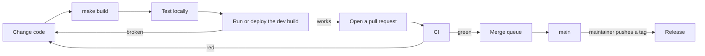

# Contributing to Cloudfield

How to build Cloudfield from source, run your build beside an installed release,
test it, put it on a test server, and get it merged. Cloudfield has a Linux
server (`aether-server`) that runs coding agents in containers, a client CLI
(`aether`) for Linux, macOS and Windows, and a web dashboard built into both
binaries. Terms such as session, workspace and environment are explained in the
[glossary](docs/README.md#concepts).



## Toolchain

| Tool | Version | Used for |
| --- | --- | --- |
| Go | 1.26 (`go.mod` pins toolchain go1.26.10) | Server, CLI, edge |
| GNU make | any recent | Builds and checks |
| Bun | 1.3+ (`web/.bun-version`) | Dashboard dependencies and tests |
| Node.js | 22+ (22.13+ for `make test-native-hooks`) | Dashboard build and dev server, desktop shell |
| git | recent | Builds, integration tests |
| Docker | recent | Integration and end-to-end suites, the server's runtime, the Android build |
| ShellCheck | any | `make lint-workflows` |
| OpenSSL 3 | 3.x | `make test-scripts`; on macOS, `brew install openssl@3` and put its `bin` first on `PATH` |

The binaries are pure Go (`CGO_ENABLED=0`) and need no Node.js or Bun at run
time.

## Build from source

```sh
git clone https://github.com/3xDevOps/Aether
cd Aether
make build
```

`make build` builds the dashboard into `web/dist` (Bun installs the
dependencies, Node runs the Next build), then the Go binaries for the
machine you are on:

| File | What it is |
| --- | --- |
| `dist/aether` | The client CLI, which serves the dashboard with `aether gui` |
| `dist/aether-server` | The server, Linux only. It serves the dashboard on its tailnet web port |
| `dist/aether-edge` | The edge relay ([docs/edge.md](docs/edge.md)), Linux only |

`web/embed.go` embeds `web/dist` when Go compiles, so rebuild the binaries
after a dashboard change. A binary compiled without `make dashboard` answers
every page with `dashboard not built: this server binary embeds no web/dist`.

Every build is stamped with `git describe --tags --always --dirty`:

```console
$ ./dist/aether version
aether v0.7.1-beta.1-12-gabc1234-dirty (abc1234)
```

That is 12 commits past the release `v0.7.1-beta.1`, at commit `abc1234`,
with uncommitted changes. Cloudfield ranks it above that release and below the
next one. A checkout without tags stamps a bare commit hash (run
`git fetch --tags`), and a plain `go build` reports `dev`. Neither compares
with a release, so update checks and version gates never count them as
behind.

`make release-binaries` builds the ten release binaries into `dist/`: server
and edge for Linux, the CLI for Linux, macOS and Windows, each on amd64 and
arm64. `SERVER_PLATFORMS`, `EDGE_PLATFORMS` and `CLI_PLATFORMS` pick the
targets, for example `make release-binaries SERVER_PLATFORMS=linux/arm64
EDGE_PLATFORMS= CLI_PLATFORMS=` for one server binary.

## Run a development build

`./dist/aether` does not replace the `aether` on your `PATH`. Call it by its
path; `aether` keeps meaning the installed release.

The two share everything a client stores: the link config
(`~/.config/aether/config.json` on Linux,
`~/Library/Application Support/aether/config.json` on macOS,
`%AppData%\aether\config.json` on Windows), the SSH key `~/.ssh/id_ed25519`
and `~/.ssh/known_hosts`. So `./dist/aether link` changes what the installed
CLI and a running desktop app connect to. Ports do not clash: every
`aether gui`, the desktop app's included, binds a free port on 127.0.0.1
unless you pass `--port`, and a taken `--port` fails with
`aether: localgw: listen: listen tcp 127.0.0.1:8080: bind: address already in use`.

To give the dev CLI its own key and links on Linux or macOS, point `HOME` and
`AETHER_CONFIG_DIR` at an empty directory and unset `SSH_AUTH_SOCK` for every
dev CLI command. With `SSH_AUTH_SOCK` set, the dev CLI offers the keys your
ssh-agent holds: `aether link` creates no key of its own, and the server signs
you in as your existing member, even with `--invite`. With all three, the dev
CLI creates its own key, so join with an invite code
([docs/teams.md](docs/teams.md)):

```sh
devhome=$(mktemp -d)
env -u SSH_AUTH_SOCK HOME=$devhome AETHER_CONFIG_DIR=$devhome ./dist/aether link <server>:2222 --invite <code>
env -u SSH_AUTH_SOCK HOME=$devhome AETHER_CONFIG_DIR=$devhome ./dist/aether gui
```

A new key makes a new person only where the server identifies people by key.
A connection over the tailnet signs in as its tailnet login before any key is
checked, unless the server runs with `--tailnet-require-key`, and an edge
sign-in with the same GitHub account reaches the same member. For a second
person on such a server, link the dev CLI by an address that goes through
neither, such as the server's LAN address, so the server checks the new key
and the invite. Otherwise sign in as a different tailnet login or a different
invited GitHub account.

> [!WARNING]
> `aether gui` checks for a newer release when it starts, and the dashboard
> offers it ([update prompts](docs/dashboard-frontend.md#update-prompts)).
> Accepting it, or running `./dist/aether update`, replaces `dist/aether`
> (and `dist/aether-server` on Linux) with the release and rebuilds an
> installed desktop app against it. `AETHER_NO_UPDATE_CHECK=1` turns the
> checks off.

### The desktop app

`./dist/aether gui build` replaces your installed desktop app, builds it from
source, and ties it to the absolute path of `dist/aether`. If `dist/` is then
deleted or moved, the app stops with `The CLI that installed this app is no
longer executable at <path>`. Run `aether gui build` with the released CLI to
go back. To try the shell on the dev CLI without touching the installed app:

```sh
cd desktop && npm ci && AETHER_BIN="$PWD/../dist/aether" npm start
```

### The dashboard with hot reload

Run Next's dev server against a local gateway
([details](docs/dashboard-frontend.md#runtime-boundary-and-commands)):

```sh
./dist/aether gui --port 8080 --url          # terminal 1: prints a URL with ?token=
cd web && AETHER_DASHBOARD=http://127.0.0.1:8080 \
  bun run dev -- --port 3000 --hostname 127.0.0.1   # terminal 2
```

Open `http://127.0.0.1:3000/?token=<token>` with the token from terminal 1;
it works until that `aether gui` exits. Edits in `web/src` reload in the
browser. Gateway or server changes need `make build` and a restart.

The server needs Linux, Docker and systemd; see
[Deploy a development build to a test server](#deploy-a-development-build-to-a-test-server).

## Test your change

Run these before you open a pull request:

| Command | Catches |
| --- | --- |
| `make fmt-check` | Go files gofmt would change |
| `make vet` | `go vet` findings |
| `make lint` | golangci-lint findings, under `go.mod`'s toolchain (no install needed) |
| `make lint-workflows` | Workflow mistakes (actionlint, with ShellCheck on embedded scripts) |
| `make test` | Go unit tests, with the race detector |
| `make test-scripts` | Installer, deploy, release and CI script tests, with every outside command stubbed |
| `make public-audit` | Private data that must not enter the public tree |
| `cd web && bun run typecheck && bun run test` | Dashboard type errors and component tests (`bun install --frozen-lockfile` first) |

`make fmt-check` uses the `gofmt` on your `PATH`, and a Go newer than the
pinned toolchain can flag files CI accepts. Check with the pinned one:
`"$(GOTOOLCHAIN=go1.26.10 go env GOROOT)/bin/gofmt" -l .`

Then run the suites for what you changed: `make test-integration` (real
Docker and git) for server work that touches containers, git or storage, and
`make test-e2e` for dashboard flows.
[docs/testing.md](docs/testing.md#which-suite-to-run) maps each kind of
change (Go, dashboard, scripts, desktop, Android, edge) to its suite.

CI on a pull request runs only the fast jobs, and one that changes only
`docs/` or root-level `*.md` files runs the public audit and nothing else. The
merge queue runs the full suite on every change before it reaches `main`
([How CI runs the suites](docs/testing.md#how-ci-runs-the-suites)). Inside an
Cloudfield run, unset the session's `AETHER_*` variables before testing, or some
tests fail
([how](docs/testing.md#running-the-docker-suites-inside-a-session)).

## Deploy a development build to a test server

`make deploy` puts your server build on a Linux machine with systemd and
Docker. It skips tests and CI.

```sh
DEPLOY_HOST=user@host make deploy   # over SSH
make deploy                         # this machine
```

1. It builds the dashboard and cross-compiles `aether-server` for the
   target (amd64 or arm64).
2. It installs it as `/usr/local/bin/aether-server`, with one SSH
   connection and at most one `sudo` password prompt.
3. It installs and enables `packaging/systemd/aether-server.service` only if
   the target has no `aether-server` unit, and installs
   `packaging/systemd/aether.slice` every time.
4. It restarts the service and checks the new version is running, or fails
   with `deploy: aether-server is not running after restart; check
   journalctl -u aether-server`.

It leaves alone the `aether` CLI on the target, `/etc/aether/`, the data
directory (`/var/lib/aether` by default) and Docker images. Environments
without a saved image start from the standard image of the release the build
descends from (`ghcr.io/3xdevops/aether-standard:v0.7.1-beta.1` for
`v0.7.1-beta.1-12-gabc1234`), or `:latest` without a release tag. A session's
Browser tab needs `aether/browser:test`, which the server never pulls, and
fails with `runtime: image aether/browser:test is built locally and is
missing from the daemon` until you run `make browser-image` on the target or
`sudo aether-server config set browser-image ghcr.io/3xdevops/aether-browser:<tag>`
and restart.

### On a server that runs a release

> [!WARNING]
> Deploy development builds to a separate test server. A server your team
> uses may not be able to go back to a release afterwards.

The database moves forward when the dev build starts, with no backup.
Migrations (`internal/store/migrate.go`) never run backwards, so if your
branch adds one, the release then refuses to start:

```text
store: database schema version N is newer than this binary supports (M)
```

Migrations are tracked by number only. If yours later ships in a different
form, a release will not apply it again.

The server accepts clients at or past the release it descends from. An older
client is refused with:

```text
rpc error -32005: this aether is <client> and the server runs <server>; update this client first: run `aether update` (desktop: Update in the app; Android: install the latest aether-android.apk), then retry
```

A server stamped `dev` or a bare hash refuses no client. The rule works the
other way too: a release server refuses a dev CLI built from an older
release.

Once a newer release exists, `sudo aether-server update` and the dashboard's
server update prompt offer it, and installing it replaces your dev build and
the `aether` beside it. Nothing installs on its own: the server only checks,
about every six hours. Add `AETHER_NO_UPDATE_CHECK=1` to
`/etc/aether/aether-server.env` to stop the check.

If the server has data you want to keep, copy its data directory while it is
stopped, then deploy:

```sh
sudo aether-server config show              # the data-dir row
sudo systemctl stop aether-server
backup=/var/lib/aether.bak-$(date +%Y%m%d-%H%M%S)
sudo cp -a /var/lib/aether "$backup"
echo "$backup"
```

Note the printed path. You need it to restore this copy.

### Test the latest main

No nightly or main-branch release is published: the installer, `aether
update` and `aether-server update` install only published releases, by
default the newest that is not a prerelease. Build `main` yourself:

```sh
git fetch --tags origin
git switch --detach origin/main
make build                          # or: DEPLOY_HOST=user@host make deploy
```

CI also keeps the binaries of each merge queue run for seven days, as
`binaries-go` (Linux and macOS) and `binaries-go-windows`; the run that
tested the commit `main` points at has them. They are unsigned, come with no
checksums, and nothing installs them for you:

```sh
gh run list --workflow ci.yml --event merge_group --commit "$(git rev-parse origin/main)" --status success --limit 1
gh run download <session-id> --name binaries-go --dir aether-main
```

## Go back to a release

On the server, if your branch added no migration:

```sh
sudo aether-server update --version <tag>
```

`<tag>` is the release your build descends from or a newer one. The update
checks the release's signature, keeps the old binary as
`/usr/local/bin/aether-server.prev`, rolls back a start that fails, and
refuses a database the release cannot open:

```text
refusing to downgrade: this database is at schema N and <tag> only knows schema M; it could not open it
```

An older release needs `aether server update --version <tag>
--allow-downgrade` from an admin's client, with the same database check.

If your branch added a migration, restore your copy, then install the
release. Without a copy, no release can open that database. Replace
`<backup-dir>` with the path the backup printed.

```sh
sudo systemctl stop aether-server
sudo rm -rf /var/lib/aether && sudo cp -a <backup-dir> /var/lib/aether
curl -fsSL https://raw.githubusercontent.com/3xDevOps/Aether/main/scripts/install.sh \
  | sh -s -- --server --role none --version <tag>
sudo systemctl start aether-server
```

On a client the installed `aether` was never replaced. If you ran
`./dist/aether gui build`, run `aether gui build` to tie the desktop app to
the release again. `make clean` deletes `dist/`.

## Desktop shell

`desktop/` is an Electron window around `aether gui`. It bundles no CLI: it
starts the one named by `AETHER_BIN`, else the one recorded by the
`aether gui build` that installed it, else `aether` on `PATH`. Users install
it with `aether gui build`, which unpacks the sources embedded by
`desktop/embed.go` ([docs/install.md](docs/install.md#desktop-app)), so a new
file the shell needs at run time goes in both `desktop/embed.go` and the
`files` list in `desktop/electron-builder.yml`. `make test-scripts` runs its
tests (`cd desktop && node --test`). To build an installer for this machine:

```sh
cd desktop && npm ci && npm run dist   # into desktop/dist/
```

<details>
<summary>Installers for other platforms</summary>

| Artifact | On Linux | On macOS | On Windows |
| --- | --- | --- | --- |
| Linux `.AppImage`, `.deb` | `npm run dist -- --linux` | Docker image | Docker image |
| Windows `.exe` (NSIS) | Docker image | native tooling | `npm run dist -- --win` |
| macOS `.zip` | `npm run dist -- --mac zip` | `npm run dist -- --mac` | Docker image |
| macOS `.dmg` | macOS only | `npm run dist -- --mac` | macOS only |

The Docker image is electron-builder's Wine image. Run it as your own user
with a writable cache, or it leaves root-owned files in `dist/`:

```sh
mkdir -p ~/.cache/aether-desktop-build
docker run --rm --user "$(id -u):$(id -g)" -e HOME=/home/builder \
  -v "$PWD:/project" \
  -v "$HOME/.cache/aether-desktop-build:/home/builder" \
  electronuserland/builder:wine \
  npx electron-builder --win --publish never
```

Cross-built Windows and macOS artifacts are unsigned: SmartScreen and
Gatekeeper warn, and auto-update refuses them. Treat them as test builds.

</details>

Every icon Cloudfield ships is generated from `web/public/aether-mark.png`.
After changing it, run `python3 scripts/make-icons.py` (needs `pillow` and
`fonttools[woff]`) and commit what it writes.

## Android shell

`android/` is a Kotlin WebView app that loads a server's dashboard or, in
Aether Edge mode, the local gateway of the `aether` CLI it carries
([docs/install.md](docs/install.md#android-app)). It builds in containers
pinned by digest, so it needs Docker and no Android SDK:

```sh
make android         # JUnit tests, then dist/aether-android-unsigned.apk and .aab
make android-debug   # dist/aether-android-debug.apk, without the tests
adb install -r dist/aether-android-debug.apk
```

`make android` first builds the dashboard and the CLI into
`android/app/src/main/jniLibs/<abi>/libaether.so`. A debug or unsigned APK
and a release never install over each other. Android Studio opens
`android/` directly. A change to what the app stores or sends also changes
the Play listing in `android/listing/` and [docs/privacy.md](docs/privacy.md).

<details>
<summary>Signing, version codes and pinned dependencies</summary>

With signing variables set, `make android` writes `dist/aether-android.apk`
and `.aab` and fails unless both carry the keystore's certificate. Keep the
keystore outside the checkout:

```sh
keytool -genkeypair -keyalg RSA -keysize 2048 -validity 10950 \
  -keystore /path/outside/the/checkout/throwaway.jks -alias throwaway
ANDROID_KEYSTORE_FILE=/path/outside/the/checkout/throwaway.jks \
ANDROID_KEYSTORE_PASSWORD=... ANDROID_KEY_ALIAS=throwaway ANDROID_KEY_PASSWORD=... \
  make android
```

`keytool` defaults to 90 days, and Google Play refuses an upload key that
expires before 22 October 2033. A PKCS12 keystore has one password, so
`ANDROID_KEY_PASSWORD` equals `ANDROID_KEYSTORE_PASSWORD`. A signed build
needs a release tag: `scripts/android-version-code.sh` derives the
versionCode from it, or, when `RELEASE_BUILD` or `RELEASE_HOTFIX` is set
on the make command line, from those as
`100000000 + RELEASE_BUILD * 100 + RELEASE_HOTFIX`, so every release
outranks the one before. An untagged or dirty tree builds versionCode 1.

`ANDROID_IMAGE` in the `Makefile` (a Cirrus Labs image, published unsigned)
moves together with `compileSdk` and `buildToolsVersion` in
`android/app/build.gradle.kts`.

`android/gradle/verification-metadata.xml` pins a sha256 for every
dependency. After changing `android/gradle/libs.versions.toml`, regenerate it
from a cold cache, then run `make android` and `make android-debug` with
`ANDROID_GRADLE_HOME` set to an empty directory:

```sh
rm -rf android/build android/app/build android/.gradle
GRADLE=$(mktemp -d) && docker run --rm -u "$(id -u):$(id -g)" \
  -v "$PWD/android":/src -w /src -v "$GRADLE":/gradle \
  -e HOME=/gradle -e GRADLE_USER_HOME=/gradle \
  ghcr.io/cirruslabs/android-sdk@sha256:f9b3ea9ed2b5fc9522adae82c7b4622ab7aa54207ef532c8e615a347dca08f31 \
  ./gradlew --write-verification-metadata sha256 \
    test assembleRelease bundleRelease assembleDebug
```

</details>

## Edge image

`images/edge/Dockerfile` builds the edge's container image. CI builds and
smoke-tests it on amd64 and arm64 in the merge queue and on `main`. [docs/testing.md](docs/testing.md#the-edge-image)
has the local check and how to force the CI jobs on a branch.

## Commits and pull requests

Commit messages, pull request titles and code style follow
[AGENTS.md](AGENTS.md#commits). Update the guide in `docs/` that a change
affects in the same pull request. An agent working inside a Cloudfield run ends
every pull request description with `Opened from Aether session <session id>`, using
the `run_id` that `aether-internal status` reports.

AI tools are welcome under the [AI contributions policy](AI_POLICY.md): you
own what you submit, you add `This PR was made with the help of <name of
tool>.` to the pull request description, and you never list an AI tool as a
commit or pull request co-author.

## Security

Do not report a security problem in a public issue or pull request, and
never put live credentials in a report.

## Releases

Cloudfield ships on three release channels, `nightly`, `beta` and `stable`
([install.md](docs/install.md#release-channel) describes them for
operators). `nightly.yml` builds a nightly from the newest `main` commit with
green CI. An admin promotes a nightly to beta and a beta to stable with
`promote.yml`; a promotion rebuilds the same commit under the new tag and
keeps its build number. A fix to a released line goes out as a hotfix tag on
a `release/X.Y` branch. Each channel's newest release is named by a signed
pointer, and releases order by their signed build number, not their tag
([security.md](docs/security.md#release-channels)). The admin steps that
must exist first are listed in order under
[Set up releases](#set-up-releases).

### Tag a release

Pushing a tag from `main` is the path for the migration's `v0.8.7-beta.N`
only. After the migration, releases come from nightly and Promote, because a
`main` tag publishes a build-0 release that no channel-aware install takes
and Promote refuses as a source. `vX.Y.Z` with Z of 1 or more is the hotfix
path ([Hotfixes](#hotfixes)).

Maintainers release by pushing a tag: `vMAJOR.MINOR.0`, or a version with
`-alpha.N`, `-beta.N` or `-rc.N`, on a `main` commit, or a hotfix
`vMAJOR.MINOR.PATCH` (patch 1 or more) on a `release/MAJOR.MINOR` commit
([Hotfixes](#hotfixes)). A `-nightly.N` tag is refused. A `main` tag's
exact commit needs a successful `CI` run from a push to `main`; a pull
request run, a merge queue run or another commit's session does not count on
its own. That push session runs the full suite, except that it may run only `changes` and `CI gate`, linking
the queue session, when the newest merge queue session of the same commit
succeeded ([How CI runs the suites](docs/testing.md#how-ci-runs-the-suites)).
If you re-run that queue session after the push, re-run the whole push
session too (`gh run rerun <session-id>`, not `--failed`): the check reads
only the push session. From a `main` checkout with `gh` and
`jq`:

```sh
git tag -a v0.8.7-beta.1 -m v0.8.7-beta.1 <commit>
sh scripts/release-ci-check.sh 3xDevOps/aether "$(git rev-parse 'v0.8.7-beta.1^{commit}')" &&
git push origin v0.8.7-beta.1
```

Push tags one at a time: GitHub starts no workflow when more than three are
pushed at once. Do not create the GitHub release yourself.
`.github/workflows/release.yml` runs only when the tag's pusher is a
repository admin and `AETHER_RELEASE_SIGNING_KEY` is set, and calls
`.github/workflows/release-build.yml`. That builds every binary, the Windows
desktop zips, the signed Android app, the guest kernel for session VMs and
the browser, edge and standard images from the tag's commit, and runs the
edge upgrade qualification and a Defender scan. Its `release` job alone
holds the signing key: it checks out the `main` commit that
`release-policy` read, checks that the Go binaries record the tag's commit,
signs the assets with that checkout's `release-manifest` and uploads them
to a draft with its `scripts/publish-release.sh`. After
checking them against the signed manifest it publishes a normal release,
not a GitHub prerelease, because the installers and update checks read
`/releases/latest`, which skips prereleases. Only a release whose signed
manifest names the `nightly` or `beta` channel is published as a
prerelease. Latest goes to the published stable release with the highest
signed build and hotfix, above every release from before channels, which
carry no build; among those, the highest version wins.

Besides the binaries, the guest kernel (`aether-vmlinux-x86_64`), the
Windows desktop zips and the Android APK and AAB, a release carries `checksums.txt` and a manifest signed with Ed25519
(`aether-release.json` and `.sig`) that both update commands verify, and the
installer too when OpenSSL 3 is present. Images carry Sigstore build
attestations. Windows and macOS binaries are not code-signed.

A failure before publishing leaves at most a draft: fix the cause and run
`gh run rerun <session-id> --failed`. Published assets are never replaced, so a
bad published release needs a new tag.

### Promote

An admin promotes a published nightly to beta, or a published beta to
stable, with `.github/workflows/promote.yml` on `main`:

```sh
gh workflow run promote.yml -f from=v0.9.0-nightly.12 -f to=beta
```

It takes the commit and build from the source's signed manifest, requires
green push CI for that commit, refuses a build not above the channel's
pointer (so a second beta of the same nightly is refused: the edge image
tag would refuse the same build), and calls `release-build.yml`, whose `release` job creates the
annotated tag (`vX.Y.Z-beta.N` or `vX.Y.Z`, with a `build:` line) once
every asset is built. `-f version=X.Y.Z` names another version, at least
the current nightly base. A failed run is re-run with `gh run rerun
<session-id> --failed`; a new dispatch of the same commit reuses a tag it
left without a release.

Promote runs only from `main`, and refuses a dispatcher or re-runner who is
not a repository admin. An agent promotes by running that command on an
admin's GitHub login. `from` is a nightly or beta tag, or the full SHA of
one; `to` is `beta` or `stable`.

The migration's first stable is the one run that takes a release from before
channels. It promotes the `v0.8.7-beta.N` that shipped the channel-aware
updater to `v0.8.7`, signs it as build 1, and writes the first
`stable.json` and `beta.json`. It refuses once either pointer exists:

```sh
gh workflow run promote.yml -f from=v0.8.7-beta.<N> -f to=stable -f first-pointer=true
```

Promote then moves `aether-edge:beta` through `promote-edge.yml`
(`:stable` moves by hand, as the Edge releases note below says).

### Nightlies

`.github/workflows/nightly.yml` builds nightlies, and does nothing until an
admin sets the repository variable `NIGHTLY_ENABLED` to `true`. Every 30
minutes it takes the newest `main` commit with green push CI, waits until 4
hours after the last nightly unless an admin ran
`gh workflow run nightly.yml` ("build now"), and has `release-build.yml` tag
it `vX.Y.Z-nightly.N` with the next build number. `X.Y.Z` is the last stable
with its minor bumped, or the core of a higher beta (after `v0.8.7`,
`v0.9.0-nightly.1`). The `release` job in the `nightly` environment signs it
with `AETHER_NIGHTLY_SIGNING_KEY` and moves `nightly.json`; `promote-edge.yml`
then moves `aether-edge:nightly`. A run that finds a nightly tag its failed
predecessor left without a release builds that tag again, but not
before 4 hours have passed since the later of the tag and the newest failed
`nightly.yml` run.

Before it builds, the `signing-key` job refuses a nightly key `main` does not
trust, so a missing public key in `nightlyKeys` fails the run before
anything is built or tagged.

With `NIGHTLY_PRUNE_ENABLED` also `true`, it deletes once a day (04:07 UTC) the release
and images, never the git tag, of each nightly older than 14 days, except
the newest, every nightly above `stable.json`'s build, and a nightly whose
image a channel tag (`nightly`, `beta`, `stable` or `latest`) still carries,
which keeps its release and images. It prunes nothing while `nightly.json` or
`stable.json` cannot be read and verified. This lists what it would
delete, and deletes nothing (`gh` needs the `read:packages` scope):

```sh
go build -o /tmp/nightly-plan ./scripts/nightly-plan
GITHUB_REPOSITORY=3xDevOps/aether NIGHTLY_PLAN=/tmp/nightly-plan sh scripts/nightly-prune.sh --dry-run
```

Switch builds on and off with the repository variables:

```sh
gh variable set NIGHTLY_ENABLED --body true --repo 3xDevOps/aether          # builds
gh variable set NIGHTLY_PRUNE_ENABLED --body true --repo 3xDevOps/aether    # pruning too, after a dry run looks right
gh variable delete NIGHTLY_PRUNE_ENABLED --repo 3xDevOps/aether             # stops pruning only
gh variable delete NIGHTLY_ENABLED --repo 3xDevOps/aether                   # stops everything, pruning included
```

A run already in progress finishes. Only the exact value `true` turns either
variable on. An organization variable of the same name also reaches this
repository; check with `gh variable list --org 3xDevOps` that neither exists
there.

Nightly's build and Promote share the `channels` concurrency group, and
GitHub keeps one pending run per group: a nightly build waiting behind a
running Promote cancels a second Promote waiting there, and the other way
round. A cancelled Promote tags and publishes nothing; dispatch it again.

### Pointers

A workflow that moves a channel pointer (`<channel>.json` on the
`channels` prerelease) keeps the pair it signed as the `pointer-<channel>`
artifact for 90 days. If an upload leaves half a pair, restore that
artifact with the `gh run download ... && gh release upload channels
--clobber ...` command the failed run prints. Once the artifact has expired
there is no workflow path to re-sign a pointer: `first-pointer` takes only the
migration's `v0.8.7-beta.N` and refuses once a pointer exists, and
`nightly.yml` has no such input. It needs a code change first. Never sign one
below what installs have seen: they refuse a lower pointer.

### Hotfixes

A hotfix fixes one line of stable releases without the rest of `main`.
The line's base is its stable release with hotfix 0, usually `vX.Y.0`; for
0.8 it is `v0.8.7`, the first stable with a build. Merge the fix to `main`
first. Cut `release/X.Y` from the base commit if it does not exist
(`git push origin 'v0.9.0^{commit}:refs/heads/release/0.9'`), and
cherry-pick the fix into it in a pull request. Each push to `release/X.Y`
runs the full `CI` suite. When it is green, tag the branch head `vX.Y.Z`,
one above the line's newest release, and check it from a `main` checkout
before pushing:

```sh
git tag -a v0.9.1 -m v0.9.1 origin/release/0.9
sh scripts/release-ci-check.sh --branch release/0.9 3xDevOps/aether "$(git rev-parse 'v0.9.1^{commit}')" &&
git push origin v0.9.1
```

`release.yml` then runs `scripts/release-hotfix.sh` from `main`. It reads
the signed manifest of the published `vX.Y.(Z-1)`, which must be a stable
release with a build; its hotfix count leads back to the base, whose
manifest must be stable on the same build with hotfix 0. `stable.json` and
`beta.json` must verify too. It refuses the tag unless its commit is the
head of `release/X.Y`, contains `vX.Y.(Z-1)` and differs from it, and the
branch's only merge base with `main` is the base commit, so the branch
carries nothing newer from `main`. The release is stable, with the base's
build and the next hotfix count. A line whose base is from before channels
has no build and cannot take a hotfix. After publishing, the signer moves
`beta.json` and then `stable.json`, each only when the hotfix is above it;
in that order beta never falls below stable, even if the second move
fails. A hotfix on a line older than `stable.json` moves neither, and only
installs that ask for that tag get it. Once a nightly carries the fix,
promote it to beta too, because beta can sit at a build above the hotfix
that lacks the fix. A hotfix never moves `aether-edge:beta`: that tag
follows at the next Promote to beta. A hotfix waits for the `channels`
concurrency group that every pointer writer shares. GitHub keeps one
pending run per group, so a pending hotfix can be cancelled when another
writer queues; re-run it with `gh run rerun <run-id>`.

A push to the branch runs the branch's `ci.yml`, and the tag runs its
`release.yml` and `release-build.yml`. A line whose base commit predates
hotfix support needs those workflow files from `main` cherry-picked onto
its branch first. Because the tag runs the branch's own workflow files with
the signing key, no check in `main`'s scripts can guard them: the tag's
`release.yml` decides what runs. Until the protections below exist, reading
the branch is the only guard, so before tagging read
`git log -p v0.9.0..origin/release/0.9 -- .github scripts`.

Before the first hotfix, a repository admin sets up three protections:

1. A ruleset for `release/*` like `main`'s, where only admins may create
   branches:

   ```sh
   gh api -X POST repos/3xDevOps/aether/rulesets --input - <<'JSON'
   {"name": "Release branches", "target": "branch", "enforcement": "active",
    "conditions": {"ref_name": {"include": ["refs/heads/release/*"], "exclude": []}},
    "bypass_actors": [{"actor_id": null, "actor_type": "OrganizationAdmin", "bypass_mode": "always"}],
    "rules": [{"type": "creation"}, {"type": "deletion"}, {"type": "non_fast_forward"},
      {"type": "pull_request", "parameters": {"required_approving_review_count": 1,
        "dismiss_stale_reviews_on_push": true, "require_last_push_approval": true,
        "require_code_owner_review": false, "required_review_thread_resolution": false}},
      {"type": "required_status_checks", "parameters": {"do_not_enforce_on_create": true,
        "strict_required_status_checks_policy": false,
        "required_status_checks": [{"context": "CI gate", "integration_id": 15368}]}}]}
   JSON
   ```

2. A ruleset for `v*` tags that lets only admins and GitHub Actions
   (`integration_id` 15368, which Promote and nightly builds tag through)
   create, move or delete them:

   ```sh
   gh api -X POST repos/3xDevOps/aether/rulesets --input - <<'JSON'
   {"name": "Release tags", "target": "tag", "enforcement": "active",
    "conditions": {"ref_name": {"include": ["refs/tags/v*"], "exclude": []}},
    "bypass_actors": [{"actor_id": null, "actor_type": "OrganizationAdmin", "bypass_mode": "always"},
      {"actor_id": 15368, "actor_type": "Integration", "bypass_mode": "always"}],
    "rules": [{"type": "creation"}, {"type": "update"}, {"type": "deletion"}]}
   JSON
   ```

3. Required reviewers on the `release` environment: **Settings →
   Environments → release → Required reviewers**, add the maintainers who
   release, and under **Deployment branches and tags** allow only tags
   `v*` and the branch `main`.

### Set up releases

Releases need these admin steps. Do them in order; nothing below publishes,
tags or prunes until a step says so. Each of 1 to 5 is one-time.

1. **No stray variables.** `gh variable list --org 3xDevOps` and `gh variable
   list --repo 3xDevOps/aether` must show no `NIGHTLY_ENABLED` or
   `NIGHTLY_PRUNE_ENABLED`. `nightly.yml` is on `main`, so an organization
   variable set to `true` would start nightly runs as soon as the pointers
   exist, and the first run would create an unprotected `nightly` environment.
2. **The `release` environment.** **Settings → Environments → release**:
   under **Deployment branches and tags** allow only the tag rule `v*` and
   the branch `main` (Promote runs on `main`), and add the maintainers who
   release as **Required reviewers**. Put `AETHER_RELEASE_SIGNING_KEY` here
   and delete any repository secret of that name. Check what exists with
   `gh api repos/3xDevOps/aether/environments/release`: a null
   `deployment_branch_policy` means any branch or tag may use the key. The
   Android job reads `ANDROID_KEYSTORE_B64`, `ANDROID_KEYSTORE_PASSWORD`,
   `ANDROID_KEY_ALIAS` and `ANDROID_KEY_PASSWORD` as repository secrets;
   losing that keystore means no release can update an installed app again.
3. **The `edge-promotion` environment**, limited to the branch `main`, with
   no required reviewers, or every nightly would wait on a person. The first
   run creates it unprotected otherwise.
4. **The `channels` prerelease** that holds the pointers. Latest and the
   installers never pick it, and its tag starts no release:

   ```sh
   gh release create channels --prerelease --title channels --notes 'Signed channel pointers.' --target main
   ```

5. **Rulesets for hotfixes**, before the first one: `release/*` branches and
   `v*` tags, with the commands under [Hotfixes](#hotfixes). If a `v*` tag
   ruleset exists, GitHub Actions must be allowed to create tags, or the
   signer's tag step is refused and nothing is published. The tag ruleset
   must also let a repository admin push a tag, because `release.yml` checks
   for a repository admin: GitHub's `OrganizationAdmin` bypass covers
   organization owners only, so add **Repository admin** to the ruleset's
   bypass list in **Settings → Rules** (the REST docs name no role id for
   it).
6. **The nightly key pair**, before the migration's tag. Generate an ed25519
   key pair offline ([Release signing](docs/security.md#release-signing) says
   the formats), and merge the public key into `nightlyKeys` in
   `internal/selfupdate/keys.go` in a reviewed pull request. Then
   `v0.8.7-beta.N` and `v0.8.7` carry it. After the migration a `main` tag
   publishes build 0, which channel-aware installs are never offered, and an
   install whose `nightlyKeys` is empty refuses `nightly.json`; only a hotfix,
   or a beta and stable promoted from a nightly built after the key merged,
   can deliver it. The repository has no key
   generation command: a maintainer generates the pair offline. The gate
   before the first nightly is `main`'s `keys.go`: the `signing-key` job fails when `main` does
   not trust the nightly key. If the migration already happened without the
   key, use one of those two ways.
7. **The migration**, once. Ship the channel-aware updater as
   `v0.8.7-beta.N` the old way (the tag flow above), which becomes Latest and
   reaches every install. Then promote it with `first-pointer`
   ([Promote](#promote)). It becomes `v0.8.7`, build 1, with the first
   `stable.json` and `beta.json`. A server still on `v0.8.7-beta.N` has no
   signed build, so it shows the update but waits for a super admin's
   `aether server update`; from `v0.8.7` on it applies updates itself, and
   `AETHER_NO_UPDATE_CHECK=1` stops that.
8. **The nightly environment and pruning**, before you switch nightlies on:
   - **Settings → Environments → New environment**, named `nightly`:
     deployment branches limited to `main`, no required reviewers, and the
     secret `AETHER_NIGHTLY_SIGNING_KEY`. Do not put
     `AETHER_RELEASE_SIGNING_KEY` there, and keep no repository-level secret
     of either name.
   - For pruning, in each of the packages `aether-browser`, `aether-edge` and
     `aether-standard`, under **Package settings → Manage Actions access**,
     give this repository the **Admin** role. Without it a prune fails with
     403 partway: images go first and the release is kept, so the next prune
     retries.
9. **Switch nightlies on** when `stable.json` and `beta.json` exist, with
   `gh variable set NIGHTLY_ENABLED` ([Nightlies](#nightlies)). The first
   nightly is `v0.9.0-nightly.1`, build 2. Run the prune dry run, then set
   `NIGHTLY_PRUNE_ENABLED`. Turn them off with `gh variable delete`.
10. **Point the project's own server at nightly:** `sudo aether-server update
   --channel nightly --yes` on it.

<details>
<summary>Edge releases and the signing key</summary>

`packaging/edge/upgrade.json` records what an edge upgrade needs:
`min_upgrade_from`, the `manual_steps` an operator must take, and the edge
store schema, protocol and file hashes. A pull request that adds an edge
migration, protocol version or `AETHER_EDGE_*` variable, or changes the edge
image or unit, updates it; `go test ./internal/edge/cmd/release-edge` fails
until it does. Never remove a step. `min_upgrade_from` and each step's `since`
name a beta or stable release, never a `-nightly.N` tag: an edge orders itself
against them by their signed build, and nightlies are pruned.

A release that becomes Latest moves `ghcr.io/3xdevops/aether-edge:latest`.
Promote moves `:beta` whenever it moves `beta.json`, on a stable
promotion too, and `nightly.yml` moves `:nightly`. Production edges follow
`:stable`, which only an admin's `promote-edge.yml` run moves, at least 24
hours after the release; [edge.md](docs/edge.md#promoting-an-edge-release-to-stable)
has the command, the soak override and the refusals.

Limit `edge-promotion` to `main` ([Set up releases](#set-up-releases)).
Losing the Android keystore means no release can update an installed app
again.

</details>
