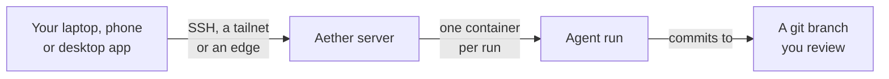

<div align="center">


# Aether - Multiplayer Cloud Agent Runtime

**A self-hosted development environment for AI coding agents running in the cloud, for teams & *multiplayer* control.**

[](go.mod)
[](LICENSE)
[](https://github.com/3xDevOps/aether/releases)
[](https://github.com/3xDevOps/aether/actions/workflows/ci.yml)


[Quickstart](docs/quickstart.md) · [Install](docs/install.md) · [Docs](docs/) · [Contributing](CONTRIBUTING.md)

<!-- Goes live once docs/media/demo.gif exists. Shot list and recording recipe: docs/media/README.md.

-->

</div>

---

Aether is a **self-hosted** development environment for long-running AI coding agents in the cloud. It offers agent-agnostic sandboxed environments that can be hosted **anywhere** and be controlled by **anyone** on your team.  
</br>
Leaving your laptop open for your agents is no longer needed. 

# Installation 

```sh
curl -fsSL https://raw.githubusercontent.com/3xDevOps/Aether/main/scripts/install.sh | sh
```
Aether installs in two places: a **desktop client** & CLI for your laptop/PC, and a **server framework** for where you intend to run your agents - a home server, PC, or an old laptop repurposed to be on all day long. 

The server runs on Linux. The script above handles Linux and macOS, asking
whether this machine is a server or a client.

On **Windows**, download and review the PowerShell installer, then run it:

```powershell
Invoke-WebRequest -UseBasicParsing -Uri https://raw.githubusercontent.com/3xDevOps/Aether/main/scripts/install.ps1 -OutFile "$env:TEMP\aether-install.ps1"
& "$env:TEMP\aether-install.ps1"
```

It installs the CLI and builds the desktop app by default. `-Role none`
installs only the CLI. See the [Windows install guide](docs/install.md#windows-install-script)
for supported releases and script-policy requirements.

On **Android**, every release carries `aether-android.apk`, a phone app for
the server-hosted dashboard; install it from the release page as described in
the [Android app guide](docs/install.md#android-app). It is not on Google Play
yet; the Play link replaces this sentence the day the listing goes live. What
it stores and sends is in [docs/privacy.md](docs/privacy.md).

**Next, see [docs/quickstart.md](docs/quickstart.md) to set up your first workspace and link your codebase, tools, and CLI agents.** 

For manual installation or uninstallation, see [install.md](docs/install.md#manual-install).

## Why Aether

Coding agents run for hours, and a laptop is a poor host for that. They use a
lot of its resources, and they stop when you close the lid. Hosted agent
services keep them running, but they charge per seat on top of your inference
bill and keep a copy of your code. Aether runs your agents on hardware you own,
such as a home server or a spare PC, and you control them from your laptop,
your phone or the desktop app.

## What you get

- Several people share one server. Everyone can watch and message each other's
  agents live, and every action is attributed to the person who took it.
- Agents run in containers on the server, so they keep working after you close
  your laptop.
- Each run works on its own git branch. Pull it and review it, or let the agent
  push it and open a pull request.
- You bring your own agent CLIs and logins: Claude Code, Codex, OpenCode and
  [others](docs/harnesses.md). Their configuration and logins live in a
  persistent home on the server.
- Runs share a team memory of short notes per repository, and a dashboard
  assistant answers questions and acts for you with your own agent login.
- It works for one person too: the first person to link a server becomes its
  administrator.



## Documentation

[docs/README.md](docs/README.md) lists every guide and defines Aether's terms.
The guides people open most:

- [Quickstart](docs/quickstart.md): from install to your first reviewed run.
- [Install](docs/install.md): every platform, upgrades and removal.
- [Agents](docs/harnesses.md): which agent CLIs work, how to sign in, and their
  limits.
- [Teams](docs/teams.md): inviting people, roles and workspaces.
- [Working across repos](docs/quickstart.md#working-across-repos): one run over
  several workspaces.
- [Troubleshooting](docs/failure-handling.md): reboots, full disks, stalled
  runs and dropped connections.

## Contributing

[CONTRIBUTING.md](CONTRIBUTING.md) covers changes, tests and releases, and
[how to build from source](CONTRIBUTING.md#build-from-source).

## License

[GPL-3.0](LICENSE)
