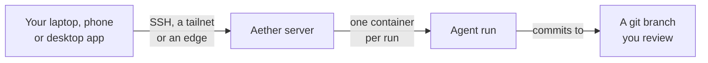

<div align="center">


# Aether - Multiplayer Cloud Agent Runtime

**A self-hostable development environment and controller for AI coding agents running in the cloud, for teams of engineers & *multiplayer* control.**

[](go.mod)
[](LICENSE)
[](https://github.com/3xDevOps/aether/releases)


[Quickstart](docs/quickstart.md) · [Install](docs/install.md) · [Docs](docs/) · [Contributing](CONTRIBUTING.md)

<!-- Goes live once docs/media/demo.gif exists. Shot list and recording recipe: docs/media/README.md.

-->

</div>

---

Aether is a **self-hostable** development environment and control surface for long-running AI coding agents in the cloud. It offers agent-agnostic sandboxed environments that can be hosted **anywhere** and be controlled by **anyone** on your team.  
</br>
Leaving your laptop open for your agents is no longer needed. Your teammates can observe and steer your agents while you are away.  

# Installation 
Aether installs in two places: 
- A **desktop control surface client** & CLI for your laptop/PC
  - Builds exist for MacOS, Windows & Linux
- A **server framework** for where you intend to run your agents - a server, PC, or an old laptop repurposed to be on all day long.
> [!WARNING] 
> Your server needs to be running **Linux**. **WSL2** is also supported (see below).

> [!NOTE]
> For **WSL2** users:  
> - `systemd` needs to be enabled. [See guide](https://learn.microsoft.com/en-us/windows/wsl/systemd#how-to-enable-systemd)  
> - Install git & openssh-client: 
> ```sh
> sudo apt update
> sudo apt install -y git openssh-client
> ```
> - Lastly, install the Docker Engine. [Docker Ubuntu installation guide](https://docs.docker.com/engine/install/ubuntu/)

Run the installer command on **both** your remote server & your client computer **(MacOS/Linux Clients)**
```sh
# MacOS & Linux
curl -fsSL https://raw.githubusercontent.com/3xDevOps/Aether/main/scripts/install.sh | sh
```

To install the client app on **Windows**, run the Windows installer instead. 
```powershell
Invoke-WebRequest -UseBasicParsing -Uri https://raw.githubusercontent.com/3xDevOps/Aether/main/scripts/install.ps1 -OutFile "$env:TEMP\aether-install.ps1"
powershell -NoProfile -ExecutionPolicy Bypass -File "$env:TEMP\aether-install.ps1"
```
> See the [Windows install guide](docs/install.md#windows-install-script) for supported releases and script-policy requirements.


**Next, see [docs/quickstart.md](docs/quickstart.md) to set up your first workspace and link your codebase, tools, and CLI agents.**   
For manual installation or uninstallation, see [install.md](docs/install.md#manual-install).
>[!TIP]
> Aether can also be accessed on the go! You can use any mobile AI chatbot that supports MCP connectors. That way you can directly use the Claude or ChatGPT
> apps on your phone to launch agents on aether and check in on them. We recommend that you go through onboarding first before setting up connectors. See
> [Connectors Guide](https://github.com/3xDevOps/aether/blob/main/docs/connectors.md)  


>[!TIP]
>We also ship an Android APK. On **Android**, every release carries `aether-android.apk`, a phone app for
>the server-hosted dashboard; install it from the release page as described in
>the [Android app guide](docs/install.md#android-app). It is not on Google Play
>yet; the Play link replaces this sentence the day the listing goes live. What
>it stores and sends is in [docs/privacy.md](docs/privacy.md).

## Why Aether?

Aether is designed to combat one of the biggest quality-of-life bottlenecks with agentic engineering today. 
Coding agents can run for hours. In a team of engineers, everyone's agents run on their own laptops in a decentralized manner. 
There is no collaborative observability - meaning you, and your agents, have no idea what other people and *their* agents are doing.  

On top of which, portable laptops are poor hosts for agent fleets in general. Agents use a
lot of its resources, and they stop when you close the lid. Hosted agent
services keep them running, but they charge per seat on top of your inference
bill and keep a copy of your code.  

Aether runs your agents on hardware you own,
such as a home server or a spare PC, and you control them from your laptop,
your phone or the desktop app. **Not only can you observe and steer your agents, but EVERYONE on your team can do so as well.**


## An all in one shared development environment for agents. 
- Several people can share one server. Everyone can watch and message each other's
  agents live, and every action is attributed to the person who took it.
- Agents run in containers on the server, so they keep working after you close
  your laptop.
- Each run works on its own git branch. Pull it and review it, or let the agent
  push it and open a pull request.
- You bring your own agent CLIs and logins: Claude Code, Codex, OpenCode and
  [others](docs/harnesses.md). Their configuration and logins live in a
  persistent home on the server.
- Runs share a team memory of short notes per repository, and a dashboard
  assistant answers questions and acts for you with your own agent login.
- It works for one person too: the first person to link a server becomes its
  administrator.



## Documentation

[docs/README.md](docs/README.md) lists every guide and defines Aether's terms.  

Common documentation:
- [Quickstart](docs/quickstart.md): from install to your first reviewed run.
- [Install](docs/install.md): every platform, upgrades and removal.
- [Agents](docs/harnesses.md): which agent CLIs work, how to sign in, and their
  limits.
- [Teams](docs/teams.md): inviting people, roles and workspaces.
- [Working across repos](docs/quickstart.md#working-across-repos): one run over
  several workspaces.
- [Troubleshooting](docs/failure-handling.md): reboots, full disks, stalled
  runs and dropped connections.

## Contributing

[CONTRIBUTING.md](CONTRIBUTING.md) covers changes, tests and releases, and
[how to build from source](CONTRIBUTING.md#build-from-source).

## License

[GPL-3.0](LICENSE)
