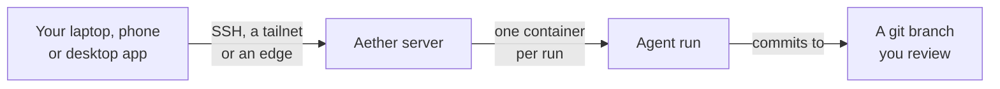

<div align="center">

<p></p>

Aether is an open-source multiplayer runtime where engineering teams run and jointly steer AI coding agents like Claude Code and Codex on their own servers.

[](go.mod)
[](LICENSE)
[](https://github.com/3xDevOps/aether/releases)
[](https://github.com/3xDevOps/aether/actions/workflows/ci.yml)


[Quickstart](docs/quickstart.md) · [Install](docs/install.md) · [Docs](docs/) · [Contributing](CONTRIBUTING.md)

</div>

---

Aether is in beta. The latest release is
[v0.7.1-beta.2](https://github.com/3xDevOps/aether/releases/tag/v0.7.1-beta.2).

## What it does

- **Your whole team sees every agent.** Everyone who joins a server can watch
  each other's agents live, message them, answer their approvals and take over
  their terminals. Every action is recorded with the person who took it
  ([teams.md](docs/teams.md#roles)).
- **Agents run on your server, not your laptop.** Each run is one agent working
  on one task in its own container on the server, so it keeps going after you
  close your laptop.
- **Each run ends as a branch or a pull request.** A run commits to its own
  branch, `aether/run-<task>-<id>`. Pull it to review locally, or publish it and
  open a pull request from the dashboard
  ([quickstart.md](docs/quickstart.md#8-review-and-publish-the-result)).
- **Agents coordinate with each other.** Runs message and ask each other
  questions across sessions, whatever agent CLI each one uses. A swarm hands
  one objective to an integrator run that splits it into tasks and launches a
  worker run for each, so Claude Code can direct Codex workers
  ([teams.md](docs/teams.md#swarms)).
- **Runs share what they learn.** Team memory holds short notes per workspace
  that every run searches and adds to ([memory.md](docs/memory.md)). The
  dashboard assistant answers questions and acts for you, such as launching a
  run, using your own agent login ([assistant.md](docs/assistant.md)).
- **It works for one person too.** The first person to link a fresh server
  becomes its administrator.

Aether works with Claude Code, Codex and many more agent CLIs, plus a
[custom agent](docs/harnesses.md#custom-and-unlisted-agents) of your own. You
install each one on the server and sign in with the vendor's own login.
[Supported agents](docs/harnesses.md#supported-agents) has the full list and
each agent's limits.



## Install

Aether has two parts: `aether-server`, which runs agents on a Linux machine
that stays on, and the `aether` CLI and desktop app, which you use from your
own computer.

### Linux and macOS

```sh
curl -fsSL https://raw.githubusercontent.com/3xDevOps/Aether/main/scripts/install.sh | sh
```

The script asks whether this machine is a `server` or a `client`. A server
gets `aether-server` and `aether` and runs `sudo aether-server setup`. A client
gets `aether` and runs `aether gui build` to install the desktop app. The
server is Linux only, so macOS installs the client. Flags and the
non-interactive form are in
[install.md](docs/install.md#the-install-script).

### Windows

Windows runs the client only. Download the PowerShell installer, review it,
then run it:

```powershell
Invoke-WebRequest -UseBasicParsing -Uri https://raw.githubusercontent.com/3xDevOps/Aether/main/scripts/install.ps1 -OutFile "$env:TEMP\aether-install.ps1"
& "$env:TEMP\aether-install.ps1"
```

It installs `aether.exe` and the desktop app. `-Role none` installs only the
CLI. See [install.md](docs/install.md#windows-install-script).

### Android

Every release carries `aether-android.apk`, which shows the dashboard on a
phone. Download it from the
[latest release](https://github.com/3xDevOps/aether/releases/latest) and follow
the [Android app guide](docs/install.md#android-app). It is not on Google Play
yet. What it stores and sends is in [privacy.md](docs/privacy.md).

Next, follow the [quickstart](docs/quickstart.md) to start the server, link
your computer, create a workspace and launch your first run. Manual install
and removal are in [install.md](docs/install.md#manual-install).

## Documentation

[docs/README.md](docs/README.md) lists every guide and defines Aether's terms.
The guides people open most:

- [Quickstart](docs/quickstart.md): from install to your first reviewed run.
- [Install](docs/install.md): every platform, upgrades and removal.
- [Agents](docs/harnesses.md): which agent CLIs work, how to sign in, and their
  limits.
- [Teams](docs/teams.md): inviting people, roles and workspaces.
- [Working across repos](docs/quickstart.md#working-across-repos): one run over
  several workspaces.
- [Troubleshooting](docs/failure-handling.md): reboots, full disks, stalled
  runs and dropped connections.

## Contributing

[CONTRIBUTING.md](CONTRIBUTING.md) covers changes, tests and releases, and
[how to build from source](CONTRIBUTING.md#build-from-source).

## License

[GPL-3.0](LICENSE)
