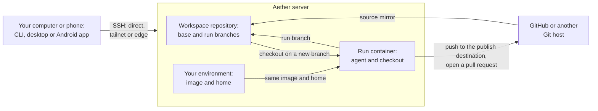

# Aether documentation

These guides cover installing, using and extending Aether, a self-hosted server
that runs coding agents for you and your team. If you are new, start with the
[quickstart](quickstart.md).

## Concepts

| Term | Meaning | Guide |
| --- | --- | --- |
| Server | `aether-server`, the Linux program that runs agents in Docker containers and stores your workspaces. Clients reach it over SSH, on port `2222` by default, over a tailnet, or through an edge. | [install.md](install.md) |
| Client | What you use to reach a server: the `aether` CLI (Linux, macOS, Windows), the desktop app, or the Android app. | [install.md](install.md) |
| Dashboard | The web app for runs, agents, files and settings. The desktop app, `aether gui` and the Android app show it, and the server can host it on a tailnet. | [networking.md](networking.md#the-dashboard) |
| Tailnet | A private network made with Tailscale. On a tailnet the server can sign people in by their Tailscale login and host the dashboard. | [networking.md](networking.md) |
| Edge | A relay with GitHub sign-in that servers and clients both dial out to, so neither needs an open port. The project runs one at `https://edge.onaether.dev`, and you can run your own. | [edge.md](edge.md) |
| Claim link | The link `aether-server setup` prints. Whoever uses it first, in the desktop app or with `aether link --claim`, becomes the server's administrator. | [quickstart.md](quickstart.md#2-start-the-server) |
| Member | A person with an account on a server. Each member has a role: viewer, collaborator (the default) or admin. | [teams.md](teams.md) |
| Administrator | A member with the admin role, who manages members, workspaces and settings. The first person to link a fresh server becomes one. | [teams.md](teams.md) |
| Workspace | One repository and its base branch (the branch new runs start from), plus the runs, notes and history that belong to it. | [teams.md](teams.md) |
| Source mirror | A workspace imported from GitHub or another Git host follows that repository: the server's mirror fetches it read-only and moves the base branch forward. A workspace without one is local-only, and collaborators push its base branch. | [teams.md](teams.md#source-mirror) |
| Publish destination | The repository runs push their branches to, shown as **Publish changes to**: the source repository, a fork, or none. | [teams.md](teams.md#workspaces) |
| Run | One agent working on one task in its own container, with its own checkout of the workspace and optionally of other workspaces ([extra repos](quickstart.md#working-across-repos)). A closed run keeps its container for 7 days, so you can relaunch it. | [quickstart.md](quickstart.md) |
| Run branch | Each run commits to its own branch, `aether/run-<task>-<id>`, in the workspace's repository on the server. The run's **Changes** view shows its diff and has **Publish…**. | [quickstart.md](quickstart.md#8-review-and-publish-the-result) |
| Board | The dashboard page that groups runs into **Needs you**, **Working** and **Finished**. | [quickstart.md](quickstart.md#7-watch-it) |
| Environment | Your own container on the server, opened from **Environment** in the dashboard or with `aether terminal`. Your runs start from its image: agents you install reach them at once, other tools only after **Save environment**. | [environments.md](environments.md) |
| Home | Your persistent directory on the server, mounted as `$HOME` in your environment and in every run you launch. Installed agents (`~/.local/bin`), their logins and their configuration live there. | [environment-home.md](environment-home.md) |
| Standard image | The container image an environment starts from until its member saves their own, `ghcr.io/3xdevops/aether-standard`. | [environments.md](environments.md) |
| Agent | A coding CLI a run starts: Claude Code, Codex, OpenCode, pi, oh-my-pi (`omp`), GitHub Copilot CLI, Gemini CLI, Cursor CLI, Antigravity CLI, or one you add. Aether's code calls these harnesses. | [harnesses.md](harnesses.md) |
| Standard, Enhanced and Background mode | How a run shows its agent. Standard is the agent's own terminal, Enhanced shows its messages, tool calls and approvals as dashboard controls, and Background runs the task once with no interaction. | [enhanced-runs.md](enhanced-runs.md) |
| Swarm | One objective handed to a group of runs: an integrator run splits it into tasks and launches a worker run for each. `aether-internal` calls a swarm a mission. | [teams.md](teams.md#swarms) |
| Team memory | Short notes per workspace that runs of any agent search and add to. Collaborators and admins pin the notes every new run starts with. | [memory.md](memory.md) |
| Watch | A subscription you keep on a run or a swarm. The server tells you, in the dashboard and on your Web Push devices, when it needs you or finishes, even with the dashboard closed. | [watches.md](watches.md) |
| Assistant | A chat panel in the dashboard that answers questions and acts for you, such as launching a run. It is your own Claude Code or Codex, running in Enhanced mode in your environment. | [assistant.md](assistant.md) |

## Reading order

1. [Quickstart](quickstart.md): install, link, add a repository and finish
   your first run.
2. [Coding agents](agents.md): a prompt that lets Claude Code, Codex or
   another coding agent set Aether up and drive it from the CLI.

Daily use:

3. [Agents](harnesses.md): which agent CLIs work, how to sign in to each, and
   what does not work.
4. [Environments](environments.md): install tools, save your image, or reset
   it. [Environment home](environment-home.md) covers what persists in your
   home and how to upload agent configuration.
5. [Terminals](terminal.md): your environment shell, a run's terminal and extra
   shells, and SSH or an editor into a run.
6. [Enhanced runs](enhanced-runs.md): when you run agents in Enhanced mode and
   want to know about permissions, restarts and the session log.
7. [Teams](teams.md): when you invite people, change roles, share agent
   accounts, set budgets or launch swarms.
8. [Networking](networking.md) and [edge](edge.md): when you choose how
   people reach the server, or host the dashboard for phones.
9. [Assistant](assistant.md): when you want to ask Aether for things in plain
   language.
10. [Team memory](memory.md): when runs should share what they learn.
11. [Connectors](connectors.md): when you want to run agents from ChatGPT or
    Claude, including their phone apps.
12. [Slack](slack.md): when you want to hear about runs, and answer them,
    in Slack, including on Android.
13. [Insights](insights.md): when you want statistics on runs, time, cost and
    pull requests.
14. [Watches](watches.md): when you want to be told that a run or swarm needs
    you or finished, after you close the dashboard.

Reference:

15. [Install](install.md): every platform, the desktop and Android apps,
    upgrades and removal.
16. [Security](security.md): what the container boundary protects and what it
    does not.
17. [Troubleshooting](failure-handling.md): reboots, full disks, stalled runs
    and dropped connections, and the server settings that tune them.
18. [Privacy](privacy.md): what the Android app, the dashboard and the
    project's edge store and send.
19. [Notices](notices.md): the licence and what the release artifacts bundle.

## Extend Aether

- [Agent integration](harness-integration.md): connect an agent CLI that
  Aether does not ship to the inbox runs use to message each other.
- [Adapters](adapters.md): add a built-in agent, or an adapter that turns an
  agent's output into timeline events.

## Contributor reference

- [CONTRIBUTING.md](../CONTRIBUTING.md): build, test and release Aether.
- [Testing](testing.md): which suite to run for a change, and how.
- [Dashboard frontend](dashboard-frontend.md): how the web client in `web/` is
  built.
- [Styles](styles.md): the dashboard's visual language.
- [Dashboard gateways](local-gateway.md): the HTTP and WebSocket surface that
  `aether gui` and the server's tailnet dashboard serve.
- [Coordination](coordination.md): how overlapping runs and swarm runs warn
  and message each other.
- [ChatGPT plugin listing](chatgpt-plugin.md): build the directory package,
  submit it to OpenAI and set up its review.
- [Claude connector listing](claude-connector.md): Anthropic's directory
  requirements, the listing package, testing and review.
- [legal/](legal/): drafts of the connector privacy policy and terms, not yet
  approved or published.
- [Candidate integration](integration.md): how swarm results are verified
  and delivered.
- [MCP bridge](mcp-bridge.md): the coordination and memory tools inside a run's
  container.
- [Agent execution separation](agent-execution-separation.md): a design record
  on splitting an agent's session from where its tools run.
- [Demo recording](media/README.md): how to record the README's demo GIF.
- [plans/](plans/): dated design records. They describe what was planned at the
  time and are not kept up to date as guides.
