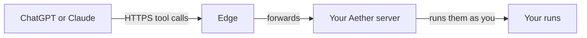

# ChatGPT and Claude connectors

A connector is a custom MCP connector in ChatGPT or Claude that points at your
Aether server. Once you add one, you can list, launch, message and stop runs
from a chat in ChatGPT or Claude, the phone apps included, with no Aether app
on the phone. The connector acts as you: the Aether member who authorized it,
under the same role checks as `aether` and the dashboard.



The edge is a public relay that your server connects out to ([edge.md](edge.md)).
It forwards HTTPS to your server, which hosts the connector endpoint and signs
you in.

## Prerequisites

- A server connected to an edge. ChatGPT and Claude reach the connector at
  `<edge-url>/mcp/<server id>`. A server reachable only on a tailnet cannot have
  one. To turn the edge on, see [edge.md](edge.md#turning-it-on).
- A server and an edge new enough to serve connectors. Otherwise the edge
  answers HTTP 501: `server <name> (<id>) runs aether-server <version>, which has no MCP endpoint; upgrade it: sudo aether-server update`.
- A linked CLI (`aether link`) on an approved device, a member SSH key or a
  tailnet connection. Under `edge-access account`, any registered device works.
- A ChatGPT or Claude plan that allows custom connectors (see below).

## Get the URL and a code

```sh
aether mcp
```

```
Add this server to ChatGPT or Claude as a custom connector:
  URL   https://edge.onaether.dev/mcp/<server id>
  Code  ABCD-EFGH   one use, expires in 10 minutes; paste it on the page that opens when you connect
Connected:
  con-7k2m9q4xbd  ChatGPT (chatgpt.com)  added 2026-10-18  last used 2h ago
Remove one: aether mcp revoke <id>
```

The URL is the same for both apps. On the server, `sudo aether-server edge
status` also prints it. The code works once, within 10 minutes. Running
`aether mcp` again replaces a code you have not used.

## Add it in ChatGPT

Custom MCP servers are added on the web only, at chatgpt.com
([OpenAI: custom MCP servers](https://developers.openai.com/api/docs/guides/custom-mcp-server)):

1. Open [ChatGPT Plugins](https://chatgpt.com/plugins).
2. Select the plus button, then **Add custom MCP server**.
3. Paste the URL from `aether mcp`.
4. Select **Create as a plugin**, then install it.
5. A page from your server opens: **Connect ChatGPT (chatgpt.com) to
   <server>**. Paste the code and select **Allow**.

As of October 2026, OpenAI says write tools need ChatGPT Business or
Enterprise/Edu. Pro gets the read tools only
([OpenAI help center](https://help.openai.com/en/articles/12584461)). The
plugin then works in ChatGPT on the web, desktop and mobile.

## Add it in Claude

On claude.ai
([Anthropic: add a custom connector](https://claude.com/docs/connectors/custom/add-unlisted)):

1. Free, Pro and Max: open **Customize → Connectors**, select **Add custom
   connector**, and paste the URL from `aether mcp`. Free allows one custom
   connector.
2. Team and Enterprise: an Owner opens **Organization settings → Connectors**,
   selects **Add**, **Custom**, then **Web**, and pastes the URL. Each member
   then selects **Connect** under **Customize → Connectors**.
3. Select **Connect**. A page from your server opens: **Connect Claude
   (claude.ai) to <server>**. Paste the code and select **Allow**.

A connected connector works in Claude on the web, desktop and mobile.

## What it can do

The connector has eight tools and no others:

| Tool | What it does | Asks you first? |
| --- | --- | --- |
| `aether_list_workspaces` | Lists the workspaces you can launch runs in | No |
| `aether_list_agents` | Lists agents and whether each is installed, signed in and supports Enhanced mode | No |
| `aether_list_runs` | Lists runs you can see, filtered by `mine`, `active_only` or `workspace_id` | No |
| `aether_get_run` | Shows one run: state, task, workspace, agent and mode | No |
| `aether_run_history` | Reads a page of an Enhanced run's conversation, 20 frames by default | No |
| `aether_launch_run` | Starts a run with a workspace, agent and task, and optionally a mode and model | Yes |
| `aether_message_run` | Sends a message to a run's agent | Yes |
| `aether_stop_run` | Stops a run | Yes |

ChatGPT and Claude ask before each tool that is not read-only. ChatGPT asks by
default and can remember your answer for a conversation. Claude offers **Allow
once** and **Always allow** per tool. Aether shows no confirmation card of its
own, and the [assistant's auto-approval](assistant.md#auto-approval) does not
apply. Your role still decides: a viewer's launch is refused, as it is in
`aether`.

## Revoke a connector

```sh
aether mcp revoke con-7k2m9q4xbd
```

The connector's next call fails, and the app asks you to connect again with a
new code. You can revoke your own connectors, and an admin can revoke anyone's.
Removing the connector in ChatGPT or Claude does not revoke it on the server.
Revoke it here too.

A connector also stops working at its next request when:

- the device it was minted on is revoked (`aether device revoke <device id>`)
- its member is removed
- the server runs under `edge-access approved-devices` and that device is not
  approved
- its refresh token goes unused for 30 days (`aether mcp` then no longer lists
  it)
- the server's connector URL changes because the edge moved to another origin

## Troubleshooting

`aether mcp` prints errors as `aether: rpc error <code>: <message>`.

| Message | Fix |
| --- | --- |
| `connector.code: this server has no edge (edge-url is empty), and ChatGPT and Claude reach a connector only through one; an admin turns it on with: sudo aether-server config set edge-url https://edge.onaether.dev, then sudo systemctl restart aether-server` | Turn the edge on |
| `connector.code: this server is not connected to its edge at <edge-url>; an admin sees why with: sudo aether-server edge status` | Fix the edge connection |
| `connector.code needs an approved device, a member SSH key or a tailnet connection; this connection signed in with device "<label>", which is registered` | An admin approves your device, or run `aether mcp` from an approved one |
| `method not found: connector.code; the server is older than this CLI, and an admin updates it with aether server update` | Update the server |
| `connector.revoke: no connector <id>; aether mcp lists yours` | The id is wrong or already revoked |
| `connector.revoke: only its own member or an admin may do this` | The connector belongs to another member |

On the page that opens when you connect:

| Message | Cause |
| --- | --- |
| `That code is wrong, expired or already used. Run aether mcp for a new one and paste it here.` | The code is not live. A server restart also forgets codes |
| `Too many wrong codes were tried on this server in the last minute. Wait a minute, then paste the code again.` | More than 10 wrong codes in a minute, from anyone |
| `Aether connectors work with ChatGPT and Claude; <host> is not one of them.` | Only `chatgpt.com` and `claude.ai` can connect |
| `This form was not issued by this server. Start the connection again from ChatGPT or Claude.` | Start again from the app |

If a connected app suddenly asks you to sign in again, the access token expired
or the connector was revoked. Run `aether mcp` for a new code.

## Security model

- ChatGPT and Claude hold the tokens. Whoever holds the access token acts as you
  for up to an hour. Whoever holds the refresh token can get new access tokens
  until it goes 30 days unused. Aether stores only hashes of tokens and rotates
  the refresh token on every use. Reusing a rotated one a minute or more later
  revokes the connector.
- The edge can read connector traffic. ChatGPT and Claude need a public
  certificate, so the edge decrypts connector requests and forwards them. A
  compromised edge could read tool calls and act as you through a live token. It
  cannot create codes or tokens, which are made on your server. SSH through the
  edge stays end to end ([security.md](security.md#edge-remote-access)).
- A connector is tied to its member and the device that created it. Every
  request re-checks both, so revoking the device or removing the member stops it.
- Eight tools are the whole surface. A connector cannot open a terminal, read
  files, change settings or manage members. Run history is text other agents
  wrote and is marked untrusted, and the apps still ask before each write.
- Codes are single use, kept in memory only and never written to disk. A pairing
  code lives 10 minutes.
- Only ChatGPT and Claude can connect. The server accepts only `https` clients on
  `chatgpt.com` and `claude.ai`, and an authorization code goes only to a
  redirect address listed by that client.
