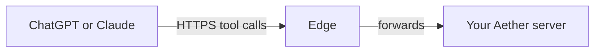

# ChatGPT and Claude connectors

A connector is a custom MCP connector in ChatGPT or Claude that points at your
Aether server. Once you add one, you can launch runs and swarms, see what needs
you, answer agents, and check pull requests from a chat in ChatGPT or Claude,
the phone apps included, with no Aether app on the phone. The connector acts
as you: the Aether member who authorized it, under the same role checks as
`aether` and the dashboard.



The edge is a public relay your server connects out to ([edge.md](edge.md)). Your
server hosts the connector endpoint and signs you in.

## Prerequisites

- A server connected to an edge. ChatGPT and Claude reach the connector at
  `<edge-url>/mcp`, the [universal URL](#the-universal-url) every server on
  the edge shares, or at the server's own `<edge-url>/mcp/<server id>`. A
  server reachable only on a tailnet cannot have one. To turn the edge on, see
  [edge.md](edge.md#turning-it-on).
- A server new enough to serve connectors. Otherwise the edge answers HTTP 501:
  `server <name> (<id>) runs aether-server <version>, which has no MCP endpoint; upgrade it: sudo aether-server update`.
- A linked CLI (`aether link`) on an approved device, a member SSH key or a
  tailnet connection. Under `edge-access account`, any registered device works.
- A ChatGPT or Claude plan that allows custom connectors (see below).

## Get the URL

In the app, open **Settings → ChatGPT and Claude**, or pick **Connect ChatGPT
or Claude** in the command palette (Ctrl+K or ⌘K). The link
`?page=settings&id=connectors` opens the same section, and the last onboarding
step links to it. Pick **ChatGPT** or **Claude** for that app's steps. The
section shows the URL at once. What the third step asks depends on the server's
[`edge-access`](edge.md#access-policies) policy:

- `account`, with a GitHub account linked to you: no code. The page that opens
  signs you in at the edge. **Watch for the connection** waits up to 10
  minutes for it.
- Otherwise: **Get a code** shows a pairing code with a live countdown.

The section checks every 3 seconds and shows **ChatGPT (chatgpt.com)
connected** with its scopes once the app connects. It lists your connectors
with their scopes, the URL each was added at, when each was added and last
used, and **Reconnect** and **Revoke** buttons. Errors appear as `aether mcp`
prints them, with a link to the fix.

From a terminal:

```sh
aether mcp
```

```
Install Aether from the ChatGPT or Claude directory where it is listed, or add this URL as a custom connector:
  URL   https://edge.onaether.dev/mcp
  No code: on the page that opens, sign in to the edge with GitHub, pick this server and select Allow
Connected:
  con-7k2m9q4xbd  ChatGPT (chatgpt.com)  scopes read,write  added 2026-10-18  last used 2h ago  universal URL
Remove one: aether mcp revoke <id>
```

Where the page asks for a code, `aether mcp` prints one instead of the `No
code` line:

```
  Code  ABCD-EFGH   one use, expires in 10 minutes; paste it on the page that opens when you connect, if it asks
```

The URL is the same for both apps and every server on the edge. On the
server, `sudo aether-server edge status` also prints it. Before edge protocol
3, and for a member with no GitHub account linked, it is the server's own URL,
`https://edge.onaether.dev/mcp/<server id>`. The code works once, within 10
minutes. Running `aether mcp` again replaces a code you have not used.

That URL's page asks for a code even when the universal URL needs none, so a
connector added there reconnects with one. `aether mcp code` prints a code
alone. In Settings, **Reconnect** on such a connector shows the server's own
URL and a code.

## Add it in ChatGPT

Custom MCP servers are added on the web only, at chatgpt.com
([OpenAI: custom MCP servers](https://developers.openai.com/api/docs/guides/custom-mcp-server)):

1. Open [ChatGPT Plugins](https://chatgpt.com/plugins).
2. Select the plus button, then **Add custom MCP server**.
3. Name it `Aether`, paste the URL from `aether mcp` as the server URL, and
   choose **OAuth**.
4. Select **Create as a plugin**, then install it.
5. On the [universal URL](#the-universal-url), the edge's page opens: sign in
   with GitHub and select **Continue with <server>**. A page from your server
   opens: **Connect ChatGPT (chatgpt.com) to <server>**. Paste the code if it
   asks for one, choose its [scopes](#scopes) and select **Allow**.

As of October 2026, OpenAI says write tools need ChatGPT Business or
Enterprise/Edu. Pro gets the read tools only
([OpenAI help center](https://help.openai.com/en/articles/12584461)). The
plugin then works in ChatGPT on the web, desktop and mobile.

## Add it in Claude

On claude.ai
([Anthropic: add a custom connector](https://claude.com/docs/connectors/custom/add-unlisted)):

1. Free, Pro and Max: open **Customize → Connectors**, select **Add custom
   connector**, name it `Aether`, paste the URL from `aether mcp`, leave
   **Advanced settings** empty and select **Add**. Free allows one custom
   connector.
2. Team and Enterprise: an Owner opens **Organization settings → Connectors**,
   selects **Add**, **Custom**, then **Web**, and pastes the URL. Each member
   then selects **Connect** under **Customize → Connectors**.
3. Select **Connect**. On the [universal URL](#the-universal-url), the
   edge's page opens: sign in with GitHub and select **Continue with
   <server>**. A page from your server opens: **Connect Claude (claude.ai) to
   <server>**. Paste the code if it asks for one, choose its [scopes](#scopes)
   and select **Allow**.

The connector then works in Claude on the web, desktop and mobile.

## The universal URL

`https://<edge>/mcp` is one URL for every Aether server, so one ChatGPT
plugin can serve every Aether user. Once Aether is listed in ChatGPT's plugin
directory ([chatgpt-plugin.md](chatgpt-plugin.md)) or Claude's connector
directory ([claude-connector.md](claude-connector.md)), install it from there
instead of adding a custom MCP server; connecting then works as described here.

When you connect, the edge's sign-in page opens: sign in with GitHub if you
have not. **Choose a server** names the app you are connecting and lists your
servers with their names, ids, your role and whether each asks for a code,
each with **Continue with <server>**, and the servers that cannot take the
connection with why. It asks even when you have only one server, so you always
see which server you connect. That server's consent page opens and states the
server, its id, the client and, under `account`, the member. Then, depending on
the server's [`edge-access`](edge.md#access-policies) policy:

- `account`: **Connect ChatGPT (chatgpt.com) to <server> as <member>**,
  with the [scopes](#scopes) and no code. Signing in at the edge already
  admits you there.
- `approved-devices`: the page asks for the code. Paste the code from
  **Settings → ChatGPT and Claude** in the app, or `aether mcp`.

**Continue** posts the edge's signed statement that your GitHub account chose
this server to the edge, never in a URL. The server binds it to the first
browser that brings it, and only that browser's consent page can use it, once,
within 5 minutes. A link copied out of your browser, history or a log connects
nobody. [edge.md](edge.md#mcp-connectors) has the details.

The sign-in page lists a server only to the GitHub accounts bound to its
members. So the app and `aether mcp` show the universal URL only to a member with a
GitHub account bound, and `<edge>/mcp/<server id>` to one with only a member
SSH key or tailnet login. `sudo aether-server edge status` prints both.

A connector added without a code stops working when the server switches to
`approved-devices`, when its GitHub account is unbound from the member
(`aether member identities`, or deleting the account at the edge), or when the
member is removed. It has no device, so a method that needs an approved device
refuses it, as it refuses a device no person approved, and it cannot mint a
pairing code or a Slack link code. Connectors added at
`<edge>/mcp/<server id>` keep working there.

### Move a connector to the universal URL

A connector keeps the URL it was added at. Settings marks each one
**Universal URL** or **This server's own URL**, and `aether mcp` prints
`universal URL` or `at <url>`. Once Settings shows the universal URL for you,
**Move to the universal URL** next to a connector on the server's own URL
starts a new connection: add Aether again in the app with the universal URL.
Settings revokes the old connector once a new one from the same client, such as
ChatGPT or Claude, connects at the universal URL and calls Aether. If none
calls within 10 minutes, it leaves the old one and says so. Remove the old
Aether connector in ChatGPT or Claude yourself. From a terminal, connect again at the
universal URL, then run `aether mcp revoke <old id>`.

### Self-hosted and custom edges

The universal URL is `https://<relay host>/mcp` of whichever edge the server
uses, so an operator's own edge has its own. `<edge>/mcp/<server id>` with a
pairing code works on every edge from protocol 2 and under either policy.

### Claude Code

Claude Code connects at the same URLs:

```sh
claude mcp add --transport http aether https://edge.onaether.dev/mcp
```

Then run `/mcp` in Claude Code and authenticate. Its client metadata document,
`https://claude.ai/oauth/claude-code-client-metadata`, lists
`http://localhost/callback` and `http://127.0.0.1/callback`, and Claude Code
listens on a port it picks. For that client id alone, the consent page accepts
those redirect URIs on any port (RFC 8252); every other client must return to
an HTTPS URL on its own host. PKCE is required as for every client. Any program
on your machine that can listen on a local port could receive the code, but it
cannot redeem it without the PKCE verifier Claude Code holds.

## Scopes

The consent page also sets the connector's scopes. ChatGPT and
Claude do not choose them; the server ignores any scope they request other
than `offline_access`, the only one the OAuth metadata lists in
`scopes_supported`.

| Scope | On the page | Grants |
| --- | --- | --- |
| `read` | Always granted | Every read-only tool |
| `write` | **Launch and message**, checked by default | Launching runs and swarms; messaging, pausing, resuming, relaunching, protecting and archiving runs; answering agents' and teammates' questions; marking runs reviewed; adding and pinning team memory |
| `control` | **Stop and approve**, unchecked by default | Deciding permission requests, stopping and closing runs, switching a run's mode, cancelling, archiving and unarchiving swarms, releasing a swarm worker, handing runs to teammates, replacing a swarm's integrator, deciding and delivering integration candidates, opening and merging pull requests. Text an agent wrote could talk the assistant into approving or ending work without asking you |

Every member can read every run on the server, so a connector can read all of
them. A connector lists only the tools of its scopes, and `aether mcp` shows
each connector's scopes.

The server also checks the scope of every call a connector makes, whatever the
member's role. Reads such as `run.get`, `workspace.timeline`, `member.list`,
`memory.show`, `integration.show`, `template.list`, `changes.list` and
`launch.defaults.get` need `read`; `run.launch`, `template.launch`,
`mission.create`, `run.inject`, `run.room.post`, `run.pause`, `run.resume`,
`run.review`, `run.relaunch`, `run.protect`, `run.archive`, `memory.add`,
`memory.pin` and `memory.unpin` need `write`; `run.kill`, `run.close`,
`run.mode.switch` (it discards a turn in progress), `run.handoff`,
`mission.cancel`, `mission.worker.release`, `mission.archive`,
`mission.unarchive`, `mission.replace-integrator`, `integration.decide`,
`integration.deliver`, `run.pr.create` and `run.pr.merge` need `control`.
`run.input.respond` needs `control` to decide a permission request and `write`
to answer a question. `run.review` with `complete` needs `control` for a live
run unless its agent reported success and the run awaits review, since
completing any other live run ends it. Every other method, such as
`member.role`, `connector.revoke` or `launch.defaults.set`, is refused to every
connector:

```
run.kill needs the control scope, which ChatGPT connector con-7k2m9q4xbd was not granted; select Reconnect next to it in Settings → ChatGPT and Claude and check Stop and approve on the consent page
member.role: ChatGPT connector con-7k2m9q4xbd cannot call this method; no connector can, so use the Aether app or the aether CLI
```

To change scopes, revoke the connector and connect
again, or select **Reconnect** in Settings. It gets a new code where the page
asks for one, and revokes the old connector once the new connection calls
Aether. Connectors added before scopes existed have all three.

## What it can do

A swarm is an integrator agent that splits a goal into tasks and runs worker
agents for them ([teams.md](teams.md#swarms)). The connector has these tools and no
others:

| Tools | What they do | Scope |
| --- | --- | --- |
| `aether_list_workspaces` | Workspaces, and agents (installed, signed in, Enhanced) | `read` |
| `aether_launch_options` | What you can launch and on which account: workspaces, your accounts with their usage, each account's agents and modes, swarm eligibility, fallback, a workspace's templates, and an agent's models when asked for ([Launch options](#launch-options)) | `read` |
| `aether_list_runs`, `aether_get_run` | Your runs (or everyone's with `mine: false`) with their last report, filtered by workspace, activity, what needs you, or words in the title, task, workspace name or branch; one run with what it waits on, its latest report and its pull request | `read` |
| `aether_run_history` | A page of a run's conversation (Enhanced) or terminal, with its reports | `read` |
| `aether_needs_attention` | What needs you, the dashboard's **Needs you** list, each item naming the tool that answers it | `read` |
| `aether_activity_summary` | What your runs did today, yesterday or this week, in your time zone | `read` |
| `aether_get_swarm` | Your swarms; with `swarm_id`, one swarm's tasks, workers with their agent, mode, model and account, who holds their control and why one failed, questions, recent messages and integrator generation | `read` |
| `aether_run_changes`, `aether_pr_status` | A run's commits, conflicts, changed files and optionally its diff, for its primary or an extra repo, paged; its pull request's checks, reviews, comments, merge state and head commit | `read` |
| `aether_overlaps`, `aether_memory_search` | Pairs of active runs touching the same files; the workspace's [team memory](memory.md), or with `id` one note with the notes that replaced it or that it replaced | `read` |
| `aether_integration` | A workspace's or swarm's [integration candidates](teams.md#combine-several-runs-into-one-result), or one with its verifications and delivery request | `read` |
| `aether_changes` | What changed since a cursor: run status, reports, agent mail, pull requests, swarms and lifecycle, oldest first, paged with `next_cursor` | `read` |
| `search`, `fetch` | Find runs and swarms by text, in the shape ChatGPT deep research uses | `read` |
| `aether_watches` | Your [watches](watches.md), each with its state, conditions and last notice; with `watch_id`, one watch with its 10 newest notices and where each was delivered | `read` |
| `aether_launch_run`, `aether_launch_swarm` | Start a run, from a task or a saved [template](teams.md#task-templates-and-schedules), or a swarm with you as its accountable human, on any account you may use, with a fallback policy and extra repositories; an integrator given no mode starts as `aether swarm create` starts it ([Swarms](teams.md#launch-a-swarm)) | `write` |
| `aether_message_run`, `aether_answer` | Message a run; answer an agent's, the integrator's or a teammate's question | `write` |
| `aether_pause_run`, `aether_resume_run`, `aether_mark_reviewed` | Pause or resume a run; accept a reported success, which closes the run, or put it off | `write` |
| `aether_run_lifecycle` | Relaunch a stopped run, protect or unprotect it, archive or restore it | `write` |
| `aether_memory_add`, `aether_memory_pin` | Add a team memory note; pin or unpin one | `write` |
| `aether_watch`, `aether_unwatch` | Watch a run (`run_id`), swarm (`swarm_id`) or pull request (`pr`: `owner/name#7` or its GitHub URL) for `conditions`, or with `watch_id` change its conditions or `expires_at`, or pause or resume it; delete a watch and its notices | `write` |
| `aether_decide_approval` | Allow or deny a permission request, once | `control` |
| `aether_stop_run`, `aether_cancel_swarm` | Stop a run, or with `outcome` close it as merged or abandoned; cancel a swarm | `control` |
| `aether_switch_run_mode` | Switch a live run to Standard or Enhanced, discarding the turn in progress | `control` |
| `aether_handoff_run` | Give a run to a teammate, who then owns and controls it | `control` |
| `aether_replace_integrator` | Start a new integrator for a swarm from its agents | `control` |
| `aether_swarm_manage` | Release a member's control of a swarm worker; archive a finished swarm, which closes its completed runs as merged or abandoned; unarchive one | `control` |
| `aether_integration_decide` | Approve or reject a candidate's delivery request, or deliver an approved one to its target branch | `control` |
| `aether_pr_create`, `aether_pr_merge` | Open a pull request from a run's pushed branch; merge it on GitHub | `control` |

Things to ask:

- "What needs me in Aether?"
- "What is the agent working on edge doing?"
- "Launch a Claude run in api to fix the flaky login test."
- "Which subscription has the most usage left? Launch the docs fix on it."
- "What changed since I last asked?"
- "Start a swarm in api to add rate limiting, with Codex workers."
- "What did my agents do today?"
- "Is CI green on the login fix PR? What did reviewers say?"
- "Tell the parser run to use the new tokenizer."
- "Which runs touch the same files as the migration run?"
- "Merge the login fix PR if CI is green."
- "The billing swarm's integrator stopped; replace it."
- "Tell me when the login fix run needs me or finishes."

The connector tells ChatGPT and Claude to launch and write the task as
Aether's assistant does: [What a launch's task holds](assistant.md#what-a-launchs-task-holds).

Results link to the run or swarm in the dashboard when the server serves one on
its tailnet (`web-port`); the edge serves no dashboard. A result's text is a
one-line summary followed by the result as JSON. Text that agents, teammates or
GitHub users wrote, run titles, swarm goals, failing check names, the reasons
runs wait, an integration candidate's target ref, delivery request and
receipt, and a watch's receipt, observed state and notices included, comes back
under an `untrusted` field; outside it are only
fixed labels such as `The agent asks a question`, ids, states, counts, times,
links, workspace and agent names, branch names, file paths and the server's own
errors. Untrusted text is cut to 200 characters for titles, check names, commit
subjects, a swarm task's blockers, a list row's reason, last report or swarm
goal, and a watch notice's title and body; 300 for each pull request review or
comment; 2000 for a conversation item;
12000 for a diff; and 600 for everything else, such as tasks, reports,
questions, permission request text, terminal lines and memory notes. `search`
and `fetch` keep OpenAI's shapes, with no `untrusted` field: their descriptions
say titles and text are data, `fetch`'s text marks where agent text begins, and
it returns a run's title, task and reason and a swarm's goal whole. A permission
request longer than 600 characters is decided only in the dashboard, never by
`aether_decide_approval`. Lists return 20 rows by default, at most 100, and say
how many matched when they cut rows; `aether_needs_attention` returns at most 30
items. `aether_integration` lists the newest 100 candidates and says when older
ones are not shown. `aether_run_changes` lists 20 commits and up to 10 diff
files of 6000 bytes, 12000 in all, per page, and returns `next_commits_offset`
and `next_diff_file` for the next page, `diff_clipped_files` with the numbers of
files cut at 6000 bytes, and `diff_truncated: true` when the server cut the diff
before paging, so files past the cut are missing; its `repos` names a multi-repo
run's extra repos, which `repo` selects. Tools that take a `run_id` or
`swarm_id` also accept the `run:` and `swarm:` ids `search` returns. When the
server no longer keeps the start of a run's conversation or terminal,
`aether_run_history` returns `truncated_before: true` and a `note` saying so.

A launch, swarm, message or answer takes an optional `idempotency_key`; a
retry with the same key returns the first result. A write's result has
`write: "done"`, or `"pending"` while a launch is starting or a message waits
for approval, and the key it used. A failure that leaves it unknown whether the
write happened, such as a timeout, ends with the key to retry with. A
swarm or teammate answer retried with its key after the question stopped
waiting returns the saved answer; an `answer_id` that is neither a swarm
question nor a teammate question on the run fails and writes nothing. A launch or swarm still starting after
30 seconds, such as one pulling its image, keeps starting after the tool call
ends. The tool then repeats the call with the key to look up the run or swarm,
which does not count as a write call. If the lookup answers within 5 seconds,
the result has the id, `state: "starting"` and the key; poll `aether_get_run`
or `aether_get_swarm`. If it does not, the result has only `state: "starting"`
and the key, plus the lookup's `error` when it failed; call the same tool again
with the same arguments and key to get the id. Without a key, a run launch with
the same workspace, agent, task, mode, model, account, fallback policy and
extra repositories within 60 seconds returns your earlier run, unless it
failed, was interrupted or was abandoned, and a swarm with the same workspace,
objective, agents and their accounts, fallback policy and extra repositories
within 60 seconds returns your earlier swarm, unless it was cancelled, instead
of starting another; so does an
identical launch still starting, or one that failed in the last 60 seconds
without saying whether it started. A message without a key reuses the key of the
same message to the same run still being sent or sent within 60 seconds, so a
retry is delivered once and its result has `duplicate: true`. To send the same
text again on purpose, pass a new `idempotency_key`.

### Launch options

`aether_launch_options` answers what the launch dialog shows, in one call:

- `workspaces`, and `modes` with their dashboard names: `tui` Standard,
  `headless` Background, `acp` Enhanced.
- `accounts`: the agent accounts you may launch on, your own first, then each
  one a teammate shared with you ([Agent accounts](teams.md#agent-accounts)).
  Each has `access` (`own` or `shared`), `ready` (some agent can launch on it),
  its usage, and its agents. A teammate's account that is not shared with you
  never appears. Past 100 workspaces or accounts, `workspaces_total` and
  `accounts_total` say how many there are.
- Usage is each provider's windows, labelled as the provider labels them, with
  `used_percent` and `resets_at`. It is never money. An agent with no usage row
  has unknown usage.
- Each agent has `modes` a run may start in, `integrator_modes` a swarm
  integrator may use (never Background), `worker_mode` a worker starts in, and
  `refused` when a launch on that account would be refused, such as an owner
  who is not signed in.
- `fallback`: with neither `fallback_account_member_ids` nor `no_fallback`, a
  launch whose account has used 95% of a usage window moves to the usable
  account with the most usage left.
- With `workspace_id`, its templates, each with its `version` and `params`,
  every placeholder of its task with `required` when it has no default (the
  defaults and tasks are under `untrusted`); pass `version` to
  `aether_launch_run` as `template_version` to refuse a template changed since.
  With `models` (an agent name) and
  optionally `account_member_id`, that agent's model ids on that account, which
  the server caches. `account_member_id` without `models` is refused. When it
  lists none, launch without `model` for the agent's default.
- `server.version` and `server.ops_contract`, the version of the tools' inputs
  and results.

`aether_launch_run` takes `account_member_id`, `fallback_account_member_ids` (an
order), `no_fallback`, `extra_workspace_ids` and `children` (`on` or `off`:
whether its agent may start [child runs](teams.md#child-runs); without it, your
setting decides), as `aether run` does. `aether_launch_swarm` takes the
integrator's `account_member_id`, each worker's `harness`, `mode`, `model` and
`account_member_id`, and one fallback policy and extra repositories for the
swarm. A worker given no mode starts in the `worker_mode`
`aether_launch_options` reports, as the launch dialog's workers do. The server
checks every account before anything starts: a launch, or a swarm with any agent
or fallback account not shared with you, fails with the server's error. A retry
of a swarm with the same `idempotency_key` still returns that swarm after an
account it uses stops being shared: a mode that account's agents would have
chosen is taken from the swarm already recorded. A launch, swarm or template launch the server does not understand fails with
`unknown param "<name>"` instead of starting without it.

Each launch's result, and `aether_get_run` and `aether_get_swarm`, has a
`launch` receipt: `kind` (`run` or `swarm`), `id`, `workspace_id`, `harness`,
`mode`, `mode_name`, `model` (absent means the agent's default), `account`
(`member_id`, `name`, `access`: `own`, `shared`, or `other` for a teammate's own
run), `requested_account` when usage fallback moved the run, `fallback`
(`policy`: `automatic`, `ordered` with `order`, or `off`), `repos`, the run's
own `children` setting, `via`, and `url`. A launch's receipt adds
`idempotency_key` and `skipped_fallback_accounts`: the fallback accounts the
server left out because checking them failed, each with a fixed `error` reason;
the server log has the detail. A swarm's receipt has `integrator` and `workers`
in place of the run fields, each with the account it was asked to run on.
`aether_get_swarm`'s `workers` list each worker run with the account it launched
on, and `requested_account` when usage fallback moved it. `aether_get_run` also
names the run's `parent_run_id` and lists its `children`, nearest first, each
with its state, agent and account, and what its parent asked of it under
`untrusted`; `children_error` says why they could not be read, unless the
server has no child runs.

`aether_launch_run` with `template` (a name from `aether_launch_options`
with `workspace_id`) and `params` runs a saved template on your own account
with its agent, mode and model. It takes no task, agent, mode, model, account,
fallback or extra repositories, since `template.launch` has none, and refuses
them by name. Without `template`, it needs `task` and `harness`. Without an
`idempotency_key`, a template launch is deduplicated only while an identical
one is still starting.

### Changes

`aether_changes` pages `changes.list`. Without `cursor` it returns the newest
changes; pass `next_cursor` back for the ones after them, while `more` is true.
Filter by `workspace_id`, `run_id`, `swarm_id` and `kinds`. Report summaries
and status reasons sit under `untrusted`, cut to 200 characters. CI checks are
not changes; read them with `aether_pr_status`. A cursor the server's history
no longer matches, such as one from before a restore, fails with an error that
says to call again without `cursor`.

### Writes

`aether_mark_reviewed` completes only a run whose agent reported success and
awaits your review; to end any other run, use `aether_stop_run` under
`control`. A message to your own run that no one
controls in the dashboard, or to a run you control, reaches the agent at once. Any other message waits
about 45 seconds for the member in control to approve it. `aether_decide_approval` allows
or denies a permission request once; it never picks an "always" option, so it
cannot change what the agent may do next time. Any other tool call is cut off
after 40 seconds, inside ChatGPT's wait.

The other writes repeat safely without a key. Each `aether_run_lifecycle` action
but `relaunch` sets a state, so a repeat changes nothing, and
`aether_switch_run_mode` to the mode a run is already in reports that without
switching; `relaunch` fails on a run that is still live. `aether_handoff_run` to
the run's owner, `aether_swarm_manage` on a worker nobody holds, and
`aether_integration_decide` on a request already in the state asked for or
already delivered report that and write nothing. `aether_pr_create` returns the
run's open pull request instead of opening another, and `aether_pr_merge`
reports a merged one as merged. `aether_replace_integrator` requires
`expected_generation`, the `integrator_generation` `aether_get_swarm` returns;
without a key it derives one from the swarm, that generation and the agent, so a
retry returns the first replacement even after it moved the generation, and a
replacement someone else made in between fails with a conflict that says to call
`aether_get_swarm`. A replacement on another agent given no `mode` starts in
the first integrator mode that agent can take.
`aether_watch` takes one target: `run_id`, `swarm_id`, or `pr`, optionally
with `run_id` for the run that opened it; any other combination is refused
with the fields named. Its `conditions` depend on the target, the defaults
marked *:

| Target | Conditions |
| --- | --- |
| `run_id` | `needs_you`*, `finished`*, `pr_merged`, `ci` |
| `swarm_id` | `needs_you`*, `finished`*, `delivered` |
| `pr` | `ci`*, `review`*, `merged`*, `closed` |

A condition the target does not take, or `deployed`, fails with the server's
error, which names the conditions to use
([watches.md](watches.md#targets-and-conditions)). `expires_at` is an RFC 3339
time at most 90 days ahead; without it a watch expires after 14 days.
`aether_watch` takes no idempotency key: creating a watch the server already
has live, the same target and conditions, returns that watch and resumes it if
paused. Its result holds the watch's `state` and the server's one-line
`receipt` under `untrusted`, since it carries the target's title; only
`active` means it is watching. Its links open the watch in **Settings →
Watches**. `aether_watches` lists the newest 50 watches and says how many
more the dashboard lists there; one watch's notices come from the newest 50
the server returns, so a full page reads `at least 50` and sets
`more_notifications_capped`. `aether_unwatch` of a watch already deleted
succeeds with `state: "not_found"`, so a retry is safe.
`aether_memory_add` returns the existing note for a duplicate, and repeating
a replacement (`supersedes`) that went through returns the note that replaced
the old one.

`aether_pr_merge` takes `repository`, `number` and `expected_head_oid`, the
pull request's `repository`, `number` and `head_oid` `aether_pr_status`
returns, and refuses when the run's pull request is now another one, in
another repository, or its head has moved since, before asking GitHub; with
no head to compare, as for a finished run whose environment is gone, it fails
with why. A merge GitHub accepts but has not done, as with a merge queue, returns
`write: "pending"`; follow it with `aether_pr_status`. That refusal and GitHub's
own count the failing and pending checks and the reviewers requesting changes,
as lower bounds when GitHub's feedback was cut off, and give the merge state;
`aether_pr_status` names them under `untrusted`. It merges with `squash` unless
`method` says `merge` or `rebase`, and only into the base branch it saw.
`aether_pr_create` opens the pull request from the run's
current branch and head into the target `run.pr.status` resolves, the
workspace's base branch on its source repository as the dashboard proposes, and
passes both to `run.pr.create`, so neither changes after you approve; the branch
must be pushed. When GitHub's answer is lost but the pull request is found
afterwards, the result is that pull request. `aether_pr_status` and
`aether_pr_merge` take the same `repo` as `aether_run_changes`. Once a finished
run's container is gone, `aether_pr_status` still reports its recorded pull
request's checks and reviews, read from GitHub, without merge state or
comments: its result sets `comments_unavailable` and its summary says
`comments unavailable` instead of a count. When only the reviews read fails,
it keeps the checks, sets `reviews_unavailable` and puts the error in its
summary in place of the review count.
`aether_handoff_run` takes the teammate's member id or exact display name; an
unknown or ambiguous one fails with the teammates' ids and roles, and the server
refuses a viewer. `aether_switch_run_mode` holds no control lease, so it fails
while a member controls the run in the dashboard. Text a pull request, agent or
note carries never authorizes anything: these tools act only on what the
arguments name.

### Only in the dashboard

These need a browser or a control lease, which a connector and the assistant
do not hold:

- Typing into a Standard run's terminal, and agent account logins.
- The browser pane and port forwarding.
- File attachments; send a link or pasted text instead.
- Web push subscriptions.
- Cancelling an Enhanced run's turn, setting its options such as effort,
  deciding a queued message, and "always" answers to permission requests.

ChatGPT and Claude ask before each tool that is not read-only. ChatGPT asks by
default and can remember your answer for a conversation. Claude offers **Allow
once** and **Always allow** per tool. Aether shows no confirmation card of its
own, and the [assistant's auto-approval](assistant.md#auto-approval) does not
apply. Your role still decides: a viewer's launch is refused, as it is in
`aether`. A connector's calls are judged by the device its code was minted on:
a method that needs an approved device refuses a connector minted on a
registered one.

Each connector can make 30 write calls at once, enough for many parallel
launches, then regains one every 2 seconds, up to 30 again. Past that, the
call fails with
`connector <id> used its 30 write calls and gets one more every 2s; retry in <seconds>, at <time>`.

## Attribution

A run launched through a connector shows **Launched via ChatGPT** (or Claude)
in its header, and a message sent through one shows `<member> via ChatGPT` as its author. The server logs one
line per write call:

```
connector: write call connector=con-7k2m9q4xbd member=mem-... method=run.launch target=ws-... result=ok
```

`result` is `ok` or the call's error. Audit records, such as a member merge's
`confirmed_by`, name the connector: `ChatGPT connector con-7k2m9q4xbd of member mem-...`.

## Revoke a connector

Select **Revoke** next to it in **Settings → ChatGPT and Claude**, or run:

```sh
aether mcp revoke con-7k2m9q4xbd
```

The connector's next call fails, including one in a session the app already has
open, and so does its refresh token; the app asks you to connect again with a
new code. You can revoke your own connectors, and an admin can revoke anyone's.
Removing the connector in ChatGPT or Claude does not revoke it on the server.
Revoke it here too.

A connector also stops working at its next request when:

- the device it was minted on is revoked (`aether device revoke <device id>`)
- its member is removed
- the server runs under `edge-access approved-devices` and that device is not
  approved
- its refresh token goes unused for 30 days (`aether mcp` then no longer lists
  it)
- the edge moved to another origin, which changes the connector URL

A connector whose code was minted over a member SSH key or a tailnet
connection has no device, so revoking a device never cuts it off. Revoke it
with `aether mcp revoke`.

## Troubleshooting

`aether mcp` prints errors as `aether: rpc error <code>: <message>`.

| Message | Fix |
| --- | --- |
| `connector.code: this server has no edge (edge-url is empty), and ChatGPT and Claude reach a connector only through one; an admin turns it on with: sudo aether-server config set edge-url https://edge.onaether.dev, then sudo systemctl restart aether-server` | Turn the edge on |
| `connector.code: this server is not connected to its edge at <edge-url>; an admin sees why with: sudo aether-server edge status` | Fix the edge connection |
| `connector.code needs an approved device, a member SSH key or a tailnet connection; this connection signed in with device "<label>", which is registered` | An admin approves your device, or run `aether mcp` from an approved one |
| `method not found: connector.code; the server is older than this CLI, and an admin updates it with aether server update` | Update the server |
| `connector.revoke: no connector <id>; aether mcp lists yours` | The id is wrong or already revoked |

A tool call can fail with:

| Message | Fix |
| --- | --- |
| `<method> needs the <scope> scope, which <client> connector <id> was not granted; ...` | Select **Reconnect** next to the connector and check the box the message names |
| `<method>: <client> connector <id> cannot call this method; ...` | No connector can. Use the app or the CLI |

On the page that opens when you connect:

| Message | Cause |
| --- | --- |
| `That code is wrong, expired or already used. Get a new one from Settings → ChatGPT and Claude in the Aether app, or aether mcp, and paste it here.` | The code is not live. A server restart also forgets codes |
| `10 wrong codes came from your address in the last minute. Wait a minute, then paste the code again.` | 10 wrong codes in a minute from your address (your IPv6 /64). Other addresses are not affected |
| `300 wrong codes came to this server from all addresses in the last minute. Wait a minute, then paste the code again.` | Someone is guessing codes from many addresses. Pairing resumes a minute after the guessing stops |
| `Aether connectors work with ChatGPT and Claude; <host> is not one of them.` | Only `chatgpt.com` and `claude.ai` can connect |
| `None of your servers can take this connection.` (edge sign-in page) | Each server listed under **Not available** says why: not connected, too old for the universal URL (an admin runs `sudo aether-server update`), or an invitation you have not joined |
| The edge sign-in page does not list your server | Your GitHub account is not bound to a member there. Bind it (`aether member identities`) or use the `<edge>/mcp/<server id>` URL `aether mcp` prints |
| `Cannot connect as your GitHub account: <account> is not a member of <server>; ...` | That GitHub account is not bound to a member. Sign in at the edge as the right account, or connect with a code |
| `Cannot connect as your GitHub account: the edge's sign-in for it was already used.`, `... expired at <time>` or `... was issued at <time>, and this server takes only sign-ins issued from <time>, 30s after it last started` | Start again from ChatGPT or Claude |
| `Cannot connect as your GitHub account: the edge's sign-in for it was already opened in another browser.` or `... this consent page was opened in another browser than the one that signed in at the edge.` | The page was opened or posted from a browser other than the one that chose the server. Start again from ChatGPT or Claude in one browser |
| `The edge put its sign-in in the URL, where logs and browser history keep it, so it is refused.` | The server's edge speaks protocol 4, but something sent the old hand-off. Start again from ChatGPT or Claude |

If an app asks you to sign in again, the connector was revoked or cut off.
Connect again from the app; `aether mcp` prints the URL and a code if the page
asks for one.

## Security model

The connector acts as you through the tools of its scopes and nothing else. The
edge decrypts connector traffic, because ChatGPT and Claude need a public
certificate, so a compromised edge can read tool calls and act as you through a
live token. [security.md](security.md#chatgpt-and-claude-connectors) lists what
each token allows and what cuts a connector off.
