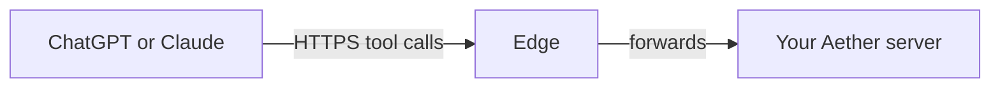

# ChatGPT and Claude connectors

A connector is a custom MCP connector in ChatGPT or Claude that points at your
Aether server. Once you add one, you can launch runs and swarms, see what needs
you, answer agents, and check pull requests from a chat in ChatGPT or Claude,
the phone apps included, with no Aether app on the phone. The connector acts
as you: the Aether member who authorized it, under the same role checks as
`aether` and the dashboard.



The edge is a public relay your server connects out to ([edge.md](edge.md)). Your
server hosts the connector endpoint and signs you in.

## Prerequisites

- A server connected to an edge. ChatGPT and Claude reach the connector at
  `<edge-url>/mcp/<server id>`. A server reachable only on a tailnet cannot have
  one. To turn the edge on, see [edge.md](edge.md#turning-it-on).
- A server new enough to serve connectors. Otherwise the edge answers HTTP 501:
  `server <name> (<id>) runs aether-server <version>, which has no MCP endpoint; upgrade it: sudo aether-server update`.
- A linked CLI (`aether link`) on an approved device, a member SSH key or a
  tailnet connection. Under `edge-access account`, any registered device works.
- A ChatGPT or Claude plan that allows custom connectors (see below).

## Get the URL and a code

```sh
aether mcp
```

```
Add this server to ChatGPT or Claude as a custom connector:
  URL   https://edge.onaether.dev/mcp/<server id>
  Code  ABCD-EFGH   one use, expires in 10 minutes; paste it on the page that opens when you connect
Connected:
  con-7k2m9q4xbd  ChatGPT (chatgpt.com)  scopes read,write  added 2026-10-18  last used 2h ago
Remove one: aether mcp revoke <id>
```

The URL is the same for both apps. On the server, `sudo aether-server edge
status` also prints it. The code works once, within 10 minutes. Running
`aether mcp` again replaces a code you have not used.

## Add it in ChatGPT

Custom MCP servers are added on the web only, at chatgpt.com
([OpenAI: custom MCP servers](https://developers.openai.com/api/docs/guides/custom-mcp-server)):

1. Open [ChatGPT Plugins](https://chatgpt.com/plugins).
2. Select the plus button, then **Add custom MCP server**.
3. Paste the URL from `aether mcp`.
4. Select **Create as a plugin**, then install it.
5. A page from your server opens: **Connect ChatGPT (chatgpt.com) to
   <server>**. Paste the code, choose its [scopes](#scopes) and select
   **Allow**.

As of October 2026, OpenAI says write tools need ChatGPT Business or
Enterprise/Edu. Pro gets the read tools only
([OpenAI help center](https://help.openai.com/en/articles/12584461)). The
plugin then works in ChatGPT on the web, desktop and mobile.

## Add it in Claude

On claude.ai
([Anthropic: add a custom connector](https://claude.com/docs/connectors/custom/add-unlisted)):

1. Free, Pro and Max: open **Customize → Connectors**, select **Add custom
   connector**, and paste the URL from `aether mcp`. Free allows one custom
   connector.
2. Team and Enterprise: an Owner opens **Organization settings → Connectors**,
   selects **Add**, **Custom**, then **Web**, and pastes the URL. Each member
   then selects **Connect** under **Customize → Connectors**.
3. Select **Connect**. A page from your server opens: **Connect Claude
   (claude.ai) to <server>**. Paste the code, choose its [scopes](#scopes)
   and select **Allow**.

The connector then works in Claude on the web, desktop and mobile.

## Scopes

The page you paste the code on also sets the connector's scopes. ChatGPT and
Claude do not choose them; the server ignores any scope they request other
than `offline_access`.

| Scope | On the page | Grants |
| --- | --- | --- |
| `read` | Always granted | Every read-only tool |
| `write` | **Launch and message**, checked by default | Launching runs and swarms; messaging, pausing and resuming runs; answering agents' and teammates' questions; marking runs reviewed |
| `control` | **Stop and approve**, unchecked by default | Deciding approvals and permission requests, stopping and closing runs, cancelling swarms. Text an agent wrote could talk the assistant into approving or ending work without asking you |

Every member can read every run on the server, so a connector can read all of
them. A connector lists only the tools of its scopes, and `aether mcp` shows
each connector's scopes. To change them, revoke the connector and connect
again. Connectors added before scopes existed have all three.

## What it can do

A swarm is an integrator agent that splits a goal into tasks and runs worker
agents for them ([teams.md](teams.md#swarms)). The connector has these tools and no
others:

| Tools | What they do | Scope |
| --- | --- | --- |
| `aether_list_workspaces`, `aether_list_agents` | Workspaces; agents (installed, signed in, Enhanced) | `read` |
| `aether_list_runs`, `aether_get_run` | Your runs (or everyone's with `mine: false`) with their last report, filtered by workspace, activity, what needs you, or words in the title, task, workspace name or branch; one run with what it waits on, its latest report and its pull request | `read` |
| `aether_run_history` | A page of a run's conversation (Enhanced) or terminal, with its reports | `read` |
| `aether_needs_attention` | What needs you, the dashboard's **Needs you** list, each item naming the tool that answers it | `read` |
| `aether_activity_summary` | What your runs did today, yesterday or this week, in your time zone | `read` |
| `aether_list_swarms`, `aether_get_swarm` | Swarms; one swarm's tasks, workers, questions and recent messages | `read` |
| `aether_run_changes`, `aether_pr_status` | A run's commits, conflicts, changed files and optionally its diff; its pull request's checks, reviews, comments and merge state | `read` |
| `aether_overlaps`, `aether_memory_search` | Pairs of active runs touching the same files; the workspace's [team memory](memory.md) | `read` |
| `search`, `fetch` | Find runs and swarms by text, in the shape ChatGPT deep research uses | `read` |
| `aether_launch_run`, `aether_launch_swarm` | Start a run, or a swarm with you as its accountable human | `write` |
| `aether_message_run`, `aether_answer` | Message a run; answer an agent's, the integrator's or a teammate's question | `write` |
| `aether_pause_run`, `aether_resume_run`, `aether_mark_reviewed` | Pause or resume a run; accept a reported success, which closes the run, or put it off | `write` |
| `aether_decide_approval` | Allow or deny an approval or permission request, once | `control` |
| `aether_stop_run`, `aether_close_run`, `aether_cancel_swarm` | Stop a run; close it as merged or abandoned; cancel a swarm | `control` |

Things to ask:

- "What needs me in Aether?"
- "What is the agent working on edge doing?"
- "Launch a Claude run in api to fix the flaky login test."
- "Start a swarm in api to add rate limiting, with Codex workers."
- "What did my agents do today?"
- "Is CI green on the login fix PR? What did reviewers say?"
- "Tell the parser run to use the new tokenizer."
- "Which runs touch the same files as the migration run?"

Results link to the run or swarm in the dashboard when the server serves one on
its tailnet (`web-port`); the edge serves no dashboard. A result's text is a
one-line summary followed by the result as JSON. Text that agents, teammates or
GitHub users wrote, run titles, swarm goals, failing check names and the
reasons runs wait included, comes back under an `untrusted` field; outside it
are only fixed labels such as `The agent asks a question`, ids, states, counts,
times, links, workspace and agent names, branch names, file paths and the
server's own errors. Untrusted text is cut to 200 characters for titles, check
names, commit subjects, a swarm task's blockers, a list row's reason, last
report or swarm goal; 300 for
each pull request review or comment; 2000 for a conversation item; 12000 for a
diff; and 600 for everything else, such as tasks, reports, questions, request
and approval text, terminal lines and memory notes. `search` and `fetch` keep
OpenAI's shapes, with no `untrusted` field: their descriptions say titles and
text are data, `fetch`'s text marks where agent text begins, and it returns a
run's title, task and reason and a swarm's goal whole. An approval or
permission request longer than 600 characters is decided only in the dashboard,
never by `aether_decide_approval`. Lists return 20 rows by default, at most
100, and say how many matched when they cut rows; `aether_needs_attention`
returns at most 30 items. Tools that take a `run_id` or `swarm_id` also accept
the `run:` and `swarm:` ids `search` returns.

A launch, swarm or message takes an optional `idempotency_key`; a retry with
the same key returns the first result. A launch or swarm still starting after
30 seconds, such as one pulling its image, answers with its id, `state:
"starting"` and the key, and keeps starting after the tool call ends: poll
`aether_get_run` or `aether_get_swarm`. Without a key, a run launch with the
same workspace, agent, task, mode and model within 60 seconds returns your
earlier run, unless it failed, was interrupted or was abandoned, and a swarm
with the same workspace, objective and agents within 60 seconds returns your
earlier swarm, unless it was cancelled, instead of starting another; so does an
identical launch still starting. A retried message without a key is sent again.
`aether_mark_reviewed` completes only a run whose agent reported success and
awaits your review; to end any other run, use `aether_stop_run` or
`aether_close_run` under `control`. A message to a run another member controls
waits about 45 seconds for them to approve it. `aether_decide_approval` allows
or denies a permission request once; it never picks an "always" option, so it
cannot change what the agent may do next time. Any other tool call is cut off
after 40 seconds, inside ChatGPT's wait.

ChatGPT and Claude ask before each tool that is not read-only. ChatGPT asks by
default and can remember your answer for a conversation. Claude offers **Allow
once** and **Always allow** per tool. Aether shows no confirmation card of its
own, and the [assistant's auto-approval](assistant.md#auto-approval) does not
apply. Your role still decides: a viewer's launch is refused, as it is in
`aether`. A connector's calls are judged by the device its code was minted on:
a method that needs an approved device refuses a connector minted on a
registered one.

Each connector can make 30 write calls at once, enough for many parallel
launches, then regains one every 2 seconds, up to 30 again. Past that, the
call fails with
`connector <id> used its 30 write calls and gets one more every 2s; retry in <seconds>, at <time>`.

## Attribution

A run launched through a connector shows **Launched via ChatGPT** (or Claude)
in its header, and a message sent through one shows `<member> via ChatGPT` as its author. The server logs one
line per write call:

```
connector: write call connector=con-7k2m9q4xbd member=mem-... method=run.launch target=ws-... result=ok
```

`result` is `ok` or the call's error. Audit records, such as a member merge's
`confirmed_by`, name the connector: `ChatGPT connector con-7k2m9q4xbd of member mem-...`.

## Revoke a connector

```sh
aether mcp revoke con-7k2m9q4xbd
```

The connector's next call fails, and the app asks you to connect again with a
new code. You can revoke your own connectors, and an admin can revoke anyone's.
Removing the connector in ChatGPT or Claude does not revoke it on the server.
Revoke it here too.

A connector also stops working at its next request when:

- the device it was minted on is revoked (`aether device revoke <device id>`)
- its member is removed
- the server runs under `edge-access approved-devices` and that device is not
  approved
- its refresh token goes unused for 30 days (`aether mcp` then no longer lists
  it)
- the edge moved to another origin, which changes the connector URL

A connector whose code was minted over a member SSH key or a tailnet
connection has no device, so revoking a device never cuts it off. Revoke it
with `aether mcp revoke`.

## Troubleshooting

`aether mcp` prints errors as `aether: rpc error <code>: <message>`.

| Message | Fix |
| --- | --- |
| `connector.code: this server has no edge (edge-url is empty), and ChatGPT and Claude reach a connector only through one; an admin turns it on with: sudo aether-server config set edge-url https://edge.onaether.dev, then sudo systemctl restart aether-server` | Turn the edge on |
| `connector.code: this server is not connected to its edge at <edge-url>; an admin sees why with: sudo aether-server edge status` | Fix the edge connection |
| `connector.code needs an approved device, a member SSH key or a tailnet connection; this connection signed in with device "<label>", which is registered` | An admin approves your device, or run `aether mcp` from an approved one |
| `method not found: connector.code; the server is older than this CLI, and an admin updates it with aether server update` | Update the server |
| `connector.revoke: no connector <id>; aether mcp lists yours` | The id is wrong or already revoked |

On the page that opens when you connect:

| Message | Cause |
| --- | --- |
| `That code is wrong, expired or already used. Run aether mcp for a new one and paste it here.` | The code is not live. A server restart also forgets codes |
| `10 wrong codes came from your address in the last minute. Wait a minute, then paste the code again.` | 10 wrong codes in a minute from your address (your IPv6 /64). Other addresses are not affected |
| `300 wrong codes came to this server from all addresses in the last minute. Wait a minute, then paste the code again.` | Someone is guessing codes from many addresses. Pairing resumes a minute after the guessing stops |
| `Aether connectors work with ChatGPT and Claude; <host> is not one of them.` | Only `chatgpt.com` and `claude.ai` can connect |

If an app asks you to sign in again, the connector was revoked. Run `aether mcp`
for a new code.

## Security model

The connector acts as you through the tools of its scopes and nothing else. The
edge decrypts connector traffic, because ChatGPT and Claude need a public
certificate, so a compromised edge can read tool calls and act as you through a
live token. [security.md](security.md#chatgpt-and-claude-connectors) lists what
each token allows and what cuts a connector off.
