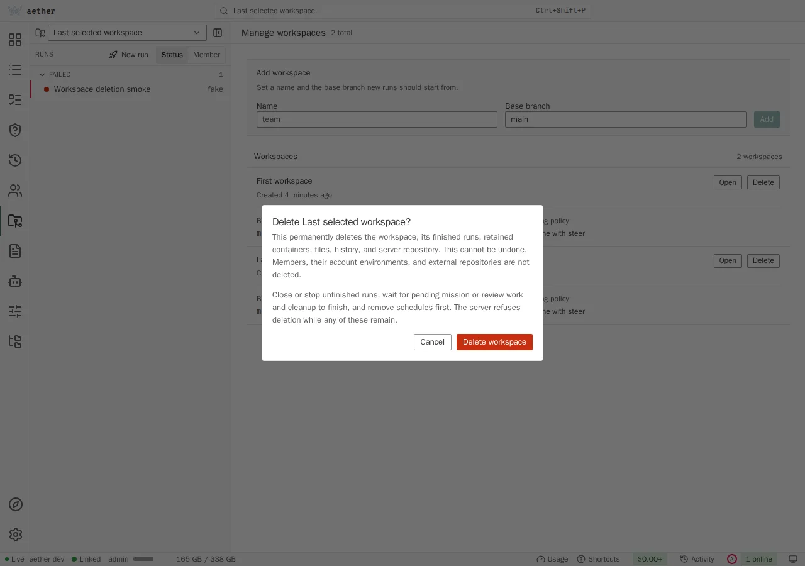
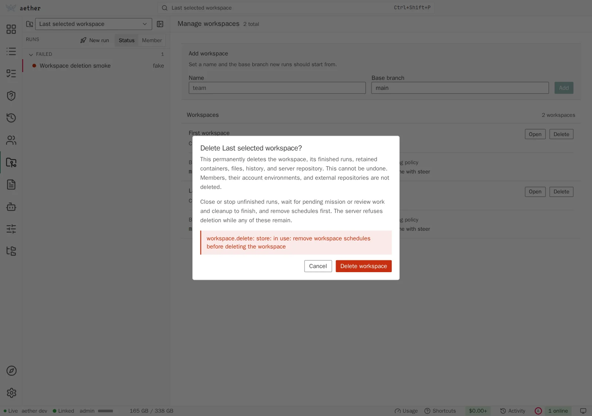

# Dashboard SPA (`web/`)

The dashboard is the browser client for Aether. A **workspace** is one
repository and base branch; a **run** is one agent working on its own branch
in its own container. The dashboard shows a member's runs, lets them launch,
watch, message and review them, and holds the pages for agents, files,
templates, members and settings.

It is one static bundle served through either dashboard gateway: `aether gui`
on the user's machine, or `aether-server --web-port` over HTTPS on the
server's tailnet addresses. Next.js 16.3.4 produces the static export, React
19 + TypeScript render the client runtime, Tailwind v4 and the Radix-based
primitives in `src/components/ui/` provide the components, and Zustand holds
the state. Both gateways use the shared `internal/webgate` API and WebSocket
surfaces; the server gateway authenticates each request with Tailscale WhoIs
and no browser token.

The visual contract is a dense developer workbench on graphite surfaces with
one teal accent: flat panes and compact controls. `docs/styles.md` defines the
tokens, type and motion.

The gateways and their transport boundaries are documented in
`docs/local-gateway.md`. The same bundle serves both, gating machine-local
surfaces on the capabilities descriptor while keeping shared Files,
configuration, runs and terminal surfaces available through either transport.
This guide describes the dashboard's routes, store and components.

## Runtime boundary and commands

`src/app/page.tsx` is a minimal Next App Router page. It loads
`src/app/client-runtime.tsx`, which is a client component that dynamically
imports `src/App.tsx` with `ssr: false`. This boundary keeps the browser-only
store, WebSocket, xterm and Electron bridge out of static prerendering. Next
still emits the document, CSS, fonts and JavaScript assets; the existing
client-side registry and in-memory `navigate()` state remain the dashboard's
navigation model. Next does not run in production.

```sh
make dashboard   # Bun install, then Node 22+ and next build (from repo root)
make build       # dashboard export, then the Go binaries
cd web && bun run dev -- --port 3000 --hostname 127.0.0.1
cd web && bun run test       # vitest
cd web && bun run typecheck  # tsc --noEmit
```

`bun run dev` starts `dev-server.mjs`, the development-only Node loopback
server. It defaults to `127.0.0.1:3000`, accepts `--port`/`-p` and
`--hostname`/`-H`, and uses `AETHER_DASHBOARD` as its gateway target. The
target may be a local `aether gui` URL or a server-hosted HTTPS dashboard;
local targets also proxy `/local`, while both targets proxy `/api` and `/ws`
with WebSocket support. The proxy preserves the browser `Host` and `Origin`
headers so the shared gateway remains the WebSocket origin boundary. Other
requests and Next HMR upgrades go to Next's development handler. The Next
Node inspector attach endpoint is unavailable through this server.

For a local gateway, run it and start the dev server in separate terminals.
The local gateway prints a tokened URL; copy its `token` query value onto the
dev URL:

```sh
# terminal 1
aether gui --port 8080 --url

# terminal 2
cd web && AETHER_DASHBOARD=http://127.0.0.1:8080 \
  bun run dev -- --port 3000 --hostname 127.0.0.1
# open http://127.0.0.1:3000/?token=<token-from-aether-gui>
```

The client moves `?token=` into `sessionStorage` under `aether.token`, removes
only that query parameter from the address bar, and sends the value as a
Bearer token on HTTP or a `token` query parameter on WebSockets. The token is
minted per `aether gui` process and stops working when that process exits.
When `AETHER_DASHBOARD` points at the server gateway instead, the browser
sends no token: Tailscale WhoIs identifies the phone or development browser
on every request.

The address carries the route (see [URL state](#url-state) and
[local-gateway.md](local-gateway.md#running-it)).

Node 22+ is required for a hand-run dashboard build. The complete contributor
toolchain and the optional desktop installer workflow are in
[CONTRIBUTING.md](../CONTRIBUTING.md#toolchain).

## Testing on a phone

The shipped phone path is the server-hosted gateway, checked by hand as
[Testing on a real phone](#testing-on-a-real-phone) describes.

For a contributor's loop against a dashboard build that is not embedded in a
server yet, use the development server as a LAN-facing proxy to a local
`aether gui`:

```sh
# terminal 1, on the computer the phone will reach
aether gui --port 8080 --url

# terminal 2, with <lan-ip> that computer's address on the phone's network
cd web && AETHER_DASHBOARD=http://127.0.0.1:8080 \
  bun run dev -- --port 3000 --hostname <lan-ip>
# on the phone: http://<lan-ip>:3000/?token=<token-from-aether-gui>
```

- **Binding the LAN address gives up the loopback boundary for as long as
  the dev server runs.** Every device on that network can reach a proxy in
  front of a gateway with the member's authority on the linked server, and
  the local bearer token is the authentication: it travels in clear over
  HTTP, sits in the URL and stays in the phone's history. Use a network you
  trust, and stop the dev server when the session ends. The shipped boundary
  is the loopback rule in [security.md](security.md#the-dashboard-gateways);
  this is a development-time exception a contributor opts into by hand.
- `--hostname` has to be the address typed on the phone. Next's development
  server permits only localhost and the hostname it was started on; any other
  origin needs `allowedDevOrigins` in `web/next.config.ts`.
- The token is minted per `aether gui` process, and the phone needs that one.
  Nothing else authenticates the local development proxy.
- A tunnel or proxy in front of this must preserve `Host` and `Origin`. One
  that rewrites `Host` breaks every WebSocket - the terminal, the event feed
  and the attach stream - while plain HTTP keeps working, which makes for a
  confusing half-broken dashboard.
- This serves the Next development build over plain HTTP, not the static
  export the binary embeds, and it needs the computer awake and on the same
  network. It is a contributor's loop, not the shipped phone path.

Automated phone coverage is the `mobile` Playwright project, described in
[testing.md](testing.md).

## Build pipeline and the embed

`web/next.config.ts` sets `output: 'export'` and `distDir: 'dist'` outside
development. `next build` therefore writes a static `web/dist` artifact:
HTML, `_next` assets, CSS and copied public files. There is no production Next
server or Node process in the shipped dashboard.

`web/embed.go` embeds `web/dist` with `//go:embed all:dist`, which fails to
compile against an empty directory. The build output is not committed, so the
invariant is kept by two placeholder files:

- `web/dist/.gitkeep` is committed so a clean checkout compiles the Go server
  before anyone has run the web build.
- `web/public/.gitkeep` is copied into `dist` by every Next build, so emptying
  the output directory never breaks the next Go build.

`.gitignore` ignores generated `web/dist` and Next metadata while retaining
`web/dist/.gitkeep`. A binary built without running the web build serves the
gateway's "dashboard not built" response rather than a blank page.

### The web app manifest

`web/src/app/manifest.ts` is a Next metadata file, so the export writes
`/manifest.webmanifest` and links it from the page. A static export refuses to
collect a metadata route that has not declared itself static, which is what the
`export const dynamic = 'force-static'` in it is for.

It declares `display: standalone` and `start_url: '/'`, and names four icons
from `web/public/icons/`: 192px and 512px in both `any` and `maskable`. 192
and 512 are the pair Chrome and MDN document; what the installability check
enforces is lower - one `any` icon of at least 144px - so shipping both
documented sizes is belt and braces. Installing does not depend on a service
worker: Chromium's installability check no longer looks for one, and the post
announcing the removal
([update-install-criteria](https://developer.chrome.com/blog/update-install-criteria))
scopes it to installing "from the menu, since version 108 on mobile and 112 on
Desktop". The one that ships, `web/public/sw.js`, exists for
[push notifications](#push-notifications) and has no `fetch` handler: the
dashboard is never cached, because it lives inside the server binary and has
to change with it.

**Both mobile browsers read the manifest.** Safari has since iOS 11.3
(`display`, `name`, `short_name`, `start_url`, `scope`), with `theme_color`
since 15 and `icons` since 15.4, so an iPhone's standalone window comes from
the manifest, not from the layout's Apple meta tags. Those tags cover what a
manifest cannot say: the status bar style, which needs
`apple-mobile-web-app-capable` spelled out by hand because Next 16 emits only
the unprefixed `mobile-web-app-capable`. `web/public/icons/apple-touch-icon.png`
stays because Safari prefers it over the manifest icons.

A manifest carries one `theme_color` where the layout's viewport export carries
one per colour scheme, so both read `web/src/app/theme-color.ts` and the
manifest takes the dark value. `background_color` is the separate
`iconBackground` from that module, `#0a0a0a`: an installed app's splash centres
an icon on it, and any other value would leave the icon's tile showing as a
square. That hex is deliberately darker than the dashboard's own dark
`--canvas`, `#141516` - a launcher icon has to read as an object against a
wallpaper - so the splash lightens slightly as the SPA paints over it.

Every icon is generated from `web/public/aether-mark.png` by `python3
scripts/make-icons.py`, the same script that writes the desktop app's, and the
output is committed. Maskable icons and the iOS icon are square and full-bleed
because the platform applies its own mask; the rest carry the rounded tile.

CI installs Bun with `oven-sh/setup-bun` (version pinned in
`web/.bun-version`) in jobs that run `make build` or `make release-binaries`,
plus a dashboard job that typechecks and tests the SPA on its own.

## The three extension seams

Views and state are added without editing the shell.

**Route registry** (`src/routes/registry.ts`). A route file calls
`registerRoute('board', Board)` at module scope; `src/routes/index.ts` imports
it once for that side effect. The center view looks the current route up by
name and renders it with `route.params`. Navigation is a store action -
`navigate('run', { runId, view: 'terminal' })` - rather than a URL router:
Next supplies the document and static assets, while the dashboard remains one
client screen and every surface uses the same action. The route is mirrored
in the address bar (see [URL state](#url-state)).

**Store slices** (`src/store/`). One Zustand store composed of slice creators,
one file each (`server`, `agent-models`, `workspaces`, `runs`, `members`, `env-terminal`,
`terminal`, `board`, `palette`, `approvals`, `presence`, `cost`, `timeline`,
`diff`, `files`, `collaboration`, `local`, `missions`, `messages`,
`sessions`, `ui`). A new feature adds a slice file and one spread in
`createRootStore`. Slices are typed against the whole root state, so a slice
may read another's data. Only view preferences and local progress (theme,
text size, sidebar width and collapse state, dock height, Details open,
terminal zoom, single-key shortcuts, diff wrap, `activeWorkspace`, the
**Mine** toggle, launch defaults, dismissed update versions, onboarding
progress) are persisted under the `aether.ui` key; `persistedUi` in
`store/index.ts` is the list that decides. Server data is always re-fetched.

**Selectors return primitives or stable references.** A selector that builds a
new array or object on every call re-renders its component on every store
write, and under React 19 can loop. Lists of IDs go through `useShallow`
(`useRunIDs(workspace)` in `src/store/hooks.ts`); one entity is read by ID
(`useRun(id)`); a row asks for a boolean (`selected`) or its own state
(`useRunPresentation(run)`) rather than the whole `route` or run map. Derived
maps live in the reducer that changes their inputs: `setInbox` rebuilds
`approvalsByRun` (each run's pending requests, oldest first), so a row's
approval count is one lookup. Run rows and board cards are `React.memo`
components; reducers replace only the record of the run that changed, so an
event about one run re-renders that run's row and card and leaves the rest
alone.

**Relative times tick on one shared clock.** `<RelativeTime at>`
(`src/components/ui/relative-time.tsx`) renders a `<time>` whose text comes
from `timeAgo` and subscribes to `useClock()` in `src/lib/clock.ts`: one
30-second interval for the whole app, running only while something
subscribes. Only the `<time>` re-renders on a tick, so "2 minutes ago" on a
board card, a run list row, a feed entry, an approval, the members and
devices views or the Changes Compare menu keeps moving without re-rendering
the row. `compact` renders `compactAge` instead: the same steps as `timeAgo`
in a few characters ("now" under a minute, then "15m", "3h", "2d", "1w",
"2mo", "1y"). A sidebar run row reads the clock itself as well, because its
accessible name carries the age. A per-second countdown, such as a queued
message's delivery (`DeliveryCountdown`), is its own small component and
re-renders only its text.

The `messages` slice holds agent mail (`coord.messages.list`) per workspace,
swarm, or run scope, merged by message ID. A scope's list is held only while
a view that shows it is mounted (`useMessageList`); the last one to unmount
drops it and the messages no other list holds. Messages list oldest first;
those created at the same instant keep the order the server inserted them,
which it reports newest first. A `coord.message` event
carries no body, so every held scope the message belongs to re-reads its
newest page; a scope whose first read failed is held empty so it re-reads too.
`coord.message.acked` stamps the row. Both re-read the recipient run for its
`unacked_messages`.

**`activeWorkspace` is the scope workspace surfaces read.** It lives on the `ui`
slice and names the workspace the sidebar's run list, the board, launches,
templates, budget dialogs and the activity feed all act on. Empty means "all",
which is what the board falls back to before hydration has named one.
`setActiveWorkspace` carries an open `workspace` route along with it, so the
switcher can never say one workspace while the view beside it acts on another,
and `navigate('workspace', ...)` makes the workspace it opens the active scope
for the same reason.
Member configuration is account-scoped and does not require a workspace.

The last selected workspace survives reopening. Browser and server-hosted
dashboards use the `aether.ui` local-storage preference. The local gateway also
stores it through `workspace.selection`, keyed by server address and member,
because the desktop app's ephemeral port changes the browser origin on each
launch. Startup restores this value before choosing a fallback; a selection
made while startup is loading takes precedence. A failed preference read shows
the gateway's original error in a toast without blocking workspace and run
data: the current valid selection or normal fallback still applies.

Derived data (the run groups, the flat run list, the Needs you counts) lives
in `src/store/selectors.ts` as pure functions over a `StateContext`
(`stateContextOf` in the same file), wrapped by memoizing hooks in
`src/store/hooks.ts`. Selectors that build new arrays must not be passed to
`useStore` directly. A view that owns its own derived shape keeps it beside
the view instead (`src/routes/board/selectors.ts`). `useRunInput` combines
structured native requests, pending Aether approvals and unanswered teammate
questions for the request indicator; the run's state comes from
[Run state](#run-state).

**Slots** (`src/components/slots.tsx`). Where a route registry is too coarse -
something belongs *inside* a surface another ticket owns - the surface renders
`<Slot name="..." />` and contributors call
`registerSlot(name, id, Component)` at module scope. Registration order is
render order, `id` keys the render and makes a double registration an error.
The slots that exist:

| Slot | Props | Where it renders |
| --- | --- | --- |
| `card:meta` | `{ run }` | the run card's meta line, after the agent, owner and diff counts |

Its contributors are the file-overlap chips (`routes/diff/conflict-chips.tsx`),
the sync badge (`routes/run-sync`) and a swarm's scope diagnostics
(`routes/missions/conflicts.tsx`). `card:meta` content renders inside
`CardControls`, above the card's open target, so its links and buttons stay
interactive. Keep it to one short item per contributor: a count or a word,
with details behind a popover.

## Shell

`src/components/shell/` is the shell: a branded navigation header above one
sidebar and one content area, with the desktop window bar above them in the
desktop app. `AppShell` (`app-shell.tsx`) mounts it once, together
with the shell-wide hosts: the command palette, the dialogs the store opens
(`components/palette/dialogs.tsx`: launch, message, forward, close, archive
and free), the shortcuts dialog, the updates dialog (`UpdateCenter`), the
connection announcer, the shell keys (`useNavShortcuts`) and the team
refresh (`useTeamRefresh`).

### Sidebar

The sidebar (`sidebar.tsx`) is a `nav` named "Aether", 260px wide by default and
resizable from 220px to 400px; older saved widths are clamped. `Mod+B`, the
**Hide sidebar** button in its header and Enter on its splitter hide it
completely; the content view's header then shows **Open sidebar** at its left
edge. Hiding or showing it hands focus to the control that reverses it. From
top to bottom:

1. **Workspace switcher and search.** The switcher
   (`workspace-switcher.tsx`) shows the active workspace's name and base
   branch, and the total Needs you count across every workspace. Its menu
   lists each workspace with its own count, **All workspaces** (the
   `overview` route), **Manage workspaces**, **Repository** (the
   workspace page) and **Environment** (the same page, scrolled to that
   section). With one workspace and no `workspace.list` method it is a
   plain label. The search button opens the command palette.
2. **New run**, the only filled button in the shell (`n`), for a member who
   may launch.
3. **Runs** (`sidebar-runs.tsx`), a `region` with three groups, **Needs you**,
   **Working** and **Finished** (see [Run state](#run-state)), each an `h2`
   holding an `aria-expanded` disclosure button and its count. Every group
   starts expanded and lists all of its runs; a group closes only when its
   header is pressed. Needs you lists every workspace; a row outside the
   selected workspace leads with that workspace's name. Working and Finished
   list the selected workspace, and only the viewer's own runs while **Mine**
   (`mineOnly`, persisted) in the Working header is pressed. The region
   scrolls on its own, and while more rows sit below the fold its bottom edge
   fades out. The sidebar never collapses on its own at narrow widths; the
   splitter and `⌘B` stay the reader's call.
4. **Members** (admins only) and **Settings**. Board through Templates live
   in the header instead, leaving the sidebar's height for runs. The current
   destination carries `aria-current="page"`. Gates come from
   `src/lib/surfaces.ts`, which also feeds the palette's Navigate group; its
   `palette` entries (Members › Devices, Manage workspaces, and Members for a
   non-admin) are reached from the palette only, and its `link` entries
   (Approvals, the board's Needs you; Onboarding, opened from **Settings ›
   Onboarding**) only from a link.
5. **One update notice row** when a server, CLI or desktop update exists, for
   example "Server 0.5.3 is available · Update"; see
   [Update prompts](#update-prompts).
6. **Footer**: the member's avatar (a neutral glyph before the computer is
   linked) and name and a connection dot, whose word
   ("Live", "Reconnecting", "Offline") is in the button's name and tooltip.
   Its menu holds **Profile** (a dialog: display name, colour, git identity
   and agent account sharing; see [Members, devices and
   Profile](#members-devices-and-profile)), **Keyboard shortcuts**, **Theme**,
   **Check for updates…**, and a **Team** line with who is online
   and the spend against workspace budgets.

A run row is a 28px `ListRow` (44px on a coarse pointer). From the left: a
static `StatusDot`; the owner mark, a 6px right-pointing triangle filled
with the colour of the run's owner (`member_id`, not the agent account and
not the controller); the title; the row's age; the agent's monochrome glyph;
and the avatars of whoever is on the run. The age is the compact form
("15m", "3h", "2d") of the time the explorer sorts by: when a Needs you row
began waiting on the viewer, else the run's last status change (`since` on
the row, `src/store/selectors.ts`). Only a snapshot without
`status_changed_at` (see [Run state](#run-state)) leaves an estimate of that
change, which counts a live run's age from its start until its next status
event. The title truncates before anything to its right does. Paused, finished and other
members' working rows recede: their title is in the muted colour.

**Who is on a run** is every member with a terminal or an Enhanced session
attached to it, the viewer included: the `watching` lists of
`presence.roster`, which covers every workspace (`runWatchers` and
`runPeople` in `src/store/presence.ts`). Their avatars stack at the row's
right edge and the age, the glyph and a swarm's button move left to make
room; a run nobody is on reserves none. The first avatar sits whole at the
edge and each one after shows from behind it, to its left. First is the
run's controller. While nobody holds control it is the last controller, if
they are still on the run. The rest follow by name. A row draws three
avatars at most: a fourth person turns the stack into two avatars and `+2`.
While a Needs you row shows its action the stack steps aside for it, so the
title keeps its room.

**Run details.** Resting a mouse on a row for 400ms opens a box docked to
the row's right edge (`run-details.tsx`): the whole title, the state's
reason, the workspace, the agent and mode, the branch, a swarm parent's
worker counts, when the run started, when it last changed if that is later,
its owner, and the people on it with the controller marked **Controlling**.
A live run nobody controls says so above them and names who had control
last, when the server knows. Moving to another row swaps the box without
the delay or the animation. The box takes no pointer events, closes when the
row is pressed, scrolled or left, and gives way to the hint of a button
inside the row. It does not open on keyboard focus, on a coarse pointer, or
under 768px, where the sidebar is a sheet. It replaces the row's native
tooltip.

The title is whole up to 120 characters, where the task fallback and the
server's provisional title stop; an agent's own longer title is cut there
(`clipLabel` in `src/lib/status.ts`). The box cannot scroll, so it lists
seven lines of people at most and ends the list with a count of the rest
("and 16 more"). Under a 120-character title, with every other part at its
tallest, that fits a 600px-tall window at the Default and Large text sizes;
Larger keeps six lines. A box still too tall for its window gives way in
order: people, a line at a time down to a bare count ("22 people"); then
the reason, to one line; then the title, to three.

The row's accessible name starts with the state word, then the workspace
when it is another one, the title, the reason, the age in words, whose run
it is, who controls it and who else is watching ("Working · rewrite the
checkout flow · Agent working · 15 minutes ago · Bob's run · Vera controls ·
you watching"). Its description is the exact time the age counts from.

A Needs you row offers the condition's primary action on hover, focus and a
coarse pointer, the same one its board card shows (see [Board](#board)):
**Approve** resolves in place, **Reply** opens the run's Session view with
the composer focused, and every other action and non-swarm rows go to the
view the condition names. Run rows share one tab stop (roving `tabindex`);
Arrow keys, Home and End move within them. Swarm-control buttons are
separate tab stops. `j` and `k` move from anywhere (starting at the open
run), and `u` opens the next run that needs you, oldest first.

A Finished or Failed row does not recede while no member has opened its run
since it finished (`finish_unopened`, see [Run state](#run-state)): its title
keeps the text colour and its accessible name says "Not opened yet" before
the age. A finished worker nested under a swarm follows the same rule. Once
any member opens the run, the row recedes in every member's dashboard.

A swarm's integrator row uses the agent's title, not the swarm objective.
Every unarchived worker and previous integrator is indented beneath the current
integrator and joined to it by tree connectors: a vertical trunk under the
integrator's status dot and a horizontal wire into each child row
([Styles](styles.md#shell-palette-and-focus)). **Mine** also filters
these children under Working and Finished; Needs you keeps the whole tree
visible. Selecting a run row opens that run, from anywhere on the row
outside its buttons. The graph-node button to the right of the title, before
the age and the agent glyph, opens the swarm control page; its tooltip
includes the workers' counts. The same `Waypoints` icon marks Swarms in
navigation and New swarm in the command palette. Unread integrator mail
still appears in the row's name and its details. The whole tree sits in
Needs you while any member needs the viewer, but only those waiting runs
contribute to that group's count.
A swarm whose integrator is missing or archived is rooted at its oldest
worker (`swarmRoot` in `src/store/selectors.ts`). The Board still aggregates a
swarm into one card. Relationships come from the run snapshot's `mission_id`,
`mission_role` and `integrator_run_id`,
not task text. `mission.changed` coalesces background refreshes of those
fields without blocking run-status events or overwriting newer run state;
reconnect hydration supersedes pending relationship requests. Older servers
that omit the fields get a flat list.

### App header

`top-bar.tsx` is a `banner` at every window width, padded by `--safe-top`.
Its first row shows the Aether mark and lowercase `aether` wordmark on the left, then **Board**,
**Swarms**, **Activity**, **Insights**, **Memory**, **Files**, **Environment**, **Agents** and
**Templates** in `nav` "Main navigation". These use the sidebar's `ListRow`
styling and current-page selection. A `ResizeObserver` measures the row and
its buttons, including font and text-size changes. Destinations that do not
fit move into **More navigation**, a click-to-open menu; Board and Swarms
never move into it. Gateway capability gates still apply. Hidden buttons
are inert and excluded from the accessibility tree.

Under 768px a second, 48px toolbar holds **Open sidebar** with an amber dot
while anything needs you, the view's title, **Search** and **New run**. On a
run page the title is "Run", because the run header under it already shows
the run's title. A connection problem is one line under the toolbar. On a
phone the view's own header keeps only its actions, and its `h1` stays for
screen readers. The header's measured bottom edge sets
`--app-header-bottom` for the command palette's position and height limit.

A phone screen has one filled button. A page whose own action is filled calls
`useHeaderPrimary(shown)` (`src/store/hooks.ts`) while that action shows; the
`ui` slice counts the holders in `headerPrimaries`, and while the count is
above zero the top bar draws **New run** as an icon button with the same
accessible name. A run page always gets the icon, with or without a primary
action. The holders are a run header with a primary action, a swarm with an
open question the viewer may answer, Environment's **Open** or **Save
environment**, onboarding, Files with a file open and the Changes view's
**Publish…**. The board, lists and settings keep the filled **New run**.

The sidebar opens as a left side sheet, a `dialog` named "Aether" with the
same contents and **Close sidebar** in place of **Hide sidebar**; a tap
outside, Escape or any navigation closes it, and navigation moves focus to the
new view's heading. `Mod+B` closes it too, because it is the key that opened
it; every other shell key stands down while it is open.

### Assistant panel

The assistant is a persistent conversation with an agent running in the
member's own environment; the server side is
[the assistant plan](plans/2026-10-14-assistant.md). `AssistantPanel`
(`components/assistant/panel.tsx`) is mounted by `AppShell` as a flex sibling
after `main`, so it is available on every route, onboarding included. It
renders nothing unless the server lists `assistant.status` and the member can
launch runs (`useAssistantAvailable`); the same check gates every entry point.

- **Desktop, docked:** an `aside` named "Assistant", 400px by default and
  resizable from 320px to 640px by a `separator` on its left edge (same keys
  as the sidebar's, mirrored: Left grows). **Close assistant** returns focus
  to the Assistant button. The saved width is a preference: the rendered width
  is capped to what the window leaves after the sidebar and
  `minReadableWidth` (560px, `lib/breakpoints.ts`) of `main`.
- **Desktop, floating:** below 320px of that room, the same `aside` floats
  over the right edge of `main`, raised by a shadow. Its width is the saved
  width, capped so at least 240px of `main` (`uncoveredWidth`) stays
  uncovered on its left, but never below 320px. It has no backdrop, no focus
  trap and no resize handle, so the run keeps its full width, and the part
  the panel does not cover stays interactive. `Esc` inside it, outside an IME
  composition, closes it and returns focus to the Assistant button, unless
  something inside it, such as the **New conversation** confirmation, handled
  the key first; so does `Mod+Shift+Space` from anywhere. Crossing between
  docked and floating restyles the one `aside` rather than remounting it, so
  the draft, the focused composer and the transcript's scroll survive.
- **Phone:** a right side sheet, a `dialog` named "Assistant".
- **Header:** an `h2`, because the view beside it owns the page's `h1`. It
  takes the run header's height on a run and the view header's elsewhere, so
  the two seams line up. It holds the agent and state, **New conversation** (confirms, then
  `assistant.reset`) and **Close assistant**. While `auto_approve` is on, a
  line under it says the assistant acts without asking, with **Change in
  Settings**.
- **Body:** by `assistant.status` state. `setup` lists each agent with its
  reason and opens `AgentSetup` in place; `needs_restart` is a callout with a
  button that calls `assistant.start {restart_environment: true}`; `failed`
  shows the server's error above the transcript with **Retry**
  (`assistant.start`). Otherwise the transcript (`role="log"`), which reuses
  the run Session's `TimelineRow` and `flattenRows` with the constant row
  context id `assistant`, and the composer (Enter sends, Shift+Enter inserts a
  newline, `Mod+Enter` also sends; **Stop** replaces **Send** while a turn
  runs). An empty conversation offers four example prompts that fill the
  composer. Harness permission and question prompts render as request cards
  answered with `assistant.answer`; each pending confirmation renders as a
  card with the summary, the method and exact params, a relative deadline,
  **Approve** and **Decline** (`assistant.confirm`). A card leaves only when a
  `confirmations` frame stops listing it. While `auto_approve` is off a card
  links **Skip these cards…** to Settings > Assistant; a card with
  `other_member` says that member (`other_owner`) owns the run, so it asks
  even with auto-approval on.
- **Auto-approval suggestion** (`components/assistant/suggestion.tsx`): when
  the status has `suggest_auto_approve`, the state is `idle`, no turn runs,
  no confirmation or harness prompt waits and the conversation has items, a
  notice between the transcript and the composer asks **Skip approval cards
  for the assistant?** It says what auto-approval passes, that each action is
  still noted, that read text could steer the assistant, and that messaging
  or stopping another member's run still asks. It scrolls past 40% of the
  viewport height, so the composer stays visible. Its three equal buttons call
  `assistant.settings`: **Turn on auto-approval** (`auto_approve: true`, no
  second dialog: the notice is the warning), **Not now** (`suggestion:
  "later"`) and **Don't suggest again** (`suggestion: "never"`). Each leaves a
  one-line answer, focused, with a **Settings → Assistant** link; a **Not
  now** answered with `suggestion_off` says it won't be suggested again. The
  line clears at the next turn or a new conversation, and is dropped if
  another member signed in before the answer arrived. A refusal stays in the
  notice, focused. The server decides when the suggestion is due; see
  [assistant.md](assistant.md#the-suggestion). These links, **Skip these
  cards…** and the **Acts without asking** line's **Change in Settings**
  close the panel when it is a sheet, and leave a docked panel open.

State lives in `store/assistant.ts`. The transcript is the `AcpSession` under
`acpSessions.assistant`, built by the run reducers and kept out of `runs`, so
it never reaches the board, sidebar or palette. The slice holds the status,
the confirmation set, the composer draft and the generation a new
conversation bumps; `assistantOpen` and `assistantWidth` persist.
`store/assistant-stream.ts` connects `/ws/assistant` through
`connectSessionStream` with the assistant endpoint. `AssistantPanel` reads
`assistant.status` once on load and on each open, then connects unless the
state is `setup` or `needs_restart`. It stays connected with the panel closed
only while the state is `running` or `starting`, or a confirmation or a
harness prompt is pending. After that, `status` frames carry the state and the
whole confirmation set, so the UI makes no further status calls. A truncated
item in the transcript is read with `assistant.item`. Each pending
confirmation or prompt puts a dot on the Assistant button, named "Assistant, N
requests waiting". A confirmation card lists its params as labelled rows
(`workspace_id` reads "Workspace"; task and message text stay whole), and its
buttons stay disabled once answered until a status frame removes the card. Only
A prompt being sent and its idempotency key live in the slice next to the
draft, so reopening the panel retries under the same key; a changed draft, a
success or a new conversation clears them. `assistantOpen` on desktop persists; a phone never reopens the sheet on load.
Closing the panel unmounts it. The transcript keeps where the reader left it,
including virtua's measured row sizes, in a module-level record keyed by
member, conversation generation, epoch, history generation and first row,
and reopening the same conversation returns there. Earlier messages loaded
while the panel was closed change the first row, so the transcript starts at
the bottom instead of at a stale offset. A transcript pinned to the bottom stays
pinned, so it follows output that arrived while the panel was closed. A
different conversation starts at the bottom.

`store/view-context.ts` builds the view context each prompt carries (see
[assistant.md](assistant.md#what-it-sees)): the route's ids, the run view
`RunFrame` reports through `setShownRunView`, the active file only on the
Files page or its own run's Files view, and `viewHistory`, the last 8 pages,
recorded only while sharing is on and never persisted. The prompt's context is kept in the retry attempt with its
key. While the panel is open and sharing is on, `syncViewContext` sends
`assistant.view` at most once a second when the context changed, one call at a
time, retrying a failed one with backoff and sending it again after each
prompt. `ContextChip` (`components/assistant/context-chip.tsx`)
above the composer shows it and turns sharing off with
`assistant.settings {share_view}`; `assistantShareChoice` holds the choice
until the server saves it, sending one save at a time so an older choice
never lands after a newer one, retrying with backoff from 3 seconds up to a
minute, stopping on `-32004` or `-32602`, or once another member signs in
(`resetAssistant` drops the choice). `status.share_view` carries it to other
tabs and devices.

When the assistant launches or messages a run for the member, the server
follows it and publishes `assistant.notice` on `/ws/events` as the run
finishes or needs input, approval or attention. Only the member named by
`member_id` reacts. `applyAssistantNotice` (`store/assistant-notice.ts`) raises
a toast with an **Open run** action (warning style for `needs_*`, plain for
`finished`) and adds one to `assistantNotices`. The Assistant button counts
those updates beside the waiting requests, named "Assistant, 1 request
waiting, 2 updates", and opening the panel clears them. The stream does not
mark replayed events, so a notice older than 30 seconds on the server's clock (the offset read from `server.info`) counts toward the
badge but raises no toast. The desktop app shows the same notice as an OS
notification that opens the run on click (`desktop/notify.js`), and skips a `needs_attention` one
when a needs-you notification for the same run fired within five
seconds. A phone gets the web push the server sends for the same notice.

Entry points: the **Assistant** button (`components/assistant/button.tsx`, one
component mounted in one place at a time: the sidebar's **New run** row (a secondary
icon button to its right, which keeps the workspace switcher's room), the top bar's first row while the sidebar is hidden, or
the phone toolbar under 768px; keeping it out of the top bar's row leaves that
row to the header destinations), `Mod+Shift+Space`, the palette's **Ask Aether**, a secondary
**Ask Aether** in the board's empty states, and **Stuck? Ask Aether** under
each onboarding step.

### Landmarks and headers

**Landmarks.** The skip link "Skip to content" is the first tab stop; the
header navigation is `nav` "Main navigation"; the sidebar is `nav` "Aether"
containing `region` "Runs"; the content is the one `main`, with one `h1` per
view from `PaneHeader` (`tabIndex=-1`). After a route
change focus moves to that `h1`, unless the view took focus for itself. Unit
and end-to-end tests select by these names.

**Headers.** Every non-run view draws `ViewHeader`
(`src/components/view-header.tsx`), a `PaneHeader` with the title in
`text-title`, an optional one-line subtitle, the view's actions, the sidebar
opener while the sidebar is hidden, and on desktop the connection problem in
place of the subtitle. While `link.status` reports no server configured there
is no connection to report, so neither header shows one.

### Window bar

In the desktop app, the navigation row is also the window's drag area; there
is no separate title-bar strip. On Windows and Linux,
`src/components/shell/window-bar.tsx` adds minimize, maximize/restore and close
at the right edge, wired to `window.aetherDesktop.controls`. Their callbacks
take no arguments: forwarding React's pointer event through Electron's
context bridge fails with `An object could not be cloned.` Those platforms
have no application menu, so a right-click on the row opens the shell's
native menu - **Check for Updates…**, Minimize, Maximize or Restore, Close -
from the window's `system-context-menu` event on a drag region and from
`controls.showMenu(x, y)` elsewhere on the row.

On macOS, the shell keeps the native traffic lights, centers them in the
44px navigation row and reserves 80px before the logo. The row uses
`-webkit-app-region: drag`; navigation buttons and window controls use
`no-drag`. The logo and unused row space remain draggable at narrow widths.
On an initial connection failure, `App.tsx` renders the same header without
navigation, so the window can still move and close. A browser tab has no
desktop bridge, so its header has neither drag regions nor window controls.

The bridge carries one more thing the SPA cannot do for itself:
`window.aetherDesktop.chooseFolder()` opens the shell's native directory
dialog and resolves to the chosen absolute path, or `""` when it was
cancelled. On macOS the dialog is a sheet on the asking window; on Windows it
is modal to it. On Linux Electron asks xdg-desktop-portal when the portal
offers a file chooser of version 4 or newer, kdialog on KDE when it is
installed, and GTK otherwise. A portal or kdialog chooser runs out of process,
which is why the caller disables its button while one is open; the GTK
fallback runs in process. On KDE under Wayland (`WAYLAND_DISPLAY` set and
`KDE` in `XDG_CURRENT_DESKTOP`) the shell asks without a parent window:
Electron draws on X11 there unless the user sets an ozone platform, and KDE's
portal backend shows nothing for an `x11:` handle. On Linux Electron reports a
failed portal as a cancel and a hung one never answers, so the shell takes the
window losing focus as the sign a chooser opened. A 10s timer runs only while
the window has focus: from the call if the window is focused then, and from
every regained focus; it stops when the window loses focus. When it fires the
call rejects with a message starting `the window held focus for the last 10s`.
A dialog that closes cancelled while the window had focus at the call and
never lost it rejects with one starting
`the folder chooser closed without opening:`. A folder picked after the 10s
rejection arrives through `window.aetherDesktop.onFolderChosen`; the
Repository step applies the first such pick, unless the field was edited,
**Use a different repository** was clicked, the step was left or reset, a
link is in flight or a clone is connected. A window the shell cannot resolve
rejects with `no window asked for the folder dialog`.
Both properties are optional on the type for the same reason `shellVersion`
exists: a shell built by an older `aether gui build` lacks them.

### Launch splash

`App.tsx` mounts `src/components/launch-splash.tsx` over the shell at desktop
startup. It intentionally preserves the original animated night sky, logo
and pixel wordmark, not the workbench's visual language
([Styles](styles.md#run-state-and-motion)).

The splash requires `window.aetherDesktop` and plays once per shell session,
recorded by `aether.launchSplashShown` in `sessionStorage`. Browser tabs,
reloads in the same shell session and `prefers-reduced-motion: reduce` skip
it. A reduced-motion launch still marks the session. If storage cannot be
read, the splash is skipped; a failed write never prevents startup. The
session is marked in an effect rather than during rendering so React
StrictMode does not suppress its own first launch.

It stays for at least 600ms, then fades when hydration succeeds or fails.
A hung connection starts the fade at 2500ms even without a result. The fade
lasts 260ms, releases pointer input as it begins and unmounts the splash at
its end, exposing the shell or the raw connection error and window controls.

### URL state

`src/lib/url-state.ts` keeps the route in the query string. A run view is
`?run=<id>`, with `&view=session|terminal|changes|files|browser` (an old
`&view=diff` reads as `changes`); any other
view is `?page=<name>`, plus `&id=<id>` for a swarm or workspace page;
the name is the route's, so Activity is `?page=timeline`, and Devices is
`?page=devices`, a tab of the Members view (`pageOf` in
`src/lib/surfaces.ts`). The board is the bare address. The store starts on
the route the address names
(`initialRoute()`), `bindRouteToUrl` pushes a history entry per navigation,
and back and forward navigate to the entry's route, so reload, back, `Esc`
and a shared link agree. Other query parameters and the hash are kept; the
token is removed on first load as before.

Both shells deliver `aether://run/<id>` as `<dashboard>?run=<id>`. The
desktop shell alone delivers `aether://join?…#<secret>` and
`aether://claim?…#<secret>`, as `<dashboard>#join=<link>` and
`#claim=<link>` with the whole link URL-encoded in the fragment, which
never reaches the server ([local-gateway.md](local-gateway.md#running-it)).
`handedLink()` in `src/lib/url-state.ts` takes `join` and `claim` off the
address on first load, `onHandedLink` does the same on `hashchange` for a
page already open, and the link is held in memory for the Connect step.
`?run=<id>` opens the run's default view (see [Run view](#run-view)). When the first
hydration does not find the run, the dashboard opens the board instead, or
onboarding for a member who has not finished it. A `?page=` name with no
view, or a page the gates in `src/lib/surfaces.ts` do not offer this gateway
or member, opens the board once the first hydration has the capabilities.
These redirects replace the history entry (`redirectRoute`), so back does not
return to the dead link. A `?page=missions&id=` link to a swarm the server
does not know stays on the Swarms page and shows the server's error.

### Window size and overflow

The shell is a fixed row - the sidebar and the content view - under the
desktop window bar or the phone top bar, and nothing in its own chrome
scrolls sideways. A control pushed past an edge is unreachable, not merely off
screen, so every row states what gives way first.

`desktop/main.js` sets `minWidth: 960` and `minHeight: 600`. That is the size
the desktop rules are designed against; a browser tab has no such floor, so
the same rules degrade below it rather than break. A phone is the far end of
that: `src/app/layout.tsx` exports the viewport the shell needs there.

- `width=device-width, initial-scale=1` - the page is laid out at the device's
  own width rather than a desktop-sized canvas scaled down.
- `viewport-fit=cover` - the shell paints under the notch and the home
  indicator, and the chrome that touches those edges pads itself back out with
  `env(safe-area-inset-*)`: the phone top bar sideways and downwards, the
  sidebar sheet on all three edges it reaches, the sidebar on the left and the
  content view on the right and bottom. The top inset is the one a surface
  away from that edge also has to read, because an installed iOS app asks for
  a `black-translucent` status bar and gets the whole screen: it is
  `--safe-top` in `src/index.css`, and the top bar's height, the palette's
  drop and the side sheets' top padding all count it. A surface that pads
  itself keeps painting to the edge and insets only what it holds, so the
  notch shows the bar's own colour rather than a gap. Every inset is 0 where
  there is none, so nothing guards them. Toasts sit 8px above the bottom
  inset, and the offset is given to `sonner` twice, as `offset` and as
  `mobileOffset`, because `sonner` swaps to the second below 600px and
  otherwise falls back to its own default.
- `interactive-widget=resizes-content` - on a browser that honours it
  (Chrome and the Android WebView; iOS Safari does not), the soft keyboard
  shrinks the layout viewport instead of sliding the page under itself. That
  is what every `dvh` in the app - dialogs, the palette, selects, menus - is
  already sized against, so they all shorten when the
  keyboard opens. Nothing in the shell uses `vh`.
- `themeColor` per `prefers-color-scheme` - the browser reads it before the
  SPA has applied the member's stored theme, so it follows the OS scheme
  rather than the app setting.

A layout that only changes size belongs in CSS. Layouts that mount different
elements for a finger than for a mouse, or for a narrow window, ask
`useMediaQuery` in `src/lib/hooks.ts`; named constants there are
`coarsePointer`, `belowSm`, `belowLg` (the board's stacked columns) and
`phoneScreen`. The `md` edge is `MOBILE_MAX_WIDTH` and `useIsMobile()` in
`src/lib/breakpoints.ts`. The shell has one breakpoint: under 768px
(`useIsMobile()`, Tailwind `max-md:`) the top bar and the sidebar sheet
replace the sidebar.

A panel docked beside other content decides from room, not from the
viewport. `minReadableWidth` (560px, `src/lib/breakpoints.ts`) is the width
a run's content keeps beside one. The assistant docks only while `main` keeps
it, and otherwise floats over `main` ([Assistant panel](#assistant-panel)).
The run's Details and Subagent inspectors dock only while the run's row,
measured with `useElementSize` and with the inspector inside it, holds the
inspector plus that width; otherwise they open as overlays
([Details](#details)). Measuring the row with the inspector inside it means
opening one never flips the answer, so the layout cannot oscillate. A
narrower run also narrows its terminal, and the shared PTY with it, for every
viewer, which is why the run keeps a readable width rather than giving way to
whatever opens beside it. At the desktop shell's 960px floor with the default
260px sidebar, the assistant floats; it docks from 1140px.

**Touch density is one variant, defined once.** `src/index.css` declares
`@custom-variant coarse (@media (pointer: coarse))`, and a control that a
finger has to hit carries its touch size beside its desktop one - for example
`size-7 coarse:size-11`. It answers for the primary pointer, so a touch
laptop with a trackpad keeps the desktop density. Under it the `Button`
sizes, `Input`, `CommandItem`, `MenuItem`, the `CollapsibleTrigger`,
the `Select` trigger and its options, the dialog close, the palette input,
the top bar, the sidebar run and navigation rows and the sidebar's own
buttons, the run-list title, the files tree rows and the approvals controls
grow to 40-44px, and the terminal toolbar row grows with the buttons in it.
Desktop density is untouched.
Use this variant rather than a new breakpoint or a per-component pixel value.

**Header offsets follow the rendered layout.** `--top-bar-height` (48px,
border included) in `src/index.css` sets the phone toolbar's height.
The app header reports its measured bottom edge through `--app-header-bottom`
for the command palette. Desktop dragging uses the navigation row, not a
separate height token.
`--safe-top` is the top safe-area inset under a name, so that
a surface measuring from the top bar can add the same amount the bar itself
grew by. It carries a `0px` fallback because a bare `env()` in a browser
without it would void every `calc()` height that reads it.

Below `md` every centred dialog opens as a bottom sheet, full width and at
most 85dvh, and scrolls inside itself, so its footer stays in reach of a thumb
and the soft keyboard shortens it from the top. iOS Safari does not resize the
layout viewport for the keyboard, so `useKeyboardInset()`
(`web/src/lib/keyboard-inset.ts`) sets `--keyboard-inset` from
`visualViewport` and the sheet sits that far above the bottom edge; it is 0 on
browsers that resize. `md` is a width breakpoint, so a desktop window
narrower than 768px is treated as a phone here too. A menu with more than six
items also opens as a bottom sheet below `md`. On a phone (`phoneScreen`)
the New run sheet's agent list shows only the chosen agent with **Change**,
so **Mode** sits above the fold; picking an agent collapses the list again.

What gives way first:

- **Update prompts** live in the updates dialog, which scrolls inside itself;
  the sidebar carries one notice row. Technical output is bounded, and every
  prompt's actions sit on their own row so long diagnostics never hide them.
- **The sidebar** keeps the run list scrollable between its fixed header and
  its navigation rows and footer, from 220px wide up.
- **The run header** truncates its title to one line and keeps its state
  line on one line: the reason gives up its room first, then the owner, then
  the mode word; the branch truncates only when it alone is wider than the
  line. The view switch always sits on its own row (see [Header](#header)).
- **The board** stacks its three columns into one list on narrow screens and
  places them side by side from the `lg`/1024px breakpoint (see
  [Board](#board)).

## Data flow

`connect()` in `src/store/sync.ts` owns the whole lifecycle. One round of HTTP
fetches hydrates the store (`server.info`, `workspace.list`, `member.list`,
`run.list`, `run.overlaps`, and `GET /api/v1/capabilities`), then `/ws/events`
is the only thing that changes it. `setWorkspaces` keeps a valid selection;
an unset selection or a workspace that has been deleted falls back to the
first by ID, or clears the selection when none remain. An open deleted
workspace route moves to the replacement workspace or **Manage workspaces**;
an open run in a deleted workspace returns to the board. A gateway that
answers the capabilities fetch with an error status or a body that is not
JSON is a legacy gateway: hydration succeeds and the store holds `null`. A
fetch that gets no answer at all, such as Chromium's
`net::ERR_NETWORK_CHANGED` after the host gains a network interface, keeps
the capabilities the connect probe loaded; with none loaded, hydration fails
and retries.
The snapshot also seeds the board's paused map from each run's wire `paused`
field, skipping runs that do not carry it.

`removeWorkspace` records deleted IDs for the lifetime of the in-memory store.
Every workspace snapshot and upsert excludes those IDs, so an older route or
hydration response cannot resurrect a deletion received from another member.
Removal also repairs the selection and open route before any refresh awaits.

- **The subscription is established first.** Hydration starts only once the
  server acknowledges it (`{"ok":true}`), which is also when the client calls
  itself live. Otherwise a change between the snapshot and the subscription
  would fall in the gap and never be delivered or replayed.
- **Events arriving during a fetch wait in the queue**, and are applied once
  the snapshot lands, so an older snapshot never overwrites a newer event.
- **Events are applied one at a time, in sequence order**, each fully resolved
  before the next begins. The cursor is a single number, so it must never move
  past an event still waiting on a fetch.
- **Listeners hear one change per frame.** The queue drains inside
  `batchNotifications` (`src/store/batch.ts`): every `set()` applies at once,
  so `getState()` and the cursor rules above are unchanged, but subscribers -
  React included - are notified on the next animation frame (a 16 ms timer
  in a hidden tab). The hold outlives an emptied queue, because each socket
  message arrives in its own task and drains before the next one lands; a
  burst of 200 events spread over a few milliseconds renders once. A write
  outside the drain, such as a click, notifies at once.
- **The stream subscribes live on the first connect** (the fetch behind it
  provides the current state) and **replays from the highest applied `seq` on
  reconnect**, with jittered backoff. An event at the cursor is ignored, so a
  replay is idempotent; one strictly *below* it means the server's event log
  restarted (a recreated or restored data dir), and the client zeroes its
  cursor and takes a fresh snapshot rather than silently dropping everything
  the new log sends.
- **A reconnect with no cursor cannot replay** - on a quiet server nothing has
  advanced `seq` - so the client re-fetches the snapshot instead of
  subscribing live and silently missing the outage.
- **Server-gateway reconnects also refresh the snapshot** when replay is
  possible: Tailscale may identify the new connection as a different member.
  Only a local gateway's fixed identity can reuse replay without that refresh.
- **Branch, pull request and swarm hints are counters.** `git.branch` and
  `run.pr` bump a per-run `gitSeq` and `prSeq`, and `integration.changed`
  and `mission.changed` a per-swarm `integrationSeq` and `missionSeq`
  (`src/store/workflow-signals.ts`). A view that shows that state keys its
  `run.git.log`, `run.pr.feedback` or `integration.show` re-read on the
  counter (`useStore(gitSeqOf(runID))`) instead of polling.
- **A failed hydration retries** on the same backoff, and the affected panes
  say the server is unreachable rather than animating skeletons forever. That
  generic copy never overwrites a more precise error already recorded.
- **The latest request to the server decides the connection state.** The
  failure class lives in `unreachable`, which every failed server read sets
  and a successful hydration clears. A subscription the server acknowledged
  also clears it, including a replay reconnect that skips hydration, unless
  a hydration retry is pending: then the retry runs at once and its result
  decides, because a live stream does not prove reads reach the server. A
  failure recorded by a connection that was torn down (a retry, or a switch
  to another server) is dropped. While `unreachable` is set the footer says
  `Unreachable` rather than `Live`, and the connection line names the layer
  that failed - client to edge, authorization, server registration, or
  end-to-end - with the server id and the next command. When the gateway's
  error carries `data.edge_path`, its `layer`, `server_id` and `edge` are
  used as given, and its `online` list, sent on a server-registration
  failure, is named as the servers the edge does see online beside the
  server id the dashboard is linked to. Each failure is stored with the
  server id it was measured on. A failure measured on another server than
  the linked one means the gateway followed a re-link (`aether link
  --from-edge`): the dashboard re-reads the link status, resets the
  connection as for any server switch, and shows the failure under the new
  server's id. An offline computer is the client-to-edge layer on a link
  through an edge and client-to-server on a direct SSH link.
- **A total failure replaces the shell with one error page.** When nothing has
  hydrated and an error is recorded, `ConnectionError` takes the window
  instead of an empty sidebar and an empty board behind a toast. Which hop
  failed picks the copy: `network` says this machine has no network at all
  and names wifi and a VPN, `server` says the server did not answer through
  the selected transport, `gateway` says the local `aether gui` process
  stopped answering, `tailnet` says the phone got no answer from the server
  that serves it the page, and an access refusal preserves the gateway's own
  reason. A fetch that got no answer at all is `gateway` only on the desktop
  origin, where that process can be restarted; on the server gateway it is
  `tailnet`, because the page came over the tailnet and there is no local
  process to blame and no wifi advice to give. A refusal on the edge path
  arrives as `data.refusal` on the gateway's `503`, and `refusalHop` in
  `src/store/sync.ts` maps its `kind` to a class, never its wording:
  `edge-server` (the edge holds no live registration for the server id;
  `aether-server edge status` on that host reports the server's side of the
  same connection and can disagree), `edge-not-claimed` (the edge
  recorded the server's owner, and the server has not applied the claim to
  its live connection yet; says to retry), `edge-refused`
  (the edge's other refusals), `signed-out` (no valid device token; gives
  the `aether login --edge` command), `not-member`, `device-revoked`,
  `device-pending`, and `server-refused` for the server's other refusals.
  The `device-pending` page says an admin approves the device from Needs
  you, or the member from an approved device, and shows `sudo aether-server
  device approve <code>` only when the refusal carries `approval_code`. A
  failure without a refusal on a link through an edge is `edge` when the
  error names the edge's host: the edge did not answer, so it refused
  nothing. `src/store/edge-sync.test.ts` pins the class of each kind. The
  capabilities probe records
  which gateway serves the page before hydration runs, so the first failure
  is classified too. The gateway's message appears in an initially open
  "Technical details" disclosure, and the page suppresses the toast that
  would otherwise repeat it. Retry clears connection state and remounts the
  subscribe-and-hydrate cycle rather than reloading the page.
- **A local token refusal is reported as access failure, not an unreachable
  server.** `connect` reads `GET /api/v1/capabilities` before it opens the
  stream, and a `401` there means the local gateway refused its token. The
  store records that refusal verbatim, stops retrying and tells the member to
  open a fresh URL from `aether gui`. The token is minted per process and held
  in the tab's session storage, so a bookmarked URL, a second tab or a
  restarted `aether gui` needs a newly printed URL. On the server gateway
  there is no token check: WhoIs identifies the source address on every
  request, while a tagged node is denied and an unavailable identity service
  reports its own `403` or `503` refusal.
- **The sockets reopen on a foreground or network return.** Both
  `connectEvents` and `connectAttach` subscribe to `visibilitychange`
  (visible) and `online` through `onWake` in `src/lib/stream.ts`. A phone
  freezes a background tab's timers and drops its sockets, so a tab coming
  back from the pocket would otherwise sit out the remainder of a wait that
  caps at 30 seconds. Either event clears the pending retry timer and resets
  the backoff unconditionally - a tab that was away cannot know how long the
  failure lasted - and reopens when there is no socket. The two differ on a
  socket that is still there: a foreground return leaves it, since tearing a
  working subscription down would replay the log for nothing and the tab
  being hidden said nothing about the network. `online` did, so it replaces
  the socket whatever state it reached, an acknowledged one included. A
  wifi-to-cellular switch leaves exactly that socket half open: the browser
  goes on reporting it as connected, the store goes on saying Live, and no
  close ever arrives, because the server's end sees the FIN and the phone
  does not. If an attach is still inside its replay boundary, `online` first
  cancels its serial parser and drain with an explicit cancellation signal,
  clears the partial operations, and drops the socket while keeping the
  terminal hidden. The replacement attach starts one fresh hidden replay, so
  no incomplete prefix can become visible and a stale completion cannot reveal
  the old host. A final replacement refusal settles the gate before showing the
  server's error. The event is rare enough that one resubscribe from `lastSeq`
  and one re-attach with its replay are the cheaper mistake. The 30 second cap
  stays for genuine outages, and an attach the gateway refused - or one parked
  on a `session ended` close, whose transcript cannot change again - is an
  answer rather than a failure, so neither event re-asks it.
- **The hydration retry wakes as well.** A re-hydration that fails after the
  first good one leaves a cursor to replay from, so the reopened stream goes
  live without re-fetching and nothing else would restart that timer. A wake
  with a retry pending clears it, resets its backoff and re-fetches at once;
  a wake with none re-fetches nothing.
- A `run.status` event for a run the client has never seen fetches that run
  before the event is applied, which is what keeps two quick transitions of a
  brand new run in order. If the fetch fails the event is unresolved: the
  cursor stays put and a fresh snapshot is taken to repair the store. A
  `run.deleted` event removes the run from every connected dashboard; a
  `run.status` event that raced a local deletion treats a `404` re-fetch as
  resolved instead of forcing a redundant hydration. An event naming an
  unknown workspace re-fetches `workspace.list`, because workspaces arrive
  only by fetch and a run under an unknown one would render nowhere. An event
  whose actor is not in the members map re-fetches `member.list` for the
  same reason: no `member.*` event exists, so a teammate who joined after
  hydration would otherwise render as a raw ID forever. A
  `workspace.timeline` entry of kind `handoff` re-reads its run the same way,
  because a handoff publishes no `run.status` event to carry the new owner.
  `run.title`, `run.model`, `run.protected` and `run.archived` follow the
  same fetch-first rule on a run the client has never seen; `run.controller`
  skips an unknown run, whose snapshot carries the holder. `run.account`
  likewise skips an unknown run, and on a known one replaces
  `account_member_id` and `requested_account_member_id` with the payload's, so
  the header names the new account at once.
  `run.retention` also fetches an unknown run, then replaces only its runtime
  deadline and cleanup metadata. It does not re-fetch known runs or change
  `finished_at`, `stateChangedAt`, the business status, `outcome_unseen` or
  `finish_unopened`.
  A `server.update` event lands in the `server` slice, which feeds the update
  prompts.
- **`run.agent` events set a run's `toolActivity`** (`{verb, target, at}` on
  the run record, `src/store/activity.ts`), so a state line can say
  "Reading src/auth.ts" without opening a socket to the run. A tool call
  sets the present tense with the call's detail (file, command, task) or the
  tool name as the target; the tool result that follows turns it past tense
  ("Read", "Ran", "Edited") or `Failed`; a subagent reads "Delegating". An
  Enhanced run's event carries `verb`, which the line shows as is.
  Calls in flight are kept by `tool_use_id`, so a result ends the call it
  names: while another call still runs, the line shows the newest one. Only
  runs whose agent has an adapter emit these events, so `toolActivity` is
  optional everywhere. An event about a run the client has not loaded is
  dropped rather than fetched. A status change - a turn ending or
  starting, a reopen - clears the activity, so an earlier action never
  reads as current; a run re-read keeps it only while the status is
  unchanged, since no snapshot carries it.

**The capabilities descriptor is the transport seam.** The store holds the
`GET /api/v1/capabilities` answer (`gateway`, `methods`, `ws`, and `local`
where the gateway has local verbs - the server gateway omits it), and
`useCapability()` in `src/store/hooks.ts` wraps it as three predicates -
`hasMethod`, `hasLocal`, `hasWS` - with `methods: ["*"]` meaning everything
and a missing `local` meaning no local verb is available.
When the descriptor is `null` (a gateway that predates the endpoint), the
fallback is the read-and-message method set every gateway has always served,
`events` and `attach` sockets, and no local verbs, so an unknown gateway
degrades to monitoring rather than to "everything". Views gate on these
predicates rather than sniffing the URL, which is what lets the same SPA
render against a gateway with or without the local surfaces
(`docs/local-gateway.md`).

**Capability is half the gate; the caller's role is the other half.**
Transport capability answers what the gateway can carry, not what this member
may do. `useSelfRole()` and `useIsAdmin()` in the same hooks file read the
role off `server.info`'s member record, and every admin affordance needs both
predicates: the gateway can carry the method *and* the caller holds the admin
role. Reads are gated on capability only, so the roster is reachable on the
server-hosted dashboard as well as through `aether gui`; the server remains
the authority and checks every call again. A non-admin cannot edit membership
or roles but can grant or revoke access to their own agent account.

Every request goes through `src/lib/api.ts` - the only module that knows route
shapes, gateway authentication and error decoding. It carries exactly the
methods the views call. Control calls use `POST /api/v1/<method>`. A refusal's
`ApiError` message is `<method>: <server message>`, or the server's message
alone when it already starts with that method. The diff
patch, disk gauge and capabilities descriptor are read through `GET`;
development and retained capture bytes also use an authenticated binary `GET`,
not base64 in control JSON. The shared browser's observation-only WebSocket is
`/ws/dev/browser/{run_id}`; actions stay on the typed HTTP control API.
`aether gui` sends its per-process token as `Authorization: Bearer` on HTTP
and as `?token=` on WebSockets. The server-hosted gateway sends no token;
WhoIs authenticates each request.

The disk gauge in Settings > **Server** renders when `server.info` carries a
`disk` object (`used_bytes`, `total_bytes`). That field does not arrive with
`server.info`: the gateway serves the number on `GET /api/v1/disk` and the
team reads write it onto the stored info, which is the gauge's only reader. The field
stays optional and the gauge stays hidden if the read fails. What `statfs`
answers is the whole filesystem holding the data directory, not the directory
itself, and the gauge is labelled as that: it is the number that says whether
the box is running out of room, and claiming it as Aether's own usage would be
an invention.

`account.usage` is the quota RPC used by Settings > **Usage**. Its params
are `{account_member_id?: string, refresh?: boolean}` and its result is
`{account_member_id, providers}` with independently decoded Claude/Codex
provider rows (`status`, `windows`, optional `plan`, `updated_at`, `retry_at`,
`error`, and `checked_at`). The provider endpoints are subscription services
whose response shapes can change; the server owns credentials, fixed provider
hosts, bounded fetches and cache policy. The dashboard does not refresh
tokens, run provider CLIs, or infer billing/history. The section reads on
open, on an account change, on reconnect and on its refresh button; nothing
polls. An older server that does not know this method is shown as needing an
update.

### Actions

Every action the dashboard sends falls in one of two categories:

- **The client can predict the result**, such as adding a note: the change
  renders at once and is confirmed or reverted when the server answers. A
  refusal reverts it, puts back what the user typed, and shows the server's
  error verbatim (`errorSentence`, inline `Callout`).
- **The server decides the result**, such as approving a teammate's message:
  only the control that sent it shows a pending label, within one frame, and
  past the deadline it reads "Still waiting for the server…".

The deadline is `optimisticDeadlineMs` (`store/optimistic.ts`, 5 seconds).
The slowest `run.room.post` measured through the local gateway over SSH
under load took 57 ms (p99 42 ms); each gateway RPC also costs about three
edge round trips, which were not measured, and 5 seconds leaves room for
three 1.5-second round trips.
`optimistic()` there runs a predictable action: it calls `apply`, then
`send`, and either `confirm`s the server's answer or `revert`s on a refusal
or at the deadline. The returned outcome carries the error and a `retry`
that resends the same request, so `send` must carry one idempotency key
across calls or be idempotent by nature. An answer that arrives after the
deadline is still `confirm`ed, and the store dedupes it by id or idempotency
key, so a late success shows as saved once and clears the error. Once any
attempt of a mutation is answered, no attempt of it reverts, and a **Retry**
still pending resolves as that success. A late
refusal resolves the unanswered outcome's `refused` promise with the
server's error, which replaces the timeout failure and drops **Retry**,
unless an attempt of that mutation was answered first.
Only a JSON-RPC error from the server is a refusal; a failure that carries no
answer, such as `Failed to fetch`, a gateway 502 or 504, the local
gateway's `server unreachable:`, `network unreachable:` or
`server did not answer`, or any error whose data carries an edge-path
`refusal`, is treated like the deadline,
with its own error text and **Retry**, because the server may have
committed.

A server-decided action locks only its own control, and the siblings a
second press would race with, such as the Deny beside a pressed Approve.
`usePastDeadline` (`store/optimistic.ts`) turns true once a pending flag has
held for the deadline; the label then reads "Still waiting for the server…".
Past the deadline, **Cancel** stops waiting and unlocks the control, only
where a resend is deduped or refused and the eventual result still shows:

| Control | Pending label | Cancel past the deadline |
| --- | --- | --- |
| Question **Reply** (Details) | Replying… | Yes: a resend of the same text reuses the idempotency key, and the reply arrives as a room event |
| Teammate message and permission **Approve** / **Deny** (Details, Approvals) | Approving… / Denying… | No: a second decision would race the first, and its "already decided" refusal would sit beside the first's success |
| Board card **Approve** | Approving… | No, for the same reason |
| Composer **Send** and the Enhanced pill's Send, Steer and Queue | Sending… | Yes: the draft keeps its idempotency key, so a resend delivers once |
| Enhanced pill's **Interrupt** and **Resume**, and a session option | Sending… | No: these carry no key, so a late interrupt could stop the turn sent after it |
| **Create workspace** | Creating… | No: `workspace.add` carries no idempotency key |
| Workspace settings **Save**, budget **Set** / **Clear budget** | Saving… / Clearing… | The dialog's own **Cancel** closes it at any time; the call sets values, so a repeat is harmless |
| **Save identity** | Saving… | No: a second save could reach the server before the first and be overwritten by it |
| Needs you device card **Approve** / **Deny** | Approving… / Denying… | No: a second decision would race the first |
| Settings **Connect my GitHub account** | Connecting as *account* (*provider*) | No: each press asks the server for a new claim code |
| Device **Approve** / **Revoke** (confirm dialog) | Approving… / Revoking… | The dialog's **Cancel** turns into **Close**; it and `Esc` close the dialog while the request keeps going. A late success still refreshes the list and toasts but leaves the approval code field alone, since it may hold a code typed since; a late failure shows as a toast |
| Schedule **Unschedule** | Unscheduling… | No |
| Invite code **Generate code** | Generating… | No: each call mints a new code |
| Roster **Remove** (confirm dialog) | Removing… | Closes the dialog, as for Device **Approve** |
| Giving up your own admin role (confirm dialog) | Becoming *role*… | Closes the dialog, as for Device **Approve** |
| Invitation **Invite** | Inviting…, and the new row reads Creating… | No, and no **Retry**: the row stays until the server answers, and the answer carries the join link. The dialog's **Cancel** closes it while the request keeps going; the answer then shows as a toast. A refusal drops the row and shows the error; a failure with no answer re-reads `member.invitation.list` once and keeps the invitation if the server holds it, else drops the row |

## Board

`src/routes/board/` is the default center view and the triage surface,
reached through **Board** in the app header; the sidebar owns the run
explorer and primary New run action. The view's **Board / Map** choice switches
between triage columns and a run canvas. **Board** shows three columns,
**Needs you**, **Working** and **Finished**, each headed by its name and count.
`board()` in `src/routes/board/selectors.ts` reads `runGroups`, so the board
has the sidebar's scoping, ordering and Mine filter: Needs you spans every
workspace and sorts oldest wait first. Under the `lg`/1024px breakpoint the
columns stack into one list and Finished starts collapsed.

A card (`run-card.tsx`, on the `Card` primitive) has exactly three lines:

1. the state line: `StatusDot`, reason, and the wait or change time;
2. the title (`runLabel`), two lines at most;
3. the meta line: agent glyph and name (`agent.list` `display_name`, else the
   run's `harness` value), owner avatar, `+added −deleted` from the newest
   `run.diff` snapshot (`N files` when that snapshot is `truncated`, because
   its counts are only a floor), the workspace name for a run outside the
   active one, and the `card:meta` slot (file overlaps, sync, and on a swarm
   card the swarm's conflict count).

A click anywhere on the card opens the run. In **Board**, a swarm is one
card: the objective, a phase word ("Swarm active") and its workers' counts; it opens
the swarm page, or acts for the root run when the root itself needs you, and
renders `card:meta` for its root run. Workers never appear as separate
**Board** cards, archived ones included; a swarm whose integrator is not
listed is rooted at its oldest worker. `useBoard` reuses a
card's previous object while it is unchanged (`dequal`), so the memoized
`RunCard` skips it.

A Needs you card shows its primary action on hover, on keyboard focus and
always on a touch screen (`card-action.tsx`). Each condition in
`src/lib/needs-you.ts` names one action, which the card and the sidebar row
both show:

| Condition | Action |
| --- | --- |
| Approval request (`approval.decide`) | **Approve**, resolved in place |
| Enhanced turn interrupted or stopped short, or a `needs input:` question | **Reply**: on the card a popover composer whose message goes through `run.inject` (`Mod+Enter` sends); in the sidebar it opens the run's Session view with the composer focused |
| Native permission or question on a Standard run; blocked, held, or an Enhanced failure | **Open terminal** |
| Native permission or question on an Enhanced run, teammate or swarm question | **Answer** |
| Usage limit with no account to move to | **Open** |
| Teammate's message waiting for the controller | **Review message** |
| Integrator down | **Open swarm** |
| Unreviewed finish | **Review** |

Every action but Approve and the card's Reply goes where the condition's
`target` points: the run (requests and questions), its Terminal view
(blocked, held, Enhanced failure), its Changes view for an unreviewed
finish, or the swarm page.

While a card has focus, `a` approves, `r` replies and `o` opens (the `card`
key scope, pushed only then and only for the actions that card offers, so
the keys stay free elsewhere). Closing the reply composer returns focus to
the card. A failed send keeps the draft and shows the server's error.

**Finished footer.** **Archived (n)** swaps Finished for archived runs in
scope (Mine applies); **Back to Finished** returns. Archived runs have no
automatic deletion countdown. **More finished-run actions** (`…`, in the Finished
heading, only when it has an item) holds **Archive closed runs…** and, for
admins, **Free retained containers…**. Both open the
store-hosted confirmations (`src/components/palette/clear-done-dialog.tsx`,
drawn by `src/routes/board/clear-done-dialog.tsx`) over a plan snapshotted
when they open: `clearDonePlan()` and `releaseFinishedPlan()` in
`src/lib/commands.ts`, over the whole active workspace whoever owns the run.
`runClearDone()` and `runReleaseFinished()` run at most six calls at once,
continue past failures and report the first real error; archive counts
`CodeNotFound` as done. Archiving hides a run whose status is final
(`isArchivable`) from every group without deleting its history; freeing removes
a retained container and keeps the run and its history.

**Empty board.** With no runs in scope the board names the first unmet
requirement, with one sentence and one button:

1. no workspace: **Add your repository** (onboarding, Repository step);
2. `files.tree` answers `CodeUnavailable` (no repository yet): **Push your
   base branch**, with the server's error (onboarding, Repository step); any
   other failure shows as an error instead. The check repeats when the window
   regains focus;
3. `agent.list` reports nothing installed: **Set up an agent** (Agents);
4. Mine hides every run in scope: **Show everyone's runs**;
5. otherwise: "A run is one agent working on its own branch in its own
   container." and **New run**, for members who may launch.

Loading shows delayed skeletons; a hydrated empty column says "Nothing here.".
An unreachable server shows its error in place of the columns.

### Map

**Map** exposes every individual run, including each swarm integrator and
worker. `mapRuns()` reads the unaggregated `runRows()` presentation rather
than Board's swarm cards. Both views reuse `RunCard`, the five run states,
agent display names, owner avatars and card actions. A map card opens that
individual run; its primary action still targets the condition that needs
the viewer.

The **Map workspace scope** picker selects the active workspace or **All
workspaces**, without changing the sidebar's selected workspace or Board's
triage scope. **Mine** filters individual Working and Finished runs by their
owner. As in Board, Needs you stays visible across workspaces and Mine.
Cards from another workspace, and all cards in All workspaces, name their
workspace. **Archived (n)** replaces Finished runs with individual archived
runs while keeping Needs you and Working visible; **Back to Finished**
returns. Archived runs obey workspace and Mine, and an all-archived scope
keeps the toggle available.

Named owner boundaries keep workers with their actual owners. Relationships
require an explicit worker role, matching `workspace_id` and `mission_id`,
and an `integrator_run_id` identifying a visible integrator. Directed
connectors cross owner boundaries as dashed lines. A worker whose integrator
is filtered, archived or not listed remains reachable and is labelled
"integrator not visible". Task text never establishes a relationship.
`map-layout.ts` packs fixed 320×160 cards into deterministic owner shelves;
run state, timestamps and input ordering do not reposition nodes.
Title, timestamp and owner-profile updates reuse geometry. Changes to visible
run identities, ownership or swarm relationships repack it.

- Drag the canvas or a card to pan; releasing a drag never opens the card.
  A press released outside the canvas cannot pan on hover or consume the next
  deliberate card click.
- Scroll to pan; Shift-scroll pans horizontally. Ctrl/Cmd-scroll zooms around
  the pointer. Touch supports dragging and two-finger pinch zoom.
- With the canvas focused, arrow keys pan, Shift increases the step,
  `+` / `-` zoom, and `Home` / `0` fit all runs.
- **Zoom out**, the zoom percentage, **Zoom in** and **Fit** remain available
  in the wrapping Runs toolbar. Tab reaches every run and its actions,
  bringing an offscreen focused card into view.

`aether.ui` stores Board/Map per active workspace and the map camera per
workspace/all-workspaces, Mine and archive scope. These origin-local
preferences survive view switches, navigation and reloads. A new camera
fits once; live metadata, added or removed runs and viewport resizing never
reset a chosen camera. Use **Fit** to frame the changed set. Layout switches
are instant, like other workbench panels.

### Run state

A run shows one state and one plain-words reason line, derived in
`src/lib/status.ts` (`presentRun`). A live run's state is the server's
`state` field: the scheduler derives it, so the dashboard never infers a wait
from a reason string. A live run or stored `run.status` event from before the
server derived one has no `state`, and a newer server may send a `state`
this dashboard does not know: a `running` one reads **Running** with a
neutral dot, never Working, and a `needs-attention` one reads **Waiting**.
The `idle` older servers wrote reads exactly as `waiting`; no surface says
Idle. The reason line is the server's `status_reason` (`reason` on the
wire) in plain words, such as an agent's waiting summary, "Turn ended
without a report" or "No update for 12m"; the dashboard never invents one.
Details lists the raw `reason` as **Last reason**.

`stateLabel` and `stateTone` in `src/lib/status.ts` are the one mapping from
state to label, dot colour and dot shape; the sidebar, board, run header,
run lists, swarm page, activity feed and palette all use it. Each state has
its own dot shape and a text or `aria-label` label, so no state is told by
colour alone. Only Working pulses, and not under `prefers-reduced-motion`.
Waiting states are a neutral, static glyph; Needs you is the only amber
state.

`stateTitle` builds the tooltip each surface puts on a state: "*Label*
since *relative* — *reason*. *What happens next*", for example "Waiting
since 5 minutes ago — Turn ended without a report. Send a message to
continue." A board card reads *Label* · *reason* outside Needs you, where
the reason alone leads. `stateDetail` drops a reason that only restates the
label. The run header's state line shows only the reason, with `stateTitle`
as its tooltip, because the Workflow chip under it already shows the dot and
label; the label stays in a visually hidden `role=status` element, so a
screen reader hears only a change of state. While a run waits for agents,
the header counts the Enhanced session's running subagents, "2 subagents
running".

| State | Dot | Comes from | Group |
| --- | --- | --- | --- |
| Working | filled circle, pulses | `state` `working` (a turn is in progress), or `queued` / `provisioning` ("Queued", "Starting") | Working |
| Waiting for agents | clock | `waiting-agents`: held background subagents or workflows, ACP Task agents, an integrator with live workers or unread worker mail, or a `waiting --for agents` report | Working |
| Waiting for CI | clock | `waiting-ci`: a `waiting --for ci` report | Working |
| Waiting for process | clock | `waiting-tools`: a background task the agent holds, such as Claude's Monitor, or a `waiting --for process` report | Working |
| Waiting | dashed ring | `waiting`, legacy `idle`, or a parked run with no `state`: the turn ended without a verified reason, or a waiting report went stale | Working |
| Needs you | amber ring | `needs-you`: a reported question or blocker, a pending permission, an unanswered question | Needs you, for the member a condition below names |
| Ready for review | filled accent circle with a check | `finished` (a reported success on a live run), or a `completed` run whose `review` is `ready` or `later` | Needs you for its owner while `review` is `ready`, else Ready for review |
| Completed / Merged | check | `completed`, `merged` | Finished |
| Closed | ring with a bar | `abandoned` ("Closed without merging") | Finished |
| Failed | cross | `failed` (an interactive failure parked for review, or a turn that failed), or `failed` | Needs you for its owner while live and `outcome_unseen`, else Finished, sorted first |
| Interrupted | ring with an exclamation mark | `interrupted` | Finished |
| Disconnected | broken ring, neutral | `disconnected`: the agent session or process ended while the run is open | Needs you for its owner |
| Paused | bars | a live run paused by a member | Working |

The sidebar and run list show Ready for review as its own quiet group
between Working and Finished; the board lists it at the head of Finished.

Live actions (stop, pause, message, Stop waiting) still gate on the wire
`status` (`running`, `needs-attention`), not on the state.

**`status_seq`** increments on every change of a run's status, state,
reason, outcome flags or `review`. `applyRunStatus` in `src/store/runs.ts` drops a
`run.status` event whose `status_seq` is not greater than the one it holds,
and `toRecord` keeps every field such an event set (status, reason, state,
`status_seq`, `outcome_unseen`, `finish_unopened`, `review`,
`review_changed_at`, `finished_at`) when a
snapshot is older, so an out-of-order event or a late `run.get` never moves a
run back. A snapshot at the same `status_seq` never sets `outcome_unseen` or
`finish_unopened` again once `run.outcome_seen` or opening the run cleared it.
A kill's prediction clears `state` with the status. `applyRunReview` applies
a `run.review` event under the same `status_seq` rule.

**Review** is the owner's answer to a reported success
([failure-handling.md](failure-handling.md#review)). `run.review` with
`action` `complete` closes a live run as `completed` (or records it on a
`completed` run) and sets `review` to `accepted`; `later` sets it to `later`
and leaves the run where it is. Both return `{"run": Run}` and need the same
permission as `run.close`; a live swarm worker is refused.

The Needs you group, its counts and badges follow the run-state attention
rule push notifications, assistant follow and `aether runs --needs-you`
share ([failure-handling.md](failure-handling.md)): a live run (`running` or
`needs-attention`) that is not paused, with `state` `needs-you`,
`disconnected`, or `failed` while `outcome_unseen`, and a reported success,
live or `completed` and not a swarm worker's, whose `review` is `ready`. Waiting, every Waiting for
state, Working, a `review` of `later` or `accepted`, and a finished run
never count. The sidebar's Needs you count, the workspace badges and the
list's Needs you rows come from the same `runRows`, so they always agree. The request rows below need a live, unpaused run
too; only the two swarm rows, an open swarm question and a stopped
integrator, hold whatever the integrator run's status, paused included.
Needs you means the viewer can resolve it.

The queued message, teammate question, swarm question, stopped integrator
and control hold rows are the dashboard's own: they come from the room and
the swarm, which the run's `state` does not cover, so push and
`aether runs --needs-you` do not announce them.
`src/lib/needs-you.ts` holds the conditions as one table, checked in order;
`needsYou(run, ctx)` returns the first that applies:

| Condition | Who it needs | Reason line |
| --- | --- | --- |
| Pending permission (approval or native) | owner or terminal controller | Permission: … (enhanced: Permission requested) |
| Pending native question | owner or terminal controller | Question: answer in the terminal (enhanced: Question from the agent) |
| Queued message from another member | terminal controller | Bob sent a message, approve to deliver |
| Teammate question to the owner | owner | Bob asked you: … |
| Open swarm question | accountable human or an admin | The integrator asks: … |
| Integrator exited or failed to launch | accountable human or an admin | Integrator stopped, replace it to continue / Integrator failed to launch, replace it to continue |
| Worker under a control hold | the member holding it | You hold control of worker 3 |
| `state` `disconnected` (labelled Disconnected) | owner | the reason: Agent disconnected: … / Enhanced could not start: … |
| `state` `needs-you` with a `blocked: <summary>` reason | owner; a worker's accountable human | Blocked: … / Worker blocked: … |
| `state` `needs-you` with a `needs input: <question>` reason | owner | Agent asks: …, with **Reply** |
| `state` `needs-you` with a usage limit Aether will not resume | owner | Usage limit reached on …, with **Open** |
| `state` `needs-you` with an Enhanced `turn interrupted` or `turn ended: <stop reason>` reason | owner | Turn interrupted · reply to continue / Stopped: the reply reached its token limit · reply to continue, with **Reply** |
| `state` `needs-you`, any other reason: a permission or question not loaded yet | owner | Open the run to see its request, with **Open** |
| `review` `ready` on a live `finished` or a `completed` run (labelled Ready for review) | owner | Your agent reports this task is finished |
| `state` `failed` with `outcome_unseen` (labelled Failed) | owner | Agent reported failure; review the result / the reason: Turn failed: … |

Failed and Disconnected rows show their reason in full-contrast text, as a
Needs you row does.

A device waiting for approval is not a run, so `deviceNeeds` in the same
file turns it into a card for an admin, and a member's own pending device
into a card for that member. The store's `devices` come from
`member.device.list`, which names whom approving admits each waiting
device as. It is read at hydration, on each `member.device` event (published
under the workspace id `server`, so the event's unknown workspace does not
drop it), and whenever the tab returns to the foreground or the browser
comes back online, which catches a failed read and an approval made with
`sudo aether-server device approve`, which publishes no event:

| Device | Who it needs | Reason line | Actions |
| --- | --- | --- | --- |
| Pending, waiting on an invitation | an admin | laptop (github mallory) wants to join as collaborator | **Approve** (`member.device.approve {device_id}`), **Deny** (`member.device.revoke`) |
| Pending, a member's | an admin | laptop (github bob) signed in as Bob | the same |
| Registered under `account`, on a server now under `approved-devices` (from `server.edge`) | an admin | laptop (github bob) signed in as Bob and is not approved | the same |
| Pending, the viewer's own | the member, not an admin | New device laptop signed in as you | the same |
| Pending, waiting on the viewer's account link | the member, not an admin | laptop (github bob-gh) is waiting on your account link | the same |

The card shows the account, the key fingerprint and whom approving admits
it as, and waits since the device was recorded. No card carries an
approval code. Merge proposal cards ([Members, devices and
Profile](#members-devices-and-profile)), then device cards, list before
runs in the board's Needs you and above the Map. The sidebar's Needs you
counts them and shows one row, "laptop waiting for approval" or "2 devices
waiting for approval", that opens the board.

A condition that applies to someone else leaves the run in Working with
"Waiting for Alice", labelled Waiting when the run needs its owner. A swarm
worker counts only for a blocked report, as in push, or a control hold: its
integrator handles its other requests, so a worker in `needs-you` reads
Waiting for agents, "Waiting for the integrator". A stopped integrator counts only while the swarm record names it as
current; the dashboard loads the selected workspace's swarms, so another
workspace's stopped integrator appears once you select that workspace. A
Background (`headless`) run follows its `state` like any run; the server
does not count its native questions, and neither does the dashboard. It takes
no input, so its row offers **Open**, not **Reply**. A Working run's reason is what its agent is
doing ("Reading src/auth.ts", from `run.agent`), else "Agent working". A
reported success, unreviewed or not, is Finished and never lists in Needs
you.

Needs you sorts oldest wait first (`waitingSince`: the approval's or
message's time, else the state change); Working and Finished sort by latest
change. Reason lines that name a wait re-read the shared clock, so "(12
min)" keeps moving.

**The change time** is `stateChangedAt` on the run record. A snapshot's
`status_changed_at` sets it: when the run entered its status, or its reason
while it needs attention. A snapshot can be older than the events already
applied, so for a run still in that status it never moves the time
backwards. A `run.status` event moves it to the event's time
on those same changes and leaves it alone on a same-status rewrite, as the
server does, so a retention relabel of a run that finished last week does not
make it the newest Finished row. An older gateway, and a run whose status
last changed before the server recorded it, send no `status_changed_at`; the
record then takes the run's finish, start or creation time and is marked
`stateChangedAtEstimated`, and it sorts and shows its change time by that
estimate.

**Terminal controller** comes from `controller_member_id`, which the
gateway decorates from the control lease on `run.get` and `run.list` (empty
when nobody holds it). A `run.controller` event, published whenever a lease
is taken, taken over, released, fenced or runs out its reconnect window,
keeps it current, so a teammate holding control of someone else's run sees
its requests without opening the run. Only a gateway too old to send
the field falls back to the run's cached presence status.

`last_controller_member_id` beside it names the latest member to hold that
lease, the current holder included, and the `run.controller` event carries
the same member as `last_member_id`. The server keeps it in memory with the
leases (`LastHolder` in `internal/control`), so the field is absent until
someone takes control after a server restart, and on a gateway too old to
send it. The explorer then has no last controller to put first or to name.

**Paused** comes from the `paused` field the gateway decorates from the
scheduler on `run.get` and `run.list`; a paused run still reads `running`.
The hydration snapshot seeds `pausedRuns` (`seedPaused`, skipping runs
without the field - a legacy gateway), and live `pause`/`resume` entries on
the `workspace.timeline` stream keep it current (`pausedFromTimeline` in
`src/store/board.ts`).

**Unreviewed outcome** marks a success or failure reported with
`aether-internal report` that the owner has not opened. Interactive Standard
and Enhanced runs stay live at `needs-attention`, with the reason
`agent reported success` or `agent reported failure`; Background runs finish.
The server owns `outcome_unseen`, so it survives reloads and needs only the
owner. `watchOutcomeSeen` (`src/store/outcome-seen.ts`) calls `run.seen` when
the owner reveals the run through `navigate()`, or is already on it in a
visible tab when the flag arrives. It makes one call per reveal: a refusal
shows the server's error and is not retried until the owner opens it again.
An answer is not ordered against the event stream, so one that a newer
`run.status` event for the run overtook is dropped and the run is asked about
again.

A reported success presents **Ready for review** whether or not the flag is
set; a reported failure stays a **Failed** row in Needs you until its owner
opens the run, the next turn or Close. A run that has ended is in Needs you
only while its `review` is `ready`; any other keeps its unopened marker in
Finished.

**Completion review** is the owner's answer to a reported success, held by
the server as the run's `review` (`""`, `ready`, `later`, `accepted`) and
`review_changed_at`. A success report sets `ready`; opening the run does not
change it, so the run stays in Needs you. While the open run is `ready`,
`CompletionPrompt` (`src/routes/run/completion-prompt.tsx`) shows an inline
callout above the Session composer, or at the foot of any other run view:
"Your agent reports this task is
finished. Mark it complete?", the summary of the run's latest success
report when its agent messages are loaded, **Mark complete** and **Not
yet**. Both are run commands
(`src/lib/commands.ts`) that follow [Actions](#actions): **Mark complete**
sends `run.review {action: "complete"}` and predicts `review` `accepted`
and, for a live run, status `completed`; **Not yet** sends `action:
"later"` and predicts `later`. A refusal puts the callout back and toasts the
server's error. After Not yet the callout stays hidden until a new success
report sets `ready` again, and **Mark complete** stays in the run's actions
menu and the palette for any run that reads Ready for review. Both need the
gateway's `run.review` method and the kill permission.
An interactive run still accepts messages and terminal input; the reason
line says it remains open for follow-up. Its next working turn returns it
to Working. Archive eligibility and input gates use the wire status, not
the presentation state: a reported interactive outcome is not a closed run.
Use **Close** to end that session and start its container retention grace.

Overdue worker mail on an open integrator takes precedence over a reviewed
outcome. Its warning and unread count replace the reason line until the
mail is acknowledged.

**Unopened finish** marks a Finished or Failed run that no member has opened
since it finished, with or without a report: an exit, a failure, an
interruption and a swarm ending its workers count as much as a reported
outcome. A run a member closed or stopped is not one: ending it is dealing
with it. The server owns `finish_unopened`, so one member opening the run
settles it for every member and device. `watchOutcomeSeen` makes the same `run.seen` call for any member
who reveals such a run, or is already on it in a visible tab when it
finishes, under the same one-call-per-reveal rule; the owner's call clears
both flags. The flag only keeps the run's sidebar row from receding (see
[Sidebar](#sidebar)); it moves no run between groups and changes no order.

### Execution, input and paused on the wire

**The parked reason survives a fetch.** `protocol.Run` carries `reason` -
the last `run.status` reason, persisted with the run and sanitized
server-side - so a run that was already in needs-attention when the tab
loaded still says why: `waiting for your input` and its siblings when the
agent reported it, `stalled: ...` when the silence heuristic parked it.
`toRecord` in `src/store/runs.ts` prefers the wire reason and falls back to
the previously stored one only when the fetch omits it and the status has
not changed (a legacy gateway); a live `run.status` event still overwrites
it with the event payload's reason. A pending approval's action or unanswered
room question remains the card's actionable summary.

**Needs you is an activity, not a new lifecycle.** The persisted/wire
status remains `needs-attention`. Turn completion, silence and prose such as
the legacy `waiting for your input` reason are not evidence of a request;
only the server's `needs-you` state and the request rows above are.

**Requests are independent of execution.** A run snapshot's `pending_inputs`
contains native request identities (`id`, `session_id`, and `kind`: `question`,
`permission`, `form`, or `extension_ui`), never prompt bodies or answers.
The durable `run.input` event replaces that set via `{pending_inputs: [...]}`;
an empty list clears it immediately. Closing one request leaves the others
visible. Run headers, cards, lists and sidebar rows combine this set with
pending Aether approvals and unanswered teammate questions, including room
questions after execution finishes. Counts and tooltips name the source.
Native prompts are answered in the Terminal on a Standard run and in the
Session view on an Enhanced one, Aether approvals in Approvals or the run's
Details, and teammate questions in Details. Unsupported native integrations
show no inferred request.

A terminal lifecycle transition also clears native requests if its empty
`run.input` event is lost. Later native input events cannot revive a request
on a finished run. This does not clear Aether approvals or teammate questions.

Hydration is authoritative and queues live events until its snapshot lands.
Ordinary run upserts preserve a known input set, including an empty one, so
an older route, room or launch response cannot resurrect a closed request.
A terminal run upsert clears native requests instead.
Swarm relationship refreshes replace only relationship fields. Input events
for unknown runs follow the existing fetch-first and ordered-cursor rules.

**An unreviewed finish is server state.** `Run.outcome_unseen` on `run.get`
and `run.list` is true while an agent-reported outcome is unopened by the
owner; absent (an older gateway) means false. Every `run.status` event sets
the flag to its payload's `outcome_unseen`, the row's flag after that event -
a same-status re-label such as retention expiry included - so a later close or
reopen clears it. A `run.outcome_seen` event, or the Run `run.seen` returns,
clears it. `run.seen` is gated on `cap.hasMethod('run.seen')` and idempotent;
only the owner's call clears this flag.

**So is an unopened finish.** `Run.finish_unopened` on `run.get` and
`run.list` is true while no member has opened a finished run; absent (an
older gateway) means false, so every finished row recedes. Every `run.status`
event sets the flag to its payload's `finish_unopened` the same way. A
`run.finish_opened` event, a `run.outcome_seen` event (the owner's open
clears both flags), or the Run `run.seen` returns, clears it.

**Paused hydrates from the same snapshot.** With `paused` on the wire
(above), a reload shows Paused for a run paused earlier, and the
palette offers the right one of pause/resume. Against a legacy gateway
whose runs carry no `paused` field the state stays unknown until a live
`workspace.timeline` pause or resume arrives, and neither surface offers a
verb rather than offering the one the server would refuse.

### All workspaces

The global `overview` route (`src/routes/overview.tsx`) is **All workspaces**:
every run in every workspace in one `RunList`, in the board's group order
(Needs you, Working, Finished) with a `StatusDot` and the state word per row.
A swarm worker whose integrator run is also listed is indented under it,
by the board map's rule (`swarmParents` in `src/routes/board/map-layout.ts`);
other workers stay in place. The tree sits where its earliest member falls, so
a worker that needs you lifts its integrator into Needs you. The integrator's
chevron, **Hide <n> workers**, folds the workers that do not need you and
is absent when all of them do.
It is reached from the workspace switcher, `g` then `l` and the palette's
**Open all workspaces**.

## Commands and the palette

`src/lib/commands.ts` holds the commands as data: an id, label, icon,
capability gate, optional confirmation and call. Run verbs (`runCommands`):
**Pause run** / **Resume run**, **Send a message to the agent…**, **Forward a
port…** (local gateway), **Close run…**, **Kill run**, **Delete run**, **Free
container…**, **Archive run** / **Restore run**, **Protect run** /
**Unprotect run**, **Reopen run**, **Pull branch** (local gateway) and **Hand
off to <member>**. Board verbs (`boardCommands`): **Open the board**, **Open
all workspaces**, **Ask Aether** (opens the assistant; offered when the server
serves `assistant.status`), **New run…**, **New swarm…**, **Launch from a template…**,
**Archive closed runs…**, **Free retained containers…** and the three theme
commands. Each verb is offered only when the server would allow it: the gates
ask the same questions `internal/permissions` does. `useCommandRunner()`
reports gateway success or its real refusal in both the run's More menu and
the palette. Pause, resume, kill, free, archive, restore, protect and
unprotect follow [Actions](#actions): the command's `predict` names the
fields the server's success certainly sets (`pausedRuns`; `status`
`abandoned` with reason `killed`; cleared `container_retained_until` and
`cleanup_pending`; `archived_at`; `protected`), the runner shows them at
once, and the success toast waits for the answer. A refusal puts back each
predicted field that still holds its predicted value; a field anything else
wrote meanwhile stays. With no answer by the deadline, or a failure that
carries none, the runner does not guess: it re-reads the run with `run.get`
(bounded by the same deadline) and applies the server's record. If the
run's record or pause state changed while the read was pending, that change
is newer than the read, so the read only replaces the predicted fields that
still hold their predicted value. If the read's record shows the predicted
state, the verb counts as confirmed (a field the
wire omits at its zero value, such as `protected`, reads as false) and toasts
its success; otherwise the toast reads "The server did not answer in 5
seconds." with **Retry**. If the re-read fails too, the predicted fields
still on screen are put back and the same toast shows. The toast keeps
**Retry** until it is pressed or the late answer arrives: a late success
dismisses it, a late refusal replaces it. While another predicted verb is
pending on the run, **Retry** sends nothing, stays, and a second toast says
why. Each **Retry** is a new attempt
with its own captured state. Once any attempt of the verb succeeds, no
other attempt puts it back, a re-read answered before the commit is
ignored, and an earlier attempt's late refusal is dropped. Once the
signed-in member changes, the toast is dismissed, its **Retry** sends
nothing, and the press's late answer, re-read or refusal changes and shows
nothing. Kill and free
(`slow` on the command) skip the deadline, because the server answers only
after the container stops: `run.kill` waits out the runtime's stop grace,
10 seconds by default. Past the deadline their prediction stays, More
shows a disabled "Still waiting for the server…" entry (`waiting` on the
run's `predicting` marker), a late success clears it without a toast, and
a refusal puts the prediction back and toasts the server's error. A failure
that carries no answer still re-reads the run, and if the re-read does not
show the result, toasts that failure's own error with **Retry**. Kill's predicted change time carries
`stateChangedAtPredicted`, so the server's `run.status` event replaces it
even when the status is unchanged; any other estimated time stays. While a
predicted verb is pending on a run (`predicting` in `store/runs.ts`, held
by that attempt's marker so a late answer clears only its own lock), More
and the palette offer no other predicted verb for that run, because one
offered from the predicted state, such as Archive after Kill, could re-read
the run and overwrite the prediction. Both subscribe to the lock, so an open
menu shows the verbs again once the answer lands. An invalid-state refusal
(`codeInvalidState`, such as "run is already paused" after a retry) re-reads
the run with `run.get` instead, bounded by the deadline and applied on the
same condition, and toasts only if the run does not show the
predicted state. Deletion removes the
confirmed run locally; archive, restore, protect and free do not overwrite
the server's events with an RPC response.

- **Forward a port…** opens `forward-dialog.tsx` over the local `forward.*`
  verbs. It forwards the port typed to the same port on this machine and
  lists the ports forwarded from that run, each a link to
  `http://localhost:<port>` beside **Stop**. For a run it reads
  `dev.port.list` first: a port bound to loopback is refused with the address
  it is bound to, and a port nothing listens on is forwarded with a note that
  its link works once something does. The Environment page's **Forward port**
  opens the same dialog for the environment, whose ports no method lists.
- **Archive / Restore** are gated on `isArchivable(status)`
  (`src/store/runs.ts`; `merged`, `abandoned`, `failed`, `interrupted`, never
  `completed`) plus the kill permission and the `run.archive` capability;
  neither confirms, since archiving is reversible. The palette resolves its
  focused run from the run map by `route.params.runId` rather than the run
  list, so an archived run's own page still offers Restore.
- **Free container…** removes a finished run's retained container and keeps
  the run and its history; the run can no longer be reopened. It needs
  `run.release`, the kill permission and a retained-container reason
  (`isRetainedRun`). A freed or expired run no longer offers it, and the
  server checks the lifecycle again if the run changed after the menu opened.
- **Reopen run** resumes a retained Standard or Enhanced run after explicit
  Close (`aether reopen` on the command line). Reported interactive completion
  needs no reopening. Older agent-finished retained runs remain eligible.
- **Hand off** and **Protect** need the run's owner or an admin. Before
  hydration the caller's own record has not arrived, and the mirror answers
  yes rather than making the shell's buttons appear a beat late. **Pull
  branch** is the desktop gateway fetching a published run branch into the
  repository on this machine, so it answers to `hasLocal('pull')` alone. It
  does not refresh a workspace base or authorize a mirror source.

A command with a `confirm` field - Kill, Delete and Free container - opens
the run-naming confirmation (`run-command-confirmation.tsx`) from More or the
palette, with Cancel initially focused. **Close run…** opens its own dialog,
which asks whether the work was merged or abandoned. Palette confirmations
capture the authenticated identity with the run and command; an identity
change dismisses a pending or visible confirmation instead of applying it to
another account. More locks while an unpredicted verb is in flight and shows
a spinner in place of its icon, which also stops a second click racing a
branch pull over SSH.

**The command palette** (`src/components/palette/`) opens from **Search** in
the sidebar or the phone top bar, `⌘K` on macOS or `Ctrl+K` elsewhere;
`Cmd/Ctrl+Shift+P` remains an alias. Its groups are **Navigate** (the board
verbs' destinations and the gated `src/lib/surfaces.ts` list), **Runs**,
**Workspaces**, **Focused run · <title>** on a run page, and **Board
actions**. Navigation comes first, so opening the palette initially selects
**Open the board**, not a mutation. With an empty query **Runs** lists the
first 50 runs in group order, Needs you first; a query searches every run. A
run matches on its label, branch, agent, workspace name and run ID, never the
full task text. Opening a workspace also makes it the active scope.

Nothing important is reachable only by a shortcut: **New run** is in the
sidebar and on an empty board, destinations are sidebar rows, and every run
view has the header's primary action and **More**. Appearance has explicit
**Use system theme**, **Use light theme** and **Use dark theme** commands
that set the same persisted preference as Settings.

The palette ranks with cmdk's default scorer. The pinned local cmdk patch
in `patches/cmdk@1.1.1.patch` stays because stock cmdk 1.1.1 leaves the
input's `aria-activedescendant` unset for the initial selection and stale
after filtering, and spreads caller props before that attribute, so no
wrapper can correct it. The patch also adds the list's `browseOrder`, which
restores current browse order when a query is cleared, and avoids redundant
scrolling and DOM reordering. Filtering and live data updates keep the
input focused and its active descendant tied to a visible enabled result.

### The forms

Three verbs that need prose open a dialog rather than calling straight
through: launch, send a message to the agent, and launch from a template.
The message form is `inject-dialog.tsx` over `run.inject`; each submission
includes a caller-generated `idempotency_key`, which stays the same when the
request is retried and changes only after the message payload changes or the
submission succeeds. The server records the message as a room
`steer_request`, so it follows the controller lease, 45-second queue,
moderation and receipt rules. The launch and message forms are store dialogs
(`openPaletteDialog` on the `palette` slice) hosted by `AppShell`, so a
button on any surface opens one by asking the store, with no dependence on
the palette being on screen. The template form's open state lives with
`CommandPalette` in `index.tsx` instead, because the store's dialog union
does not include it. It lists the active workspace's templates over
`template.list`, shows the chosen template's agent, mode, model and task, and
starts the run with `template.launch`, then reveals it.

The launch form lives in `components/launch/`. Its **Run** tab asks for a
task, an agent, a mode and a model; an account appears only when one is shared with the
caller. The agent picker is a list of rows from `agent.list`: the vendor glyph
in its colour, the display name, and "Login found" or "No login found" for a
shipped agent (`login_found` checks the launch home for login files, not for a
working session; a server that does not report it shows nothing). An agent
that is not installed stays listed, disabled, with **Set up**, which closes
the dialog and opens Agents. The last row is `custom`, the escape hatch that
`agent.list` never returns and that only launches where the deployment pinned
an agent definition with `--agent-definitions`. With nothing installed,
nothing is preselected, Launch stays disabled, and the form says "No agent is
installed in your environment." with a **Set up an agent** button in place of
the per-row links. The list is read each time the dialog opens; a failed read
shows its error and no setup button, and Launch stays disabled.

**Mode** is a segmented control with one line per mode: **Standard** (`tui`,
"Your agent's own terminal"), **Enhanced** (`acp`, "Native messages,
approvals and progress", see [enhanced-runs.md](enhanced-runs.md)) and
**Background** (`headless`, "Runs the task once, no interaction"). Enhanced
is disabled with the reason under the control when the agent reports
`enhanced: none` ("<agent> has no Enhanced support.") or the adapter is not
installed ("The Enhanced adapter for <agent> is not installed.", with
**Set up**). A launch never switches mode on its own: the mode sent is the
one the control shows, and a refusal from `run.launch` appears in the dialog
verbatim under "Launch failed" while the dialog stays open, until another
agent or mode is chosen. The task is
optional in Standard and Enhanced - a taskless launch opens the agent with
no prompt - and required in Background, which takes no input, so Launch
stays disabled until one is written (`runLaunch` in
`internal/sshd/handlers.go` is the same rule). Only what was chosen goes on
the wire: an empty task and `tui` are the server's defaults.

**Model**, under Mode, is a searchable picker (`ModelPicker` in
`src/components/launch/model-picker.tsx`) whose choice is sent as `model` on
`run.launch` and passed to the agent as is
([per-agent flags](harnesses.md#launch-argv)). Its first entry, **Agent
default**, sends no `model` and shows what that default resolves to when the
agent reports it. The rest come from `agent.models` for the chosen agent and
account, fetched when the field first shows and kept for the page session;
the refresh button asks again with `refresh: true`. The list says when it is
the agent's cache or a fallback list, and shows a failed discovery's error
verbatim without blocking a choice. Search matches id, name and description;
text that matches no id is offered as **Use “<text>”**, so any id works,
including for agents with no discovery. A saved model missing from the list
stays selected. A model that is not a single argument is
refused by `run.launch` and shown under "Launch failed".

The form remembers a mode and a model per agent in the persisted
`launchDefaults` slice (`{mode, model, at}` keyed by agent name). It
preselects the launchable agent launched most recently, then the agent of
the newest run, then the first launchable one, and starts in that agent's
remembered mode, else Enhanced, with its remembered model; an Enhanced or
remembered mode the agent cannot use (no Enhanced support, or its adapter
not installed) shows as Standard.

**Options** appears when `account.list` returns more than the caller and
holds the **Account** select: the caller first as "(you)", then accounts
shared with them as "(shared)". A shared selection sends its ID as
`account_member_id` on `agent.list` and `run.launch`. `agent.list` still
returns the caller's own agents and installations, since the run executes
in the caller's environment, and marks each agent the account's owner has no
login for with `login_missing`, each name that resolves to the caller's own
member-defined agent with `own_account_only`, and each agent whose owner
login exists but cannot be shared with `unavailable` and the launch's own
error. The form takes the reason from those fields, never from `source`: a
member-defined name that is also a server-wide definition launches the
server-wide one, so it can be `login_missing`. Refused rows are disabled
("Not logged in", "Your account only", "Unavailable"), and one note under
the picker says "<owner> is not logged in to <agent>" and that the owner logs
in from their own Environment, that the caller's own definitions run only
on their own account, and "<agent> cannot launch on this account: " with
the server's error unchanged. On a shared account with nothing installed the
heading reads "Neither you nor <owner> has an agent installed." and the note
says the run uses the owner's login and the caller's installation, or the
owner's when the caller has none.

Below the select, **Options** holds the [usage
fallback](teams.md#usage-fallback) controls (`launch-options.tsx`): a
**Fall back to another account** checkbox and the **Fallback accounts** list,
each account with a checkbox and
**Move `<name>` up** / **Move `<name>` down**. A hint names the rule: "The
run starts on the account here with the most usage left if `<owner>`'s
usage is at 95% or more at launch, and continues there if the vendor
reports the limit mid-run.", with "the first ticked account, top to bottom,
with usage left" in place of "the account here with the most usage left"
once the list was changed. Untouched, the
form sends neither field and the server orders by usage left. After a
reorder or untick it sends the ticked accounts in order as
`fallback_account_member_ids`; with the checkbox off, or every account
unticked, it sends `no_fallback: true` and the summary adds "· Fallback
off". On the Run tab the list leaves out the selected account. On the Swarm
tab it includes the integrator's account, because the list is also every
worker's policy; the server skips whichever account a run is already on.
The Swarm tab sends the same fields on `mission.create`.

Neither launch form asks which workspace to launch into: both take
`activeWorkspace` and say where the run will land, naming the workspace and its
base branch. The switcher is the picker, so a second one inside the dialog
would be a place for the two to disagree.

Launching is gated on `run.launch` **and** on the launch permission
(`canLaunch`). The local gateway advertises every method regardless of who is
behind it, so capability alone would put the button in front of someone the
server would refuse.

Base capture is server-side and precedes row creation. A mirror or local-base
failure is reported by Launch and leaves no run row; the dashboard does not run
a client-side base refresh before trying again.

## Run view

`src/routes/run/` is the one `run` route. Its params are `runId` and an
optional `view` (`session`, `terminal`, `changes`, `files`, `browser`),
written to the address as `?run=<id>&view=<view>`; the old `?view=diff` reads
as `changes`.
Every way into a run navigates to `run`: board card, sidebar row, run list,
palette, feed entry, approval, conflict chip, template, and the launch and
onboarding forms. A view the address does not name is the one this tab last
showed for the run (`runViewMemory`, not persisted), else `defaultView`:
Session for an Enhanced run or any run that streams a session (`acp: true`),
Terminal otherwise. Files is in the list while the run still has its
checkout, on a gateway that serves `files.tree` (`hasFiles` in
`src/routes/files/open.ts`): every run the Files tree lists, a completed one
that is not yet merged or abandoned included. Browser is in the list for
every run that has not finished, on a gateway that serves
`dev.browser.status` (`hasBrowser` in `src/routes/browser/open.ts`); no
browser has to be running, and opening the view starts none. `isRunRoute` in
`views.ts` keeps a sidebar row lit across views.

The frame (header, view switch, Details) stays mounted while the view
changes; `CenterView` remounts it only for another run, identity or event
epoch. Session, Terminal, Changes and Files mount on first visit and stay
mounted, laid out but `invisible` and `inert`: xterm hidden with
`display: none` measures zero and would resize the shared PTY, a Publish
draft (commit message, an uncertain pull request) must survive a view switch,
and an open file keeps its scroll position, caret and undo history. Browser
mounts only while shown, so a hidden Browser streams no screencast.

The Browser can also sit beside the other three views instead of being a tab:
its toolbar's **Show beside Session** (**Show beside Terminal** on a Standard
run) docks it at the right of the frame with a divider, and **Show the Browser
as a tab** puts it back. The choice and the divider's position are view
preferences (`browserBeside`, `browserBesideWidth`, persisted). Docked, it
stays on screen across Session, Terminal and Changes, leaves the view switch,
and each side keeps at least 320px (`BrowserDock` in
`src/routes/browser/dock.tsx`). The frame is measured, not the window: the
toggle is offered only while the space left by the sidebar and Details is at
least 640px, and below that the Browser is a tab whatever the preference
says. The divider is a `separator` that takes a drag or the arrow keys, Home
and End.

The agent's attach lives in `useAgentTerminal` at frame level, so switching
views never reattaches, and `useRunRoom` reads the newest room page once per
frame, then follows `workspace.room_message` events. An event naming a
message the store already holds in the event's `state`, such as the author's
own post, reads nothing, unless that message is a steering request, whose
agent delivery the payload does not carry. After the event stream reconnects
it reads back to the cached history, as one page or more, so a gap is
closed; each older page merges below the pages before it, so same-instant
messages keep the server's order. It polls presence every ten seconds with an abortable 15-second
deadline.

### Header

The header (`header.tsx`) is a 56px `PaneHeader size="run"`: the title (the
agent's last terminal or Enhanced session title,
[until then](enhanced-runs.md#status) a taskless Enhanced run's first message
line, else the task's first line cut at 120 characters, with a lock for a
protected run), then a one-line state line: the run branch with a copy
icon (click copies the name), the agent's glyph and mode ("Standard"; the
tooltip adds the `agent.list` display name and `run.model`, "Claude Code ·
Standard · opus"), "On `<name>`'s account (fallback)" when the run carries
`requested_account_member_id` ([usage fallback](teams.md#usage-fallback);
a `run.account` event updates it live when the run moves), the reason, and
the owner. The state's dot and label are the Workflow chip's, on the row
below. The reason takes only the room left over, so a long command never
moves or hides the branch; the owner goes below 32rem, and the mode word
truncates before the branch does. The full task and the run record are in
Details.

The actions, in order:

1. The state's one primary action, the only filled button on the frame. It is
   the label the condition names in `lib/needs-you.ts`, the same one the board
   card and sidebar row show, performed inside the frame: **Approve**
   resolves the approval in place, **Reply** focuses the Session composer,
   **Open terminal** switches to Terminal and asks for the lease, **Answer**
   focuses the docked request on Session or reveals the question's card in
   Details, **Review message** reveals the queued message's card in Details,
   **Review** opens Changes for a finish, and **Open swarm** opens the swarm
   page. On the Terminal view there is no terminal action in the header; the
   toolbar has **Take control**. Session rows and Details cards that send the
   member elsewhere use secondary buttons.
2. **Show details** / **Hide details** (`Mod+.`).
3. **More** (`components/run-actions.tsx`, an icon button on a phone): every
   run verb from `lib/commands.ts` except **Send a message to the agent…**,
   which the composer replaces, then **Hand off…**, the mode switch,
   **Open in editor…**, **Captures…** and **Raw events…**, then **Close
   run…**, **Kill run** and **Delete run** after a separator. Kill, Delete
   and **Free container…** confirm first.

**Open in editor…** (`open-in-editor.tsx`) is offered for a live run the
member may steer, by the same `allowed('steer', …)` question the run verbs
ask, and never on a phone (`phoneScreen`), which has no editor to hand the
run to. A paused run shows it disabled with **Resume the run first**. Its
dialog has a **VS Code**, a **Cursor** and a **Zed** button, each navigating
to that editor's deep link for the ssh host `<run-id>.aether` and the
checkout `/workspace`, then `ssh <run-id>.aether` and `aether ssh-config` as
copyable commands for whoever has not set the host up. For a swarm worker
(`mission_role === 'worker'`) a `needs-you` callout above the buttons,
**Connecting takes control of this swarm worker**, says that a shell,
command or file transfer over SSH stops the integrator from steering it
until control is released on the swarm page. The item is not offered for a
run whose id is not one lowercase host label (`runHost`), the only kind the
links and the command are built from. The dashboard calls
nothing: the server authorizes when the editor connects
([terminal.md](terminal.md#ssh-and-editors)). The desktop app lets exactly
those three link shapes out of its window.

The mode switch (`mode-switch.tsx`) is **Switch to Enhanced…** or **Switch
to Standard…**, shown only for a live run of an agent `agent.list` reports
as `switchable`. It confirms what happens, then calls `run.mode.switch` with
the lease the tab holds; while the switch runs the item and the state line
read "Switching to Enhanced…". The dashboard decides ahead what it can: with
`enhanced_installed` false the item reads **Enhanced adapter not installed ·
Set up** and opens Agents. A refusal's `data.reason` is kept for the run's
current status: `session_not_reported` disables the item with **Available
after the agent's first turn**, `adapter_not_installed` shows the setup
line, and `not_switchable` hides the item. Every error toast goes through
`errorSentence` (`lib/format.ts`), which drops the leading RPC method and Go
package names (`run.mode.switch: scheduler: `) and keeps the server's
sentence.

The view switch is a segmented `tablist` named "Run views" with manual
activation, on its own 32px row under the header at every width. When the
row is too narrow for every tab, as on a phone whose run has a pull request,
the tabs scroll sideways (`ViewSwitch`): the shown view's tab is kept in
sight as the view or the room changes, and the right edge fades while more
tabs lie past it. The [Workflow panel](#workflow-panel)'s chip follows the
tabs. On a phone with the composer focused the header keeps only the title
line.

A run with a pull request shows it at the right end of that row
(`pull-request.tsx`): `#412`, a link to the pull request on GitHub, then the
state of its checks as a button, **2 failing**, **Checks running**, **Checks
passed** or **No checks**, and **Merged** or **Closed** once it is. Failing
wins over running, and running over passed. An answer that failed part-way,
or stopped at its limit of 100 checks, may be missing some: it still reports
a failure it saw, and otherwise reads **Checks incomplete**, never passed. A
row under 480px wide keeps the dot and the failing count. The panel is
mounted beside the header, not in that row, so a send waiting for control
survives the row leaving while the composer has focus on a phone. The server stores no pull request, so the
dashboard reads it (`routes/diff/publish-pr.ts`): `run.pr.feedback` for the
pull request from the checkout's branch on its GitHub remote into the run's
base branch, the same target the Publish dialog fills in, or one a member
typed into that dialog and found or opened a pull request at. It asks once
when the run page opens, every 60
seconds while the page is visible, after each push or creation in the
dialog, and at once on a `run.pr` or `git.branch` event for the run or an
`integration.changed` event for its swarm. The header and the [git card](#changes-view-and-publish)
share one poll per run however many of them are mounted. It re-reads `run.git.status` only when the answer says the branch or
HEAD moved. Both calls execute `git` and `gh` in the run's container, so the
check state exists only while the run is `running` or `needs-attention`: a
run that leaves those states keeps the link and drops the state, and a page
loaded after that shows neither. The board and sidebar show no pull request.
See
[Changes view and Publish](#changes-view-and-publish) for the panel the button
opens.

### Multiplayer controls

Enhanced runs render `MultiplayerControls` (`routes/run/multiplayer-controls.tsx`)
below the view switch at frame level, so Session, Terminal and Changes share
one control surface. The Browser view leaves it out: it is about who controls
the agent's session, and the page has a lease of its own
([Browser view](#browser-view)). The Files view leaves it out too: reading
and saving a file uses no lease. With the Browser docked beside Session,
Terminal or Changes the strip is back, above both. It shows the controller and every watcher
with their member name and `Avatar`, protection and the existing
`ControlButton`: take a free lease, release it, or hold for three seconds to
request an occupied lease. A local lease acknowledgement takes precedence
over polled controller metadata; the controller's name remains visible
beside **You control** or **You control in another tab**.
**Multiplayer** still opens Details for shared notes and run facts.
The strip is one row whenever the controls fit beside a 6rem roster, which
covers desktop windows. Only when they cannot, as on a phone with
**Protected** and a connection word, do the controls wrap to a second line
rather than overlap the roster. The roster takes the space left between
**Multiplayer** and the controls and scrolls horizontally rather than replacing names with a count;
below a 34rem strip it shows avatars with the names kept for screen readers,
and below 30rem **Multiplayer** keeps only its icon. The controller summary
truncates instead of wrapping, at 12rem below a 48rem strip. Offline or
failed presence reads mark the retained roster **(last known)**. Control and
presence failures stay beside the action rather than inside a closed composer.

ACP control uses the same server-timed hold, seven-second holder dialog,
cancellation and server acknowledgement as Standard runs. Streaming updates
do not cancel a held gesture. Explicit control choices and revocations stop
automatic acquisition for the open stream; release carries the current lease
generation. Takeover denials belong to the requester, not the holder.

`SessionView` reuses `TerminalControlBorder` along the top of the Enhanced
timeline, under the frame toolbar. The component is one SVG strip, 5.6rem tall,
over the top of its parent: a single top-edge path, drawn from right to left
so the light pours out of the control button, rendered as a blurred wide
glow, a tight halo and a rim. All three inherit the SVG's animated
`stroke-dashoffset` and colour, which is what the acquisition, release, hold
and takeover animations drive. Strength is the SVG's own opacity, a separate
animation: 70% while the light moves or a hold is under way, then half once
acquisition settles, breathing on an infinite 8-second loop. Animating the
`<svg>` element's opacity, not its blurred strokes, lets the compositor run
the loop without repainting. During a hold the teal copy takes a dash
pattern that leaves out the span the red copy covers. Its appearance follows
the acknowledged ACP lease, not the unused agent terminal's history or
connection state. Voluntary release retracts it; takeover feedback requires
an explicit revocation matching the held session and generation.
Disconnects, permission loss and other fencing hide it immediately. The
shared component supplies acquisition, holder progress, takeover loss and
reduced-motion behavior.

### Session view

The Session view (`session-view.tsx`) is the run's conversation: what was said
to the agent, what it did and asked, and the run's notes. It is a `virtua`
list in a 736px column over `rowsForRun` (`store/sessions.ts`). For a Standard
run the rows come from the run's `run.agent`, `workspace.timeline` and
`run.status` events (read with `workspace.timeline` filtered by run and type,
then kept live by sync), room messages, the run record and its pending inputs:
`user` (a message to the agent with its delivery word), `note`, `work`
(consecutive tool calls folded into "Ran 3 commands and read 2 files",
expanding to verb-first entries), `request` (an agent request reads "Answer in
the terminal." with **Open terminal**, or "Answer it from the agent's
session." when the run has no agent terminal; a teammate question offers
**Reply**, the owner's own question is a plain message), `event`,
`finished`, and while the run works with no pending input a `live` row (the
run's `toolActivity`, "Reading src/billing.js", else its state label such as
"Working" or "Waiting for agents", with that state's dot, which pulses only
while Working) and a
`terminal-note` row, **Live detail is in the Terminal.** with **Open
terminal**. An "Agent report" event is dropped while the report's agent
message is shown. Request titles and that copy live in `lib/run-requests.ts`, shared
with Details. A timeline message that matches a room message is shown once.
**Show older messages** at the top pages room history back 100 messages at a
time, and a failed history read shows the server's error with **Retry**. The
log keeps the last 2,000 events: the first read pages backward from the log
head (`workspace.timeline` with `newest: true`, then `before_seq` set to the
previous page's `older_seq`) and stops there, and a later read resumes forward
from `next_seq`, which a backward page sets to the head. The list is
`role="log"` with `aria-live="off"`, and each row carries
`aria-setsize`/`aria-posinset`. The docked composer ("Message the agent",
**Send**) posts a room `steer_request` with the lease the tab holds; its rules
are in [Run control](terminal.md#run-control). A refused send or image upload
shows the error above the textarea (`role="alert"`, **Dismiss**); Details
shows only the failures of its own actions. Details' **Agent messages**
section ends with **Hide from Session** (**Show in Session** once hidden),
which drops those messages from the timeline; the choice is per run, in
`hiddenAgentMessages`, until the page reloads. `Esc` in an empty composer focuses the list's
viewport; the next `Esc` is the run's `leave-run`.

The composer fills the Session pane with 16px gutters on both sides; on wide
screens, opening Details narrows the pane rather than overlaying the composer.
Its focus highlight follows the outer border around the textarea and attachments.
Transcript rows retain their 736px reading width.

The changes bar (`changes-bar.tsx`) sits above the composer: one line,
"14 files changed +612 −140" and **Review**. It counts the run's whole
worktree against its base, the Changes view's **All changes**, so
edits made by shell commands count too. Its source is the newest `run.diff`
stat set. Until the page has received one live, it reads the newest with
`workspace.timeline` (`types: ["run.diff"]`, `newest: true`, `limit: 1`)
on load and again whenever the connection returns, since the page may hold
no replay cursor yet; after that, a resumed event stream replays any it
missed. It starts collapsed and stays expanded per run
once opened. Expanded, it lists each file with its status letter and
`+a −d`, at most 192px tall (30% of the viewport on a phone). A file opens
the Changes view at that file; **Review** opens its **All changes**. A
`truncated` snapshot shows no line counts, because they are only a floor.
The bar is hidden while nothing has changed and once the run is merged or
abandoned, which removes its checkout; a
failed read shows the server's error with **Retry**. Conversation rows carry no file lists: each edit's diff stays in its `work` entry.

For a run with `acp: true` (Enhanced, or Background over ACP) the rows come
from its [session item log](enhanced-runs.md#the-session-item-log) instead.
With no conversation rows or older-history control, the pane shows a
decorative, low-contrast Aether mark above the run's title, workspace, agent
and mode, branch, owner and creation time. The title and each metadata row
are centered in the conversation pane, including when long metadata needs
scrolling. The overview gives way to the conversation as rows arrive. History
errors and their **Retry** action remain visible above it; the overview does
not imply that the agent is connected.

Screenshots with fixture data: [desktop](media/acp-session-desktop.png),
[phone](media/acp-session-phone.png),
[history error](media/acp-session-history-error.png).

`useAgentTerminal` subscribes the run to `/ws/acp/<run>` while the run is open
and not `switching`; `store/session-stream.ts` owns the socket
(`lib/acp-stream.ts`: the events feed's backoff and `onWake`, `after_seq`
resume, an immediate resubscribe on close 1012, a final stop on 1008 or a
`-32602` refusal) and the control session id, so the lease and timed takeover
frames work as on an attach and switching views keeps the stream. The tab asks
for the lease once it has shown Session and the stream has acked, when the
terminal would (the owner, not a phone, not a swarm worker). A refused
automatic request shows no error: it retries with backoff while the holder is
the viewer or nobody, and again when `run.controller` reports the lease free.
Leaving the page releases a held lease, so a reload takes it straight back;
closing the stream resets the run's stream and lease state. Frames go through
`batchNotifications`, so a burst re-renders once per frame.

An ack or history page's `truncated_before` displays the expired-prefix
boundary. The page's `oldest_seq` stops older-page requests at the actual
retained boundary. A same-epoch reset preserves the ack's authoritative
pending approvals and expiry metadata; it cannot synthesize missing frames.
An expired full-item request shows the server's error rather than empty detail.

The `sessions` slice keeps each run's `AcpSession`: items grouped into
turns (`store/session-rows.ts`), the ack's live state (turn in flight,
pending requests, config options, commands, auth, steering), the lease and
the stream state. A `reset` frame or an ack with `oldest_seq` starts the
timeline over. Scrolling within three viewport heights of the top
automatically pages `run.acp.history` before the oldest item held, 1000 items
at a time, along with older room messages, and repeats until that much is
loaded above the viewport or history ends. A page shorter than the request
does not end paging, so a server with a lower `limit` cap still pages to the
start. If the loaded rows do not fill the viewport, paging continues until
they do or history ends. Inactive views and failed reads do not auto-page;
failures keep the server's error with **Retry**. While older items remain, a
room message or agent message from before the oldest item held stays hidden
until the items around it load; a message the agent has not taken yet always
shows. A page can merge into the first loaded row and change its key (tool
calls joining a `work` row), so the list matches rows by key from the end.
While every row below the top visible one keeps its key, it anchors the page
from the end. That keeps the distance from the end, which moves with any row
that resizes below the reader, so an unpinned view also restores the first
visible row that survives, by key and offset; that alone places the view when
live rows arrive with the page. A closed
turn's rows are derived once and kept; only the open turn re-derives. At most
three sessions stay whole; the least recently
opened others keep their newest 200 items. Rows: `user` (the run's
appended instructions hidden under its task), `assistant` (markdown through
`react-markdown` and `remark-gfm`, split into blocks with `marked`'s lexer
so only the streaming block re-renders, code highlighted with the Lezer
languages), `thinking`, `work` (folded by kind; expanded entries and their
detail - command, output tail, `DiffBlock` - splice into the same list,
and a body cut to fit the wire is read whole with `run.acp.item`), `live`,
`plan`, `answered`, `event` (notices, mode changes, a new
agent session, an inbox wake), `finished` and `agent-message`. The `live`
row reads "Waiting for your approval: <command>" (or "Waiting for your
answer") with the amber dot while a request is pending. A `finished` row
reads **Finished**, **Cancelled** (stop reason `cancelled`) or **Interrupted**
(`interrupted`, a turn a restart or lost connection cut off), matching the
run reasons `turn cancelled` and `turn interrupted`. A person's
message is matched to the room message that carried it for its author. While
older items remain and the same text was sent more than once, a delivered
room message sent within the loaded items, before the row, is matched first.
One not in the log yet shows its delivery word. One polite `status` region
announces a new request, a finished turn and a state change. The row
components (`components/ui/timeline.tsx`, `session-blocks.tsx`,
`markdown.tsx`, `components/messages/message-row.tsx`) serve both modes.

A subagent is the agent that Claude Code's `Agent` or `Task` tool launches,
that another agent announces as an ACP child session, or that a fallback
launch call names ([session item
log](enhanced-runs.md#the-session-item-log)); a dynamic workflow is its
`Workflow` tool. A launch card is any call with `tool_call.subagent`, or a
Claude `Agent`, `Task` or `Workflow` call. Their items carry a parent link
([session item log](enhanced-runs.md#the-session-item-log)), and
`store/subagents.ts` keeps them out of the conversation. Each session holds
an index keyed by the launching tool call's id, with the call's latest
snapshot, the subagent's own items, nested subagents, tool count, latest
activity, and start and settle times. `acpFrames` and `acpOlder` update it
incrementally; a history page that arrives out of order prepends, and a
reset starts it over. Only the turns' own items reach `turnRows`, so a
child item re-renders its card, not the conversation. A launch call
becomes a `subagents` row, and consecutive launches share one row:
"3 subagents · 2 running", expanded by default. Each card shows a status dot,
the description, the subagent type, the tool and nested counts, and the
elapsed time. A running card shows its latest activity, a settled one the
first line of its report, without Markdown marks. The state comes from the
launch call: `completed` is done, `failed` failed, a call still open when its
turn ended and silent since is stopped, and a call whose snapshot is not
loaded is unknown. Elapsed time counts from the call's opening snapshot, so a
card whose replay starts after it shows none until history reaches it. A
Workflow call, or an Agent call with `run_in_background`, completes as soon
as its work starts. When the call carries `tool_call.task`
([session item log](enhanced-runs.md#the-session-item-log)), the card follows
the task: running, then done, failed or stopped, with elapsed time to the
snapshot that settled it. Without it, the card reads "Launched in the
background", and running once a child item is logged after the call
completed. The launch acknowledgement is never shown as a report. A workflow card lists the subagents whose items name it as parent.
A subagent whose launch call is not loaded, or was trimmed, shows its card at
its first held item until a history page brings the launch; without the
call its state is unknown. A launch id seen again after
its call settled names a new subagent, keyed `<id>@<seq>`. While the main
agent only waits on its subagents, the live row reads "Waiting on 2
subagents". A fallback launch shows a card with no nested items;
an agent with neither child sessions nor a launch call renders as before.

A card opens the subagent inspector (`routes/run/subagent-inspector.tsx`)
at `?agent=<tool call id>`. While the run's row holds 448px for it plus
`minReadableWidth` (560px), it is an inline aside that replaces Details
while open; narrower, it is a side sheet, and a bottom sheet on phones.
Until the row is measured neither renders. An inline inspector that loses
that room to the assistant docking beside the run closes instead of reopening
as a modal sheet over it, and focus stays in the assistant
(`replaceRouteKeepingFocus` in `components/shell/center-view.tsx` skips the
focus move to the run heading). Losing the room any other way, such as
showing the sidebar or narrowing the window, reopens it as the side sheet. It shows breadcrumbs back to **Session** through nested
subagents, **Previous subagent** and **Next subagent** among siblings, and
**Close subagent**; `Esc` closes it before it leaves the run. Stepping
between siblings and closing replace the history entry, so Back does not
reopen it. Below them,
one virtualized list holds the prompt (`raw_input.prompt`, read whole with
`run.acp.item` when the item was cut; a launch input over the log's
16 KiB raw limit is kept cut, so the prompt reads as unavailable), the
subagent's transcript through `turnRows`, `flattenRows` and `TimelineRow`,
and its report (the completed
call's text content). Until a known subagent's launch call is loaded it pages
`run.acp.history`, at most five pages, then offers **Load earlier history**;
an id the loaded history does not name pages only on that button. A failed
page, or a failed read of the whole launch item, shows the server's error
with **Retry**.

A tool call snapshot logged in a later turn than the call's first, as
when a call outlives its turn, joins that first turn and keeps one row.

A path the agent names opens that file in the run's
[Files view](#files-in-a-run): in an `assistant` or `thinking` row's prose
and inline code, in a `work` entry's command and output tail, and in a
`DiffBlock`'s caption. A Markdown link whose target is a repository path
opens there as well, where it used to open a dead address in a new tab.
Fenced code blocks, a person's own messages and the entry labels, which
toggle their detail, are left as text.

A `turn_start` with `autonomous` is a turn the agent ran with no prompt
(Claude Code reacting to a finished background task). It opens a turn as a
prompt does, so its rows, `live` row and **Steer**, **Queue** and
**Interrupt** work the same. The ack's `state` carries `background` and
`tasks`; `advance` (`store/sessions.ts`) updates them from items newer than
the ack's `seq` only, so a replay of older items cannot bring back tasks the
ack no longer lists. A `background` item replaces `tasks`, and with no turn
in flight sets `background` while a task `holds` or a `follow_up` is owed;
one with no tasks and `stop_reason: "interrupted"` clears them. A turn
boundary sets `turn_in_flight` and, at `turn_end`, `background` from the held
tasks. `backgroundWait` returns the live tasks while the stream is live,
`background` is set, no turn is in flight, and the run is `running` or
parked `stalled:` or `needs input:`. A `running` run's wait adds a `live`
row reading "Working in background" when only a follow-up is owed, or
"Working in background: N tasks" with N held tasks.

The Enhanced composer (`routes/run/composer.tsx`, state in
`composer-state.ts`) sends with `run.inject` and the lease; its pill reads
**Send**, **Steer** (a turn is running and the agent advertised steering),
**Queue** (`Mod+Shift` held, or no steering), **Interrupt** (`run.acp.cancel`,
an empty composer during a turn), **Stop waiting** (`run.acp.cancel`, an
empty composer while `backgroundWait` holds, including a wait that stalled
or shows a question) or **Resume** (a paused run). **Stop waiting** ends the
wait and parks the run `turn cancelled`; the agent's background tasks keep
running, and a later follow-up opens a new autonomous turn. With text typed
the pill is **Send**, which starts a turn, so a reply to the question still
goes out. `Enter` does what the pill says and nothing without text or
images, `Shift+Enter` adds a line and `Mod+Shift+Enter` queues; on touch only
the pill sends. `Enter` is a plain key, which the shortcut table stands down
for inside a field, so the textarea answers it itself through `isPress`; the
binding stays registered so the shortcuts reference lists it. A key still composing in an input method
never sends. The shared upload state in
`composer-images.tsx` accepts file selection and native file paste, enforces
the eight-file limit, and uploads PNG, JPEG, GIF and WebP through
`terminal.image` and every other file through `terminal.file`. File-backed
object URLs show image thumbnails inside the input, other files a chip with
name and size; removal, successful send and unmount revoke them. Enhanced
sends pass text and ordered attachment references separately through
`run.inject`; the server resolves images into ACP image blocks and other files
into `resource_link` blocks. Attachment-only messages are allowed, incomplete
uploads block sending, and failures preserve the draft and previews.
`prompt_images` from the ACP snapshot gates sending a message with an image
(`hasImages`), not other files.

The timeline rows and both composers share `sessionColumn`
(`session-rows.tsx`): the 736px column with 16px gutters, so message text and
the message box line up at every width. The box (`rounded-composer`, 14px)
holds the textarea above one footer row: attach, the agent's mode, model and
effort pickers, the context meter, and the send pill at the end. The pill is a
round arrow while it reads **Send** and widens to its word otherwise. Hints
and the 45-second delivery notice sit under the box. Footer controls wrap on
narrow screens. The context meter shows the agent's last ACP `usage_update`
(`state.usage` in the snapshot, replaced by each `usage` item) as a share of
its context window, with token counts in its tooltip; it turns
`state-needs-you` at 90%. An agent that reports no usage shows no meter.

An unsent prompt is a per-run draft held by `composer-state.ts`: the text, the
attached files with their uploaded paths, and the idempotency key of the last
attempt to send them, so sending the same prompt again delivers it once. The
Standard and Enhanced composers read the same draft, so it survives opening
another run or page, an event-log restart that remounts the run, and a switch
between Standard and Enhanced. A sent prompt empties the draft; deleting the
run, or authenticating as another member or server, drops it.

A send or an upload outlives the composer that started it, so the
request in flight and its error are part of the draft too. A composer that
mounts meanwhile reads **Sending…** or **Uploading…** and stays locked until
the request settles: nothing can be added to a prompt that is being sent, and
it cannot be sent or uploaded a second time. A request settles only the draft
it marked (`beginDraftRequest`), never one that replaced it. Past the
deadline a send reads "Still waiting for the server…" with **Cancel**, which
clears the mark and unlocks the draft, and a resend reuses the draft's key.
A late success then settles nothing; a late failure of an Enhanced prompt
still shows its error on the draft without locking it, unless a newer send
is in flight or the draft no longer carries that send's key. The first focus
of a composer that mounts with text puts the caret after it, and the
suggestion menu follows the selection as well as the text.

Drafts live in memory and end with the page. They sit in their own Zustand
store, not a root-store slice: every root-store write rewrites `aether.ui`,
and one made while events drain notifies on the next frame, which drops
keystrokes in a controlled textarea.

User rows keep room-message IDs and attachment indices, not image bytes, and
the container paths of other files. A path under
`.aether/terminal-files/<random>/` is a file (`isAttachedFile`); any other
attachment is an image. Image-bearing ACP rows match room messages by those IDs
rather than caption text, so separate image-only messages remain separate; an
ACP row whose `resource_link` URIs name attached files matches the room
message with the same text and the same attachment paths. `message-images.tsx`
fetches authorized image blobs through `api.roomImage` and revokes its object
URLs when identity, run or row changes, and shows each other file as a chip
named by its basename with the path as its title. Attachments sit outside the
text-collapse area and remain available through history and reconnect.
Mode and effort menus use content-sized described rows; model selectors use
`Command` inside `Popover`, preserving every advertised option and provider
group with search by name, ID and description. Selections use
`run.acp.set_option`; `/` completes the agent's commands and `@` paths from
the Files tree cache. It closes with one line of reason while switching, for a
Background run, while connecting, or while the controller has a pending
request (keeping **Interrupt**). An authorized non-controller can **Send**
through the existing 45-second moderated path even while an agent request
waits for an answer; model and mode menus stay disabled and the hint explains
controller approval. `useImplicitControl`
(`agent-terminal.ts`) lets the owner of a run nobody controls act in one step
on any screen: Send, the Standard composer's Send and a request's options
request the lease and run the action once it is held (given up after 10
seconds). Pending requests dock above it
one at a time (`routes/run/session-requests.tsx`), ordered allow-once first
and allow-always last by ACP `kind`; `1`-`4` pick an option while a card has
focus, `1` never an allow-always one, and the header's **Answer** focuses the
docked card on every screen. While Session shows the dock, Details' **Needs
you** shows one link, "1 request, shown below the timeline", that closes a
Details sheet and focuses the card; on other views it lists the cards. `routes/run/session-failure.tsx` shows an adapter failure with
**Retry Enhanced** and **Open in Standard**, and a sign-in failure with the
agent's auth methods.

### Terminal view

`TerminalView` (`terminal-view.tsx`) stacks the agent's `TerminalPane` and
the selected shell under one toolbar, a 32px strip (44px on touch): the
terminal tabs (**Agent**, then each shell; one menu under 768px), **+ Shell**,
the **Tools** menu, and on the right the presence summary with
`ControlButton` (click to take a free lease, hold three seconds to request an
occupied one; **Release** has the accent fill) and the connection word only
while a live run's attach is not live. A finished run reads "Container
removed · read-only" in muted text there.
Refusals, lost steering and presence errors are one line under the strip. A
run with no agent terminal, such as an Enhanced run, shows "No agent
terminal" and the shell controls. The frame renders one `TakeoverDialog`
above every sheet and dialog for the holder's decision; the dialog restores
the interrupted focus. Worker runs never ask for the lease on open.

**Shells.** A shell is a shared development terminal in the run's container
([terminal.md](terminal.md#run-shells)). **+ Shell** (named "New shell")
starts one with `dev.terminal.start`. `useRunShells(runID, visible)` in
`shells.tsx` lists them with `dev.terminal.list` every two seconds while the
Terminal view is showing and every ten behind another view, and holds what
outlives one mounted shell: the write intent and control session of each
incarnation, and `open`, `show` and `stop`. A run's shells start hidden behind
the agent's terminal (`shellShown: false` in `initialRunShellDock`, keyed by
run id in `shellDocks`).

`TerminalTabs` draws one tab per shell: its name ("Shell 2" for the server's
`tab-2`, so a number never moves), the agent's glyph when `started_by` is
`run_agent`, its process state once it is no longer running, and a close
button. `ShellCloseItems` is what closing means, in the tab's menu and in
**Shell actions** alike: **Hide, keep running** and **Stop shell** for a
running shell, one **Close** for an ended one. Hidden running shells are a
count beside **+ Shell** ("2 hidden") whose menu shows them again; on a phone
they follow **New shell** in the terminal menu. At four running shells started
by people (`maxOwnShells`, mirroring `maxRunShells` in
`internal/scheduler/run_shell.go`) **+ Shell** is `aria-disabled` beside "At
most 4 shells", and the phone's **New shell** carries the reason as its
description. `syncShellTerminals` gives an ended shell a tab only where it
ended in front of this viewer, so a closed one never returns.

`ShellTerminal` (`shell-terminal.tsx`) owns the selected shell's attach on
`/ws/attach/<run>?shell=<terminal_id>` (sockets registered in
`store/terminal.ts`) and its own control lease, independent of the agent's and
the Browser's. A shell that `open` started attaches asking for the lease. In
any other shell nobody else controls, the first `onData` buffers what is typed
and reopens the attach with `write` and `resume`. `sendPending` sends the
buffer under the granted fence once the lease is held and the replay gate is
no longer muted, so keys typed while the shell redraws arrive in order; a
refusal, a release or a dropped connection discards them. If the server
answers with a full replay instead of resuming, that redraw stays on screen
rather than behind "Restoring terminal history", which would blur the terminal
mid-word.
The toolbar reads "You control" with an accent-filled **Release**, or "<name> controls"
/ "The agent controls" with **Take control**, which confirms; with nobody
controlling it shows neither. Under 768px the controller's name moves to the
line under the toolbar. Leaving the Terminal view releases the lease, and a
swarm worker's shell never takes it without **Take control**. **Shell
actions** holds **Take a screenshot** and the close items. `shells.stop` uses
the lease the page holds, or acquires one with `dev.control.acquire` and
releases it afterwards; `StopShellDialog` asks first when someone else holds
it. A member without steer permission gets "You can view this run but not
open a shell in it" in place of the terminal.

`TerminalTools` in `src/components/terminal-pane.tsx` is the **Tools** menu
(named "Terminal tools"): **Find** (**Find in recorded output** while
reading history), the text size with **Smaller text**, **Larger text** and
**Reset text size**, **Copy selection**, **Copy screen**, **Paste**,
**Upload image…** and, on a run, **Captures…**. It is one menu at every
width; on a phone a menu longer than six items opens as a bottom sheet.

The rest of this section is the terminal machinery the run terminal, its
shells and the Environment share.

`CenterView` mounts only the active route. A terminal key includes the route,
the authenticated identity, the terminal data-generation epoch, and the run id,
so a change of identity or epoch remounts the surface instead of reusing it.
Leaving the run closes its WebSocket and disposes xterm; no hidden live
terminal stays warm. A pinned view retains only its static presentation and
history state. Returning attaches again at the compact current screen behind
the saved reading surface, without replacing its content or position. A run
left following live output shows that fresh current screen. Neither path
replays the retained archive into xterm.

The normal run xterm requests up to 5,000 scrollback rows. Once the server
acknowledges geometry, xterm adapts the combined normal and alternate buffers
to stay near 1,000,000 cells; wider terminals therefore retain fewer rows.
That bound is the live surface. `history.tsx` integrates older recorded output
into upward scrolling in the same pane: normal-buffer wheel-up, `PageUp`,
`Home`, scrollbar movement or a downward finger drag freezes the current
presentation and enters reading mode. Ordinary alternate-screen gestures
remain app-owned; `Shift+PageUp` explicitly enters recorded output there,
using a prior captured normal screen if available rather than pretending the
alternate screen is normal scrollback.

The reading surface virtualizes visible rows plus overscan and prefetches near
the oldest loaded rows. Its bounded scroll coordinate window shifts around the
reader for very large archives; it does not discard older pages or impose a
fixed line-count cutoff. Archived rows have stable negative indices, with
the newest at `-1`, and retain their opaque server cursors. Frozen normal-screen
rows have nonnegative indices. An explicit inline boundary separates normalized
recorded text above from frozen VT presentation below. There is no heuristic
text deduplication across that boundary and no claim of exact historical VT
reconstruction.

`history-cache.ts` stores pages, continuation metadata and the frozen HTML view
in IndexedDB, with an eight-page resident text LRU. The saved anchor is a stable
row plus its relative pixel offset and horizontal offset, not a distance from
the ever-changing live bottom. Prepending pages and switching A to B to A
preserve that anchor and the same cursor-linked row while output continues.
The frozen rows keep their captured layout through live geometry changes;
shared font zoom scales their presentation without rewrapping them.
Storage is scoped by authenticated identity, terminal-data epoch, run id and
creation time. Identity/epoch changes, authoritative run deletion and stale
async completions cannot restore another scope's data. Leaving cancels fetching,
not the saved view. Browser-storage failures are visible; unavailable storage
allows an in-memory session fallback, not a durable-restore guarantee. Missing
persisted pages are errors, not silent truncation.
The saved continuation also preserves `truncated_before`, so a restored page
still names an expired recording prefix. An expired server cursor leaves the
read location intact and displays the refusal; it never quietly restarts
older-page loading from another window.

Arrows, `PageUp`/`PageDown`, `Home`, wheel and touch browse the read surface.
Scrolling downward to its bottom or pressing `End` returns live. Only a new
reading episode after returning live resets paging to the newest archive
head; remounting a pinned run keeps its continuation and loaded pages.
Empty bounded scan windows continue automatically while yielding to input;
genuine fetch/storage failures appear inline. Existing pane Find searches
retained loaded pages and frozen rows, not unfetched server history; copy
selects from the read surface. Typing, paste and image insertion stay muted
while reading. The hidden native host is inert; input guards block user
actions without suppressing authorized terminal-generated protocol replies.

A same-incarnation resume, when the current surface is still mounted, supplies
only the bounded gap. An invalid cursor, ring, geometry, or incarnation falls
back to a compact current-screen bootstrap through the hidden serial
transaction. A finished run stays read-only until that same run is reopened.
A reopened run reattaches its agent terminal once the old stream ends with
`session ended`. A `run.account` move does the same, because the replacement
session keeps the same name while the run stays live.

Find replaces the toolbar strip's contents while it is open, so it never
obscures a matched terminal line; closing it returns focus to the terminal.

`TerminalPane` lays out its shared toolbar and optional Find row above the
terminal host. During a dashboard run's compact current-screen
bootstrap it receives `replaying={replaying}`: the xterm host is hidden with
CSS visibility while each frame-sized operation is parsed through one serial
xterm write chain. When no saved reading surface covers it, the pane says
**Restoring terminal history** throughout the parse, paint delay, and
saved-viewport restoration; the status clears only when the surface is ready
to reveal. It describes compact bootstrap restoration, not an archive scan.
When a pinned view exists it remains visible instead. The run terminal,
run-shell tabs, and environment dock all use this shared replay gate. User
input and terminal-generated replies remain muted through the final replay
write callback. That callback restores authorized protocol replies, including
while reading; user input remains blocked until returning live. A full replay
remains hidden for two paint turns, then its queued viewport restoration
settles before visibility is restored.

There is one vertical scroll owner at a time: xterm while live, the virtual
read surface while pinned. The host and ancestors suppress competing vertical
overflow. xterm's scrollbar inherits the host's CSS visibility: its
`visible`/`invisible` classes control opacity and must not pick up Tailwind's
visibility utilities. Otherwise an inert live scrollbar remains painted over
the reading surface or compact-bootstrap overlay.

Live xterm follows output at the bottom. Its controller still
protects viewport intent across structural replay or column reflow: it restores
only a current operation, with no intervening viewport interaction and no
normal/alternate-buffer change. The run's saved static reading surface is
independent of those live-buffer operations, so a fresh bootstrap cannot
overwrite it or shift its anchor.

The [scrollbar comparison](media/terminal-scrollbar-visibility.webp) shows,
top to bottom, the leaked scrollbar, the corrected reading surface, and the
return to the live prompt. It uses the real terminal components with synthetic
output; the headless browser suppresses its own native scrollbar in captures.

Terminal tools delegate key behavior to the xterm controller and clipboard
helpers rather than putting those actions in each dock. `useTerminalImage`
owns the hidden file input, preview dialog, validation, upload call, and
shell-quoted path insertion. Its identity (`terminal`, target, active-tab
key, and enabled state) plus a generation token rejects a chooser, paste, or
upload callback that completes after the host or target has changed. The
find overlay sizes to the available width, so a narrow pane clips neither
its input nor its close control.

The image half of clipboard handling is registered by `useTerminalImage` with
`registerClipboardImages` on the current xterm input in capture phase. The
effect cleans up and registers again when the terminal identity changes; it
claims only image-file paste events from a terminal with a live image
handler and leaves text to the native xterm path.

**Shared terminal geometry.** Every terminal renders the server's acknowledged
grid and subsequent `geometry` frames, including desktop writers whose panes
are larger than another writer's. `useXterm.geometry()` returns the local pane
measurement from FitAddon without resizing the renderer; `setGeometry()` queues
the server resize and optional attach reset between xterm writes. A font or
pane resize reports the local measurement, never the smaller rendered grid,
so a viewer cannot accidentally pin the shared minimum after it grows.
Queued geometry work is discarded when its terminal is disposed.
The server queues geometry with terminal output. SSH and in-process dashboard
attachments request ordered framing, and the gateway emits the geometry frame
before the next output record; independent geometry and output pumps would
allow a repaint to reach xterm at the old size.

**The terminal on a phone.** The PTY is the per-dimension minimum over the
clients that impose a geometry on it, so a client that fits xterm to its own
pane reflows the agent's screen for everyone else. The protocol's answer is
the `follow` flag (`docs/local-gateway.md`): a follower renders the session
at the size it already is, is left out of that minimum whether or not it can
write, and is told the size in the ack and in a `geometry` frame after every
change. On `phoneScreen` - a coarse pointer on a screen narrower than `sm`,
from `src/lib/hooks.ts` - all three terminals follow: the run's terminal, its
shell tabs and the environment dock, each of which is a session someone else
may be watching at a desktop's width.

A following terminal therefore:

- sends `follow` in the attach header. `useXterm`'s `follow` option suppresses
  local measurements and resize reports, while `setGeometry()` applies the
  server's grid just as on desktop. The header carries `standardGeometry`
  (80x24) only for a session being created, such as a new shell tab. On phones
  the live terminal host exposes both axes. `useTerminalPan` reveals the
  cursor on entry, focus, input and viewport changes, without resizing xterm;
  a manual pan pauses following until a tap, focus or input resumes it. It
  rounds fractional viewport bounds inward so the whole cursor cell remains
  visible. History capture keeps the absolute outer pan offset separate from
  accumulated gesture deltas, including when disposal beats the next paint.
  Layout cleanup records the latest pan before host detachment, even if its
  scroll event has not fired. The integrated run-history surface owns both
  axes while reading, with live-grid panning disabled. Holding control still
  keeps this viewer out of the shared size calculation.
- does not ask for control on entry even on the member's own run. **Take
  control** is the only way in, and `disableStdin` holds until the ack grants write - that is
  what makes xterm's textarea read-only, so a tap on a mirror raises no
  keyboard.

`TerminalKeys` is shown under the host on any coarse pointer while the
terminal is writable, a tablet included: Ctrl, Esc, Tab, the arrows, Enter
and Ctrl+C, each through `terminal.input` so the replay gate and
`disableStdin` treat a tap exactly like a keystroke. Ctrl is a one-shot
modifier held in the host (`armCtrl`), because a soft keyboard sends
characters and never a modifier: it rewrites the next character into its
control code, and a key it has no code for keeps the modifier armed rather
than spending it on the wrong byte.

In a run's normal buffer, a downward finger drag pans the live grid to its
top before handing off continuously to integrated history. Horizontal drags
do not enter history. Subsequent history swipes browse older pages or return
live at the bottom. Panning either surface does not resize the PTY or raise
an input keyboard. Oversized alternate screens use live-grid panning too;
when the grid fits vertically, application scrolling remains native. Shells
and the Environment keep native xterm scrollback.

- **The socket is `attach.ts`**, framework-free. It reuses `backoff()` from
  `src/lib/stream.ts`, splits paste input below the gateway's 64 KiB frame cap,
  and keeps callbacks bound to the current terminal host. The primary run
  header requests `screen:true` and `interactive:true`; shells and CLI
  attachments keep their existing stream modes. `screen:true` bootstraps the
  compact current screen and bounded scrollback. Upward scrolling fetches older
  normalized output through `terminal.history`, independently of the attach.
  The dashboard does not download the raw archive.
- **Controller lease and compact bootstrap.** A desktop owner's attach asks
  for write for ordinary and integrator runs, not swarm workers, once the
  Terminal view has been shown; until then it is a mirror. Swarm-worker
  terminals and other members start as mirrors. The server grants write only
  when no controller exists; a second tab cannot become a second writer. A
  mirror shows who controls ("Nobody controls", "<name> controls", "You
  control in another tab", with "(last known)" while the status is stale)
  and **Take control**. Live, acknowledged local control reads "You control"
  with an accent-filled **Release**, plus the control light along the
  terminal's top edge while input is writable ([styles.md](styles.md)). It
  never changes layout, and is hidden during replay or history reading and
  after release, mirroring, disconnect or a refused write. Starting runs keep their spinner;
  ended runs show no control and replay their recording, or say **This run
  has ended and left no recorded terminal to replay.** Whether a member may
  write is the server's answer: `-32001` downgrades the attach to a mirror
  and disables the control button. An
  occupied write request is a conflict and needs the host's shared confirmed
  takeover.

  The attach ack's `replay` count is the exact bootstrap/live byte boundary,
  even when a WebSocket frame straddles it. For a fresh, live, or finished
  dashboard run attach, those bytes are the compact current-screen snapshot,
  not the complete retained transcript. A valid same-incarnation
  `resume`/`cursor`/`resume_id` supplies only the bounded gap and keeps the
  warm screen. If the cursor or ring cannot serve it, `resumed:false` selects
  a compact snapshot fallback. `connectAttach` parses frame-sized operations
  through one serial xterm write chain. Input and terminal-generated replies
  remain muted through the final write callback; input can then open unless
  the user is reading history. The host stays hidden through two animation
  frames and structural viewport restoration, and remains behind a pinned
  reading surface until return-live. The attach never allocates a
  transcript-sized browser buffer.

  **Control changes stay on this WebSocket.** The client sends
  `{"type":"control","request_id":17,"write":true,"takeover":true,
  "control_generation":8}` (omit `takeover` unless explicitly displacing a
  controller). The ordered response has `type:"control"`, the same
  `request_id`, `ok`, optional `code`/`error`, and authoritative
  `has_control`, `control_session_id`, and `control_generation`. An
  unsolicited lease or steer-permission revocation has no `request_id`; it
  carries `ok:false`, `has_control:false`, and the exact revoked generation.
  An interactive attach remains open as a read-only mirror, with no replay or
  reconnect. Input carries the current `control_generation`; stale input is
  fenced. Take and release do not reconnect or replay, and the UI changes its
  writable state only from acknowledged metadata.
- **A missing session is not a dead terminal.** `-32004` means the run has
  no PTY session, and `internal/sshd/attach.go` refuses rather than waits
  for one, so the client is what has to tell a container that is still
  starting apart from a terminal that is gone. A `queued` or `provisioning`
  run is not attached to at all: the tab clears the pane and covers it with
  `TerminalSpinner`, the overlay the environment dock uses, reading
  **Starting the run's container**, and reports no connection state while
  nothing is connecting. The attach effect already re-runs on `run.status`,
  so the run turning `running` attaches on its own. On a run that is up, a
  `-32004` is retried a bounded number of times on the usual `backoff()`
  before it counts as final, because the server names that case transient -
  recovery starts a session under a row that already reads `running` - and
  says the client's retry is what resolves it. Only then does the tab show
  the gateway's error.
- **A dead end gets no Retry.** Retry is offered on every refusal except on
  a run that has finished, where no session will ever answer it.
  `endedStatuses` is that set, and it mirrors `replayableStatus` in
  internal/sshd/attach.go, which is `domain.RunStatus.Terminal()`: the same
  answer decides whether a missing session is worth waiting out, so the
  client cannot drift from the server gate. A run waiting for a human is not
  finished, so it keeps both its retry and the gateway's own words. A run
  that never started has no transcript either, and its `run.reason` carries
  the provisioning failure, so the tab shows that reason directly alongside the
  shared run header. That substitution is keyed on the
  refusal's own code: only a missing session says anything about the run, so
  a revoked token or a withdrawn membership still shows the gateway's own
  message.
- **Every attach answers for itself.** The agent run slice is reset when the
  view mounts, and a successful attach clears the standing refusal. Otherwise
  a denial outlives the socket that produced it: leaving the tab and coming
  back would show a live terminal beside a stale error, with steering greyed
  out even after `run.handoff` granted it.
- **Interactive revocation stays on the mirror socket.** The server re-checks
  a live attach's authorization every few seconds. Losing the steer permission
  sends an unsolicited control notification on the existing interactive
  WebSocket; the client applies its exact revoked generation, disables input,
  and remains a read-only mirror without replaying or reconnecting. A raw
  legacy (non-interactive) attach retains the named **1008** close, reason
  `steer permission withdrawn`. Membership withdrawal also uses **1008**,
  reason `membership withdrawn`, and stops reconnecting. A refusal frame's own
  close is handled only when no prior control response explains it.
- **Live Find, zoom, and clipboard share xterm's key handler.**
  `xterm-host.tsx` chains zoom, find, and `clipboardKeys` in that order; the
  first to claim a key stops it reaching the shell. `clipboardKeys` claims
  copy shortcuts but leaves native paste alive. `Ctrl+Shift+F` opens the find bar
  `TerminalPane` (`src/components/terminal-pane.tsx`) places above the
  terminal. Live search uses `@xterm/addon-search`; while reading, the same
  bar delegates to loaded archive pages and frozen rows. **No matches** comes
  from the active surface's answer rather than a tracked count. The read
  surface handles the same find, copy and zoom shortcuts without forwarding
  typing or paste to xterm. `Ctrl+=`, `Ctrl+-` and `Ctrl+0` move
  `UiSlice.terminalFontSize`, clamped to 8-32px by `clampTerminalFontSize` -
  on the way in from a keystroke and again in the store's `merge`, because a
  same-version reload never reaches `migrate` and xterm does not validate
  `fontSize`. The size is one persisted preference behind every terminal,
  applied to the live instance and re-fitted rather than by rebuilding it,
  which would throw the scrollback away. The static reading surface scales
  with that same preference while preserving its row-relative anchor.
- **DOM renderer, deliberately.** `@xterm/addon-webgl` 0.19.0 can reuse stale
  glyph-atlas positions under heavy glyph churn (xtermjs/xterm.js#6038),
  garbling scrolled rows until a forced refresh; the DOM renderer never
  desyncs. The terminals render in the shipped JetBrainsMono Nerd Font Mono
  (`src/lib/term-font.ts`, declared in `src/index.css`), so agent TUIs get
  their powerline and devicon glyphs at the same advance as text. The terminal
  opens only once regular and bold faces are loaded, because xterm caches
  glyph metrics synchronously at `open` and would otherwise bake fallback
  metrics in.
- **Delivered messages need no extra terminal work.** Once a message to the
  agent is delivered, the server writes the attributed member-coloured banner
  into the PTY stream itself, so it arrives as ANSI and xterm renders it like
  any other output.

The terminal's colours are the one place the tokens cannot be used directly:
xterm needs resolved theme values rather than the CSS variables, so the view
reads the computed background and foreground off its own host element and
re-reads them when the dark class on `<html>` changes.

### Changes view and Publish

`src/routes/diff/` is the run's Changes view, and `src/store/diff.ts` holds
both what it renders and the overlap set the conflict chips read.

- **One strip, then the files.** A 32px strip (`strip.tsx`) holds the file
  count and `+a −d` totals, the Compare menu, the conflict chips, and on the
  right **Wrap lines**, **Refresh**, **More** (**Expand all files**,
  **Collapse all files**, **Review locally…**) and **Publish…**. Below it a
  file list (`file-list.tsx`: status letter, name, folder, `+a −d`) sits
  beside the patch once the view itself is 780px wide - a container query,
  so opening Details narrows it too; narrower, the count in the strip is a
  menu of the same files. Picking a file opens it and scrolls to it. With
  nothing changed the view is the "No changes yet." empty state. `Land`
  (`land.tsx`) adds a row above the strip only after a pull put the run branch
  on this machine.
- **The git card sits above the strip.** `components/workflow/git-flow.tsx`
  (`GitFlow`, model in `store/git-flow.ts`) is the run branch, its pull
  request, checks and merge readiness in one card that updates in place.
  The header is the pull request's title and `#128` linking to GitHub with
  **Draft**, **Open**, **Merged** or **Closed** and its dot, or the branch
  name before there is a pull request. Above the strip it takes at most 55%
  of the view's height; only its commit list gives up room, down to two
  rows, and scrolls, so
  the header, the head row, readiness and the primary action stay in sight.
  The Workflow panel shows it with `compact`: the header, the head row, one
  line of check counts and the primary action, with **Show N commits**
  unfolding the graph. The panel leaves it out while the Changes view shows
  the full card.
- **The graph is `run.git.log`.** One 28px row per commit under one SVG of
  two lanes: the run branch's commits (`commits`) on the accent lane, the
  base's commits the branch does not have (`upstream`) muted on the second,
  interleaved by time, and the merge base at the bottom. A merge curves into
  the base lane from its own row; the branch's first commit bends into the
  merge base. A row shows the subject (focusable, with the full subject in a
  tooltip), a mono pill with the branch or base name at its tip, the short
  SHA, and the author and age once the card is 420px wide. An upstream
  commit that touches a path a merge would conflict on (`paths`) is amber
  with a count. More than eight commits fold into **N more commits**, which
  keeps the three newest upstream commits in sight and unfolds the rest; a
  `truncated` log ends in a row that says so, with dotted edges. The top row
  is the pending action, a hollow node with dashed edges to both tips:
  **Open pull request**, **Merge into main**, **Merged into main**, **Closed
  without merging** or **No commits ahead of origin/main**, with its state
  on the right: **2 conflicts** (a button whose popover lists the files), **3
  behind**, **not pushed**, **draft**, **ready**, **merged**, or what else
  holds the merge. The status line under the card reads "7 of 9 checks
  passed · 1 running · 2 ahead · 1 behind origin/main". A failed log read
  keeps the last graph on screen beside the error.
- **Checks, reviews and readiness come from GitHub.** Each check from the
  last `run.pr.feedback` is a pill, failed first, with its name and
  **passed**, **failed** or **running**; its tooltip gives its status and
  conclusion and the pill links to the check on GitHub. Under them, the
  latest approval or change request of each reviewer by name, and the review
  comments behind a disclosure (send them to the agent from the header's
  dialog). **Merge readiness** lists **Draft** for a draft, then **Checks**,
  **Conflicts**, **Review** and **Base**, each with its own dot. With a pull
  request, **Conflicts** and **Base** are GitHub's `mergeable` and
  `merge_state_status`: `CONFLICTING` is "GitHub reports conflicts with
  main", naming the file count when the run's log measured the same merge;
  `BEHIND` is "Behind main"; `BLOCKED`, a branch rule GitHub still
  enforces such as a second required approval, blocks the row and offers
  **Open on GitHub** instead of **Merge**; `UNKNOWN`, which GitHub answers while it is
  still computing, is **Not checked yet**. While the checkout has commits
  the pull request lacks, **Base** reads "Pull request head is behind the
  branch: 2 unpushed commits" and **Merge** is not offered. Before a pull
  request the log only predicts, against the checkout's last fetch of the
  base: "1 file conflicts with origin/main as last fetched" holds the row,
  and "None against origin/main as last fetched" is never counted as done.
  Anything not yet read, read from a failed refresh, or from a partial
  answer is **Not checked yet** or "Incomplete answer from GitHub", though
  a failure or change request it saw still counts. The heading reads
  **Ready to merge** only when every item is grounded.
- **One primary action, by state.** **Review changes** (outside the Changes
  tab, with nothing to publish yet) opens the Changes tab; **Open pull
  request** opens the Publish dialog, which also appears when the branch is
  ahead of its base with an empty patch; **Ask agent to resolve conflicts**
  sends the run, through `useAgentSend`, one message naming the base, its
  commit and every conflicting file the log found (or only GitHub's report
  when it found none against that base), under the composer's rules, and
  the receipt reads "Sent conflict list to Claude Code."; **Squash and
  merge** calls `run.pr.merge` with the pull request's repository, number,
  `expected_head` (the head on screen), `expected_base` and
  `expected_login`, after a
  confirmation that repeats the checklist, and its menu switches to **Create
  a merge commit** or **Rebase and merge**; **Open on GitHub** covers a
  draft, a blocked, an unpushed, a merged or a closed pull request. A merge
  GitHub accepted but has not done, as through a merge queue, shows `gh`'s
  output, or "GitHub has not merged #128; it is open.". Open, merge and
  resolve need a live run, the collaborator role and leave to steer the run
  (its owner, or anyone the run's protection and the workspace's
  `steer_others` allow), the rules the server applies; resolve also needs a
  member who may message the agent now. While the card
  offers an action, **Publish…** turns secondary, so the view keeps one
  filled button. A running action disables its button with a spinner and
  names itself in the status line. Every error, from the log, the feedback,
  a send or a merge, is shown as the server or GitHub wrote it.
- **The card reads on events, not timers.** The log is read when the first
  card for a run mounts and again on each `git.branch` event for the run or
  `integration.changed` for its swarm (`gitSeq` and `integrationSeq` in
  `store/workflow-signals.ts`), and with each 60s pull request poll, since
  a fetch moves the base without a `git.branch` event. The pull request is
  read again on `run.pr`, `git.branch` and `integration.changed`. One read
  of each is in flight per run (`store/coalesce.ts`). A refetch keeps every
  row whose commit did not change as the same object, so its memoised row
  does not re-render. A polite screen-reader region repeats the status line
  once it has held for a second.
- **The patch is fetched, the events only say when.** `run.diff` carries
  per-file stats and no patch text, so a snapshot bumps the run's `revision`
  and the view re-fetches the chosen comparison from `GET /api/v1/run/<id>/patch`
  (`docs/local-gateway.md`) whenever that has moved past the `fetched`
  revision the stored patch answers for. Counters rather than a stale flag,
  because a snapshot landing *during* a request would write true over true
  and then be cleared by the response: the answer records the revision it was
  issued at, and anything newer asks again. A failure records the revision
  too, so it cannot spin, and the patch already on screen stays beside the
  server's error; the next snapshot or **Refresh** asks again. One fetch per
  run is in flight at a time, even across a remount of the view. A stored
  patch over 1 MiB is not re-fetched on a snapshot, so a reader is never
  frozen or reshuffled mid-read: the strip's button becomes **New changes ·
  Refresh** and loads them on click. The store keeps one patch per run and
  records which comparison it answers for (`from`); choosing another
  comparison shows a loading state and fetches at once, never the previous
  comparison's text.
- **Files are split by scanning, then parsed when read.** `parsePatch`
  (`parse.ts`) finds each `diff --git` boundary and counts a file's
  additions, deletions and content lines without allocating a row per line,
  so a 20 MB patch splits in well under a second. A file's `lines` are parsed
  the first time something reads them, so a closed or off-screen file is never
  split into lines. A refetch hands the previous files back in, and a file
  whose text is unchanged is the same object, so its memoised rows and placed
  review comments are not redone.
- **Compare is a menu.** The Compare menu chooses what the patch is measured
  against, and its trigger names the choice. **All changes** (the default)
  is the cumulative diff against the run's effective base, described as
  "Against main @ 1a2b3c4" with the base branch and the short sha the patch
  response names. **Since the run started** appears only when that base
  differs from the fork point on the run record (`base_commit`), meaning the
  run merged upstream work: it requests `?from=<fork_tree>`, so it also
  counts that upstream work. Under **Changes since a checkpoint** every
  recorded `run.diff` snapshot is a row, newest first, labelled with its local
  time (with the date when not today) and its age. Its description is the
  commit subject when `head` moved since the next older checkpoint, otherwise
  the file count and `+a −d` totals, or the count alone for a `truncated`
  snapshot. Choosing a row requests `?from=<tree>`: everything that changed
  since that checkpoint up to now, which grows as the run goes on and
  re-fetches on each new snapshot like the whole diff. The newest 50
  checkpoints load from `workspace.timeline` (`types: ["run.diff"]`,
  `newest: true`) when the view first opens for a run on this page, live
  snapshots join them, one row per tree, and **Show older checkpoints** pages
  back with `before_seq` while the timeline says `more`. A checkpoint keeps
  only its time, tree, head, subject and counts, never its file list. A
  snapshot with no tree - from a server that predates them, or one whose
  capture failed with `snapshot_error` - is a disabled row whose description
  says why; a `history_gap` before a recorded tree does not disable it. A
  failed history read shows the server's error with **Retry**. A link
  with `file` or `diff: 'current'` selects **All changes**.
- **Big files start closed.** Each file (`patch-view.tsx`, `FilePatch`) has a
  sticky header with a chevron, its path, a status word and `+a −d`. A file
  over 500 lines or 256 KiB of patch text, a binary file and a deleted file
  start collapsed; the header then also gives the line count, or the size for
  a file big in bytes but short in lines, such as a minified bundle. Line
  counts here leave out hunk headers. An opened file over 500 lines renders
  its lines through `virtua` in a box of its own. A patch over 1,500 lines in
  total or over 100 files also mounts only the files near the screen, so a
  large diff costs the rows on screen rather than one DOM node per line. The
  file list virtualizes past 100 files, and the strip's file menu lists the
  first 100 and says how many more there are. A line renders at most 3,000
  characters followed by "… N more characters"; review comments still quote
  the whole line. Lines carry old and new line numbers, which `parse.ts`
  reads from the hunk headers.
- **The path opens the file.** Clicking a file's path opens it in the run's
  [Files view](#files-in-a-run) (`openInFiles` in `routes/files/open.ts`),
  without leaving the run. It needs a run that has a Files view. Binary files
  and files the current diff shows as deleted have no link.
- **A link can name a file.** A navigation to the run route with
  `view: 'changes'` and `file: <path>` selects **All changes**, expands that
  file and scrolls to it once the diff has it; `diff: 'current'` selects
  **All changes** alone. The Session view's changes bar navigates these
  ways. `file` is not written to the
  address.
- **Lines take comments.** A review comment is a note on one line or a range
  of lines of the diff, held in this browser until it is sent to the agent.
  Each line's number gutter takes a click (`LineGutter`,
  `components/ui/line-gutter.tsx`) and shows a `+` while the pointer is on
  the line or the gutter has focus, and nothing otherwise. A click opens an
  editor under the line (`comment-card.tsx`). **Comment** or `Mod+Enter` pins
  it, **Cancel** closes it, and `Esc` closes one nobody typed into. A pinned
  comment has **Edit comment** and **Delete comment**. For a range, drag
  across the gutters, Shift-click another line while the editor is open, or
  hold `Shift` with `↑`/`↓` and press `Enter`; a range stops at the edge of
  its hunk. A file's gutters are one tab stop and `↑`/`↓` move between its
  lines: only the line the keyboard is on has a real button, so a long file
  adds one control to the page and to a screen reader, not one per line. On a
  touch screen a tap on a line shows its `+`, and a tap on another
  line while the new editor is still empty makes the range. A new editor
  nobody typed into closes when another opens. Commented lines keep a tinted
  gutter and the file header counts its comments. The Files diff pane and the
  Publish dialog pass `FilePatch` no `review`, so their lines stay plain.
- **A review is one message.** The review bar (`review-bar.tsx`) is a row
  under the strip that exists only while a pinned comment waits or the last
  send has a receipt. It holds the count, **Discard** behind a confirmation,
  and **Send to agent**, the view's filled button while it shows (**Publish…**
  turns secondary). Sending builds one message (`reviewMessage` in
  `review.ts`): a numbered block per comment in file order then line order,
  each with `path:line` or `path:start-end`, the lines in a `diff` fence with
  their `+`, `-` or space markers, and the comment. Line numbers are the new
  file's; lines that were only removed give the old numbers and `(removed)`.
  An open editor's text is sent in place of the pinned text; an empty one
  leaves the pinned text as it is. A sent or queued review clears the comments
  it carried, except one changed while the request was out, and leaves "Sent 2
  comments to <agent>." with **Open the session**; the receipt reads the room
  message from the store, so a later denial or failed delivery replaces it. A
  send the server refuses, cannot deliver or cannot vouch for keeps every
  comment and shows the server's error in the bar, beside the reason when the
  run has since stopped taking messages.
- **`sendToAgent` is the send path.** `src/lib/send-to-agent.ts` takes a run,
  the text and, when the tab holds it, the control lease. It posts a room
  `steer_request` and returns the room message, whose `state` is the receipt,
  so the composer's rules in [Run control](terminal.md#run-control) apply
  unchanged. A send the server has not answered keeps its idempotency key by
  run and text until it is answered or another member signs in: the same text
  sent again is delivered once, whatever went to the run in between.
  `useAgentSend` (`agent-send.ts`) wraps it for the review bar and the pull
  request panel: it passes the lease and, for the owner of a run nobody
  controls, takes it first (`useImplicitControl`); anyone else's message
  waits 45 seconds for the controller, and both surfaces say so. **Send to
  agent** is disabled, with the composer's own sentence beside it, for a
  finished, starting or switching run, a Background run, a protected run and
  a member who may not message the agent. Both surfaces word their receipts
  with the same `receipt` function.
- **A pull request's feedback is one click from the agent.** The check state
  in the run header ([Header](#header)) opens `publish-feedback.tsx`, a
  dialog that is a bottom sheet on a phone: the pull request's title linking
  to GitHub, its state and target, then **Checks** and **Review comments**
  from the last `run.pr.feedback` answer, with **Refresh** to ask again.
  Failing checks come first, then running ones, each named with its
  conclusion and linking to its page on GitHub; passed checks fold into "7
  passed" under them, and are listed outright when no other check is.
  Comments are the pull request's
  conversation, its inline review comments with their `path:line`, and
  reviews that approve, request changes or carry text, oldest first. Each
  failing check and each comment has **Send to agent**, which sends one
  message: the pull request, its target and head, then the check's name,
  conclusion and link, or the comment with its author, lines, commit and
  diff hunk. The server returns no log for a check, so none is sent; the
  link is what the agent reads it from. The row then shows the receipt, "Sent
  1 check to Claude Code." with **Open the session**, or the server's error
  with the button still there. One send is out at a time: the other rows'
  buttons are disabled from the click until the server answers, including
  while the owner's tab is taking control, and a send whose control never
  arrives says so and frees them. GitHub's own error, when the read fails,
  shows above the lists with the last answer kept under it.
- **Comments follow their lines.** Unsent comments sit in their own Zustand
  store in `review.ts`, keyed by run, for the reason composer drafts do. They
  survive switching views, opening another page and every diff refresh, and
  end with the page, a deleted run or another identity. A comment stores the
  lines it was written on - kind, text, old and new numbers - and which
  comparison that was: `''` for All changes, `start` for Since the run
  started, `since:<tree>` for a checkpoint. `locate` finds those lines in the
  diff on screen: at the same numbers first, otherwise where the same block
  appears exactly once. A comment therefore follows code that moved, and is
  never pinned to one of two identical blocks by guess. A comment whose lines
  the diff no longer shows is kept and marked **Outdated** with its quote, at
  the top of its file, or above the files when the file left the diff; it is
  sent with that quote and a note that the lines changed. A comment written
  on another comparison shows wherever its lines appear and is counted
  otherwise.
- **Colour is the whole of the highlighting.** Added and removed lines use the
  `diff-add` and `diff-del` tokens. The dashboard never edits code, so there
  is no editor and no language grammar. The server sends complete run diffs
  up to 64 MiB, and the parser stays tolerant of incomplete input.
- **Long lines wrap or scroll, and the pointer picks which first.** **Wrap
  lines** starts on for a coarse pointer and off for a mouse. The choice is a
  persisted view preference on the UI slice (`diffWrap`), which the Files diff
  pane and the Publish dialog's diffs read too.
- **Review locally is a dialog.** **More → Review locally…** shows the two
  copyable `git` commands that read the run branch in the linked repository
  and the output of the last pull (`review-commands.tsx`). It is gated on the
  `pull` local verb: a gateway without it - a phone on the server's
  dashboard - has no repository for those commands to run in.
- **Publish is two steps.** **Publish…** appears with `run.git.status` once
  the diff has a file, and opens `publish-dialog.tsx`, a bottom sheet on a
  phone. One line above both steps names what they act on and as whom,
  "`aether/run-1` at `4f9c2a7d` · as Ada Lovelace · GitHub ada-l", with
  **Refresh status** beside it and the status's own errors under it. **1 ·
  Commit** selects changed paths, reviews their worktree and staged diffs and
  untracked contents, and runs **Commit selected**. **2 · Push and pull
  request** is where the dialog opens when the first status has nothing to
  commit. The dialog's state lives in `publish-state.ts` and stays mounted
  while the run is open, because the Changes view stays mounted after its
  first visit, so a typed message and a PR creation whose outcome is
  uncertain survive switching steps, closing the dialog and switching views.
- **The destination is two sentences.** Step 2 (`publish-push.tsx`) says
  where the work goes instead of asking: "Pushes commit `4f9c2a7d` to
  `https://github.com/acme/app.git` as branch `aether/run-1`. Never a force
  push." and "Opens a pull request into `acme/app:main` from
  `ada/app:aether/run-1` as **ada-l**. It is not merged from here." Under
  them sit only what the member writes, **PR title**, **PR description** and
  **Draft PR**, and the buttons. A pull request the branch already has
  replaces the second sentence with its number, title and state, linking to
  GitHub, and the title fields go. A push to anything but GitHub says no
  pull request is filled in.
- **Change destination holds the fields.** The seven fields the sentences
  are built from, the push remote, its URL and branch and the pull request's
  repository, base, head repository and head branch, sit behind one
  disclosure with **Discover existing PR**, the full HEAD, the agent
  account's id and the branch's upstream. It opens by itself only when a
  sentence cannot be written or a destination refused: no checkout Origin, a
  remote with several push URLs, a detached HEAD, a refused push, a failed
  lookup or a failed creation. The reason is on screen with it, in place of
  the sentence or in the outcome under it.
- **Defaults come from the checkout.** Every field starts from what the
  checkout and the workspace already say (`publish-target.ts`), follows each
  status refresh, and stops following once the member edits it. The push
  remote is the branch's upstream, else `origin` when the workspace has a
  checkout Origin; without one `origin` is the server's own repository, so
  nothing is chosen. The push URL is the remote's, when it has exactly one,
  and the branch is the upstream's or the checkout's. The pull request's head
  is that push when its URL is a github.com repository, its base branch is
  the run's, and its repository is the one the workspace's source mirror
  reads (`workspace.mirror.status`), which for a fork Origin is the
  upstream; without a GitHub mirror it is the head repository. The title is
  HEAD's subject (`head_subject`) once the run has a commit of its own.
- **One button publishes, and says how far it got.** With no pull request
  yet the filled button is **Push and open pull request**: it pushes, and
  only if the push landed opens the pull request. Each half reports under
  its own sentence, **Push outcome** and **PR creation outcome**, with the
  server's error and output, so a push that landed stays "Pushed: yes"
  whatever the pull request did. After such a partial result the filled
  button is **Open pull request**, which only creates. **Push only** sits
  beside both. A branch with a pull request, or a push that leads to none,
  has **Push branch** alone. An uncertain creation leaves **Reconcile PR
  read-only**, which looks the exact target up and never creates.
- **The server holds the fences.** Nothing is pushed or opened unless its
  sentence is on screen, and every mutation names the branch and HEAD in
  that sentence: the server refuses it when the checkout moved, refuses a
  push unless the remote still has exactly that URL, and refuses a creation
  when the GitHub login is no longer the one shown. The dialog looks for an
  existing pull request by itself (`run.pr.status`) after every status read,
  which follows opening the dialog, **Refresh status**, a commit and a push,
  provided GitHub is logged in and the target is complete. Editing a field
  stops that until **Discover existing PR** is pressed, so a half-typed
  target is never looked up, and a pull request can be opened only after a
  lookup of the exact target on screen has answered.
- **Conflict chips write their list out for a finger.** The overlapping file
  names live in the chip's tooltip, which a touch screen cannot open, so on a
  coarse pointer the same list is rendered as visible text beside the chip.
- **Conflict chips are advisory.** `conflict-chips.tsx` registers an overlap
  count into `card:meta`, whose popover lists the chips, and the Changes view
  renders the chips in its strip. It reads the overlap set the conflict radar
  reports (`run.overlaps` at hydration, then `run.overlap` events), names the
  file and the other member, and navigates to their run. Attribution comes
  from the runs the store already holds; an empty peer list means the overlap
  cleared and the chip goes.

### Browser view

`src/routes/browser/` is the run's **Browser**: a tab among the run's views,
or a pane beside them (see [Run view](#run-view)), in the same bundle the
local SSH gateway and the server-hosted tailnet gateway serve. It shows the
run's own Chromium, which the server starts beside the run's container in the
same network namespace, so `http://localhost:3000` is the app in the run, not
the phone or laptop looking at it. It is not an iframe or a forwarded preview
host: app JavaScript, cookies, redirects, popups and hot updates run there.
No debugging/CDP endpoint is exposed to the dashboard.

Opening the view reads status, pages and the control lease; it starts no
browser. It re-reads every 1.5 seconds while the tab is visible and the run
is live. The first page starts the browser, which takes longer than later
pages; the pane says **Starting the browser** meanwhile. A server that cannot
run one answers the status read with its reason, and the pane shows that
reason under **Browser unavailable**. A status read that fails shows its
error the same way:

```
dev.browser.status: scheduler: the run has no live environment: the run is provisioning
```

**One row of chrome** (`index.tsx`), a `toolbar` named "Browser":

- **Back**, **Forward** and **Reload**, icon buttons whose tooltips carry
  their shortcuts. Reload is a spinner while a navigation this tab started is
  in flight.
- The **Address** field (`address-bar.tsx`).
- **Ports** (`ports.tsx`): how many ports the run is listening on, with their
  list behind it. A pane narrower than 480px has no room for it; the address
  field and the empty pane list the ports there.
- **Keyboard**, on a coarse pointer only: it opens the phone's keyboard for
  the page, which a tap on the page deliberately does not.
- **Annotate**, a toggle; see Annotate below. A phone's row has no room for
  one more button, so there Annotate starts from **Browser actions**, and
  while it is on its toggle takes the place of **Keyboard**.
- **Console and network**, a toggle that counts the rows not yet seen; see
  Console and network below. In a pane narrower than 480px it is in **Browser
  actions**, and that button carries a dot instead of the count.
- **Viewport**, a menu: **Fit the pane**, **Desktop** 1280 × 800, **Tablet**
  820 × 1180, **Phone** 390 × 844. In a pane narrower than 480px the same
  choices head the **Browser actions** menu instead.
- **Show beside Session** / **Show the Browser as a tab**, only on a frame
  wide enough for both.
- **Browser actions**: **New page**, **Screenshot**, **Release control**
  while this tab drives, **Close page…** and **Reset session…**.
- Who is driving, when it is not nobody; see Control below.

A second page or a popup adds a `tablist` named "Pages" under the toolbar;
with one page there is no strip. A page that opened by itself carries a dot
and "(new)" in its name until it is selected. Selecting a tab selects that
page for the agent and every other viewer. **New page** opens a blank page
and puts the caret in the address field.

Under the chrome there is only the page. Before one is open the pane reads
**Open a page** over the ports the run is listening on, each a button that
opens it (see Ports below), and the address field has focus, except on a
touch device and when the Browser is docked beside another view. A message
about an action,
such as a failed navigation or who is driving, is laid over the top of the
page with a **Dismiss** button, so it never changes the page's size.

**Address.** `normalizeAddress` (`address.ts`) gives a scheme to an address
typed without one, because the server accepts absolute `http(s)` URLs and
`about:blank` only: `localhost`, `*.localhost`, an IPv4 literal or a bracketed
IPv6 literal becomes `http://`, any other host `https://`, and an address
that already has a scheme is sent as typed. There is no search fallback and
no history. Focus selects the whole address. What is being typed is kept
until it is submitted, dropped with Escape, or the page moves on while the
field is not focused. Enter navigates the selected page, or opens the first
one. Enter pressed while another action is still in flight runs when that
action ends; of several, the last one. Once its own address has opened, the
field hands the keyboard to the page, unless focus has moved or something
else was typed meanwhile. A navigation the server refuses shows the server's
message and leaves the typed address in the field:

```
dev.browser.navigate: browser: page.goto: net::ERR_CONNECTION_REFUSED at http://localhost:3000/
```

With a page open, the focused field is a `combobox` that offers the listening
ports whose address contains what is typed, in a `listbox` under it. Up and
Down choose one, Enter or a press opens it, and Escape drops the offers with
the draft. With no page open the pane already lists them.

**Ports.** `usePorts` (`ports.tsx`) reads `dev.port.list` when the view opens
and every three seconds while the view is shown, the browser tab is visible
and the run is live. Nothing is pushed, and a server without the method gets
none of this. A port reads as the address that reaches it from inside the run
and the name of the executable listening, as in `localhost:5173 node`:
`localhost` for a port bound to every interface or to loopback, the address
itself for any other binding (`portAddress` in `src/lib/ports.ts`). The ports
are listed before a page is open, behind **Ports** in the toolbar, and under
the address field. Picking one opens it like an address typed and entered:
the first interaction takes the lease, and the keyboard goes to the page once
it is open. With nothing listening the pane says what to do:

```
Nothing in this run is listening on a port yet. Start a server in the Terminal, or ask the agent to, and it appears here.
```

A read that fails shows the server's error where the list would be.

Each listed port also has **Open on this computer** on the local gateway and
in the desktop app. It reads the ports again, starts a forward from
`127.0.0.1:<port>` on this machine (`forward.start`) and opens
`http://localhost:<port>` in the person's own browser (`openOnThisComputer`).
The tab is opened before the first request, so a popup blocker lets it
through, and closed again when nothing was forwarded. The row then links the
forwarded address and says where to stop it. A forward cannot reach a port
bound to loopback ([local-gateway.md](local-gateway.md#forwarding-a-port)),
so none is started and the row names the address:

```
Port 5173 is bound to ::1 inside the run, so only the run can reach it. Start the server on 0.0.0.0 to open it on this computer.
```

A port that closed since the last read answers "Nothing in the run is
listening on port 5173.", and a forward the gateway refuses shows its error:

```
localops: listen on 127.0.0.1:8000: bind: address already in use
```

The server-hosted dashboard has no machine of the viewer's to open a port on.
There the button is **Open on your own computer**, and it shows
`aether forward <run-id> <port>` beside **Copy the command**.

**Control.** Input to the page is serialized by one lease per run browser
(`dev.control.*`, surface `browser`). The server fences every mutation by the
lease's session and generation, an agent may take a free lease but never one
a person holds, and a person may take over from anyone; see
[coordination.md](coordination.md#development-terminals-browser-and-captures).
A lease held over HTTP does not expire, so the dashboard holds one only
while the Browser is what its user is working in:

- Nobody driving: the first click, key, scroll, toolbar action or Enter takes
  the lease without asking and then acts, so the first click lands on the
  page. A click beside a page that does not fill the pane takes it too. There
  is no **Take control** button.
- This tab driving: a pointer mark in the toolbar, **You are driving** beside
  it in a wide pane, and **Release control** in **Browser actions**.
- Someone else driving: the toolbar names them ("The agent is driving", "Pat
  is driving", "You are driving in another tab") beside one **Take over**
  button, which displaces exactly the lease it shows. Until then every action
  here does nothing but say who is driving.
- The user goes elsewhere: the tab releases its lease, so the agent or a
  teammate can drive. Elsewhere is the window losing focus or being hidden,
  the view or the dashboard being left, and focus or a key press landing in
  another part of the dashboard, such as the composer beside a docked
  Browser. A menu or a dialog does not count, since it may be the Browser's
  own. An action still running when focus or a key lands elsewhere in the
  dashboard, such as the first page opening, finishes and then gives its
  lease back, and takes no focus back with it; so does a terminal link
  opened in a docked Browser while the keyboard stays in the terminal. A
  press on the page whose lease arrives after that is dropped with the
  lease. A press, a touch or a wheel in the Browser is a return to it,
  though none of them moves focus. A status read that finds this tab still
  holding the lease while its user is away, because a release failed,
  releases it again. Nothing is shown as blocked on return; the next
  interaction takes the lease again when it is free. A wheel over a window
  that is not focused takes nothing. The release is sent `keepalive`, so it
  survives the tab closing.

A reload starts a new tab-local control identity. A lease the old one still
holds reads "You are driving in another tab".

**Viewport.** While this tab drives, the page's viewport follows a target:
the pane's size (`paneViewport` in `viewport.ts`, inside the 240-2560 by
240-1600 the server accepts) or the chosen preset. A mismatch is corrected
250ms after it last changed, but not until the page has had no input for half
a second, and never while a pointer is down, text is being composed or an
earlier correction is still being applied: a resize invalidates input aimed
at the old viewport. The first page opens at
the target. A preset is remembered for the
run while the dashboard stays open (`browserPresets`). Presets change the
real remote viewport, not the displayed image, and emulate no user agent,
pixel ratio or hardware. A page someone else drives keeps their size here and
is shrunk to fit; a frame is never enlarged, so a preset smaller than the
pane shows at its true size.

**Stream.** The page arrives as frames on `/ws/dev/browser/{run_id}`
(`surface.tsx`), one bounded binary frame per WebSocket message (16 KiB
metadata and 2 MiB image maximum). The view keeps one pending compressed image
and one decode, closes decoded bitmaps after painting, and never builds an
image history. A stream that closes or is refused reconnects by itself after
0.5, 1, 2, 4 and 8 seconds, with the last frame still on screen and the lease
untouched. A press the page still held is released and what was queued is
dropped; until a fresh frame is painted the page takes no input, since the
real page may have changed under the frame that stopped updating. When the
sixth attempt fails the pane shows **The page stream
stopped**, the server's last refusal or the socket's close reason, and
**Retry**.

**Input.** Click or touch the image to interact. Keys carry their modifiers,
pointer gestures include button and click count, wheel input scrolls the
remote page, and up to ten touch contacts retain distinct IDs. Committed
composition/IME text is sent once rather than forwarding intermediate
candidates. Input uses the metadata of the frame actually painted, including
page revision and viewport ID; coordinates exclude the margin around a shrunk
frame and undo image/page scaling. The ordered input buffer is capped at 32
operations and one second, not counting the time taken to acquire a free
lease; redundant moves for the same contact are coalesced. A changed frame
identity, expired input or changed authority discards pending input with a
visible message. Failed mutations are not retried or replayed. While a toolbar
action or a viewport change is in flight, input is dropped without a message.
A press still held when a toolbar action starts is released first, because
its release could not follow an action that changes the page.
Native hardware-bound login flows and identity providers which reject
automated Chromium remain limitations; use test accounts rather than
importing a personal browser profile.

**Shortcuts.** The page receives every key pressed on it, so the four
Browser bindings are matched first and kept from it; see
[Keyboard and focus](#keyboard-and-focus). The address-bar shortcut shows the
Browser first when it is neither selected nor docked. It is also the way out
of the page for a keyboard user, since Tab goes to the page.

**Links from a terminal.** `openRunLink` (`open.ts`) is the link handler of a
run's agent terminal and shells. An `http(s)` link to `localhost`,
`127.0.0.1`, `0.0.0.0` or `[::1]` is recorded in `browserRequests`; the run
frame shows the Browser unless it is already docked, and the Browser opens
the address as if it had been typed. A path in the run's checkout opens in
its [Files view](#files-in-a-run). Every other link opens in a new tab as
before, and an OAuth callback link is still intercepted first. The
address-bar shortcut uses the same record with an empty address.

Switching to another run view or closing the dashboard detaches observation
only. The app, pages and login continue according to the run's lifetime.
**Close page…** and **Reset session…** take the lease like any other action
and then confirm in the shared `AlertDialog`. Close removes the selected page
for everyone while leaving the other pages and the session; Reset destroys
shared pages, cookies and logins. Each confirmation captures the session and
control identity and generation, plus the page and revision for Close. A
replacement page, session or authority invalidates it rather than retargeting
the mutation; that includes the lease released by a window blur. Cancel
restores focus to **Browser actions**, and raw failures remain readable in
the confirmation. Closing the run owns stopping the companion itself.

**Annotate.** A person points at what is wrong instead of describing it.
While **Annotate** is on (`annotate.tsx`), the pointer picks elements and
sends the page nothing. Moving it outlines the element under it with a label
such as `button#save 120 × 36`; a click, or a tap on a phone, opens a card
beside that element. The card names the element, shows where it comes from
(`src/components/SaveButton.tsx:12:5` when the page exposes it, its selector
otherwise) and takes the comment. **Comment** pins a numbered marker;
**Cancel**, or Escape in an empty card, drops it. A marker opens its note to
read, edit or delete. Leaving the mode, by the toggle, its shortcut or `Esc`,
keeps what an open card holds.

The outline is drawn beside the canvas from the bounds `dev.browser.inspect`
returns, one read at a time and at most ten a second, so it can trail the
pointer by a frame. Nothing is injected into the page. Inspection is a read:
it needs no control lease, so a page the agent is driving can be annotated
without taking over, and annotating never takes the lease. The wheel still
scrolls the page; keys do not reach it. Markers show while Annotate is on and
the Browser shows the page they were made on at the same viewport size, and
they follow the page's scroll. Picking needs a pointer; a screenshot note and
the console rows below do not.

A server without the method, or a run whose browser companion is older than
the server, cannot annotate. The toggle is dimmed, and its tooltip and a
notice give the reason in the server's words:

```
dev.browser.inspect: this run's browser companion predates dev.browser.inspect; update the server's browser image, then stop and reopen the run to replace the companion: browser: invalid_request: Unknown browser operation
```

**Screenshot** calls the real capture API at its own recorded boundary, not
a canvas copy or the last received frame, and needs no lease. It creates a
private transient capture and a note for it, with its card open: words for
the agent are optional, **Keep as evidence…** opens **Captures** (see
[Captures and candidate review](#captures-and-candidate-review)), where a
member inspects and retains it, and **Remove** takes it out of the message
while the capture stays in the run. Taking a screenshot does not publish or
retain anything.

**Send to agent.** Once there is a confirmed note, a screenshot or a ticked
row, a bar under the toolbar (`feedback-bar.tsx`) counts them, "2 annotations,
1 screenshot, 1 failed request", beside **Discard** and **Send to agent**. It
is the Changes view's review bar for a page: one message, sent under the
Session composer's rules (`useAgentSend`), with delivery reported the same
way. A refused send leaves everything in place under the server's reason.
Sending first uploads each annotated element's picture through
`terminal.image`, which returns a path inside the run. The picture is cut in
the dashboard from the frame that was on the canvas when the element was
picked, with 12 pixels around it. A gateway without `terminal.image` sends the
notes without pictures. The message (`feedbackMessage` in `feedback.ts`)
gives the page URL and viewport, then for each note what the person wrote
followed by what the page says:

````
Feedback from the page in this run's browser: 1 annotation, 1 failed request.
Each screenshot path is an image file inside the run; open it to see what I saw.
Page: http://localhost:3000/settings (viewport 1280x800)

1. button "Save changes"
The label is cut off at this width.
- Screenshot: /home/aether/.aether/terminal-images/image-4f2c.png
- Selector: button#save
- Source: src/components/SaveButton.tsx:12:5
- Component: App > Toolbar > SaveButton
- Role: button
- Name: Save changes
- Text: Save
- Attributes: id="save" class="btn primary"
- Bounds: x 40, y 30, 120 x 36
- Styles: display: block; position: absolute; width: 120px; ...
```html
<button id="save" class="btn primary">Save</button>
```

Failed requests (http://localhost:3000/settings):
- 12:01:04Z GET http://localhost:3000/api/user 500
````

A line is left out when the page has nothing for it: `Source` needs a
development build of React 18 or earlier, `Component` any development build
of React. HTML is trimmed to 1200 characters. No form control's value is in
the message; see `inspect` in
[coordination.md](coordination.md#development-terminals-browser-and-captures).
A screenshot note names the capture's own path in the run. One message
carries at most 20 notes. What waits to be sent is kept per run while the
dashboard stays open, across view switches.

**Console and network.** The strip under the page (`logs.tsx`) stands in for
developer tools, which a streamed browser cannot offer. It lists what the
server has recorded for the selected page, read every two seconds while the
Browser is shown: console errors and warnings, uncaught errors, and requests
that failed or answered 400 or above. `console.log` output and requests that
succeeded are not recorded, and the empty strip says so. The toggle counts
the rows that arrived while the strip was closed. Ticking rows, or the
header's box for all of them, adds them to the bar above.

`web/e2e/development-browser/` adds real-server Playwright scenarios using the
existing server/SSH-gateway harness, a Node 22.14.0 app process bound only to
run-loopback, and the real browser companion. They cover the first page from
the address bar, invalid credentials, cookie-backed sign-in/logout, module
hot replacement without logout, desktop/phone input, native Chromium
composition, multiple touch contacts, same-page run-principal actions,
popups, fit-to-pane and presets, silent acquisition, watch/takeover and stale
control/viewport rejection, and annotating an element of a page the agent is
driving, with a failed request, into one message. The app container publishes no host port.
Use the normal E2E binary/build prerequisites and a built `aether/browser:test`
image, or the harness's inherited `AETHER_BROWSER_IMAGE` override. The
deterministic harness only holds the run alive: these are not proof of an
authenticated vendor model/tool loop, nor an authenticated Tailscale-hosted
device run.

### Details

While the run's row holds 320px for it plus `minReadableWidth` (560px),
Details is a 320px `complementary "Run details"` beside the view, toggled by
the header button or `Mod+.` and remembered (`detailsOpen`, persisted). When
the row narrows, for example when the assistant docks, the inline panel goes
and comes back once there is room again. Narrower rows open it as a side sheet and
phones as a bottom sheet, each a `dialog "Run details"` that returns focus to
whatever opened it. Sections (`details.tsx`):

- **Needs you**: `RequestCard`s for pending native inputs, Aether approvals
  with **Approve** / **Deny**, teammate messages awaiting the controller with
  **Approve** / **Deny** through `run.room.decide`, and teammate questions
  with a reply field. A pending decision or reply locks only its own card
  ([Actions](#actions)). With none of these, one card with the needs-you reason
  and the header's action as a secondary button, or "Nothing is waiting on
  you."
- **Agent messages**: the run-scoped agent mail, which the Session view also
  shows inline, with **Show older** and **Show all**.
- **Notes**: notes are `comment` room messages, human to human on the run,
  with an **Add a note** field and **Add**. **Add** follows
  [Actions](#actions): the field empties and the note shows muted with
  "Sending…" under its idempotency key as its id, until `run.room.post` or
  the `workspace.room_message` refetch brings the server's copy with that
  key. A refusal, the deadline or a failure with no answer removes it and
  shows the error under the list beside the note's text, one entry per
  failed note; the text goes back into the field when the field is empty.
  Every failure except a refusal adds **Retry**. Until a saved copy arrives, resending the same text by
  **Retry**, **Add**, or after **Dismiss** reuses its key, so a late answer
  never shows twice. A refusal keeps the key too: `run.room.post` can save
  the note and then fail, so the key is dropped only when a saved copy with
  it arrives or the signed-in member changes. The field, pending keys and failures live in the store
  per run, so they survive closing Details, and are dropped, with any note
  still reading "Sending…", when the signed-in member changes; an answer or failure that arrives after the
  change is dropped too. Adding a note never disables **Reply**,
  **Approve** / **Deny** or the composer.
- **Details**: the task, Owner, Agent account (when it is someone else's),
  Agent and mode, Branch, Created, Changed, Last commit, In control,
  Watching, Container ("Starting", "Running", "Stopped, kept for reopening"
  or "Removed"), Container size (what the run wrote inside its container
  outside the mounted home, checkout and cache; shown to the run's owner and
  admins once measured), Archived, and **Last reason**, the server's `run.reason`, so
  a parked error or stall detail the reason line leaves out is never hidden.

Any other failed room action shows its error above the sections with
**Dismiss**; the composer's own failures stay above the composer.

### Workflow panel

The Workflow panel (`src/routes/run/workflow-panel.tsx`) shows what the run
and its agents are doing as a tree. Its chip sits after the view switch and
mirrors the run's state: `● Working · 2 agents running` (subagents and
workflows running at any depth, a background one included) or
`● Waiting for CI · 3 of 9 checks` (passing checks of the pull request's
checks this tab last read). The chip toggles the panel. While the
run's row holds 320px for it plus `minReadableWidth`, the panel is a 320px
`complementary "Workflow"` rail at the right of the frame, remembered per
device (`workflowOpen`, persisted, closed until the chip first opens it). A
row too narrow for it beside Details or the subagent inspector shows those
instead; the chip then closes Details to make room.
Narrower rows open it as a side sheet and phones as a bottom sheet, a
`dialog "Workflow"` that returns focus to the chip, and that closes when a
row opens the subagent inspector or the request, or the view changes. Under the tree, a run
with a branch shows the compact git card (`GitFlow` in
`src/components/workflow/git-flow.tsx`), except on the Changes view, which
shows the full one.

The tree (`src/components/workflow/workflow-tree.tsx`) is derived by
`src/store/workflow.ts` from what the dashboard already holds: the run's
`presentRun` state and reason, and the session's subagent index. Its root is
the run; a run that needs you leads with a Needs you row naming the
request; under it every subagent and nested workflow nests under the agent
that launched it (one whose launch the loaded history lacks sits under the
run, `Not checked yet`), with its label, state and a summary of its tool calls
("Read 3 files and ran 2 commands"), never its prose. Node ids are server
ids (`run:<id>`, `agent:<tool call id>`), and a re-derivation keeps every
unchanged subtree's object, so only rows that changed re-render.

Each 28px row shows a status dot (shape and text, the vocabulary of
[Run state](#run-state) plus `Not started` and `Not checked yet`), the label,
the muted reason, and at the right the elapsed time in tabular figures, or
on the root real counts (`2 agents running`, counting every depth, or
`3 of 5 tasks done`).
Completed subtrees start folded to their summary row; everything else starts
open. A folded parent still lists every descendant that needs you under it.
Rows below the fourth level collapse into one `Nested workflow · N agents`
row that opens that subtree in place, with **Show the whole workflow** to go
back. Past 200 visible rows the tree renders only the rows in view.
Selecting an agent row opens it in the subagent inspector; selecting the
Needs you row performs the header's action or reveals the request card.

The tree is a `tree` with one tab stop among its rows: Up and Down move,
Home and End jump, Right opens a folded row or moves to its first child,
Left folds an open row or moves to its parent, and Enter or Space selects.
Links and buttons inside a row, a pull request link or **Task details**, are
tab stops of their own after it. When the focused row disappears, as when a
completed subtree folds, focus moves to its nearest remaining ancestor; in a
virtualized tree the focused row stays mounted while scrolled away. Each
`treeitem` carries `aria-level`, `aria-posinset`, `aria-setsize` and, on a
parent, `aria-expanded`. One polite status region announces rows that come
to need you, fail, become ready for review or complete: transitions are
gathered for 1.5 seconds from the first, then up to three are read, Needs
you and Failed first. Only Working dots pulse, and rows added after the first render fade
in over 120ms; with reduced motion requested, neither animates.

### Captures and candidate review

**Captures…** in More (and in the terminal's **Tools** menu) opens
`routes/run/captures.tsx`, a dialog titled **Captures** (a bottom sheet on
phones, positioned against the viewport so the run view's scroll containers
cannot clip it). Captures record what was seen, not that it was verified. The
dialog holds, top to bottom:

- **Candidate review**, collapsed (`routes/terminal/candidate-review.tsx`).
- **Select transient captures to retain** and **Retain selected captures**:
  a screenshot from the Browser or a shell is private and transient until
  retained here. Nothing is retained or attached to a pull request on its own.
- The run's retained packets, each with **Open**, and **Load older**. An open
  packet shows its summary, changed files, source availability, unresolved
  questions, verification notes and retained captures, with its patch and
  transcript on demand. **Answer** on an unresolved question closes the
  dialog and puts the question in the Notes field.

**Raw events…** opens the run's slice of the activity feed
(`routes/run/raw-events.tsx`) and restores the feed filters on close.

Candidate review is the human path to combine retained packets into one
change. **Select retained packets** takes at least two, in an order the
member arranges; **Target ref** and **Expected target revision** (read from
the run's captured base commit) fix where it lands, and **Prepare candidate**
starts assembly. **Existing candidates** lists the workspace's candidates,
each with **Show full**. A candidate shows its ordered inputs, state and
revision; a conflicted one offers a complete-contents field per path with
**Apply this resolution** and **Delete file**, then **Apply resolutions**.
Once frozen, **Verification** takes a **Verification argv** (a JSON array)
and **Timeout seconds** and runs **Run verification** on the server; each
result shows its status, exit code, argv, observed environment and bounded
output. **Delivery** picks a **Delivery action** (**Update target ref** or
**Create proposal**) and sends **Request delivery** with the selected
passing verifications; a pending request offers **Approve delivery** and
**Deny delivery** (a swarm integrator's request arrives already approved),
and an approved one **Deliver candidate**.

Mutations are disabled while the connection is not **Live** or the
workspace's authority is still loading ("Offline or reconnecting.", "Loading
fresh workspace authority."). A return to **Live** refetches candidates and
the selected review before enabling controls, so stale revisions and requests
are not reused. A refreshed candidate with a new identity or version
invalidates resolution drafts; an own partial **Apply resolutions** response
keeps only untouched drafts that still conflict. The panel shows the
gateway's error with **Reload candidate** rather than a client-side result.

The swarm page's Integration section mounts the same panel with `readOnly`:
an integrator prepares, verifies and delivers on its own, so the page lists
the workspace's candidates ("No candidate has been prepared yet."), **Show
full** loads one, and the panel re-reads every five seconds while open.
Packet selection, target fields, conflict editors and every mutation button
are not rendered. The wire methods and bounded records are in
[integration.md](integration.md).

### Missing run

A run id none of the four tabs can find renders one shared `MissingRun`
(`src/components/missing-run.tsx`) instead of that header, its tab strip and
four copies of a sentence with nothing to press. What it says is what the
store actually knows. While the server is unreachable it reports that, in
the same words `run-list.tsx` uses and with the same split - a dead token is
not a server that is retrying, so that one says what the error recorded -
rather than a claim about the run. While the store is still hydrating it is
a skeleton, held behind `useDelayed` so a fast load never flashes one. Only
once the store has hydrated does it say the run is not on the server, and
offer **Back to board**. The launch paths seed the run they just started -
both template launches and the onboarding first-run form, the way
`launch-dialog.tsx` does - so a launch never lands on the deleted claim.

## Swarms

A **swarm** is a group of runs working on one objective: an **integrator**
run plans the work, starts one **worker** run per task and combines their
results. On the wire and in code a swarm is a mission (`mission.*` RPCs,
`routes/missions`, the `missions` route name). In the sidebar and on the
board a swarm is one row or card (see [Sidebar](#sidebar) and
[Board](#board)).

### Creating a swarm

The launch dialog opens on **Run**. When the gateway advertises
`mission.create` and the member's role may launch, it also has a **Swarm**
tab, titled **New swarm**, with the help line "The integrator plans the
work, starts a worker run per task, and combines the results." It asks for
an objective, the **Integrator agent** (the same picker as Run, on the
account under Options), **Integrator mode** (the integrator agent's
remembered mode, shared with Run and saved when the swarm is created, else
Enhanced when the agent can use it and Standard otherwise; Background disabled with the reason
`mission.create` gives: it exits after one turn), **Integrator model**
(the same field as Run), **Agents for workers** (a checkbox row per
installed agent and account, defaulting to the integrator account's first
launchable agent; a ticked row has the same model picker, Agent default
until changed) and **Worker mode**, which defaults to Background. Each worker choice is sent in the worker mode when its agent can
use it and in Standard otherwise; the row says so ("Runs Standard: no
Enhanced support"). Rows a shared account cannot launch are disabled with
the same reasons as the Run picker, and a ticked worker whose agent stops
being launchable when the lists are read again is dropped.

`mission.create` refuses an integrator whose exact account, `harness`, mode
and `model` are not one of `execution_choices`, so the integrator's own
choice is always sent; a worker choice with the same tuple is not sent twice,
two choices that differ only in model are both sent, and the list is sorted
by account, harness, mode and model, so the same set is always the same
request. **Create swarm** starts the integrator, not the workers, toasts
`Swarm created` and navigates to `missions/<server-issued-id>`; a refusal,
such as `mission: coordination is unavailable`, appears in the dialog verbatim
under "Swarm not created".

The dialog opens on Swarm from the Swarms view's **New swarm** button or the
palette's **New swarm…** entry (`openPaletteDialog('swarm')`, listed under the
same two conditions) when both hold, and on Run otherwise. If either stops
holding while the dialog is open on Swarm - a re-hydration that could not read
the capabilities, or a role change - the dialog stays on Swarm with **Create
swarm** disabled and says why, naming missing capabilities before the role:

- `Swarm launch is unavailable: the server did not report its capabilities.
  Switch to Run to launch a run.`
- `Swarm launch is unavailable: your role cannot launch.`
- `Swarm launch is unavailable: the gateway does not offer mission.create.
  Switch to Run to launch a run.`

The key belongs to the submitted contents, not to the dialog: the tab keeps
one key per distinct set of contents in memory until a create with them
succeeds. A failed create may already have stored the swarm, so resending
the same contents - after edits and back, or after closing and reopening the
dialog - sends the same key and the server replays that mission. Changed
contents get their own key, because the server refuses changed contents
under a used key as `store: mission idempotency conflict`. After a success
the same contents start a new swarm. Client-generated IDs are never used as
swarm authority.

`routes/missions` (`index.tsx` loads, `list.tsx`, `detail.tsx`, and one
file per section) is registered through `routes/index.ts`; the route name
stays `missions` and links are `?page=missions&id=<mission>`. The
`MissionsSlice` is composed into the root store. Hydration reads
`mission.list` for the active workspace; mission events refetch either the
open `mission.show` projection or the first list page, merged so older pages
loaded with **Show more** stay. A `mission.changed` with `deleted` removes
the swarm from the store without a read, and leaves its page for the list.
The slice records which workspace the list
and cursor were read for (`missionListWorkspace`), so **Show more** only
follows a cursor read for the active workspace.

### Swarms list

A `PaneHeader` "Swarms" with **New swarm**, then one card per swarm: a state
line, the objective's first line as the title, the integrator's agent glyph,
display name and mode ("Claude Code · Enhanced"), and worker counts ("3
working · 1 needs you · 2 done", or "No workers yet"). The state line is the
phase word (`Planning`, `Planning · N questions for you`, `Active`,
`Completed`, `Cancelled`), the Needs you reason when a swarm run needs the
viewer, the unread reason when the integrator has left mail unread for over
two minutes, or `Integrator did not launch: <error>` while
`integrator_launch_error` is set. When a Needs you reason leads, the unread
sentence follows the counts in muted text. Swarms that need you sort first,
then by last update; completed and cancelled swarms fold behind **Finished
(n)**, listed openly when no swarm is open. Archived swarms (`archived_at`
set) leave both and fold behind a second, always collapsed **Archived
(n)**. With no swarms the page shows one sentence and **New swarm**. On a
phone **New swarm** is a secondary button under the cards, since the top bar
already has **New run**. Counts come from one pass over the run store
(`swarmLines` in `routes/missions/swarm.ts`), not a request per card.

### Swarm detail

The header's title is the objective's first line cut to 80 characters; its
state line reads the phase or reason, the integrator ("Claude Code ·
Standard") and the creation time. On a phone the top bar keeps `Swarms`, so
the body repeats the title and state line, with the actions beside the
title. One primary action: **Answer** (focuses the first open question's
field) while a question waits on the viewer, else **Open integrator**, which
sits directly under the Integration heading (visible while it is collapsed),
not in the header or beside the phone title. On a phone the header
**Answer** is left out: the open question's own **Answer** is the screen's
filled button, and the top bar's **New run** shrinks to an icon. **More swarm actions** holds
**Replace integrator…**, **Archive swarm…** (completed or cancelled, not
archived), **Unarchive swarm** (archived), **Cancel swarm…**, and **Delete
swarm…** (cancelled or archived). An archived swarm's state line adds
`archived <time ago>`.

The body is one column, in this order:

1. The rest of the objective (clamped to three lines with **Show more**) and
   the phase sentence, verbatim: planning "The integrator asks you
   clarifying questions only if it needs answers, then proposes tasks and
   starts the swarm.", active "Workers run. The integrator accepts their
   work, verifies and delivers the result, then reports success.", completed
   "The integrator reported success. Leftover workers were stopped.",
   cancelled "The swarm was cancelled. Its workers and integrator run are
   stopped." A stopped or missing integrator adds a callout with
   **Replace integrator…** (see below). An integrator that needs you for its
   own reason, such as `Enhanced could not start: <error>`, adds a callout `The
   integrator needs you` with that reason, and the reason leads the state
   line ahead of any `N questions for you`.
2. **Questions for you**, only when the integrator asked any. An open
   question is a Needs you callout with an `Answer question <n>` field and
   **Answer**, which sends `mission.question.answer` with the key
   `question-answer-<question_id>`, so a retry replays. A question answered
   elsewhere while a draft is typed keeps the draft and says `Answered by
   <name> while you were typing: <answer>`. Answered questions fold to one
   line with `Answered by <name>`; expanding shows the answer. With none
   left open the section is titled **Questions from the integrator**. A
   member who may not answer sees `Only <accountable human> or an admin can
   answer.`
   Answering needs `mission.question.answer`, launch permission and the
   accountable human or an admin.
3. **Tasks**, the [workflow tree](#workflow-panel) of the swarm, derived by
   `deriveSwarmWorkflow` in `src/store/workflow.ts` from `mission.show`,
   the store's runs and `integration.list`. The root is the current
   integrator run, labelled `Integrator · <agent> · <mode>`, with
   `<n> of <m> tasks done`, where a task is done only when the server
   accepted a submission for its current revision. Under it each task shows
   its state: Not started (`No worker yet`, or `Proposed, not accepted yet`),
   Waiting (`Waiting on <task>` for an unfinished dependency, or `Blocked on
   <kind>: <action>`), the state of its newest worker for the current
   revision while that worker runs,
   Waiting for agents once the worker finished or submitted, and Completed.
   Under each task every worker is listed newest first (`Worker <n>` and
   `attempt <m>` from `workerName`, agent and mode) with the attempt state
   ahead of the run's reason, `from a replaced integrator` when an earlier
   integrator generation dispatched it, and a line with its branch and, when
   this tab has read it, the pull request's number and state. A run the
   store does not hold shows the attempt state alone. Under each worker are
   its submissions: Accepted, Rejected, `Submitted, waiting for the
   integrator`, Superseded or Abandoned, with `for revision <n>` when it was
   for an earlier revision and any scope violations. After the tasks come
   the integration candidates, newest first, each `Candidate for <ref>`:
   Preparing, `<n> conflicts: <paths>`, `Verification running`,
   `Verification passed`, `Verification failed: <error or exit code>`,
   `Delivery pending`, `Delivered`, or `Not verified yet`; the newest three
   are read with `integration.show` for their checks, a failed read shows
   its error verbatim, and the list is read again on each
   `integration.changed` and `mission.changed` for the swarm. Selecting a worker, submission or the
   integrator opens that run. An open task, or one with no worker yet,
   offers **Task details**, closed by default, with the task's objective, scope, blockers other than
   `proposal` in planning, scope diagnostics with a link to the other run,
   and attempt errors. A worker under a human control hold shows `<name>
   holds control of this worker` above the tree with **Release control**,
   which sends `mission.worker.release` with the observed
   `expected_takeover_generation`; it stays visible however the tree is
   folded.
4. **Agent messages**, described below.
5. **Integration**, closed by default: the read-only candidate panel (see
   [Captures and candidate review](#captures-and-candidate-review)),
   listing this swarm's candidates, and a **Technical details** disclosure
   with the swarm ID, integrator run ID, generation, accepted set version,
   execution choices, task IDs and revisions, attempts, and each accepted
   submission's run, retained revision, evidence reference, evidence
   exceptions and scope disposition. Every run ID there opens its run.

Each `mission.changed` for the open swarm re-reads `mission.show`, and
with it the candidates, and one
for any other swarm re-reads `mission.list`, without holding up the events
behind it. A burst coalesces to one read in flight and one queued per swarm
(or workspace list), so the page settles on the last state.

When `current_integrator_run_id` names a run the hydrated store does not
hold, the page asks `run.get` once; a create's response can reach the
dashboard before the run's first event. Only a not-found answer marks it
missing: the callout then says `The integrator run has not started. The
server retries the launch periodically and logs each failure as "mission:
recover integrator".`, or `The integrator run was deleted; replace the
integrator or cancel the swarm.` when `integrator_run_launched` is true. An
integrator whose run ended says `The integrator run has exited; replace the
integrator to continue.` Either adds `Last launch failure <time ago>:
<error>` while `integrator_launch_error` is set. Another `run.get` failure
shows its error and is asked again on the next swarm refetch. Finished
swarms show none of this; the server refuses a replacement there.

**Replace integrator…** opens a dialog with the distinct accounts and
agent-and-model pairs from `execution_choices` (each listed as
"<agent> · <model>" when it has a model), sends the choice's model,
always sends mode `tui`, pins
`expected_generation`, and reuses one idempotency key across retries.
**Cancel swarm…** confirms, then sends `mission.cancel` with a key minted
when the confirmation opened. **Archive swarm…** and **Delete swarm…** use
the `Confirm` primitive and send `mission.archive` and `mission.delete`;
**Unarchive swarm** sends `mission.unarchive` at once and toasts the result
or the error. A delete removes the swarm from the store and returns to the
list, unless the dialog was closed past the deadline. Each item needs its capability; cancel, archive, unarchive and delete
also need the accountable human or an admin. Failures stay in the dialog,
verbatim, such as `run <id> is running; cancel the swarm and wait for its
runs to stop`.

The board's **Archive closed runs…** archives closed swarm runs one by one
like any other run and says so: their swarms stay in **Swarms** until
archived from the swarm page.

### Agent messages on a swarm

The section reads `coord.messages.list` with `mission_id` into the messages
slice and subscribes only to that swarm's list; a `coord.message` event
re-reads its newest page. A failed read shows the error with **Retry**.
`groupMessages` (`store/messages.ts`) groups the loaded rows by structure,
never by content: a reply sits under its question when the question is loaded,
reports and questions stand alone, and adjacent plain messages between the
same sender and recipient fold into one line ("Worker 1 → Integrator · 3
messages", expandable). Each row is the Activity message row
(`components/messages/message-row.tsx`). Every swarm participant is named by
a short handle (`useRunHandle` in `components/messages/handles.ts`):
**Integrator**, or **Worker N** numbered by the swarm's task order, with
", attempt M" for a retried task and the task title as the tooltip. The
handle comes from the swarm's `mission.show`, read once when a row needs one
the store does not hold; a caller's label overrides it, so a run's own
Details and Session name it "This run". Outside a swarm a participant is its
run title. The task table's Worker column leads with the same handle. A
participant is a muted link (the `quiet` Button
variant) that opens that run; the run already open is plain text. Groups order
by their latest message, so a fresh reply brings its thread forward. The
newest six groups show first; **Show all** shows every loaded group and then
**Show earlier messages** pages older history. Rows use `content-visibility:
auto` rather than a virtualizer: history arrives only as the viewer pages it.

### Unread mail

An integrator whose oldest unacknowledged message (`oldest_unacked_at` on
the run) is over two minutes old reads `Integrator has not read 3 messages
(12 min)`. It is muted text, never amber: the swarm card shows it beside the
counts, or as the card's state line and the swarm page's when nothing else
needs the viewer, and the sidebar row carries it in its name and tooltip.
`presentRun` (`lib/status.ts`)
computes it once, through `unreadMail` in `lib/needs-you.ts`; it is a
reason, not a Needs you state. A `coord.message` or `coord.message.acked`
event re-reads the recipient's count and age.

`mission.show` also carries bounded server-derived scope diagnostics. They
show under their task and register into the run card's `card:meta` slot as
a conflict count, so overlap warnings stay in the conflict experience
rather than creating a second board or lock surface.

## Activity, approvals and budgets

`src/routes/team/` holds presence, the shared approval inbox and budgets, and
`src/routes/activity/` the workspace activity feed - the readouts of the team
features (`internal/approvals`, `internal/timeline`, `internal/cost`).
Watchers show in the run view, presence and spend are the **Team** line in
the sidebar footer menu, and the two full views are registry routes:
**Activity** (`timeline`) is in the header navigation (or its overflow menu),
and **Approvals** (`approvals`) is reached from the palette. Each is gated on
the method it needs.

The approval inbox is for agent permission and plan approvals. Teammate
questions and queued messages stay contextual to their run, in its Details
**Needs you** section. Unanswered questions to the owner put the run in
**Needs you**, and neither creates a second action inbox.

- **Events keep them current; a full read only fills gaps.**
  `useTeamRefresh` in `src/routes/team/sync.ts` reads everything once on
  mount, again whenever the event stream comes back live - a reconnect that
  re-hydrates does not replay what it missed - and when the workspace set or
  **Show decided** changes. Between those, `applyEvent` updates the store
  from the events that change these reads:
  - `workspace.approval` names the request and its decision but not its text.
    A request the inbox holds is decided in place (and dropped while decided
    requests are hidden); an unknown one reads that one workspace's
    `approval.list`. Each such event is counted per workspace, and a read that
    started before it - full or single - does not overwrite its workspace;
    that workspace is then read again on its own. A failed read, full or
    single, sets the inbox error and retries that workspace after 5 s; while
    the stream stays live it keeps retrying, doubling the wait up to 60 s,
    until a read succeeds or a full read clears the error.
  - `workspace.budget` carries the state, cap and spend, applied as they
    are. It fires on threshold crossings, refusals and admin edits, not on
    every spend change, so `run.cost` re-reads that workspace's
    `budget.get` to keep the spend and unmetered count current, once 1.5 s
    pass without another result for it. Each budget event is counted per
    workspace, and a read that started before one is dropped. A failed
    read retries with the inbox's backoff (5 s doubling to 60 s) until a
    read succeeds, a budget event lands, or the stream leaves `live`.
  - `workspace.presence` names one transition, so it re-reads
    `presence.roster`.
  These reads start without holding up the events queued behind them (only a
  run fetch does, for the cursor rule), and each is coalesced in
  `src/store/coalesce.ts`: per workspace, one in flight and one queued, so a
  burst of results or attaches costs two requests. `AppShell` mounts the hook
  once, which is also where the presence heartbeat lives (every 15 s, with the
  disk gauge read beside it). It also reads and beats on `onWake`, because a
  backgrounded tab freezes its timers and drops its socket: a phone returns
  with its presence already expired server-side (the TTL is 45s) and may have
  missed an approval. That read keeps a 2.5 s floor, so app switching cannot
  turn into a request per workspace each time; the heartbeat is one request
  and always goes.
- **One refresh covers every workspace, and there is only the one.** These
  reads are per workspace on the wire, and a workspace is a repo plus its
  team settings. A deployment has a handful of them and they outlive every
  run in them. So `refreshTeam` reads all of them each time rather than
  splitting into a bounded recurring pass and a wide occasional one. Both
  readouts it feeds ask a whole-deployment question anyway - the Team line
  claims the worst budget state anywhere, and Needs you claims every pending
  request - and a workspace does not stop being over its cap or holding an
  undecided request when its last run finishes, so no subset could answer
  either one. Failures leave the last good data in place.
- **An unreadable queue says so.** `refreshInbox` keeps the first
  per-workspace `approval.list` failure, and the inbox and the footer menu's
  Team line report it rather than "Nothing is waiting on a decision.",
  which over a failed read means "no agent is blocked". Workspaces that
  answered are still listed. Each read is stamped, so a slow failure cannot
  overwrite a newer good answer.
- **The heartbeat is narrower.** It claims only the workspace in view -
  `focusedWorkspace` prefers the route's `workspaceId`, then the workspace of
  the run in view, then `activeWorkspace` - because presence is keyed on
  (member, workspace) and beating them all would report you online to
  teammates in workspaces you have never opened.
- **The queue is every workspace's, in one list.** The inbox view reads them
  all again when it opens, because it is the surface that shows the requests
  themselves rather than a count. Each row names the workspace the request
  belongs to, since the list crosses them. **Show decided** / **Hide
  decided** sits in the view header's actions. Decisions go through
  `approval.decide` with the run the request belongs to, so the server
  attributes them and applies the steer permission check: a refusal is
  rendered as the server's answer, never predicted by the form. A request the
  user has just decided stays on screen reporting its outcome, laid over the
  fetched queue, because the next fetch no longer returns it.
- **The feed opens at the end of the log.** The feed reads
  `workspace.timeline` forward from a cursor, so the view first asks for a
  page past the end - that answer carries the log head - and opens a window
  back from it. After that the feed is live without reading: while a feed view
  is mounted (`useLiveFeed`), `applyEvent` appends each event the filters
  select by the server reader's own rule (workspace, run or mail to it, actor,
  type; `run.diff`, `run.title`, `run.agent`, `coord.message.acked`,
  `mission.changed`, `integration.changed`, `run.pr` and `workspace.presence`
  only when asked for by type),
  skipping a sequence already held. The cursor follows only while the window
  is whole - no read in flight, failed or cut short - and a view reads from
  the cursor again when the stream reconnects. A failed or cut-short read is
  retried on the next event applied (a failed opening read reopens the
  window), so one bad response does not pin the error until the user changes a
  filter. A read that reaches the log head clears the cut-short notice. "Load
  older" reads the new stretch only, up to where the previous window began,
  keeping what is already loaded: re-reading the whole widened window would
  spend the page budget on history the feed already has and lose the newest
  end of it. Pages merge into the feed in sequence order however they arrive,
  so the window stays oldest-first. When that budget does run out the view
  says so rather than stopping quietly. Every open stamps the read, so pages
  still arriving under the filters the user just left write nothing. Actor
  avatars carry the member's own colour from the member payload. This is the
  one scoped surface that keeps a workspace filter of its own (shown when
  there is more than one workspace), because comparing what happened in one
  workspace against another is the question the view exists to answer; it
  opens on the active workspace and switching it clears the run filter, since
  a run belongs to exactly one workspace.
- **A feed row is a sentence.** `src/components/event-words.tsx` words
  every event type the server declares: "You messaged the agent: “…”",
  "Waiting: turn ended without a report", "Alice approved “Bash: rm -rf build”", "Failed:
  Agent exited with code 1". The viewer is "You", server reasons go through
  `plainReason` (`src/lib/status.ts`), and room ids, run ids and wire enums
  never appear outside Raw events. Its table is keyed by `src/lib/events.ts`'s
  type names, which also name the filter options, so a type cannot gain a
  name without words. `src/lib/events.test.tsx` reads the event, timeline
  and room vocabularies from the Go sources under `internal/`, so a server
  type without words fails the test. A type this dashboard has never heard of
  reads "Something changed" under the type name "Other". A
  [usage fallback](teams.md#usage-fallback) move reads "Moved from Alice's
  account to your account" (`run.account`, filter **Account changed**), and
  the headless Claude output that triggered it "Usage limit reached: You've
  hit your session limit · resets 3pm (UTC)", the agent's message cut at 160
  characters (`run.usage_limit`, filter **Usage limit reached**).
- **Opening a run is one row.** Viewing a run takes its control and leaving
  releases it; `foldVisits` (`routes/activity/visits.ts`) folds each
  `run.controller` take and the release that ends it into one "Alice viewed
  the run" row ("is viewing" while it lasts). A release with no take on the
  page stays "Control released". **Show › Run control** lists only these
  rows. Raw events does not fold.
- **One Filter popover.** **Filter** in the Activity header holds Workspace,
  **Show** (every event, one event type, or **Agent messages**), Run and
  Member; its label counts what is set (`Filter · 2`), so a narrowed feed is
  not read as an empty log, and **Clear filters** resets it. **More activity
  options** holds the **Raw events** checkbox, which prints each row's wire
  type and JSON payload instead of its description.
- **Rows share one time column.** Each row is a grid: relative time, a state
  dot only on `run.status` (the run's new state), the actor's avatar or the
  message kind glyph, the sentence, and the run as a quiet link. On a phone
  the sentence shares the first line with the time and the run link takes
  the full width under it. `coord.message` and `coord.message.acked` rows
  name sender and recipient by their handles (`Worker 1 → Integrator`), never
  the payload's ids, and a delivery word only
  once the message is in the messages slice; the event alone does not say
  whether it was delivered.
  `run.retention` has its own **Runtime retention** filter and describes the
  exact grace deadline, pending cleanup, and safe cleanup diagnostic. It has
  no business-state dot; cleared metadata is not another completed outcome
  or proof that a reopened run's runtime was removed.
- **The feed is virtualized.** `virtua` mounts only the rows near the
  viewport of the view's scroller (`routes/activity/virtual-list.tsx`); each
  row carries `aria-setsize` and `aria-posinset`, so a screen reader still
  hears the list's real length. When live events land above a reader who
  has scrolled down, the list shifts by their height so the rows in view
  stay put; at the very top the new rows show.
- **Agent messages is the workspace's message history.** Choosing it in
  **Show** swaps the feed for `coord.messages.list` rows, newest first, drawn
  by `components/messages/message-row.tsx`: kind glyph, sender → recipient
  (each a muted link to that run), kind word, delivery word (Sent, Delivered,
  Acknowledged), relative time, and the body clamped at three lines. Sender
  or Recipient asks the server for that run's mail (`run_id`) and keeps the
  chosen side; **Thread** on a question or report asks the server for that
  thread (`correlation_id`), so replies on older pages show too; all three
  are in the Filter popover while Agent messages is shown. The search box filters the bodies already loaded and says so while
  older pages remain; **Show all** reads the older pages, at most 20 per
  click. New mail re-reads the newest page through the messages slice.
- **A budget warns, it never stops anything.** The Team line in the sidebar
  footer menu shows the spend and the worst state any workspace is in (`ok`,
  `warn`, `exceeded`) - every workspace, ones with nothing running included,
  which is what the wide read above is for - and says so in those words, for
  example "1 online · $12.40 spent". The spend is every run's total, not a
  month's. A spend that includes unmetered runs renders as a floor ("at least
  $1.20 spent"), because an agent with no adapter reports nothing; a zero
  spend reads "no spend yet", or "no spend reported" when only unmetered runs
  exist.
- Watcher avatars come from the roster's `watching` set, which the gateway
  fills from live PTY attaches - the browser's attaches included.
- The full read and the heartbeat interval read `GET /api/v1/disk` and write
  it onto the stored `server.info`, which is what fills the disk gauge in
  Settings > Server. One read runs at a time, so a reconnect or wake joins
  the heartbeat's read, and a read unanswered after 10 seconds is aborted and
  shown as the gauge's error: both gateways speak HTTP/1.1, so a stuck read
  holds one of the browser's six connections to the host.

## Insights

`src/routes/insights/` is **Insights** (`?page=insights`), what a member's
agents finished over the last seven local days. It is in the header
navigation after **Activity** when the gateway offers `insights.get`, and
reads that one method; the server computes every number
([insights.md](insights.md)). The page reads twice, `scope: "mine"` and
`scope: "everyone"`, and re-reads when the workspace changes and when the
event stream comes back live, dropping answers to an older request. Each
section loads, fails and retries on its own.

- **Controls.** **Workspace** (All workspaces or one; shown with more than
  one workspace, opening on `activeWorkspace`). The window is the seven
  local days ending at the next local midnight, so today counts. The
  request carries the browser's IANA time zone for day buckets, or "" (UTC)
  when the browser reports none, which the page then says. The choice lasts
  while the page is open; it is not in the address. On a phone it wraps
  above the content instead of sitting in the header. Runs in **Needs you**
  follow as a link to the Board.
- **My statistics** and **Team statistics.** Two sections with the same
  layout, mine first. Each has four boxes and one chart:
  - *Runs / swarms completed*: `outcomes.runs.done` and
    `outcomes.swarms.done` as "7 runs / 1 swarm", with the failed and
    abandoned counts of each below. Every number is from `outcomes`, work
    that finished in the window, so the box and the chart agree.
  - *Success rate*: runs and swarms that ended with a merged pull request
    over all that finished, `success.runs` plus `success.swarms`, rounded
    down in integers so 100% means exactly all succeeded; a dash when none finished. Each
    fraction is written out below.
  - *Swarm tasks accepted*: `swarms.tasks_accepted`, with the agents in
    those swarms. Unlike the other boxes, `swarms.*` counts swarms started
    in the window, which the box says; the page never shows swarms launched
    beside swarms completed.
  - *Total tokens used*: `cost.total_tokens` as "100K tokens", with the
    harness at the head of `cost.by_agent` and its share, rounded down
    ("Claude Code used 56% of the 100K tokens") and how many runs reported no tokens.
- **Outcome chart.** One chart per section: seven day groups, each three
  bars side by side, Done, Failed and Abandoned, from `outcomes.series`. A
  **Runs** / **Swarms** toggle switches the unit. Every bar carries its
  count; the letters D, F and A under each group name its bars, and Failed is
  striped and Abandoned dotted, so no outcome is told by color alone, not
  even when a member's color is red. Hovering or focusing a day highlights
  its group, dims the other six and opens a tooltip with the counts; a day
  stays active while the pointer is on it, whichever day loses focus. Each day is one tab stop labelled with its
  counts. The team chart stacks every bar by member, using the member's
  profile color from `outcomes.members` and a legend of members. A color
  repeats after eight members, so each member also has a two-letter tag
  (numbered when two collide) in the legend and tooltip, and a ringed
  swatch; labels give each member's count. On the team chart the outcome
  swatches in the legend and tooltip are neutral gray, keeping their
  stripes and dots, so they cannot be mistaken for a member's color. The
  chart always draws its
  axes and says so when nothing ended. The y axis tops out at the busiest
  bar.
The sections below cover only the member's own runs in the same window.

- **Finished work.** The server's 50 most recent runs that ended, ten shown
  until **Show all**: title, outcome badge, workspace, agent and model
  ("default model" when the run used the agent's own), duration, pull
  request link and relative end time. A row opens the run. The server
  learns a merge only when `run.pr.status` is called for the run, so after
  each load the page calls `run.pr.status {"run_id":"<run-id>"}` one after
  another for up to ten listed runs whose pull request is recorded `open`,
  then reads `insights.get` again once if any state changed. The team
  statistics do the same for their own list, skipping runs already
  checked, and a change in either rereads both. A failed call
  leaves the row as it was and puts the error in the pull request link's
  tooltip; a failed second read is shown above the page, which keeps the
  first.
- **Last 26 weeks.** A calendar heatmap of runs active each day in one
  accent hue, with a Fewer to More scale. It is one tab stop; arrow keys
  move by day and week, and each day is labelled with its date and count.
- **Breakdown.** By workspace and by agent: launched, finished and failed as
  numbers beside a bar.
- **Time.** Median and slowest-10% run time, and, from the server's state
  record, median time working, waiting on you and your response time. When
  fewer runs have state times than run times it says "measured for N of M
  runs; Aether records this from <date> on."
- **Usage**, collapsed: cost as a floor ("at least $4.12") with how many
  runs reported it, tokens, and a link to **Settings › Usage** for
  subscription quota. Cost never stops a run.

A failed read shows the server's error with **Retry** in the section that
failed; a server without `insights.get`, or one whose answer lacks
`outcomes`, `success` or `cost.by_agent`, gets one neutral line asking for
an update. Until the event stream is live the page names the connection
problem instead of loading. With nothing in the window the boxes read zero
and the chart says nothing ended.

## Memory

`src/routes/memory/` is **Memory** (`?page=memory`), the active workspace's
[team memory](memory.md): short attributed notes every run can search and
write, and the brief a new run starts with. It is in the header navigation
after **Insights** when the gateway offers `memory.search`. It reads
`memory.search`, `memory.show` and `memory.brief`, writes with `memory.add`,
`memory.pin`, `memory.unpin` and `memory.rm`, and re-reads the list and the
brief after each write, on each `memory.change` event for the workspace, and
when the event stream comes back live, dropping answers to an older request.

- **Controls.** **Workspace** (shown with more than one, opening on
  `activeWorkspace` or the first; notes belong to one workspace, so there is
  no "all") and **Add note**. A search box sends its words to
  `memory.search` 250 ms after typing stops. **Show** picks one of **All**,
  **Pinned**, **Agent notes**, **Outcomes**, **Answers** and **Superseded**,
  which `memory.search` applies as `pinned: true`, `source: agent`,
  `kind: outcome`, `source: answer` and `replaced: true`, so a match older
  than the newest 100 notes is still listed.
- **List.** Two reads with the same words and filter: every pinned note
  (`pinned: true`), and the 100 newest notes or best matches, which
  **Pinned** skips. **Superseded** makes only the second read, since a
  replaced note is never pinned. Each note is listed once, pinned first,
  each group in the server's order, so a pin older than the newest 100
  still leads the list. A row shows the title, a pin badge
  ("Pinned by Dana", or "Pinned for you" or "Pinned for Dana" on a pin for
  one member's briefs),
  **Superseded**, the kind, the source (Agent note, Member note, Run report,
  Swarm answer), the author with the agent's display name, the run as a link,
  the pull request, the first cited file and how many more, and the age.
  When the 100-note read is full the page says it shows every pinned note,
  then the 100 newest notes or best matches. While a new search or filter
  is read, the previous list stays on screen as it was.
- **Detail.** A row opens `memory.show`: the note's text, its provenance
  (author, run and its ID, commit, pull request, files, the report or
  question it came from, when it was written and pinned, what replaced it)
  and the supersede chain oldest first, each other note a link. A member who
  may push gets **Pin for me only** (`scope: member`, as
  `aether memory pin --me`), **Pin** on a workspace-scope note (no `scope`,
  so the note keeps its own, as `aether memory pin`), **Unpin** and
  **Remove…**, which asks before `memory.rm`; a replaced note offers no
  pin.
- **Add note.** Kind (decision, convention, gotcha or preference), the text,
  **Only me** (`scope: member`) and **Pin**. A duplicate answers with the
  live note already holding the text and says so.
- **Brief**, collapsed, with its size against the 3072-byte cap: the bytes
  `memory.brief` returns for the viewing member, in a code block.

Every refusal shows the server's text unchanged, method included:
`memory.add: rejected, gitleaks rule github-pat at 0:22; remove the secret
and retry`, or `memory.pin: pinned workspace notes use 980 of 1024 bytes;
this note needs 120; unpin one first`. A pin refused after an add
(`memory.add: <id> is stored but not pinned: …`) also re-reads the list,
because the note was stored. A viewer sees no write controls. A server
without `memory.search` gets a neutral line asking for an update. Activity
words `memory.change` as "Dana pinned a team memory note", "The agent
added a team memory note" for a run's write or outcome, and "Dana recorded
a swarm answer in team memory" for an answer.

## Files

`src/routes/files/` is the Files explorer and editor. It combines each visible
workspace's base branch, live run checkouts, and **Home**, the authenticated
member's whole persistent home ([Home](#home)). `files.tree`,
`files.read`, `files.write`, `files.diff`, and the `home.*` methods are
available through both the local SSH-backed gateway and the server-hosted
WhoIs gateway. Directory requests are lazy and cached in
`src/store/files.ts`; file content comes from `files.read` or `home.read`.
A live run's file can switch from **File** to **Changes vs base**. The same
tree and editor are a view of each run, scoped to that run's checkout: see
[Files in a run](#files-in-a-run).

The tree lists each workspace's `base: <branch>` first, then its live runs
under **Run checkouts**, then one **Home** row; both start folded, so a
run's tree or the home is read only when it is opened. Folder expansion is
kept per view. The tree sits beside the
editor from `md` up. On a phone it is the first view; once a file is open the
editor fills the screen and **Browse** opens the tree as a side sheet.
CodeMirror provides syntax highlighting for JSON/JSONC, JavaScript/TypeScript,
Markdown, Python and TOML, plus find/replace. The editor renders complete
UTF-8 text without NUL bytes up to 64 MiB; binary and oversized responses
remain read-only.

The action label states the write target: base files show **Commit to
<branch>…**, which opens a dialog saying the commit lands on that branch and
is not pushed upstream, then creates one file commit (a failed commit keeps
the dialog open with the error); live-run files show **Save**, changing the
run's uncommitted checkout; Home files show **Save**, changing only
the authenticated member's persistent home. Base writes need the push
permission, run writes the steer permission, and Home reads and writes are
always for the calling member and need the launch permission. A text file
the member may read but not change shows **Read-only** in place of the
action. The header names a Home file as `~/<path>`.

Saves are explicit (**Save**, **Commit to <branch>…**, or Ctrl/Cmd-S, which
opens the same commit dialog for a base file); there is no autosave or
force-save. A tab closes from its ×, a middle click, or Delete
while it has focus. Open tabs and dirty drafts live in memory and survive
route changes and reconnects to the same identity. A different authenticated
member or server clears them. The browser warns before unloading dirty buffers.
The revision is the SHA-256 of the complete bytes read. A failed or stale save
keeps the draft and its error. On a conflict, **Reload from server** replaces
the document and discards that draft. **Discard edits** restores the last
successfully loaded or saved content without fetching.
All runs the member launches and their Environment mount one shared
read-write persistent HOME, so uploaded configuration and saves are
visible to active and future runs; a tool may need to reload. Files edits
do not create CLI snapshot history. Optional run
snapshot pins are provenance, not isolated writable copies. Manual profile
push and rollback overlay snapshot files into that same HOME without removing
paths absent from the snapshot; rollback is not an exact-tree restore.

A `run.diff` event drops every listing and document cached for that run,
because its checkout changed; a save into a run's checkout causes one too.
The tree and the editor keep what they last read until the reread lands
(`TreeDirectory`, `FileEditor`), and `EditableDocument` then replaces only
the span that differs, so an open folder does not blink and the caret, the
scroll position and the marked line stay where they were. A draft started
during the reread is still based on the revision that was on screen.

### Files in a run

`RunFiles` (`run-files.tsx`) is the run page's Files view: that run's
checkout under its branch name, with the tree, the editor, the tabs and the
phone layout of the Files route (`FilesPane`, `closeTab` in `pane.tsx`). Its
tabs are the open files of that run; they are the same tabs the Files route
shows under **Run checkouts**. The base branch and Home stay
on the Files route. The pane is measured: below 640px, with the Browser
docked beside it for instance, it shows the tree until a file is open and
then the editor with **Browse**, as a phone does.

`openInFiles(runID, { path, line, column })` (`open.ts`) is the one way in
from outside the tree. It navigates to the run route with `view: 'files'`,
`file` and, when named, `line` and `column`; those three are not written to
the address. The view opens the file, opens the folders above it in the tree
and scrolls its row into view (`TreeExpansion reveal`), and the editor puts
the caret at the line and column, scrolls the line to the middle and marks
it with the selection colour. The mark follows edits and stays until another
line is opened. Following the same link again is a new navigation, so it
shows the line again. A line past the end of the file marks the last line.
A file the checkout does not have opens with the server's `files.read` error.

Three things call it: a file's header in the Changes view, a path in the
Session view and a path in one of the run's terminals.

`findPaths` (`paths.ts`) reads what could name a file: `path`, `path:line`,
`path:line:col` and `path#L12`, relative to the repository, with a leading
`./`, or under `/workspace/`, where every run's checkout is mounted. A lone
word counts only with an extension or a line (`go.mod`, `Makefile:12`).
URLs, absolute paths outside `/workspace`, `..` and `.git` segments are not
paths.

A path is a link only when it is a file in the checkout, and the dashboard
does not ask the server about text that is merely on screen. `isRunFile`
answers from the directory listings in `src/store/files.ts`, the cache the
tree fills, and reads at most two it lacks: the repository root, which rules
out prose such as "and/or" with no request of its own, and the file's
directory. The Session view asks when the pointer reaches a path or a finger
taps it (`FileLink` in `path-link.tsx`); a terminal asks for the line under
the pointer (`findRunFiles`, through `useXterm`'s `findLinks`, which joins a
wrapped line before it is searched). Each listing is fetched once however
many paths wait on it, so every path in a directory becomes a link together,
and a path that became a link stays one while it is on screen. A path
that is not a file is never styled and does nothing when clicked. Until a
path's directory has been listed it has no link style and cannot be reached
with Tab; the tree is the keyboard's way to any file.

There is no file finder: `files.tree` lists one directory, and nothing lists
a whole checkout.

### Home

**Home** is one root row with a trailing `~`, shown when the gateway serves
`home.tree`. Under it is the member's whole persistent home, the directory
that is `$HOME` in their Environment and runs, read one folder at a time
through `home.tree` with nothing filtered. Only this tree changes files;
base and run-checkout trees are read and edited as before. The methods and
the server's rules are in
[local-gateway.md](local-gateway.md#files-and-member-configuration).

| File | Holds |
| --- | --- |
| `home.tsx` | `HomeFiles`, the provider that owns naming, the dialogs, uploads and drag state, and `useHomeFiles` |
| `home-tree.tsx` | `HomeTree`, its rows, and `HomeStatus`, the transfer line under the tree |
| `home-menu.tsx` | `HomeMenu`, a row's actions |
| `home-name.tsx` | `NameRow`, the field a name is typed into |
| `home-dialogs.tsx` | The delete, move and replace confirmations |
| `home-upload.ts` | `useHomeUpload` and `droppedUploads` |

`HomeFiles` wraps the whole route, above `FilesPane`: a phone remounts the
tree in its side sheet, and an upload in progress or an open dialog must
outlive that. It is keyed by the signed-in identity, and every answer is
dropped when `sameIdentity()` says the member changed while it was pending.

Each row has a **…** button in the `ListRow` `hoverAction`, which a coarse
pointer always shows, and a right click on the row opens the same `Menu`:

| Row | Items |
| --- | --- |
| Folder | **New file**, **New folder**, **Upload files…**, **Rename**, **Copy path**, **Delete** |
| **Home** | **New file**, **New folder**, **Upload files…**, **Refresh**, **Copy path**, beside a **Refresh Home** icon button |
| File | **Download**, **Rename**, **Copy path**, **Delete** |
| Credential file or symlink | **Rename**, **Copy path**, **Delete** |

**Copy path** copies `~/<path>`. **Download** reads the file with
`home.download` and saves it through an object URL; `HomeStatus` shows
**Downloading name** meanwhile. **Refresh** drops every
Home listing from the store (`refreshHome`), so each open folder is reread;
`useListing` in `tree.tsx` keeps the last listing up meanwhile. Nothing
watches the home: a file an agent writes shows after a refresh.

A name is typed where the entry sits. **New file** and **New folder** open
the folder and put `NameRow` first among its children, with the entry's
icon; **Rename**, or F2 on a focused row, replaces the row's label with a
field holding the name, its stem selected. Enter commits, and a new file
then opens in the editor. Escape or leaving the field cancels. A name is one
path segment: an empty one, one with `/`, `.` and `..` are refused before any
request, and a server refusal such as `notes/drafts already exists` shows
under the field, which stays open. When naming ends, focus returns to the
row (`takeFocus`). A menu item that opens the field does so from the menu's
`onCloseAutoFocus`: a closing menu returns focus to its button, which would
otherwise blur the new field and cancel it.

**Delete**, or the Delete key on a focused row, opens an `AlertDialog`
titled **Delete <name>?** that names `~/<path>`, says a folder goes with
everything in it, and says when open files under it have unsaved edits.
Confirming calls `home.remove`. A refusal stays in the dialog.

**Upload files…** opens the system file picker. Files and folders dragged
from the desktop upload into the folder under the pointer: a folder row is
that folder, a file row its parent, and the **Home** row or the empty pane
below the tree is `~`. The folder that would receive them is outlined, and
a folded one opens after 600ms. `droppedUploads` walks dropped folders with
`webkitGetAsEntry`, so their structure is kept; empty folders are not
created. `useHomeUpload` sends one `home.upload` per file, in order, first
without `overwrite`, while `HomeStatus` shows **Uploading 3 of 12 · name**
pinned to the bottom of the tree pane. A file over 64 MiB fails without being
read. Files the server already has are collected and asked about once at the
end, **Replace 2 files?** with **Replace** and **Skip**; replacing sends
them again with `overwrite: true`. Each file that failed is listed with the
server's error until dismissed. One batch uploads at a time: a drop is
taken, and a second one refused, before its folders are walked, while the
status reads **Reading dropped files…**. An upload or download started as
one member stops when another signs in, before any byte is sent or saved.
While the
route is mounted, a file dropped anywhere else on the page is refused, so
it cannot replace the dashboard.

Dragging a Home row onto a folder, or onto **Home**, asks **Move <name> to
~/<folder>?** and calls `home.rename`. A row cannot land on itself, inside
itself, or in the folder it is already in.

Open tabs stay truthful. After a rename or a move, `moveHomePath` rekeys the
tabs, documents, drafts and listings of that path and of everything under
it, and `TreeExpansion` keeps a renamed folder as open as it was; after a
delete, `dropHomePath` closes those tabs and drops their documents and
drafts. A listing or
read in flight under the moved path is dropped, so its reader asks again at
the new one. A save in flight keeps its `saving` state and settles on the
file wherever it is by then: the editor follows the `homeMoves` recorded
since the save began (`followHomeKey`), and drops the answer when the file
was deleted.

A credential file, `locked` in `home.tree`, shows a lock at the end of its
row, has no **Rename**, and cannot be dragged. It opens like any file, and
the editor shows the server's refusal:
`home.read: .claude/.credentials.json is a credential file; read it in the Environment terminal`.
A symlink shows a link icon and does not open. Inline and dialog errors show
the server's sentence without its method prefix (`errorSentence`).

Drag and drop needs a mouse. On a phone every action is in the row's menu,
and Escape in the name field cancels the name without closing the tree
sheet (`FilesPane`).

## Templates

`src/routes/templates/` lists the active workspace's templates
(`template.list`), one row each: agent glyph, name, mode word (Standard,
Enhanced, Background), whether it is scheduled, the task, and when it next
launches, last launched or was saved. **Launch** is the row's action and opens
the new run. The row menu holds **Schedule…**, **Edit**, **Duplicate** and
**Delete**. **Schedule…** opens the cron editor in a dialog; the preview is
the `next_fire_at` that `schedule.save` returned, shown relative and in UTC,
never computed in the browser. **Duplicate** opens the form prefilled under
`<name> copy`. The form's agent select lists the agents from `agent.list` by
display name and keeps the template's current agent as an extra option when
the list omits it. With no templates the view says what one is and offers
**New template**.

Save, **Delete** and the schedule save follow [Actions](#actions): the dialog
closes on Save or Delete and the list shows the result at once; a saved
schedule shows at once and its next launch arrives with the server's answer.
A refusal puts the list back and shows the dialog again, reopened if closed,
with what was typed and the server's error. At the deadline it shows "The
server did not answer in 5 seconds." with **Retry**. `template.save` and `schedule.save`
upsert by name, and a delete retry treats "not found" as deleted, so a retry
never applies twice. A refusal or deadline puts back the last value the
server confirmed, and only while the row still shows that action's
prediction. A late success shows the saved row or removes the deleted one,
and closes the dialog only if it still shows that unedited draft. If another
dialog is open when a failure arrives, it stays as it is and a toast shows
the error with **Reopen**, plus **Retry** at the deadline; a late refusal
replaces that toast, and is dropped once a **Retry** of that action was
answered. A late success of that action dismisses its toast. After the
signed-in member changes, the toast is dismissed, its **Retry** and
**Reopen** do nothing, a later failure of that action is not shown, and its
late answer or rollback leaves the lists alone.
The same toast shows a failure that arrives after you
left Templates, or after a workspace switch, and its **Reopen** opens
Templates in the workspace the action was sent from, with the dialog as it
was. A form reopened before the first `template.list` read answers keeps
what it saves.
**Retry** in a dialog sends what the dialog shows now, so edits made after
the deadline are not lost. A template whose save the server has not answered, past the deadline
too, offers no **Launch**, **Delete** or **Schedule…**, since
`template.launch` sends only the name. **Unschedule** reads "Unscheduling…", then
"Still waiting for the server…" past the deadline; while a schedule save for
that template in that workspace is unanswered it reads "Saving…" and is disabled, so the delete
cannot land before the save. Both holds last across leaving Templates and
coming back, and so do the lists, kept per workspace outside the view:
coming back shows them at once, and an answer or rollback that arrives
after you left still lands on them.
When saves of one template, or of its schedule, overlap, only
the answer to the last one sent is written; an earlier answer leaves the
list alone. An earlier save's answer becomes the value a later pending
save of that template, or of its schedule, puts back on a refusal or
deadline. A `template.list` or `schedule.list` answer older than the last
one applied in that workspace, or sent before the signed-in member
changed, is dropped. A `template.list` or `schedule.list` read,
on opening, on a workspace switch or after **Unschedule**, keeps the
templates and schedules saved or removed here while it was pending, and
those whose save is still unanswered. A
refused delete puts the template back only if none of that name was saved
meanwhile, and a successful delete removes the row, or its schedule, only if
none of that name was saved after the delete was sent. An answer or rollback that arrives after the active workspace
changed lands on the list of the workspace it was sent from, not the shown one.

## Agents

An **agent** is the coding CLI a run starts, such as Claude Code or Codex.
`src/routes/agents/` is the **Agents** page; it and onboarding's Agent step
render the same parts from `src/components/agents/`, so this section covers
both. The page header has **Add agent…** where the gateway serves
`agent.register`, and a sub-screen there shows **All agents** to go back.

`AgentList` rows show the agent's coloured `AgentGlyph` (`ui/agent-glyph.tsx`
maps each shipped name to an icon and its `--agent-*` colour token), its
display name,
"Not installed", "Installed", "Installed · Login found" or "Installed · No
login found" (from `login_found`), "Standard · Enhanced" or "Standard", and
one button by state: **Set up** while not installed, **Log in** while
installed with no login found, and **Run** once ready, with **Set up again**
in the row's **More** menu; closing a setup returns focus to that row's
button. On the Agents page only, where the gateway serves `agent.remove`, the
**More** menu of a member agent or an installed agent also has **Remove…**.
It opens `RemoveAgent` (`remove-agent.tsx`), a confirmation that says what is
deleted (`~/.local/bin/<executable>`, plus the Enhanced adapter's link, or the
member's definition) and what stays; a refusal appears in the open dialog, and
success reloads the shared agent list, so the launcher's picker updates too. On the Agents page an installed agent's row also has a **Default
mode** select, shown as "Default: Standard", which writes `launchDefaults`
without changing which agent **New run** preselects. Once one agent is
installed the page folds the rest under **More agents (n)**. **What's the
difference?** beside the page's lead opens the Standard and Enhanced cards
(`ModeOverview`) in a dialog.
**Run** remembers the agent and its default mode and opens **New run** on it;
in onboarding it moves to First run with that agent preselected. **Add
agent…** (`add-agent.tsx`) asks for a name, a Standard and a Background
command and an optional Enhanced command, Enhanced start mode and login file,
sent through `agent.register`. The Background default follows the Standard
command's first word, which is also the executable. A session that is not
signed in offers its terminal login method, typed as the ACP server command
(`agent_command` in the session state) with the method's args.

Below the list, `AgentExtras` holds collapsed disclosures: **Git identity**
(Agents page only), which says agents commit as the name and email in the
member's Profile and opens it with **Set it in Profile** rather than editing
the identity itself; **GitHub**; and **Agent config files**, a prompt that
has an agent on the member's computer upload its configuration.

**Set up** opens `agent-setup.tsx`, three numbered steps: **Choose how runs
show it**, **Install and log in** and **Check**. The first is
`mode-comparison.tsx`: a `radiogroup` of two cards (`ModeOverview` draws the
same cards as a static list with agent-neutral notes), side by side
when its container is at least 640px wide and stacked below, each with a mock
at least 160px tall above its description, trade-off and note. The mocks
draw one canned item log (`mock-moment.ts`, `SessionItem` shapes): the
Standard card as a terminal still, the Enhanced card through `session-mock.tsx`
as messages and tool lines. Neither shows a permission prompt, since both
modes run with full permissions by default. Both are spans with `aria-hidden`, static, so they can sit inside
the radio's button; the description and
trade-off are its `aria-describedby`. Below the cards a `dl` gives the
per-agent lines from `agent-copy.ts`: support, setup, switching (from
`switchable`, otherwise "Chosen when the run starts"), fallback, and billing
for Claude Code. An agent whose `enhanced` is not `native` or `adapter` gets
the Enhanced card disabled with the reason as its note; otherwise the note
is `permissionNote` from `agent-copy.ts`, which says per shipped agent how it
runs without asking and whether a session mode can ask. The selection starts
on the remembered default, else Enhanced when `enhanced_default` is set,
else `default_mode`.

**Install and log in** calls `agent.install` with `enhanced` set when Enhanced
is chosen and shows the answer: the log tail in an **Install output**
disclosure, open when `error` is set, and **Install failed** with the error.
Once the agent is installed it mounts an Environment dock with the agent's
login command typed. A gateway without `agent.install` types the
install command there instead, and one without a terminal socket prints the
`aether terminal` commands. **Check** re-reads `agent.list` and lists
**Installed**, **Enhanced installed** and **Login found** or **No login
found**; the copy never says "signed in", because the probe checks for a
file. **Done** appears once the agent is installed with no missing login and
calls `rememberLaunch` with the chosen mode, which seeds **New run** and
First run. Setup does not save the Environment image: the install lands in
the member's home directory, which every container mounts.

**GitHub (member-scoped terminal setup).** `github-connect.tsx` remains the
Agents page's native setup and the collaborator onboarding path. Administrator
onboarding instead uses the shared browser connection described under
[Manage workspaces](#manage-workspaces), including a persisted status check on
the Agent step so Repository-step authorization need not be repeated.
The terminal setup's closed `<section aria-label="Connect GitHub">` says what a connection
buys - runs push branches and open pull requests as the member, and commits
are signed with a key kept in their home directory - and **Connect GitHub**
opens the sub-screen. The sub-screen mounts the same `TerminalDock` the
setup screen uses and calls `github.probe` once that dock reports a running
container: the probe runs `gh --version` inside it and refuses when there
is nothing to run it in. Until then the screen says it is waiting for that
terminal to start, and once it has one, that it is checking it for gh;
through both it shows no login command and types nothing. **I've logged
in** stays live there on purpose: `github.connect` makes the same check
itself, so it is the way out of a probe that never settles.

Once the probe answers with a gh that can do the login, `initialLine`
becomes `typedLoginCommand` from `src/lib/github.ts`: `gh auth login
--hostname github.com --git-protocol https --web --scopes
admin:ssh_signing_key`, prefixed with Ctrl-U. The member can have typed at
the prompt while the check was out, so the line clears it rather than
landing on top of it. Ctrl-U kills backward from the cursor, so anything to
its right survives and is appended to the login command; Ctrl-K would cover
that, but the terminal falls back to `/bin/sh` on an image without bash and
dash passes Ctrl-K through as input, which breaks the command. The byte is
raw input either way, so a member sitting in an editor or a pager gets it as
one. The screen echoes the command itself, without the prefix, in a code
block for anyone who would rather type it, and says what that login looks
like from inside a container: gh asks the member to press Enter to open a
browser and then reports that it could not open one, so the member presses
Enter, ignores the failure and opens the printed URL with the one-time code.

A probe reporting no gh, a gh that would not run, or one too old for the
login check replaces the login command and its explanation - not the dock,
which is where the remedy is carried out. In their place comes the screen's
own sentence about the gh the probe found, then the server's commands as
`CopyableCommand`s - the admin one when there is one, then the member's -
and gh's own answer in the same monospace pane refusals use; no login
command is offered at all, and **I've logged in** is disabled, because
connecting would only collect the matching refusal.

There are three shapes. A gh the member installed into their own home
directory - which the probe reports as `path`, and which comes first on PATH
and survives every image - is named as the file it is, with no image command
at all. A member on their own saved image is offered the install-and-save that
keeps it first, and told that `aether env reset` removes it. A member on the
server's standard image is told an admin runs the command, or just to reopen
the terminal when the image has already moved without them. Every remedy the
copy names is reachable from the dock right below: **Save environment**, or
**Environment actions** for **Reset to standard…** and **Stop environment…**.
**Check again** re-runs the probe, because none of those three restarts the
container by itself.

A probe that fails, or a dock that never got a terminal at all, puts the
login command back - shown, not typed, and said to be untyped - because a
member whose gh is fine must not be stopped by a check that could not run.
A dock that has a terminal and merely refused a write is not that, and does
not release it. A failed probe renders its own error above **Check again**;
a dock that could not open reports in its own pane, and gets no button,
because a second probe cannot run without a container and the attach is
already retrying.

**I've logged in** calls `github.connect`, which does the non-interactive
rest on the server; success names the account and the signing key's
fingerprint, and **Close** returns to the page, whose **GitHub** disclosure
then opens on "Connected in this session as `<login>`" - the connection is
React state that a reload loses. Server refusals - most often `github: not
logged in to github.com in the environment terminal; run gh auth login there
first` - render verbatim in the same
monospace pane the Repository step gives git's output, because gh's answer
runs to several lines, and leave the screen open to retry.

Where the gateway serves no terminal socket the screen gives the CLI path
and nothing else: `aether terminal`, the same `gh auth login`, then `aether
github connect`. There is no **I've logged in** button there - with no
terminal to log in through, the whole flow is the CLI's. The login command
itself lives in `src/lib/github.ts`, so the screen and the Playwright spec
assert one string.

### Agent config files

`src/components/agents/config-prompt.tsx` fills the **Agent config files**
disclosure on Agents and in onboarding's Agent step whenever `config.roots`
and `config.import` are advertised, on both gateways, without a workspace.
There is no separate route: typing "config files" in the command palette
finds **Agents**, through the `keywords` its entry in `src/lib/surfaces.ts`
carries.

The browser reads and uploads nothing. The section gives the member a prompt
to paste into a coding agent on the computer that has their configuration;
that agent picks the files, asks the member, and uploads them with
`aether config ls` and `aether config push`, so that computer needs the
`aether` CLI linked to this server. The two sentences above the prompt say so and link
the quickstart's install and link steps.

The prompt is `configPrompt` in `src/lib/config-prompt.ts`, a plain module
so the Playwright spec can import it; the user docs print the same text byte
for byte. It shows in a read-only, focusable monospace block that keeps its
line breaks, wraps long lines and scrolls past 18rem. **Copy prompt** goes
through `copyText` (`src/lib/clipboard.ts`): it toasts **Copied**, or, when
the clipboard refuses, selects the whole prompt and toasts **Selected. Press
Ctrl+C to copy.** **Open remote files** navigates to the `files` route with
`home: 'open'`, which unfolds [Home](#home), where the uploads are. Agent
logins are separate. See
[Agent configuration](harnesses.md#agent-configuration-import-and-files) for
the user workflow and [the
protocol](local-gateway.md#files-and-member-configuration) for the
`config.*` methods.

## Environment

`src/routes/environment/` is the member's **Environment**: a shell into their
own long-lived container, where they install tools, log in to agents and save
the result as the image new runs start from
([environment-home.md](environment-home.md)). It is reached through the
header's **Environment** button (or **More navigation → Environment**) or
`g e`, and only when the gateway advertises the `terminal` WebSocket.

The view mounts `TerminalDock` (`terminal-dock.tsx`) with
`containment="fill"`, so the dock fills the view with no resize handle and no
collapse control. Before the container exists the view says "Your
environment starts on first open" with **Open**. On desktop the dock hands
its actions to the view's header (`header` prop): **Save environment** is the
header's only filled button while the container runs, **Environment
actions** (`…`) holds the rest, and the save hint **Installs here reach
agents after you save.** is the header's second line while nothing is saved.
On a phone the top bar already names the view, so the actions sit at the end
of the tab row. The tab strip is 32px, 44px on a touch screen, and holds up
to six tabs; **Add terminal tab** opens another. Before the first open there
is no **Add terminal tab**, and no strip at all when it would be empty; the
empty state's **Open** starts the environment.

**Environment actions** holds capability-gated **Forward port**, **Stop
environment…** and **Reset to standard…**. Stopping the container and
discarding the saved image are separate decisions with separate
confirmations: Stop confirms with a plain primary button and says the saved
image is kept. Reset appears only when there is a `saved_image` to throw
away, confirms with the image's own name ("Reset to the standard image?") and
carries the only destructive button either dialog has; that confirmation
names the container only while there is one to stop, because Reset outlives
it. Stopping carries the rest of the status forward, so Reset stays on offer
with the environment stopped. Closing a dialog opened from the menu returns
focus to its trigger, or to **Open** if stopping or resetting removed the
menu.

From the moment a tab opens until its attach is acked, a spinner covers the
terminal. The words follow what the dock knows: a terminal it has not seen
running is **Starting your environment container**, the wait Docker's
container start accounts for; a second tab, a tab switch or an expanded dock
is **Connecting to your environment**. A refused or failed start replaces the
terminal with the gateway's own error and **Retry**.

The same dock mounts inline, collapsible and resizable, on the Agents setup
screen and the GitHub connect screen, with its actions in its own tab row.
There it has a persisted height (`UiSlice.terminalDockHeight`) and, on a fine
pointer, a resizer; under `coarse` the separator is not rendered and a header
control toggles between half of the room it has and all of it.
`TerminalDock` mounted with `openOnMount` expands itself once, because those
screens type into it.

The environment dock's state and socket registry live in
`src/store/env-terminal.ts` (run shells use `src/store/terminal.ts`). The
live attachment objects stay outside persisted Zustand state, but a dock
socket can outlive the component that last displayed it. When a new xterm
host adopts one, the dock calls `Attachment.rebind()` with fresh callbacks.
`rebind(next)` is a host-replacement boundary: it cancels any old replay
parser or drain with an explicit cancellation signal, drops the old socket,
updates the handlers, and starts one fresh full replay after cancellation.
Docks must not separately call `reopen()` after `rebind()`. Host
subscriptions are removed on cleanup, while closing a tab or an exited shell
unregisters its socket, so route changes and tab remounts cannot deliver late
output, resizes, or image actions to a disposed host.

The same stop confirmation (`StopEnvironmentDialog`) backs the Profile
dialog's notice after a member's first account share: containers started
before that share lack the in-place mount of Claude Code's login file
([security.md](security.md#account-sharing)), so when the store's
`envTerminal.status`, re-read with `terminal.status` at the share, says the
container is running, or that re-read fails, **Agent account sharing** says
so and offers **Stop environment**. The advice follows the first share the
server answered while no other grant was saved; a later share shows
nothing, because the page cannot tell whether the container predates the
first one.

## Members, devices and Profile

`src/routes/members/` is one page with two tabs, **Members** and **Devices**.
Each tab has its own route name (`members`, `devices`), so the address, back
button and the palette's **Devices** entry land on the right tab, and the
sidebar's **Members** row stays current on both.

**Members** is a roster table: name, role, whether you and that member share
an agent account, and last seen (**Online**, a relative time, or
**Offline**). An admin changes a role or removes a member from the row's
menu; giving up your own admin role, and removing anyone, ask first. Members
waiting for approval are listed above the roster with **Approve**. Below it,
admins see **Open invitations** with **Revoke**.

A role change, **Approve**, and a confirmed **Revoke** follow
[Actions](#actions): the radio moves, the member joins the roster, or the
invitation row goes at once. A refusal puts it back and shows the server's
error above the roster or the invitations. At the deadline the change is put
back with "The server did not answer in 5 seconds." and **Retry**, which
resends the same call, unless a server record for that member arrived
meanwhile; your own name and colour in the header then follow that record.
When overlapping changes of one field all fail, the field returns to the
last value the server confirmed. Starting an action clears only that
action's earlier error, such as the same member's role or the same
invitation's revoke. A retried revoke that is refused as not found counts
as revoked, because the first `member.invitation.revoke` landed; a first
revoke refused as not found, such as of an invitation already accepted,
puts the row back and shows the server's error. A late
success applies the change again and clears its error; a late refusal shows
its error even after newer actions, unless a **Retry** of that action was
answered, and an older answer never overwrites a newer one, and writes only
the field that action changed, also across closing and reopening Profile
(`nextMemberOrder` in `store/members.ts`). A `member.list` read keeps the
record of a member changed anywhere since the read was sent, Profile
included; for a member with a change still pending it keeps only the
fields that change touches and takes the rest from the read. This holds
for every `member.list` read, including the read after **Remove**, the reads a `member.changed` event or
an unknown actor triggers, and the reconnect snapshot unless the signed-in
member changed. The `member.invitation.list` read made
when the section mounts keeps rows created or revoked while it was pending,
and rows whose create or revoke is still unanswered, so switching tabs and
back keeps a **Creating…** row and leaves a revoked row out. An answer that arrives
after the signed-in member changed leaves the invitations alone. **Remove**
and giving up your admin role read "Removing…" and "Becoming *role*…", then
"Still waiting for the server…" past the deadline, when the dialog can be
closed and the request goes on.

**Invite…** in the header is the one way to invite. Its dialog has two tabs
when the gateway serves both: **Account** invites a GitHub login or an email
with a role (`member.invitation.create`) and then shows the invitation's
join link once, with **Copy link**; **Invite code** mints a one-time code
for an SSH-key join (`member.invite`), shown only there. The server records
every new invitation for a GitHub account; an email invitation an earlier
version stored for another provider shows that provider, such as
`dana@example.com on google`. **Learn more** says what the link admits
under each policy: under `account` opening it makes the account a member;
under `approved-devices` its device waits until an admin approves it from
Needs you.

**Invite** on the Account tab lists the invitation at once with
**Creating…** in place of its expiry, then swaps in the server's row. The
join link comes only in the server's answer, so the dialog stays open and
**Invite** reads "Inviting…", then "Still waiting for the server…", until
the answer shows the link. `member.invitation.create` takes no idempotency
key, so nothing offers a resend that could create a second invitation. A
refusal, early or late, drops the row and shows the server's error in the
dialog, with what was typed. A failure with no answer, such as `Failed to
fetch`, re-reads `member.invitation.list` once: an invitation the server
holds for that account and role replaces the row, and the error says its
link was lost with the answer, so revoke it and invite again. Otherwise, or
if that read fails too, the row goes and the error warns that the
invitation may have been created, since the create may still be running;
nothing resends it. If that dialog was closed, or you have left Members, a
toast shows the error with **Reopen**, which opens Members with the dialog
as it was, or shows `Invited <account>` with **Show link**, which opens the
dialog on the link. Once the signed-in member changes, that toast is
dismissed, its action does nothing, and a later answer to that invite is
not shown. **Generate code** reads
"Generating…", then "Still waiting for the server…".

**Devices** (`src/routes/devices/`) lists the computers members reach the
server with through an edge: the member's own, or every member's for an
admin, with status **Approved**, **Pending**, **Registered** (admitted by
signing in under `edge-access account`) or **Revoked**, and the key
fingerprint. Approving by id is the Needs you card's
([Run state](#run-state)); this tab approves by an approval code typed in
from that device, which no row shows: **Review** looks the code up with
`member.device.lookup`, and a dialog shows the device, its account, its
fingerprint, and the member and role approving admits it as, before
**Approve** sends `member.device.approve` with the device id and the code.
It revokes a device too, and shows every server refusal verbatim.

Personal settings are not on this page. The sidebar footer menu's
**Profile** opens the **Profile** dialog (`src/routes/members/personal.tsx`):
the member's name and role, **Display name** (an input with **Save**, sent
as `member.rename`), **Colour**, **Git identity** (the name and email
the member's agents commit as, saved with `member.git`; the same form
onboarding shows) and **Agent account sharing** (**Share account** or
**Revoke access** per teammate, with the omp warning behind **Learn more**).
Profile is the one place that edits the git identity; Agents links to it.

Display name, colour, and share or revoke follow [Actions](#actions): the
header, roster and avatars take the new name or colour, and the teammate's
row flips, at once; that row's button stays disabled until the server
answers. A refusal restores the earlier value, keeps the typed name in the
field, and shows the server's error under the section. A share or revoke
goes back to the last grant the server confirmed for that teammate, which
a late answer to an earlier press may have changed. At the deadline the
change is put back with "The server did not answer in 5 seconds." and
**Retry**, which resends the same call; each is idempotent by nature. A late
success shows the change again unless a newer one for the same field or
teammate has started, and a late refusal shows its error even after a newer
change saved, unless a **Retry** of that change was answered. A failure that arrives after Profile closed shows as a toast
with the server's error, **Retry** at the deadline, and for the display name
**Reopen**, which opens Profile with the typed name and the error. Once the
signed-in member changes, that toast is dismissed, its **Retry** and
**Reopen** do nothing, and the action's later failures are not shown, so
nothing is resent as the new member.
The `account.list` read made when Profile opens keeps the shown state of a
teammate shared or revoked since it was sent.
A `member.changed` event re-reads `member.list` in every other open
dashboard, and updates the viewer's own name when it is theirs.

**Sign-ins** in Profile (`src/routes/members/sign-ins.tsx`) lists, from
`member.identity.list` (readable by the member or an admin), the member's
tailnet login, SSH key fingerprint, GitHub accounts and devices with their
status, re-read whenever the devices are (a `member.device` event or a
wake), since approving a device binds an account. **Link a GitHub account**
sends `member.identity.link` for the viewer and shows the join link with
the next step: open it on a device signed in as that account, or `aether
link '<link>'`, then approve that device. **Merge with another member**
opens a dialog with two tabs:

- **Get a merge code** sends `member.merge.start` and shows the code, a
  per-second expiry countdown and `aether member merge <code>`. Proposing
  and cancelling publish no event, so `connect` re-reads
  `member.merge.pending` every 5 seconds while that code is valid or a
  proposal is open, dialog closed or not, and when the tab wakes. Only the
  latest read lands, and a cancel or accept outdates reads already sent;
  a failed read keeps the proposals shown and its error shows on the
  board and in Sign-ins.
- **I have a merge code** sends `member.merge.preview` and shows both
  members side by side (role, sign-ins, devices, runs, schedules,
  settings), stacked at phone width. **Keep settings from** has no
  default; choosing a side lists what the other loses. When the roles
  differ the resulting role is stated, and the admin side gets **Keep the
  merged member an admin** only when the plan carries
  `role_with_keep_admin`. **Propose merge** (danger style) stays disabled
  until a side is chosen and **Discard the listed settings** is ticked,
  then sends `member.merge.propose` with the plan's `plan_digest`; the
  answer says the other sign-in must accept. A refused propose shows the
  error and drops the preview, as does editing the code, so only a new
  **Preview** can propose.

A proposal for the viewer to accept (`member.merge.pending` where the
viewer minted the code) shows in Sign-ins, in the code tab, as a Needs you
card and as a row in the sidebar's Needs you; **Review** and the row open
Profile at Sign-ins. Profile is mounted by the app shell (`profileOpen` in
`store/ui.ts`), not the sidebar, so **Review** works with the sidebar
collapsed or the phone drawer closed. It lists the proposer's sign-ins, the settings kept,
what is discarded and the resulting role; **Accept and merge** (danger
style) needs the same tick and sends `member.merge.accept` with the
proposal's digest, and **Cancel** sends `member.merge.cancel`. A refused
accept clears the tick and re-reads the proposals, so a `refusal` the
server now reports disables **Accept and merge**. A proposal the server
could not plan shows only its `refusal` and **Cancel**, and the viewer's
own open proposals show with **Cancel**. Every RPC error shows verbatim,
as a toast when it arrives after its dialog or Profile closed, unless the
signed-in member changed. After a merge
the record shows in Sign-ins; **Merge history** lists `member.merge.list`
with the discarded settings, custom agent definitions included, and the
archive path.

`member.list`'s `merged_into` is kept as `mergedInto`. `memberName` and
`resolveMember` in `lib/member-name.ts` follow it, so an id history names
(events, runs, costs, comments, swarms, devices) shows the survivor's name
with `(merged)`. A `member.merged` event (workspace id `server`) takes a
fresh snapshot: a merge moves runs and roles without their own events, and
a session absorbed by the merge then shows the survivor, with its role,
without a reload.

## Manage workspaces

`src/routes/workspaces/` lists workspaces as rows. Selecting a row opens the
workspace: it becomes the active one and the board shows. Each row's menu
holds **Repository** (the repository page), **Environment** (its Environment
section), **Settings…** (who may message others' runs) and **Delete…**, each
gated by its permission. **Add
workspace** in the header shows the creation choices above the list; with no
workspace yet they show without it. Open the page from the workspace
switcher or the command palette.

The creation choices are the shared `src/components/workspace-create.tsx`,
the same ones onboarding's Repository step shows:

- **Add GitHub repository** is the primary administrator path, using shared
  `GitHubConnection` (`components/github-connection.tsx`) and
  `GitHubRepositoryDialog` (`routes/admin-dialogs/github-repository-dialog.tsx`).
  Connect displays a one-time code, **Copy code and open GitHub**, a visible
  **Open GitHub** fallback and **Cancel connection**. It completes automatically:
  no terminal or **I've logged in** confirmation is required. Status is read
  from the server on mount, not inferred from a previous React session.
  Connection controls explicitly use `type="button"` so authorization inside
  source settings cannot accidentally save or rebind a mirror.
  The picker labels the account, searches loaded pages and offers **Load more**.
  Private collaborator repositories with read-only access are selectable.
  Selection changes only local form state. Name and branch use the repository's
  actual defaults. A writable selected repository is proposed as the publishing
  destination and shown before import; read-only sources leave it unconfigured.
  **Advanced** lets the admin change the name, branch or destination, including
  choosing **None — do not publish**.
  **Review repository** imports with `auth:"github"` and the list's numeric
  `github_account_id`, then shows the actual observed branch/SHA inline.
  **Use repository** explicitly adopts that generation and the exact displayed
  SHA (`expected_commit`) before reporting success. Generation pins source
  configuration; the SHA pins the reviewed code even if another actor refreshes
  the candidate without changing configuration. A stale review keeps the
  workspace and displays the server error without fetching or accepting the new
  candidate automatically. **Check source status** deliberately loads the latest
  candidate for review; **Use repository** then accepts that reviewed SHA.
  A failed fetch retains the workspace ID: **Retry fetch** refreshes it, never
  creates another workspace. **Source settings** opens the existing source
  dialog locally; closing it returns to this same workspace and reads status
  before another action. Saving a different account/branch requires a fresh
  review. Lost mutation responses are shown as uncertain, not automatically
  retried; use **Check source status**, or inspect Workspaces if creation itself
  was uncertain.
- **Import a remote repository** opens **Import repository**.
  Public sources use credential-free HTTPS. This manual alternative's private
  sources use a server-held, read-only deploy key, installed by an administrator of the upstream
  repository. Generic SSH sources also require independently verified
  `known_hosts` entries. Import retains the new workspace even if fetching
  fails and then opens its repository page; repair the source there rather
  than importing again. Verify the key, review the observed commit, and
  explicitly adopt its generation and exact displayed SHA. A stale adoption keeps
  the existing accepted base and candidate review visible; **Refresh** loads the
  new candidate for another explicit **Adopt candidate** confirmation.
  Reconfiguring rotates the key; verifying does not.
- **From a local clone** opens **Create from local clone** on a local
  gateway. Name the workspace and the base branch that exists in the clone;
  the repository page then opens with the clone link started. A hosted
  gateway instead gives the desktop/CLI path; it neither creates an unusable
  local workspace nor pretends to browse the member's filesystem.

Creation and remote source administration require an administrator. A
collaborator can link a clone to an existing workspace; a viewer cannot push
its base.

The GitHub entry is available only to admins with `workspace.import`,
`github.oauth.start` and `github.repositories.list`; local-clone controls retain
their gateway capability gates. Async connection/list/import results are fenced
by client, server identity/connection epoch and member/role. Context changes
discard stale selections/results; unmount or terminal OAuth states stop polling.
An account change between repository pages clears the selection rather than
mixing identities. Server permission checks independently reject forged calls.

**Delete…** asks first and lists what is permanently removed; **Cancel**
leaves the workspace untouched. The server refuses active work, pending
cleanup and configured schedules rather than stopping them. Failures remain
in the dialog verbatim, so the admin can resolve the blocker and retry. See
[workspace deletion](teams.md#workspaces) for the CLI and cleanup rules.





After deletion, the list and workspace switcher update together.
`workspace.deleted` events reconcile other connected dashboards, including
their selection and any open deleted workspace or run.

### Repository page

The workspace switcher's **Repository** item and the **Repository** item of
a row's menu in Manage workspaces open `routes/workspace.tsx`. It is one
workspace in sections: **Base branch**, read-only because runs have already
forked from it; **Source and clone**, the shared
`components/workspace-repository.tsx` (link a local clone, the
server-fetched source with its mirror status and deploy key, the checkout
Origin) with its Advanced part open; **Environment**, below; and **Team**,
the budget with **Set budget…** (`budget.set`) and who may message others'
runs with **Change…** (`workspace.settings`). Each button is gated by its
server-side permission; a member without it reads the same facts. The page
lists no runs: the board does.

**Environment** (`components/workspace-environment.tsx`) is the workspace's
setup script and variables ([environments.md](environments.md#workspace-environment)),
read with `workspace.environment.get` when the page opens. Opening the page
through an **Environment** menu item passes `section: 'environment'`, and the
section scrolls into view once it has loaded.

- An admin edits the **Setup script** in a monospace field and each variable
  as a row: name, value, a **Secret** checkbox and **Remove**. A saved secret
  shows a fixed row of dots, since the page never holds its value: its name is
  read-only, **Replace** swaps the dots for an empty field and **Keep
  current** puts them back. Ticking **Secret** on a plain variable masks the
  field and saves it as one; a saved secret cannot be made plain, only removed.
  A value with line breaks, whether loaded, imported or pasted into the
  one-line field, is edited in a multi-line field that does not wrap. As a
  secret it shows the dots and **Replace** instead, since that field cannot
  mask.
- **Import .env…** (`components/workspace-environment-import.tsx`) takes
  pasted `NAME=VALUE` lines or a chosen file, parsed by `lib/dotenv.ts`, the
  format `aether workspace env import` reads. It lists each name as **New** or
  **Replaces the current value**, counts the lines it skips, and has **Store
  as secrets** ticked. An empty value has nothing to hide and is added
  plain; over a saved secret it stays a secret with no value, which **Save**
  refuses, so the saved one is not removed unnoticed. **Add _n_ variables**
  puts them in the list; nothing is sent yet.
- **Save** sends one `workspace.environment.set` holding only what changed,
  so an untouched secret is never named. It is disabled until something
  differs; **Unsaved changes.** and **Discard** show while it does. Beside it
  the page says what a save reaches: runs launched afterwards, not containers
  that exist. A row that cannot be saved - no name, a name used twice, `=` in
  a name, a secret with no value - is marked on **Save**, which focuses it and
  sends nothing. The server's refusal shows verbatim under **Not saved**, and
  the edits stay. A result's `warning` shows under **Saved**.
- Any other member reads the script, each name and each plain value, with
  **Secret** in place of a secret's value and **Only an admin can change
  this.** A failed read shows the server's error with **Retry**.

When the setup script fails a launch, the New run and template launch
dialogs show the server's reason and, under **Setup script output**, what
the script printed (`components/launch/setup-output.tsx`, from the error's
`setup_output`).

The source mirror dialog reports local-only, pending, ready or failure,
including the configured source, branch, accepted SHA and last check time.
**Configure source** starts from `Workspace.Origin` and offers `public`,
`deploy-key` and `github` authentication, with source URL and branch fields.
Deploy-key mode alone shows `known_hosts`, the public key and GitHub deploy-key
installation link; **Save source** rotates that key, not **Verify**.
GitHub mode uses the shared connection control and shows the source's numeric
account ID and authorizing member (`github_user_id`, `github_member_id`).
An explicit **Save source** binds it to the current admin's verified account;
reconnecting alone does not silently change an existing binding. These are
non-secret source fields, never a token or member-home path.
**Verify** (**Refresh** once the source is ready) reports the server's
result; fetching is not approval, so **Adopt candidate** and **Disable
source** require explicit confirmations. A local-only workspace uses its
pushed base.

## Settings

`src/routes/settings/` is one column of capability-gated sections, available
through either gateway:

- **Appearance**: **Theme** (System, Light, Dark; the palette and the
  footer menu offer the same), **Text size** (Default, Large, Larger; it
  scales the interface type tokens through `data-text-size` on the root
  element and leaves terminal zoom alone), and **Single-key shortcuts** (see
  [Keyboard and focus](#keyboard-and-focus)).
- **Notifications**: **Notify this device when a run needs me**, described
  under [Push notifications](#push-notifications).
- **Assistant**, where the assistant is available (`useAssistantAvailable`):
  **Let the assistant act without asking** reads and sets `assistant.settings`
  `auto_approve`. Under it, **What auto-approval covers** lists what runs
  without a card, what always asks and that the assistant's shell and file
  tools are unaffected. Turning it on first asks **Let the assistant act
  without asking?** with the warning that the assistant will launch runs,
  message and stop the member's runs and save the environment on its own;
  turning it off does not ask. A refusal stays in the dialog or under the
  row. Links from the assistant panel navigate with `{section: "assistant"}`,
  which scrolls the section into view.
- **This computer**, only on the local gateway: the linked **Server** and
  **Repository** (`link.status`) with **Link another server** (**Link a server**
before any), **Saved servers** (the default link, then named ones) with
**Switch**, which calls `link.switch` and reloads the dashboard, the
  **Sync daemon** (`daemon.status`), and **Mirror run files**, which starts
  and stops a live run's sync overlay (`sync.status`). Each row says in one
  sentence what it does and prefills its target read-only: the daemon the
  linked server and repository, the mirror the newest live run (or the one
  already mirroring). **Change** edits the target; **Install** and **Start
  mirroring** are secondary buttons. The server-hosted dashboard omits the
  section.
- **Danger zone**, last on the page and only on the local gateway: a red
  **Clear local state** button. Its confirmation dialog names what goes -
  `config.json`, the edge device key and tokens, and the dashboard's saved
  settings - and what stays: the SSH key, the clone and the server's data.
  Confirming calls `link.reset`, clears `localStorage` and reloads into
  onboarding, so the computer can link to a different server from scratch.
  A refusal stays in the dialog.
- **GitHub**, for admins when the OAuth methods are available: the same
  `GitHubConnection` and **Add repository** picker used in onboarding and
  Manage workspaces, not another importer. Existing native authorization is
  reused. Successful explicit revision acceptance upserts/selects the workspace
  and opens its repository page. Nonadmins see neither this section nor its
  repository-add controls.
- **Server**: the server version and protocol, **Check for updates…** (named
  **Check now** after a failed check, whose error shows verbatim below it)
  and **Update…** when an update is waiting; **Tailnet dashboard**, only
  when `server.info` carries `tailnet_dashboard_error`, with that error
  verbatim and the restart command a config change needs, re-read every 30
  seconds while the section is open because the server keeps retrying;
  data-filesystem used and available space, separate from
  Aether's attributed worktrees, transcripts, database, repositories, homes,
  managed caches, evidence and other data. Snapshots are included in worktrees, not added
  again. Daemon-wide Docker accounting includes non-Aether workloads and has
  its own block; filesystem used totals are never added together. Docker's
  unused classification is not permission to delete saved environments.
  Missing values stay unknown, and partial-measurement warnings and Docker
  errors remain visible. **Container sizes** expands to each run's and
  environment's container, largest first, with the bytes it wrote outside its
  mounted home, checkout and cache, such as `/tmp`. Those files are deleted
  with the container and are not counted in the categories above. Admins see
  every container, other members their own. Admins can expand **Largest storage owners** for up
  to 50 entries with ownership, bytes, retention deadlines and errors; their
  bytes overlap category totals and are not extra usage. Cache-pool deadlines
  are age targets, not guaranteed minimum retention. **Free retained containers…**
  opens the same admin confirmation as the board's Finished menu for the
  active workspace. It prevents reopening those runs but does not delete
  all run data: checkouts, homes, repositories and history retain their
  existing lifecycle. Storage accounting adds no manual pruning controls.
  Run headers, action confirmations and the Finished release dialog show the
  exact runtime deadline and cleanup failures. Cleanup-only refreshes preserve
  the completion time; reopening clears the old retention disclosure.
- **Docker inside runs**, a row in **Server**, for admins when the server
  answers `server.sysbox.status` (`src/lib/use-sysbox.ts`). States: **On**,
  **Off** with **Install**, `Unavailable on this host` plus the server's
  reason, `Installing… this takes a minute or two`, and **Install failed**
  with the reason, **Show output** (the install log in a `CodeBlock`) and
  **Try again**. **Install** calls `server.sysbox.install`, which returns at
  once; the row then polls `server.sysbox.status` every 2 seconds while the
  state is `installing`. Reaching **On** from an install announces `New runs
  get it now. Reopen your Environment to use it there.` in a polite status
  region, because an existing Environment keeps its old container. On the
  board, an admin whose server reports `off` sees a neutral callout, `Let
  agents use Docker in their runs`, with **Install** and **Dismiss**
  (`src/components/sysbox-nudge.tsx`). It stays through `installing` and
  `failed`, and shows `unsupported` (with the reason) only after an install
  the admin started from it; it never shows for a plain `on` or
  `unsupported`. Dismissal is persisted as `sysboxNudgeDismissed`.
  Non-admins and older servers see neither. An `off` reason is shown
  verbatim; the not-root reason, which contains `sudo aether-server sysbox
  install`, hides **Install** and offers that command with a copy button.
- **Remote access**, when the server answers `server.edge` (the `edge`
  store slice, read at hydration): the **Edge** URL or `off`, the copyable
  **Server id**, the **Access policy**, the **Owner** (`<login> (github)`
  or `none`) and the **Connection**: `connected`, `not connected`, or `the
  edge has not recorded this server` while the edge reports it unclaimed.
  For an admin of a server with no owner, a dashboard with the local verbs
  `edge.status`, `edge.login` and `edge.claim` shows **Connect my GitHub
  account**, followed by `(<login>)` when `edge.status` reports this
  machine signed in at the server's edge: it signs in there first if not,
  showing the sign-in code, calls `server.edge.claimcode`, passes
  the code to `edge.claim` unless it names another server than the one shown
  (`The gateway now reaches another server; reload and try again.`), and
  reads `server.edge` again. A `token-revoked` or `not-signed-in` refusal
from the claim signs in again and repeats it once. Without those verbs it shows `aether edge
  connect` to copy ([edge.md](edge.md#server-id-and-claiming)).
- **Usage**: the subscription usage of your account, or of an account
  shared with you.

Repository settings, base freshness and the source mirror live on the
[Repository page](#repository-page) on either gateway.

### Push notifications

`src/routes/settings/notifications.tsx` is one row over `src/lib/push.ts`.
What a notification is sent for, and what the server needs, is in
[networking.md](networking.md#notifications); the server side is
`internal/push`.

`readPush` gives the row its state, and the checkbox is enabled only for the
first two:

| State | When | The row shows |
| --- | --- | --- |
| on | the browser holds a push subscription and `push.status` says the server holds it too | checked, with **Send test notification** |
| off | no subscription, or one the server has dropped | unchecked |
| blocked | `Notification.permission` is `denied` | how to allow notifications in the browser |
| unsupported, `desktop` | the Electron shell | that the desktop app notifies by itself |
| unsupported, `gateway` | any gateway but the server's own | that `aether gui` cannot be opened by a notification later |
| unsupported, `home-screen` | no Web Push, on an iPhone or iPad outside a home-screen app | a link to [Add it to your home screen](networking.md#add-it-to-your-home-screen) |
| unsupported, `browser` | no Web Push anywhere else, the Android app's WebView included | the same link |

`enablePush` calls `Notification.requestPermission()` before anything else is
awaited, because Safari grants the prompt only straight from the tap. It then
registers `/sw.js`, subscribes with the key `push.status` returns and hands
the subscription to `push.subscribe`. A subscription the browser made for
another server key is replaced. `disablePush` unsubscribes on the server and
then in the browser. A failure of either, or of **Send test notification**
(`push.test`), is shown as the error the browser or the server gave.

`web/public/sw.js` is the whole worker. On `push` it shows the notification
with the run's ID as its `tag`, so a newer one for a run replaces the older,
and it shows a fallback for a message it cannot read, because Safari drops a
subscription whose push shows nothing. On `notificationclick` it focuses a
dashboard window that is already open and posts it
`{type: 'aether:open-run', run}`, or opens `/?run=<id>` when none is.
`watchPush`, started with the connection in `src/store/sync.ts`, navigates on
that message. It also calls `push.active` at most every 20 seconds while the
pointer, the keyboard or the wheel is in use, which is what makes the server
hold a member's notifications while they are at a dashboard. A server that
has no such method, or that the member is still pending on, is not asked
again.

The desktop shell does not use Web Push. `desktop/notify.js` applies push's
rule to each `run.status` event (see
[failure-handling.md](failure-handling.md#run-activity)): it reads the run
with `run.get` for its title, `paused`, `mission_role` and `member_id`, and
announces only runs the signed-in member owns, as push does. When `run.get`
fails it announces nothing. It notifies once per need, keyed on the run's status, state, reason and `status_changed_at`, and
words it as `internal/push/need.go` does. An event whose `status_seq` is not
above the last one seen is ignored. `waiting`, `waiting-*` and `working`
never notify. A need counts toward the dock badge and its notification
closes when the need ends, including on `run.outcome_seen` for an unseen
failure and on a `run.review` event that sets `later` or `accepted`. A
review `ready` gets one silent, low-urgency notice per entry into `ready`,
counted in the badge; an unseen failure of a run that already ended gets
one outside it.
`cd desktop && node --test` runs `desktop/notify.test.js`; `make
test-scripts` includes it.
Clicking it pushes `?run=<id>` onto the page's history and dispatches
`popstate`, which `bindRouteToUrl` follows, so the run opens without the
reload that would discard an unsent message.

## Onboarding wizard

`src/routes/onboarding/` is the guided first-run path: four steps under one
header, **Connect**, **Repository**, **Agent** and **First run**. The header is
the view's `PaneHeader` with the steps as numbered chips in its right-hand
slot; there is no step counter or second header. A local gateway starts at
Connect. A hosted gateway, which has no `link.status`, starts at Repository:
remote import, server-side agent setup and configuration do not require a
clone or SSH identity on the browser's machine. Only the local clone controls
require local capabilities, and their hosted replacement names the exact
desktop/CLI handoff. Each step's action row holds its filled button, so on a
phone the top bar's **New run** is an icon throughout onboarding.

Each step is a file: `connect-step.tsx` (with `edge-link.tsx`),
`repository-step.tsx`, `agent-step.tsx` and `first-run-step.tsx`, all built on
`Step` from `layout.tsx`, which draws the step's `<section aria-label>`, its
title and lead line, and the sticky action row. Git identity is
`git-identity.tsx`, a form rather than a step. The shared
`workspace-create.tsx` and `workspace-repository.tsx` components keep initial
and later workspace setup on the same paths; local linking is `repo-step.tsx`.
The Agent step and the **Agents** page share `src/components/agents/`.

Navigation is two levels: the step index, and one sub-screen name owned by
whichever step has sub-screens. The Agent step owns all of today's - an
agent's setup, named by the agent, **Add agent…** (`@custom`) and the GitHub
connect screen (`@github`) - and the wizard holds the name, so **Back**
closes an open sub-screen first and leaves the step only from the step's own
screen. A step with sub-screens takes them as `setup` and `onSetup` rather
than keeping them in its own state.

The wizard passes a **Back** action to each step. While a local clone form
is open, its **Cancel** closes it. Returning from Agent preserves the selected
workspace and repository state; changing workspaces never applies the
previous workspace's link or Git result.

In the step header, every step the member has already reached carries a check
(a dash for a skipped Agent step) and is a button that jumps to it, forwards
as well as back, so walking backwards does not strand them on a step they
cannot leave. The current step and the ones never reached are inert text.
Leaving the wizard keeps its progress, and **Settings › Onboarding › Open
guide** reopens it at the furthest step reached; only finishing First run
starts it over.

Git identity is the name and email the member's commits are authored as,
saved on the server with `member.git` by **Save identity**. A local gateway
shows it at the bottom of Connect once the server is linked; a hosted one at
the top of Repository. Where the gateway serves `git.identity` it prefills
them from this machine's own `git config`, without overwriting a field the
user has typed in; what the member already saved wins over both. Moving on
without saving leaves the server's fallback in place, so it never blocks the
wizard. See [teams.md](teams.md) for what the identity does once it is set.

Repository's first line defines the word: a workspace is one repository and
base branch, and the runs started from it. With no workspace chosen it lists
the member's workspaces with **Use** and, for an admin whose gateway serves
`workspace.import` or `workspace.add`, the shared **Add a workspace** choices.
**Add GitHub repository** leads when its methods are available on either
gateway; manual remote import and local-clone creation remain alternatives.
After explicit GitHub revision acceptance, onboarding continues to Agent.
A member who cannot add one and finds
none gets **Ask an admin to add a workspace** and **Continue to Agent**,
because Agent setup does not depend on a workspace. Once a workspace is chosen
the step shows it as one row with **Change**, then the **Local clone** section
and one **Advanced** disclosure holding the server-fetched source status, the
checkout origin and the mode-specific source authorization details. The source status stays mounted while
collapsed, so a source that is not ready says so above the disclosure.

**Link local repository** opens the local path form; its path must be
absolute, accepting a leading `/`, a drive letter or a UNC prefix. The field
offers folders `link.status` already knows: the current clone and named
profiles as a `datalist`. In the desktop shell it also gets a **Choose
folder** button, which opens the native directory dialog through
`window.aetherDesktop.chooseFolder`, writes the answer into the field and
clears any error the last attempt left; cancelling leaves both alone, a dialog
that fails puts the shell's own error under the form, and the whole path form
waits while a dialog is open, because a chooser that is not modal to the
window leaves it live. On Linux the shell gives up once the window has held
focus for 10s and puts its error under the form; a folder picked after that
fills the field unless it was edited or the step moved on since (see the
bridge paragraph above). On a shell built before that, leaving the step and
coming back is the way out of a chooser that died without answering. Typing
stays the fallback, because a browser tab has no dialog and a shell built by
an older `aether gui build` has no method.

The step adds the `aether` remote (`link.repo`) and then seeds the workspace:
where the local gateway serves `repo.push` it shows a **Push now** button.
The gateway compares the clone's base branch with the workspace's copy before
pushing and answers with one of four states, so the second member to join a
workspace reads what happened instead of git's `! [rejected] main -> main
(fetch first)`.

Local-only workspaces retain **Push now**, **Fast-forward my clone**, daemon
base pushes and direct base writes. A mirrored workspace owns its base on the
server and rejects direct base writes; run branches can still be pulled.
The dashboard withholds base push controls while an administrator's source
status is unresolved or identifies a mirror. Configuring or fetching a source
never silently authorizes its candidate.

When `link.repo` answers an `origin`, the connected line adds `Runs push to
<origin>`: the upstream a run pushes to, the same one `aether link --repo`
prints. That push destination is separate from the Source control read source.
A link that recorded none says nothing about one.

`pushed` names the branch that landed; `up-to-date` names the commit the
workspace already has. Both keep git's output in a "What git did" panel,
open on arrival because `Everything up-to-date` and `[new branch]` are both
success and mean different things, and Continue moves on.

`behind` means the workspace is ahead. The step names both tips and offers
**Fast-forward my clone**, which runs `repo.fast-forward` and then reports
the new tip, whether that branch was the checked-out one, and whether the
working tree is dirty. The panel then shows both outputs in the order git
produced them: the comparison's fetch, then the fast-forward. `diverged`
means both sides moved on: the step names both tips and offers the fetch,
log, rebase and push commands to resolve it by hand, copyable as one block,
with no fast-forward button, because Aether never force-pushes.

Both states keep **Push now**, which re-compares - the thing to do after
resolving by hand - and both take away the copyable `git push -u aether
<branch>`: it is the command that produced the rejection this comparison
exists to replace. That command stays only where it is the right one, which
is a clone the workspace has not moved past: before any push, after one that
failed, and after one that landed. A refusal keeps the user on the step with
git's own output in a monospace block. The three outcome panels - behind,
diverged and the fast-forward result - are `aria-live="polite"`, because they
appear without a page change.

The branch is the workspace's base branch, so a workspace created with
`--base` seeds the branch its runs fork from. When `repo.push` is unavailable,
the step shows only the copyable command.

Link, push and fast-forward always carry the selected workspace ID. Each
server profile has one current clone, not a clone per workspace. The UI
rechecks `link.status` on entry, focus and before Git mutations; a remembered
connection for a different current clone must be linked again. The gateway
also checks that the clone's `aether` remote names the requested workspace.

What the step settled - the clone path, the remote the gateway wrote,
git's push answer, and the fast-forward once one has run - lives on the UI
slice as `onboardingRepo`, not in the component. Each answer is written onto
the record as it stands in the store rather than the one captured at render,
so a push and a fast-forward started from the same screen cannot lose each
other's result. Each answer also carries the clone it ran against. A member
who re-points while a request is in flight has that answer - and its error -
dropped rather than merged onto the repository that replaced it, and the new
form starts with its own push button rather than the old request's spinner.
A member who picks another workspace keeps the answer on the record it was
issued for, and the step, which shows only the record matching the selected
workspace, never renders it against the workspace that replaced it.
Returning to the step shows that connected
repo with **Use a different repository** to go back to the form, prefilled
with the old path; a blank form there would ask again for a remote that
already exists.

The UI slice persists the resume point, furthest step reached, selected
workspace, source choice, connected repository and First run draft. Finishing
the wizard or navigating away clears these fields. Steps are stored by name
rather than position, so inserting a step never
relocates someone who is mid-wizard. The persisted state is versioned, and one
migration in `web/src/store/index.ts` covers every older shape: versions 0
through 2 stored the resume point as an index, so those numbers are read back
as the steps they named; versions 0 and 1 stored a Repository answer this build
cannot use - version 0's predates the comparison states and version 1's carries
no link id - so it is dropped rather than rehydrating a blank panel; and
no version before 4 has a furthest step, so the resume point becomes it, or
the first backward jump would turn every later step inert. Versions before 8
named the six steps of the old wizard; each maps to the step that absorbed it
(Link and Git identity to Connect, Workspace to Repository, Agents to Agent).
Anything it cannot place starts over. Repository without a workspace opens on
the workspace list; Agent never needs one; First run without one says so and
offers **Choose a repository**.

Hydration reads `link.status` first for a local gateway. A linked machine with
no in-progress workspace is marked onboarded on initial hydration. An
unlinked local gateway routes here when `onboarded` is false. Hosted onboarding
also resumes after reload when its saved workspace still exists, even after
the first import. A linked clone must not erase a resumed wizard's workspace
or draft, and a reconnect must not redirect navigation.
Authorized run deep links take precedence. Completing the final step or
navigating elsewhere marks the UI onboarded and clears wizard state.

Connect first offers signing in to an edge
(`src/routes/onboarding/edge-link.tsx`): it runs the edge's device flow
through the local gateway, which keeps the device token, shows the code
while it polls `edge.status`, then lists the servers the account reaches,
each with one **Link**. Signed in to more than one edge, it lists them and
shows nothing to link until one is chosen; the server list, link by id and
claim then pass that edge to the gateway, as `--edge` does on the command
line. A server picked from the list opens a **Confirm server** panel with its
id and the host key fingerprint `edge.hostkey` read, and links only on **Link
and pin**, because that id comes from the edge. Opened from Settings > This computer > **Link another server**, the step
starts on this picker with a server already linked; linking an edge server makes it the default and keeps the
previous edge default as a saved server named by its server id. **Other ways to
link** holds
**Server id from your admin**, which the edge cannot substitute, and
**Claim code or link**, which takes the claim link or code `aether-server
setup` printed and refuses a claim link naming another edge than the one
signed in; a join link pasted there opens the Join panel below. **Link by
address** is a second
disclosure below the sign-in, for a tailnet or SSH server. While no edge is
signed in, below **Link by address**, **Have an invitation or claim link?**
takes either link and **Open link** opens it as a handed-over link, so a
join or claim link can be given before signing in; anything else answers
`That is not an invitation or claim link.` Connect
distinguishes no configured server from a linked one, shows **Continue** only
once a server is configured, and refreshes on Retry and when the window
regains focus, so a separate `aether link` command appears without
restarting the GUI.

A link a shell hands over ([URL state](#url-state)) opens
Connect at any step. A claim link fills **Claim code or link** and opens
its disclosure. A join link replaces the sign-in with a **Join** panel:
`Join <server id> as the invited account?` with the account `edge.status`
reports for the link's edge, signing in to that edge first if needed, and
**Join** sends the link to `edge.join`. On a `device-pending` refusal it
shows `Waiting for an admin of <server> to approve this device` with the
device label and key fingerprint, or, when the refusal carries an
`approval_code` because nobody can approve in the app, the refusal's
message with the console command, and calls
`edge.join` again every 5 seconds until it links or is refused otherwise;
a `token-revoked` or `not-signed-in` refusal signs the panel out and offers
**Sign in**, and a `join-wrong` refusal, an invitation that names another
account, offers **Sign in with another account**;
the admin's side is the Needs you card ([Run state](#run-state)). A join
or claim that succeeds but could not move the clone's `aether` remote
shows the gateway's `remote_error` as an error toast; the link stays. A
gateway without `edge.join` or `edge.claim`, such as the Android app's
Tailscale-mode dashboard, shows the link and the `aether link` command to copy
instead, with **Continue**.

The Agent step opens with the two Standard and Enhanced cards
(`ModeOverview`), then the agent list, **Add agent…** and the extras
described under [Agents](#agents). Its primary action is **Continue** once
any agent is installed; before that the first agent's **Set up** is the
filled button, with **Skip for now** beside Back. A skipped Agent step shows
a dash in the step list instead of a check. On a phone the setup
sub-screen's Back row scrolls with the page rather than sticking over the
cards. A gateway that cannot
install agents says to run `aether agent add` from a terminal instead.

First run is the launch form, not a copy of it: `RunFields` and
`useAgentChoice` from `src/components/launch/run-fields.tsx` are what the
**New run** dialog's run tab renders, so the task, the agent picker and the
**Mode** control follow the same rules - task optional except for
Background, a mode the agent cannot use disabled with its reason. The persisted
draft's agent wins the first pick, then the most recently remembered launch
default, which the Agent step's **Done** or **Run** just set. With nothing
installed the step drops the form, says **No agent is installed yet** and
offers **Set up an agent**, which jumps back to Agent. A failed `agent.list`
shows the server's error with **Retry**, because a gateway that could not
answer is not the same fact as an account with nothing installed. Launch
sends `mode` unless it is Standard and records it with `rememberLaunch`.

Before enabling **Launch**, the step checks the selected workspace's base
through `files.tree` where available and reads available mirror status for
every role. A mirrored workspace must have a ready source and an accepted
commit. Missing branches, pending authorization and source errors show as
**The base branch is not ready** with **Check again** and **Review
repository**. Empty workspace creation is not source readiness. The server
rechecks permission and source policy at launch. One line says what happens
between **Launch** and the first output: the container starts, the image is
pulled the first time the server uses it, then the agent starts, about 5 s
more in Enhanced. The fake agent is documented in
[quickstart.md](quickstart.md#prove-the-plumbing-without-an-agent-subscription),
not on the step.

## Update prompts

The dashboard tracks three update targets: the **server**, **this client**
(the `aether` binary running `aether gui`) and the **desktop shell**.
`src/store/updates.ts` derives each target's state from the store:
`up_to_date`, `checking`, `check_failed`, `available`, `required`,
`scheduled`, `applying`, `restarting`, `ready_to_restart`, `failed` or
`rolled_back`. Every surface below renders from those states:

- the sidebar notice row,
- the **Updates** dialog (`UpdateCenter` in
  `src/components/update-banner.tsx`, mounted by `AppShell`),
- the required-update gate (`src/components/update-gate.tsx`, mounted by
  `App`),
- **Settings › Server**.

The client row lives in `src/components/cli-update-banner.tsx`. The pieces
the rows share are in `src/components/update-banner-shared.tsx`. Versions
compare with `src/lib/version.ts`, which follows `internal/selfupdate`'s
semver precedence:

- numeric prerelease identifiers order numerically;
- a `git describe` tail ranks just above its tag;
- an unparseable version (`dev`, a bare commit) is never behind.

The server always comes first. It updates before its clients, and a server
that runs a newer release than a client refuses that client
([install.md](install.md#upgrading)).

- **The reads.** `src/components/update-checks.tsx` is mounted by `App`, so
  it keeps running behind the gate. It reads `update.check` from the local
  gateway and `server.update_status` from the server at these times:
  - on mount;
  - on a timer of 30 minutes ±10%, so dashboards opened together do not
    check together;
  - on window `focus` and `visibilitychange`, at most once a minute.

  `server.update_status` is read again after every reconnect, and whenever
  `server.info` names a different version. A reconnect that finds an update
  in flight (`preflight`, `applying`, `restarting`, `verifying`) re-reads
  the status every 3 seconds, up to 20 times, so a server that came back
  verifying is seen to reach `applied` instead of timing out. The timer and
  focus reads skip the status while the stream is not live, or while a
  status read is already out. Nothing is read while the window is hidden,
  except in a desktop shell that can notify: there the reads run in the
  background too.

  The CLI and shell rows come from `update.check`, because the dashboard can
  update only the machine running `aether gui`. The server row comes from
  the server's own background release check. Any member may read the
  server's status.

  Reads of each kind are numbered, and only the newest one's answer is
  written, so a click supersedes reads already out and an older status
  cannot overwrite a newer one. The periodic read stands down while
  an install runs, so it cannot rename the release the row names.

  A failed read is recorded, not swallowed. The last good answer stays on
  the store, so an offer already on screen does not vanish. The error shows
  wherever the target has nothing better to say, even over an older status.
  The server counts as up to date only when its status names a latest
  release. When the gateway's release
  lookup fails, `update.check` answers with `cli_error`; that is a failed
  check too.
- **Check for updates.** **Check for updates…** is always in the sidebar
  footer menu and in **Settings › Server**, and **Check now** is in the
  dialog footer. The desktop shell's **Check for Updates…** menu item runs
  the same check. It:
  1. clears the dismissals;
  2. opens the dialog;
  3. reads `update.check` and `server.update_status` with `refresh: true`.

  The server runs its release check there and then, and the gateway skips
  its cache. The check always answers. With nothing to update, the dialog
  says *You're up to date (vX). Checked HH:MM.*, and each row says the same
  for its target; an out-of-date desktop app withholds that line. A check that failed shows the error verbatim:
  - *Could not check for a new Aether release.*
  - *The server could not check for a new release.*
  - *Could not read the server's update status.* when the status read
    itself failed.

  Settings › Server shows the same error under **Version**, and its button
  reads **Check now**.
- **The notice row.** The sidebar shows one line, linked to the dialog by
  **Update**. In priority order:
  1. *Server update in progress, terminals reconnect briefly*;
  2. for admins, *Server update to X failed* or *The server update was
     rolled back*;
  3. *Server X is available* (members: *Server X is available, ask an
     admin*);
  4. *Update to Aether X failed* or *Aether X is available*;
  5. *The desktop app is out of date*.
- **The dialog lists the server first.**
  - **Admins** get the server's version, the latest release and the
    release notes link. What else the row offers comes from
    `server.update_status`:
    - *capable*: **Update now** and **Update when idle**. Update now opens
      a confirm dialog. It counts the runs active in this member's own run
      list, using the server's definition of busy: a paused run and one
      parked at needs-attention do not count. The dialog says what the
      restart costs: runs keep going because the server reattaches to
      their containers, and attached terminals reconnect on their own. The
      confirm calls `server.update` with `when: "now"`. Update when idle
      sends `when: "idle"`, and the row becomes *Server X is scheduled.
      Scheduled by <member>, applies when no run is active.*, with a
      **Cancel** that sends `when: "cancel"`. A scheduled row also names
      what the update is still waiting for (`status.waiting`), because a
      live terminal attach holds it back the same way a working run does.
    - *not capable*: no buttons. The row shows the server's own reason,
      then the commands to run on the server host, each with a copy button.
      A server without `server.update_status` falls back to
      `update.check`'s `server_behind`.

    While the server is behind (its row says *available*, or
    `update.check` reports `server_behind` because the server's own
    release check failed), the client row adds *Update the server first,
    from its row above or with aether server update; this client updates
    after it.* When `update.check` reports `server_first`, `update.apply`
    would refuse, so the client row drops **Update now**; a member is told
    to ask an admin to run `aether server update`.
  - **Members** see *Server X is available.* and *Ask an admin to run
    `aether server update`; this client updates after it.*, with no
    buttons. A failed update shows the server's error and says to ask an
    admin.
- **Server phases.** `server.update` events land on the `server` slice
  through `applyEvent`. They arrive once per workspace and once more from
  the RPC result, so the slice keeps the furthest phase of one update,
  never the last frame to arrive. The phases render as:
  - *preflight* and *applying*: *Updating the server to X…*, saying nothing
    has been replaced yet;
  - *restarting* and *verifying*: *Restarting the server on X…*;
  - *failed*: the server's error verbatim, then the manual commands;
  - *rolled_back*: *The server update was rolled back; it runs Y again.*,
    with the error.

  Once one update is `applied`, `failed` or `rolled_back`, a late
  `applying`, `restarting` or `verifying` frame for the same version is
  ignored; **Update now** and **Update when idle** clear the settled phase
  before they ask. A **Cancel** result ends a schedule at once, ahead of
  the status read before it that still lists `pending`.

  `server.update_status` carries the same `phase`, `error`, `from_version`
  and `to_version`. A status still in flight seeds the progress after a
  reload. A status with a settled `phase` (`applied`, `failed`,
  `rolled_back`, `idle`) ends it, and so does, on an older server, a
  `server_version` at or past the version the phases were about.
  `failed` and `rolled_back` show only while the server is still behind
  the latest release. A server whose phases stop for 10 minutes becomes
  *failed*: *The server did not finish updating to X within 10 minutes.
  Last error: …*, with the last error the status, the last attempt or the
  status read reported. Every phase is also a row in the activity feed,
  filterable as *Server updates*.
- **The client row is for everyone.** It names the new version and the
  running one, says what updating costs, and offers **Update now**, the
  release notes and a dismiss. Updating replaces the `aether` binary on
  this machine and restarts the dashboard, which stops attached terminals
  and any running sync session; the runs keep going on the server.

  What the button does is decided before the click, from `update.check`'s
  `install_method` (`docs/local-gateway.md`):
  - *direct*: the button and nothing more.
  - *admin-prompt* (macOS with a GUI session and a `cli_path` in a
    directory only root can write, such as `/usr/local/bin/aether`): the
    button, and before the click: *macOS will ask for an administrator
    password: {cli_path} is in a directory this account cannot write to.
    The dialog is labelled osascript, the tool Aether asks through. Aether
    never sees your password.*
  - *manual*: no button. The row shows `sudo aether update` with a copy
    button.

  When `update.check`'s top-level `can_self_update` is not `true` (a packaged or a
  development build), there is no button and no
  `aether update`. One line names `target_version`, such as *This aether cannot
  update itself. Install vX from its release page.*, followed by a link to
  that tag's GitHub release page. The link appears only when the tag has
  the `vMAJOR.MINOR.PATCH[-PRERELEASE]` form.

  `applyClientUpdate` in `src/store/updates.ts` runs the click, shared with
  the gate:
  1. It re-reads `update.check` with `refresh: true`. A fresh answer that
     finds this machine current installs nothing and says *Aether vX is the
     newest release. Nothing was downloaded.* A fresh `cli_error` is the
     click's error, except on a gated client whose `target_version` is
     set: the server's release was found anyway, so the install goes on.
  2. It calls `update.apply`. While a desktop-app rebuild runs, it polls
     `update.status` every second.

  The outcome stays on the store, so the row keeps saying what happened
  after the re-checks report this machine as current:
  - the paths replaced;
  - the `restart_command` for a co-located `aether-server`;
  - a rebuild still running, or its real error with `aether gui build`.

  A `403` answer means the macOS dialog was cancelled or the password
  refused: *Update cancelled, nothing was changed.*, muted, with the
  gateway's words, and the button comes back. Any other refusal is
  rendered verbatim. A failure or cancel is about one release: a later
  check that names another one clears it and offers the new release.

  When the gateway reports the CLI as `packaged` (the Android app), the
  client row and its notice are gone. The dialog says *Updates come from
  the Android app: install its new version to update Aether.*, followed,
  when a newer release exists, by *Aether <tag> is released; the app's
  banner says when and where to update.* The app's own banner is the
  notice ([install.md](install.md#android-app)).
- **The required-update gate.** The gate replaces the whole dashboard while
  this client is gated:
  - after any call answers `-32005` or HTTP 426 (`onUpgradeRequired` in
    `src/lib/api.ts` hears every one);
  - after the events stream's subscribe ack does
    (`{"ok":false,"code":-32005}`);
  - when `update.check` reports `client_update_required`.

  `App` renders the gate ahead of `ConnectionError`, because a gated client
  is refused everything except `server.info` and `server.update_status`.
  The hydration retry and the event stream stop for good, since every
  retry would be refused the same way.

  The gate cannot be dismissed. It is a region labelled by its heading,
  which takes focus when the gate appears. It shows the server's own
  message once, which names both versions, and the `min_client_version`
  the server accepts. **Update now** runs `applyClientUpdate`. While gated,
  `update.apply` installs the server's release, named by `update.check`'s
  `target_version`, not the latest one. An empty `target_version` means no
  published release matches the server; the click then installs nothing
  and shows that error. Progress, the real error and a cancelled
  administrator prompt share one status live region. The manual command
  (`aether update`, or `sudo aether update` for a *manual* install) is
  chosen by the dashboard; the `command` a -32005 carries is ignored, so a
  server cannot choose what a member pastes into a terminal. It is
  followed by what makes it take effect: *Then restart `aether gui` and
  reload this page.*, or in the desktop shell *Then quit and reopen the
  desktop app.*, because the running gateway keeps the binary it started
  with. A client that cannot update itself gets neither button nor
  command, only the line and release link the client row shows; a
  *packaged* one (the Android app) reads *Updates come from the Android
  app: install its vX release to update Aether.* What follows a finished
  update depends on the gateway:
  - under the desktop shell, the gateway relaunches and the page comes
    back on the new version;
  - in a browser tab, the gate says *Aether X is installed.*, says to
    restart `aether gui`, and offers **Reload**.

  A later `update.check` that reached the server (`server_version` set, no
  `server_error`) and reports `client_update_required: false` ends the
  gate with one reload, since the stopped stream restarts only on a
  reload. It reloads once per client version per tab session
  (`aether.update-gate-reloaded` in `sessionStorage`), so a server that
  keeps refusing leaves the gate up rather than looping.

  The way out is always there:
  - **Copy details** copies the versions, the message, the manual command
    and the last error;
  - **Reload**;
  - **Switch to <name>** for every other server saved with `aether link
    --name`, through `link.switch`.

  A dashboard served by the server itself is never gated. It reloads
  instead when the server comes back on a different version, since its
  pages are that server's build.
- **Dismissal is per version and it persists.** `dismissedUpdates` on the
  `ui` slice records which version was dismissed for each target. It rides
  the persisted preferences, so a dismissal survives a reload, and the next
  release shows the prompt again. A dismissal hides only an offer. A
  scheduled, applying, failed or rolled-back server update still shows.
- **Desktop notifications.** In the desktop shell, a newly available
  release raises one OS notification per target and version, through
  `desktop/notify.js`. It names the server release for an admin whose
  server is behind, and the client release otherwise. It fires only while
  no app window is focused; in front, the notice row is the notice. The
  shell owns the record of what it announced, keyed `server:<tag>` or
  `cli:<tag>`, in `announced-updates.json` under Electron's `userData`
  directory: the gateway listens on a new port every launch, so the page's
  own storage would start empty each time. Clicking the notification opens
  the dialog and runs a check.
- **The desktop shell has a prompt of its own.** The SPA ships inside the
  CLI, but the Electron shell around it is whatever `aether gui build`
  last installed. The shell's `package.json` carries the complete CLI
  version beside its npm-valid version, and the install records the CLI's
  executable path in `resources/aether-cli.json`.
  `desktop/main.js` starts the recorded binary ahead of `PATH` (unless
  `AETHER_BIN` overrides it) and hands the build version to the renderer.
  `desktop/preload.js` exposes it as `window.aetherDesktop.shellVersion`.
  On a local gateway, a shell whose version differs from the capabilities
  version by release precedence raises *The desktop app is out of date.*
  with `aether gui build`. Two builds of one tag do not count as
  different. A browser tab and a server-hosted dashboard have no local
  shell to compare. The prompt is independent of `update_available`: the
  CLI is usually current *after* an update that left the shell old.

  The bridge also carries `onCheckForUpdates` (the menu item) and
  `notifyUpdate`. On Windows and Linux, `controls.showMenu` opens the
  title-bar menu. All three are optional, because a shell built by an older
  `aether gui build` lacks them.

## Keyboard and focus

Everything the dashboard can do is reachable without a mouse, and every control
a keyboard reaches draws the same focus indicator.

**One focus indicator.** `focusRing` in `src/lib/utils.ts` is the shared
outline utility. Every focusable primitive composes it, including
`SelectTrigger`, `SelectItem`, `Checkbox` and `CollapsibleTrigger`. Raw
buttons, links, menu items, dialog close controls and resize handles use it
too. Controls that fill a scroll container use the inset variant so the
outline is not clipped. Keyboard outlines appear immediately, without a
colour transition, and focus remains on a real control when a row or pane
changes. Verify focus, keyboard and accessibility as observable behavior, not
CSS class or source-string contracts.

**Only after Tab.** Browsers match `:focus-visible` after any key press
followed by a scripted focus move - Enter sending a message, a shortcut, a
dialog returning focus - so a control nobody tabbed to could wear an outline.
`index.css` redefines the `focus-visible:` variant to also need
`data-tabbing` on the root, which an effect in `App.tsx` sets on Tab and
clears on the next pointer press, and removes the browser's own
ring outside that state. Text fields keep the native rule, so a clicked field
still shows its outline.

It is an outline rather than a ring, for two reasons. Windows High Contrast
(`forced-colors: active`) discards box shadows, which is what Tailwind's
`ring-*` compiles to, and would leave the app with no focus indicator at all.
And `ring-*` already means "selected" on the member colour swatches, where a
focus ring in the same property could not be told apart from the selection.

The outline sits 2px outside the control, except where the control has no
room outside it: a row that fills its scroll container - a sidebar run, a run
list entry, a changed-file row, a board card - and a menu item, which sits flush
against its neighbours. There it is drawn 2px inside instead. An outline
outside a full-bleed row is clipped at both edges by the scroller, and padding
the container would inset the dividers that are meant to run edge to edge. The
inset has to carry the same variant as the token
(`focus-visible:-outline-offset-2`): a bare `-outline-offset-2` is one
pseudo-class less specific and loses at the moment the outline is drawn.

`MenuContent` and `DialogContent` suppress the outline on themselves:
each takes focus programmatically when it opens and has nothing to show for
it. Their contents are not the same case. A `MenuItem` takes real DOM
focus under Radix's roving tabindex, so it wears the outline like any other
control, keeping its `focus:` background as well. A `SelectItem` is that case
again: Radix moves DOM focus onto the highlighted option, so it wears the
outline inset like a menu item, and `SelectContent` suppresses its own for the
reason the other two containers do. A `CommandItem` suppresses the outline
too, and that one is deliberate: cmdk never moves focus to it at all, leaving
it on the input and tracking the highlighted row with `aria-activedescendant`,
so a background is all it has, and all it needs. It is the one row the focus
sweep is told to skip.

**One keybinding table.** `src/lib/keybindings.ts` lists every shortcut as `{
id, keys, scope, label, when? }`, with `keys` in
[tinykeys](https://github.com/jamiebuilds/tinykeys) syntax (`$mod` is Cmd on
Apple platforms and Ctrl elsewhere; a space separates the two presses of a
sequence). The table drives the handlers, the tooltips (`shortcutLabel(id)`)
and the shortcuts dialog (`?`, or **Keyboard shortcuts** in the sidebar footer
menu), which groups it by scope and adds the keys a focused tab strip,
splitter, Changes line or terminal owns itself. `keybindings.test.ts` fails when two
bindings in overlapping scopes share keys, or one begins the other's sequence.

| Key | Scope | What it does |
| --- | --- | --- |
| `⌘K` / `Ctrl+K` | global | Open the command palette |
| `⌘Shift+P` / `Ctrl+Shift+P` | global | Open the command palette |
| `⌘B` / `Ctrl+B` | global | Show or hide the sidebar |
| `⌘Shift+Space` / `Ctrl+Shift+Space` | global | Open or close the assistant, from a field, an editor or a terminal too |
| `?` | global | Open the shortcuts dialog |
| `n` | global | New run |
| `u` | global | Open the next run that needs you |
| `j` / `k` | global | Focus the next or previous run in the sidebar |
| `g` then `b`, `l`, `s`, `a`, `f`, `g`, `e`, `,` | global | Go to the board, all workspaces, swarms, activity, files, agents, environment, settings |
| `[` / `]` | run | Show the previous or next run view |
| `⌘.` / `Ctrl+.` | run | Show or hide run details |
| `c` | run | Message the agent (focuses the Session composer) |
| `Esc` | run | Leave a run for the board |
| `⌘L` / `Ctrl+L` | browser | Focus the Browser's address bar, from anywhere in the run |
| `⌘R` / `Ctrl+R` | browser | Reload the page |
| `⌘[` / `Alt+←` | browser | Go back |
| `⌘]` / `Alt+→` | browser | Go forward |
| `⌘Shift+C` / `Ctrl+Shift+C` | browser | Annotate the page for the agent |
| `Enter` | composer | Send the message, or steer the running turn |
| `⌘Shift+Enter` / `Ctrl+Shift+Enter` | composer | Queue the message for after this turn |
| `1` to `4` | request | Pick that option of the focused Session request |

A component answers its bindings with `useKeybindings(scope, handlers)`, which
pushes the scope onto the stack in `src/lib/key-scope.ts` while it is mounted.
The scopes are `global`, `run`, `browser`, `card`, `request` and `composer`;
`card` is the board's `a`/`r`/`o` on the focused card, `request` the option
digits on a focused Session request, `composer` the send keys while the
Session composer has focus and `browser` the keys of a run's Browser
while it is on screen. `Esc` is the run's, to leave it, and the table gives a
key to one binding; while a page is being annotated the Browser answers
`Esc` itself first and stops annotating instead. When a key matches in two live scopes, the
innermost wins. A binding without a handler does
nothing and is left out of the dialog: `n` is offered only to a member who
may launch, and a `g` destination only when the gateway serves it. A run's
keys are listed even from the board, where no run scope is on screen.

A dialog a shortcut opens has no trigger to return to, so `useReturnFocus` in
`src/lib/hooks.ts` records what had focus when it opened and puts focus back
there on close: New run (`n`), the shortcuts dialog (`?`) and every dialog the
palette opens. A palette command that opens a dialog hands the palette's own
invoker over (`handOverFocus`), so closing New run after `⌘K` returns to
where `⌘K` was pressed, not to the vanished palette input.

Two window listeners serve every scope. Chords (a modifier beyond Shift) are
matched while the event is capturing, so a terminal's own handler never turns
them into input. Single keys are matched while it bubbles, after Radix and any
component that acts on the key first have had their chance to mark it handled.

The single keys stand down whenever something else has the keyboard:
`keyboardBusy` and `inModal` in `src/lib/keys.ts` cover a text field or a
select, a live terminal or its focused history surface, an open menu or list
box, or an open dialog. A stray `n` typed at an agent has to reach the agent;
in history it does nothing. In a menu it is that menu's typeahead, and on a
select it jumps to the option that starts with it. The guard finds a select by
its `combobox` role, since the control is a button. **Settings > Appearance >
Single-key shortcuts** (on by default, persisted with the other view
preferences) turns off every character key: `n`, `?`, `u`, `j`, `k`, the `g`
sequences and the board card's `a`, `r` and `o`. Escape and the chords stay
live. The `g` prefix waits 1.5s for the key that completes it, and any key
that goes somewhere else ends the wait.

A chord's own handler or its `when` decides where it stands down. The palette
chords cannot be mistaken for typing, and with the terminal holding the focus
and swallowing Tab they are the way out of a run. They stand down for a modal
rather than for anything that has the keyboard, through `inModal` and the
store flag that names the form the shell is hosting. They take the key from
the browser either way, so a stand-down cannot land the reader in the address
bar. `Mod+B` stands down like a single key, so a terminal keeps Ctrl+B for
tmux.

The Browser's chords are the host browser's own, taken from it only where
they are about the page. `Mod+L` answers anywhere in the run except inside a
terminal, a menu or a dialog, so Ctrl+L still clears a shell; the run frame
registers it, so it works before the Browser is on screen. Reload, back
and forward answer only while focus is inside the Browser (its page, its
address field or its toolbar); anywhere else the host browser or the desktop
shell keeps them. History uses the platform's keys, `⌘[` and `⌘]` on macOS
and `Alt+←` and `Alt+→` elsewhere, because Alt and an arrow moves a caret by
a word on macOS. Each handler prevents the default and stops the event while
it is still capturing, so neither the host browser nor the remote page, which
is sent every other key, acts on it.

That guard reads the event target rather than the document. Radix dismisses an
overlay from a capturing document listener without stopping the event, and
React commits the close in a microtask that runs before a window listener is
reached: asking the DOM what is open would find the dialog already gone and
let Escape both close the dialog and leave the run. The shell also stands down
on `defaultPrevented`, which is how Radix marks the Escape it just acted on.
The document is asked in one case only, by both guards: a key that landed on
`body`, where focus falls when an overlay removes the control that was holding
it, or merely disables it - Radix's focus scope watches for removals and does
not take the keyboard back from a button that disabled itself mid-flight.
There is no target left to read, so the fallback asks whether a dialog or a
menu is open, and a dialog playing its exit animation does not count. It does
not ask about terminals: focus on `body` with a terminal on screen is
ordinary, and closing a shell hands the keyboard to the next running shell or,
when there is none, to the selected terminal tab or **+ Shell** rather than
orphaning it.

An open tooltip is the one overlay that neither guard names, and it does not
need to: a tooltip owns no keys, and its trigger is an ordinary control.
Escape is the exception. Radix closes the tooltip and marks that press
handled, so the shell ignores it: on a run, the first Escape closes the
tooltip and the second leaves. Every other key reaches the shell as usual, and a
tooltip closes on the first of them whatever it is, so a pending `g` is
untouched.

Blocking a control with `aria-disabled` rather than `disabled` keeps it in the
tab order, which is the point; the Styleguide rule below says why. The run's
More trigger, the shell button and the Run mode toggle keep their tab stops
while their verbs are unavailable, and each guards its own handler rather
than relying on the browser.

**The modifier is named after the reader's keyboard.** `$mod` is Cmd on Apple
platforms and Ctrl elsewhere, read from `navigator.platform` as tinykeys does,
and `formatKeys` in `src/lib/keybindings.ts` prints the same side: the palette
badge reads `⌘K` on macOS and `Ctrl+K` elsewhere. Terminal zoom belongs to
xterm, not the table, and accepts Ctrl and Meta alike. Terminal copy, paste and
find are Ctrl on every platform, because that is what xterm binds; see
[terminal.md](terminal.md).

**Tab strips behave as tab lists.** The run view switch is a Radix `Tabs`
(`TabsList look="segmented"`) whose panels are the run's views, so Radix wires
`aria-controls` and the `tabpanel`s. The terminal strip in the run toolbar
(`TerminalTabs` in `routes/run/shells.tsx`, named "Terminals") and the
Environment dock (`components/dock.tsx`) carry `role="tablist"`,
`aria-selected`, a single tab stop that follows focus, and Left/Right/Home/End
through `onTabListKeyDown` in `src/lib/keys.ts`. The terminal strip's Agent
tab controls the agent pane and each shell tab the shell pane, both
`tabpanel`s while a shell is open; with only the agent there is one terminal
and no tab list. A removable dock tab and a shell tab advertise unmodified
Delete and Backspace through `aria-keyshortcuts`.

Those keys move focus and nothing else. Selection does not follow focus here,
which the ARIA tab list pattern reserves for panels that are cheap to swap:
behind these tabs are websocket attaches, a patch fetch and xterm hosts, so
arrowing must not open the tab it lands on. Enter or Space opens the focused
tab, and a click opens the tab it landed on. Delete or Backspace closes the
focused removable dock tab. A close repairs focus to the next surviving tab,
the previous one when closing the last tab, or **Add terminal tab** when the
dock becomes empty. On a shell tab the same keys open its close choices, or
close a shell that has ended.

**Resize handles are window splitters.** The sidebar's, the assistant's and the
docks' `separator` handles take Tab, name the pane they size with `aria-controls`,
report `aria-valuenow` against their available bounds, move 16px per arrow
press, snap to those bounds on Home and End, and collapse the pane on Enter,
handing focus to the control that restores it. Pointer dragging stays within
the available space and follows the same bounds. Both handles set
`touch-action: none`, without which the browser claims the drag as a pan and
cancels the pointer stream the drag listens to. The sidebar's is a drag a
finger makes: it grows to a 24px hit area centred on its edge under
`coarse:`, without changing what it paints, and carries a `z-index` so the
half of it that overhangs the pane beside it is not covered by that pane.
The docks' is not - dragging a horizontal edge to size a terminal on a phone
is not something a finger does well - so that handle is not drawn on a
coarse pointer at all and the dock offers collapsed, half and full instead
(see [Environment](#environment)).

## Styleguide

- **Tokens only.** See [styles.md](styles.md) for the palette, interaction
  tokens, `--state-*` tokens, geometry, radii, fonts and the one inline-colour
  exception for member attributes. Components use semantic token classes rather
  than route-specific colour literals.
- **Dark, light, system.** Settings > Appearance and explicit palette commands
  set the stored preference; `system` follows `prefers-color-scheme` live.
  There is no additional theme mode or cycling status icon.
- **Typography and density.** DM Sans at 13px with 12px supporting copy, on
  the type scale in [styles.md](styles.md#type). JetBrainsMono NFM is the
  terminal's alone; code uses the system monospace stack. Use the 28px
  control and row, 24px small control, 44px view header and 56px run header,
  and avoid promotional titles or oversized cards.
- **Flat shell and palette host.** One 220-400px sidebar beside the content
  view; under 768px a 48px top bar and the sidebar as a side sheet. Mount the
  command palette, the shortcuts dialog and the updates dialog once in
  `AppShell`.
- **Agent and state are separate.** The agent glyph says who is running;
  the state mark says what state. `StatusDot`
  (`src/components/ui/status-dot.tsx`) is the only run-state mark: one shape
  and colour per state (filled circle Working, clock Waiting for, dashed ring
  Waiting, amber ring Needs you, filled accent check Ready for review, check
  Completed, ring with a bar Closed, cross Failed, ring with an exclamation
  mark Interrupted, broken ring Disconnected, bars Paused), named by the state
  word where it stands alone.
  `StateLine` pairs it with the reason, as on board cards. The states are
  described under [Run state](#run-state).
- **Lists stay still.** Sidebar rows, board cards, the palette and All
  workspaces draw a static dot. Only the run header's dot and the Session
  view's live row pulse while Working (`state-pulse`, an opacity step).
- **Motion is optional.** The controlling terminal's 1px teal outline is
  always static. The state pulse, the Session live row's shimmer, spinners and
  skeletons stop moving under `prefers-reduced-motion: reduce`. There is no
  startup scene or reveal-flash animation.
- **Primitives first.** `src/components/ui/` holds the house primitives on
  Radix: `Button` (`primary`, `secondary`, `ghost`, `danger`, `link` and the
  muted `quiet` link), `Input`, `Textarea`, `Label`, `FormField`, `Select`,
  `Checkbox`, `Radio`, `Collapsible`, `Dialog`, `AlertDialog`, `Menu`,
  `Popover`, `Tooltip`, `Tabs`, `Command`, `Card`, `Callout`, `Badge`,
  `ListRow`, `PaneHeader`, `EmptyState`, `RequestCard`, `StatusDot`,
  `Skeleton` and the Session `timeline` and `session-blocks` rows. They are
  tuned to the shared scale and `focusRing`, and preserve props, events, refs
  and accessibility contracts. Use them instead of raw form elements. Fields
  and buttons are 28px, small buttons 24px, all 44px on a coarse pointer;
  adjoining panes and rows are square, and controls use the 4px
  `--radius-control`. `Input`, `Textarea` and `SelectTrigger` compose the
  shared `field` style with contrast-tuned `--control-border` borders,
  readable placeholders and explicit disabled/read-only states.
  Shared `Label` captions are block-level; stacked caption-to-field gaps must
  measure 4px, including wrapped inputs, rather than relying on inline margins.
- **The empty string belongs to the Select placeholder.** Use a named,
  non-empty sentinel for an empty API or filter value, then map it back at
  that boundary. The Select wrapper ignores the empty report Radix can send
  through its hidden native select while options arrive.
- **Name the Select trigger.** Pair the caption's `htmlFor` with the trigger's
  `id`, so the control announces its purpose rather than only its current
  option.
- **Disclosures normally unmount closed content.** `CollapsibleTrigger`
  supplies the marker.
- **Status and metadata pills are `Badge`.** It takes a run-state `tone` or
  stays neutral. A `Badge` takes no `title` of its own, so a pill whose text
  can be clipped wears one on the span around it. Run and dock tab strips
  retain their custom manual tab semantics.
- **A hint a reader needs is a `Tooltip`, not a `title`.** A `title` is drawn
  by the pointer and by nothing else, so on a control a keyboard can land on
  it is information that reader can never get at. A Tooltip opens on focus and
  hover, with a 300ms hover delay, and points the control's `aria-describedby`
  at itself. It is a description rather than the name: an icon-only `Button`
  takes `label`, which sets both. A `title` stays only on what a keyboard
  cannot land on - a truncated path, a timestamp, a breakdown - since a
  tooltip needs a focusable trigger, and a hint on a mark would buy a tab stop
  per feed row or per card. A mark that names itself needs `role="img"` first:
  a bare `<span>` is `generic`, and ARIA gives `generic` no name.
- **A yes-or-no confirm is an `AlertDialog`, not a `Dialog`.** The role
  interrupts rather than announcing a form, it takes the close X away, and an
  outside click no longer dismisses it. A dialog that asks which of several
  outcomes to record - closing a run as merged or abandoned - is a choice
  rather than a confirm, and stays a `Dialog`. `AlertDialogAction` is
  destructive unless the caller says otherwise. A confirm that reports its own
  failure prevents the default on that click and closes on the answer instead,
  or the refusal would be unmounted with the dialog.
- **A control a reader still needs is `aria-disabled`, not `disabled`.** A
  `disabled` button takes neither focus nor a pointer, so anything it had to
  say - the full verb behind a shortened label, why a row cannot be opened -
  goes with it. Those keep their place in the tab order, guard their own
  handler, and drop the hover the enabled state paints.
- **One focus indicator, one source:** `focusRing`; see
  [Keyboard and focus](#keyboard-and-focus).
- **Member colour attributes, it does not fill.** The avatar rings itself in
  the member's colour and keeps its initials in the foreground token, because
  the colour is arbitrary server data with no contrast guarantee in either
  theme.
- **Loading feedback matches duration.** Skeletons appear only after ~200ms
  (`useDelayed`), so a fast response never flashes.

## Tests

The dashboard tests use Vitest, jsdom and Testing Library for observable
client behavior, with fixtures and stub API/WebSocket transports where a
server is not required. Store slices, selectors, token bootstrap, stream
lifecycle, terminal attach/reconnect behavior, permissions and error paths
remain covered as state transitions. Component tests should assert labels,
accessible names, focus handoff, keyboard actions, navigation, loading and
empty states, server errors, capability gates and mutation results.

Session component fixtures unmount before restoring timers or browser globals.
Await the stream-disposal batch, then reset the root store to cancel its held
notification frame and fallback timer.

Run actions cover the retained-run contract: Close chooses merged or abandoned,
while Reopen run appears only for eligible retained Standard runs. Free
container is also offered for finished retained swarm workers; its
confirmation and error path do not hide or delete history. Expired or
unavailable runs offer no Free container. Sidebar tests cover group
disclosure: every group starts expanded and closes when its header is pressed.
They also cover an unopened finish: the row and a nested worker keep the text
colour and say so in their names until `finish_unopened` clears. They also
cover a run row's age, owner mark, people stack and details box.
`src/lib/needs-you.test.ts` has one case per Needs you condition, and the
device cards an admin and a member see.

`src/a11y.test.tsx` exercises the run tab strip, dock tabs and sidebar
splitter with keyboard events: arrow navigation, Enter and Space activation,
Delete and Backspace close, focus handoff, clamped resizing and collapse.
`src/components/shell/nav-shortcuts.test.tsx` covers the shell shortcut
precedence across fields, dialogs, menus, lists and selects, and the
Single-key shortcuts setting; `src/lib/keybindings.test.ts` fails on two
bindings sharing keys in overlapping scopes.
`src/components/ui/controls.test.tsx` and `primitives.test.tsx` check the
primitives: button and field sizes per pointer, tooltips and names,
`aria-disabled` tab stops, form-field labels and Select behavior. These are
behavior assertions against rendered controls; source scans, literal class
assertions and CSS text checks are not behavior coverage.

Route and shared-header tests cover the board, global overview, terminal,
Browser, diff, files, workspace, onboarding, team, members, settings, agents,
templates, palette and update surfaces. Keep assertions on what a member can
observe: a route or control appears or disappears under its capability and
role, a focus or navigation action lands in the expected view, a loading or
error message is shown, or the API receives the mutation only after the
relevant confirmation. Preserve verbatim gateway errors in assertions when
they are part of the contract.

`web/e2e/` is the layout and browser-behavior layer. Playwright drives a real
browser against the local `aether gui` gateway and the server it proxies,
while the same static bundle is also usable through the server-hosted
gateway. `keyboard-focus` checks Escape ordering across an open dialog, the
footer menu and a run view, confirms that a focused control paints the app
outline, and drags the sidebar resizer. `window-sizing` exercises the updates
dialog at the smallest desktop window and below it. `run-deep-link` checks
that the address follows navigation, survives a reload and agrees with back
and Escape. `run-session` streams an Enhanced run, answers a permission,
sends a message and stops it with Interrupt.

The touch shell is driven by the `mobile` project, which
[testing.md](testing.md) describes: `shell-drawer.mobile.spec.ts` opens the
phone drawer, taps a run and finds the drawer gone with the run on screen and
focus on its heading; `dialog-anchor.mobile.spec.ts` checks that a short
dialog sits at the top rather than the middle, and that the launch form keeps
its footer on screen on a viewport as short as a keyboard leaves;
`toast-clearance.mobile.spec.ts` checks that a toast comes to rest 8px clear
of the bottom edge; `home-screen.mobile.spec.ts` checks the manifest, icons
and that the top bar clears a phone status bar; `run-views.mobile.spec.ts`
protects a run from More and reads its changes; `swarm.mobile.spec.ts` reads
and answers a swarm; and `files-browser.mobile.spec.ts` opens a second file
from the tree sheet. `sidebar-drawer.spec.ts` stays on the desktop project
because its keyboard contract - `Mod+B` closing the drawer and the palette
coming back once it is gone - needs a narrow window with a keyboard rather
than a phone. `sign-ins-merge.spec.ts` gets a merge code
as one member and previews it as another at phone width; both harness
members have an SSH key, so it checks the server's refusal verbatim, and
`src/routes/members/sign-ins.test.tsx` covers choosing, proposing and
accepting. `board-card`, `run-switch`, `run-attach-retry`,
`run-provisioning`, `terminal-tools` and the onboarding scenarios cover the
corresponding real UI transitions, gateway responses and terminal behavior.
Run the full browser workflow with `make test-e2e`; its scenario inventory and
setup details live in [testing.md](testing.md).

`run-room.spec.ts` and `run-room.mobile.spec.ts` cover shared notes,
moderated messages, explicit control transfer, the phone Details sheet and
Captures on a phone; `run-evidence.spec.ts` and `run-evidence.mobile.spec.ts`
cover retained captures. `src/routes/run/frame.test.tsx` covers the view
switch, header actions, Details sections and composer gating;
`shells.test.tsx` covers the shell tabs, closing, the limit and shell
control; `terminal.test.tsx` covers the agent
attach, presence and occupied-lease fencing; `src/store/sessions.test.ts`
covers the Session rows; `src/store/session-rows.test.ts`,
`acp-sessions.test.ts`, `src/lib/acp-stream.test.ts`,
`src/routes/run/composer-state.test.ts` and `session.test.tsx` cover the
Enhanced rows, store, stream client, composer and requests, and
`src/store/session-perf.test.tsx` (`RUN_PERF=1`) streams 5,000 items and
opens 2,000. `src/routes/browser/index.test.tsx` covers the first page,
silent acquisition, takeover, release on blur and on focus elsewhere, the
address field and its queue, shortcuts, fit-to-pane and presets, the page
strip, close/reset identity fencing and raw refusals; `surface.test.tsx`
covers input queued across acquiring a lease, watching, wheel input, stream
reconnection and its failure; `address.test.ts` covers the
scheme rules; `ports.test.tsx` covers the port list in the empty pane, the
toolbar and the address field, its polling, and opening a port on this
computer or showing the command for it; and `src/routes/run/frame.test.tsx`
covers when Browser and Files are offered, the docked layout and run-local
terminal links.
`src/routes/files/home.test.tsx` covers the Home tree: each row's menu,
naming in place, delete, upload from the picker and from a drop, and moving
a dragged row.
`src/routes/files/run-files.test.tsx` covers the run's Files view and path
links in the Session view, `paths.test.ts` what reads as a path, and
`src/routes/run/terminal-links.test.tsx` a path link in a terminal.
`src/routes/settings/settings.test.tsx` covers Appearance without local RPCs.
`src/routes/settings/notifications.test.tsx` covers every state of the
Notifications row, `src/lib/push.test.ts` the browser side behind it
(permission before anything else, the server key, the activity report), and
`src/sw.test.ts` runs `public/sw.js` against a stand-in for the worker scope.
`src/components/workspace-environment.test.tsx` covers the workspace
Environment section: the change a save sends, replacing a secret, the `.env`
preview, rows that cannot be saved, the server's refusal and the read-only
view.

Use the browser workflow for real computed geometry, top bar and sidebar
behavior, responsive overflow, keyboard focus and gateway-backed transitions.
Exercise both themes and narrow and desktop widths against the actual surface;
do not pin CSS classes, source strings, token declarations or component
plumbing. When changing a visible contract, update the assertion at the layer
that can observe it. Use a component test for state, text, role, focus and
navigation behavior, and Playwright for computed layout, actual browser focus
outlines, responsive overflow, Escape ordering and gateway-backed flows.

### Testing on a real phone
The browser suite exercises the local gateway path; the server-hosted gateway
and a real touch device are checked by hand. Give the server a dashboard port
and restart it:

```sh
sudo aether-server config set web-port 443
sudo systemctl restart aether-server
```

Then open `https://<the server's MagicDNS name>/` on a phone joined to the
same tailnet. Expect hosted onboarding for a member who has not completed
setup, even when other members have created workspaces; completed members
start on the board. WhoIs already identifies the member. The machine-local
Link step, update notice, pull, forward and sync controls are absent
because the descriptor carries no `local` verbs. Repository linking instead
shows a local-client/CLI handoff. Settings remains available for Appearance.
Files and configuration editing also remain available through the
server-hosted gateway.

The installed app is a manual check too, because no browser lets a test
emulate the `display-mode: standalone` a real install gives. On Android,
Chrome's ⋮ menu should offer **Install app**; on iPhone, Safari's **Share >
Add to Home Screen**. The icon that lands on the home screen should be the
Aether mark on a dark tile, and opening it should give a full-screen dashboard
with the shell's own top bar, safe-area padding intact under
the notch, and the soft keyboard still shortening the layout rather than
covering it. Watch what the server saw with:

```sh
journalctl -u aether-server -f
```

Prerequisites and the refusals a bad tailnet setup produces are in
[networking.md](networking.md#the-dashboard).

The [Android app](install.md#android-app) is the same page in a WebView, served
by the server in Tailscale mode and by a local gateway in Edge mode, so the
same expectations hold there. It is worth checking separately for two
things the browser does not exercise: whether the top bar and the content
clear the system bars, which depends on the WebView forwarding safe-area
insets, and whether the soft keyboard shortens the layout rather than covering
it.

```sh
make android-debug
adb install -r dist/aether-android-debug.apk
```

A debug APK allows `chrome://inspect` from a computer on the same USB
connection, which is how to read the page's console and its computed
`env(safe-area-inset-*)` values on the device. A release APK does not. The
shell falls back to padding for the system bars itself on a WebView older
than Chromium 140, so check `chrome://version` on the phone before
concluding the page is wrong.
