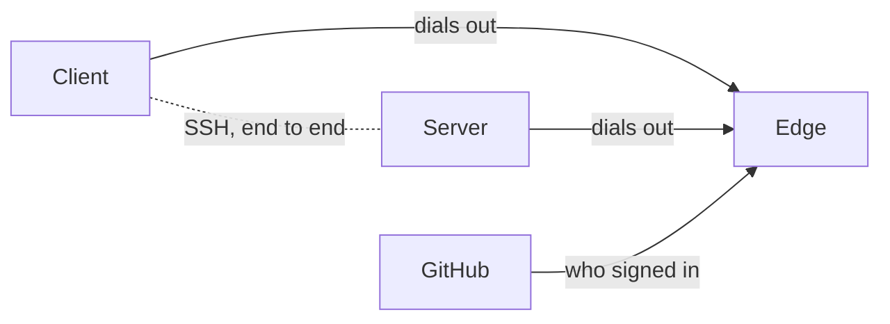

# Edge remote access

An **edge** is a relay that lets members reach a server through a public host
name with a GitHub sign-in. The server and the client both dial out to it, so
a laptop reaches a server with no Tailscale, no open router port and no SSH
key to copy. The project runs one at `https://edge.onaether.dev`, and
`aether-edge` runs your own.

- [Using an edge](#using-an-edge) is for members and server administrators.
- [Running your own edge](#running-your-own-edge) is for operators.

Other ways to reach a server are in [networking.md](networking.md).

## Using an edge

### How it works



The edge splices the two outbound connections. SSH runs end to end between
client and server, so the edge cannot read it. The edge says who signed in; the
server alone decides what that person may do. Tailnet identities, member SSH
keys, invite codes and `aether gui` keep working beside the edge.

| Term | Meaning |
| --- | --- |
| Account | A person signed in to the edge with GitHub, identified by GitHub's numeric user id, never by login or email |
| Device | One client install, with its own device key (not your `~/.ssh` key) and a device token from the edge |
| Server id | 26 characters derived from the server's SSH host key. Clients check the host key against it on every connection |
| Owner | The account that claimed the server at the edge |
| Invitation | A GitHub account that may join with a role. Its join link carries a secret the server checks and the edge never sees |

On the project's edge, `https://auth.onaether.dev` serves sign-in and the
Devices, Servers and Account pages, and `https://edge.onaether.dev` is the relay,
the name you configure clients and servers with. A path asked for on the wrong
host gets `421 Misdirected Request`.

### Turning it on

The edge is off until you turn it on. `aether-server setup` turns on
`https://edge.onaether.dev` when the host has no Tailscale or you turn tailnet
sign-in off, and prints what the edge can see. With tailnet sign-in on, it asks
`Reach this server through the edge too`, defaulting to no. Otherwise use
`aether-server install --edge-url <url> --edge-access <policy>` (it refuses
`--edge-url` without `--edge-access`), or the config keys:

```sh
sudo aether-server config set edge-url https://edge.onaether.dev
sudo aether-server config set edge-access approved-devices
sudo aether-server config set edge-url ""     # off
sudo systemctl restart aether-server          # apply the change
```

`edge-access` defaults to `approved-devices`. The server honours `HTTPS_PROXY`
from `/etc/aether/aether-server.env`.

The server pins the edge's signing key on first connection, so a new host name
for the same edge keeps the pin and the owner. An edge with another key is
refused with `edge key changed` until you run `sudo aether-server edge trust`.
To move to another edge:

```sh
sudo aether-server edge leave                 # unenroll at the old edge, forget its owner
sudo aether-server config set edge-url https://<edge-host>
sudo aether-server edge trust                 # compare the key with the one the edge's operator publishes, type yes
sudo systemctl restart aether-server
sudo aether-server edge claim-code --admin <member id>   # or, from an admin's linked terminal: aether edge connect
```

### Server id and claiming

The server id comes from `<data-dir>/ssh/host_ed25519_key`. Back that file up: a
new host key is a new server that must be claimed and linked again.

Until an account claims it, the edge relays nothing for a server except claim
connections. Setup ends with a claim link,
`aether://claim?edge=...&server=<server id>#<secret>`, and the claim code
`<server id>-<secret>`, valid for 30 minutes and 5 attempts. `sudo aether-server
edge claim-code` prints a new one. It is refused while the server has an owner,
and without `--admin` while it has members.

1. Start the server: `sudo systemctl daemon-reload && sudo systemctl enable
   --now aether-server`.
2. On your computer, open the claim link (the desktop app's Connect step also
   accepts it pasted), or run `aether link --claim <code>`.

The claiming account becomes the owner and an admin, and its device is approved
under either policy, because the code came from the machine's console. A claim
from a device signed in as another account is refused with `this device claims
as github account <subject>, but the edge signed the connection in as github
account <login>; the claim was not attempted`.

On a server that already has members (its first admin joined with an SSH key or
over the tailnet), an admin claims it under **Settings → Remote access → Connect
my GitHub account**, or from a linked terminal:

```sh
aether login --edge <edge url>   # if this machine is not signed in there
aether edge connect
```

This binds your GitHub account to your own member, changes no role, and adds the
edge to the current link. If the server already has an owner it prints `this
server is already connected to <edge url> as github <login>` and changes
nothing. Any other claim on a server with members is refused with `server is
already claimed`. Until the edge has recorded the server, `aether invite
--github|--email`, the Invite dialog and `aether member link` are refused with
`the edge has not recorded this server yet ... connect your GitHub account
first`. If the edge cannot record a claim, `sudo aether-server edge status`
shows `ownership report refused: <reason>`.

### Checking the connection

`sudo aether-server edge status` prints the edge, policy, server id, the
[connector](#mcp-connectors) URL, the pinned edge key, the owner and the
connection. `connection` reads `connected since <time>`, `stale: ...` when the
server process is gone or the edge has not answered for 40 seconds, or `never
connected: ...` when the service has not started since `edge-url` was set. Then
run `sudo systemctl status aether-server` and `sudo journalctl -u aether-server -n
50 --no-pager`. A connected server can still be unreachable for a client: only a
connection opened through the edge tests the whole path.

When the edge's key changed, the server keeps retrying and logs this. Run `edge
trust` only after the edge's operator confirms the new fingerprint:

```
edge key changed: pinned SHA256:<old>, edge presents SHA256:<new>; if the edge's operator rotated its key, or edge-url now names another edge, run `aether-server edge trust`
```

The server has no owner under a key it was not claimed with, so it reports itself
ownerless as it reconnects. An admin's **Connect my GitHub account**, or `edge
claim-code --admin <member id>`, gives it an owner again.

### Signing in and linking

```sh
aether login              # prints an address and a code; confirm the code in the browser
aether servers            # servers your account reaches
aether logout             # revokes this device's token at the edge and deletes it here
```

Confirm only a code you started. `--edge <url>` takes the relay origin; without
it commands use the one edge this machine is signed in to, else
`https://edge.onaether.dev`. The device key `edge-device-key` and the token file
`edge-tokens.json` live in the client's config directory with mode 0600.
`aether servers` shows the access policy the edge reports; the server enforces
its own.

Only a 26-character server id goes through the edge. Any other argument, such as
`my-server`, is an SSH address. A link pins the server id: every later connection,
direct or through the edge, must present a host key that derives it. Ways to link,
safest first:

| Command | Where the id comes from | Who you trust |
| --- | --- | --- |
| `aether link <join link>` | The invitation link an admin sent | The admin and the channel they used |
| `aether link --claim <code>` | The claim link printed on the server's console | Whoever handed it to you |
| `aether link <server id>` | The admin, from Settings → Remote access or `sudo aether-server edge status` | The admin and the channel. The edge cannot substitute another server |
| `aether link --from-edge <server id>` | `aether servers`, which the edge supplies | The edge. One that lists a false id can send your first link to another server |

`--from-edge` shows the server's name, id, host key and policy, then asks `link
and pin this server? [y/N]`. Compare the host key with `sudo ssh-keygen -lf
/var/lib/aether/ssh/host_ed25519_key` on the server. Without a terminal it needs
`--yes`. `--addr host:2222` tries a direct address first (3-second timeout) and
falls back to the edge. The direct path admits approved devices only, so under
`account` a new device works through the edge but not directly until approved.

`aether link` points the repository's `aether` remote at
`<server id>.edge.aether.invalid` and sets `core.sshCommand` to `aether
edge-ssh`, so `git push aether` goes through the edge. If the repository already
sets a different `core.sshCommand`, it prints the line to add instead.

A pending device, or one registered under `account` when the server now
requires approval, fails with:

```
device "dana-laptop", signed in as github account dana, is waiting for approval. An admin approves it from the dashboard's Needs you card, or you do, from an approved device of yours, or with:
  aether device approve <device id>
or on the server:
  sudo aether-server device review
```

If the device would be the server's only admin and that admin has no approved
device, the refusal carries an approval code for `sudo aether-server device
approve <code>` instead.

### Members, invitations and devices

Invitations, device approval and removing access are in
[teams.md](teams.md#through-an-edge). `aether member identities <id>` lists the
GitHub accounts bound to a member.

#### Join page

An invitation's link is `https://<relay host>/join/<server id>/<invitation
id>#<secret>`. Opening it shows a page that opens the desktop app (**Open in
Aether**) and offers the link to **Copy**, or run `aether link <link>`. The
secret is the link's fragment, which a browser never sends, so no request to the
edge carries it. There is no claim page, so no claim secret passes through the
edge.

### Access policies

Each server chooses its policy and enforces it itself. `aether-server setup`
asks `Who may reach this server through the edge?`: `1` is `account`, `2` is
`approved-devices`.

| Policy | Who gets in | What must be compromised for an attacker to get in |
| --- | --- | --- |
| `account` | Any invited member who signs in with GitHub, from any new device, with their role | One of: the member's GitHub account, or the edge (its host, database or signing key). A compromised edge reaches every member of every `account` server on it |
| `approved-devices` | A member whose device a person approved: an admin, the member from an approved device, or the machine's administrator | One of those, and also a person who approves the attacker's device. The **Needs you** card shows the device label, account, key fingerprint and the member and role it admits as |

Choose `account` for one person, or a team that already relies on GitHub
accounts for source access. Choose `approved-devices` for a server holding code
or credentials that must stay protected even if a GitHub account or the edge is
taken over.

Under both, the server maps the account to a member with the usual roles, and
every device is listed and revocable. If you lose every device, under `account`
sign in on a new one. Under `approved-devices` an admin approves the new one, and
an admin with no approved device left gets a code that the machine's
administrator approves.

#### Changing the policy

Only on the server's host. No dashboard action or client command changes it.

```sh
sudo aether-server config set edge-access approved-devices
sudo aether-server device review     # before restarting: see what a switch affects
sudo systemctl restart aether-server
```

Switching changes no device's status. A device registered under `account` is
refused under `approved-devices` with `device "<label>" was admitted by signing
in alone and is waiting for approval: this server now admits approved devices
only`. `device review` asks `approve, revoke or skip? [a/r/S]` for each device,
then lists the member SSH keys and tailnet logins that reach the server whatever
`edge-access` says. Those do not depend on the edge or the policy, and
`edge-url ""` leaves them working.

#### What an attacker can do

| An attacker with | `account` | `approved-devices` |
| --- | --- | --- |
| A member's GitHub account | Signs in and lists the member's servers. Reaches a workspace with the member's role. If the member is an admin, can invite accounts, change roles and transfer ownership, but not approve a device | Signs in and lists servers. The new device is pending and reaches nothing |
| That account plus the join link sent to it | Completes the join with the invited role | A pending device that waits for an admin's click |
| That account without the join link | Refused: `<account> is invited to this server; open the invitation link the admin sent, or run: aether link <link>` | The same |
| A compromised edge or its signing key | Forges a grant for any account and reaches the workspace of every `account` server as any member | Forged grants yield pending devices. It cannot admit one |
| A stolen device key | Reaches the direct address once the device is approved, like an SSH key. Through the edge it also needs the token or the edge | The same |
| A stolen device token | Nothing: the server also requires the device key | Nothing |

Under both, a compromised edge cannot read SSH, impersonate a server to a linked
client (the host key must derive the linked id), or take a claim (the code
travels inside SSH). It can learn who connects to which server and deny service,
and send a first `--from-edge` link to another server ([Signing in and
linking](#signing-in-and-linking)). It can serve a join page whose script reads
an invitation's secret, then accept that one invitation: under `account` with
its role, under `approved-devices` as a pending device. A forged account
deletion removes access and gains none. [MCP connector](#mcp-connectors) traffic
is the exception to end to end encryption, under both policies.

### Revoking access

| Action | Relayed connections | Direct connections with the device key |
| --- | --- | --- |
| `aether member remove <id>`, `aether device revoke <id>` | Closed at once | Closed at once |
| Revoking in `sudo aether-server device review` | Closed within 3 seconds | The same |
| `aether logout`, or revoking on the edge's Devices page | Closed at once | Stay open, and new ones are admitted: the device is still approved on the server |
| Deleting the account ([Deleting an account](#deleting-an-account)) | Closed at once | Closed: each server removes the account's edge devices (when it next connects to the edge, if it is offline) |
| `aether-edge accounts block` or `delete` by the edge's operator | Stay open until they end or the edge restarts | `delete` reaches each server at its next enrollment |

A revocation made on a server works without the edge. To end a device
completely, revoke it on both the edge and the server. A device token never
expires. A sign-in code lasts 10 minutes, an edge session 30 days after last use,
an invitation 7 days and a claim code 30 minutes. If the edge cannot be reached,
`aether logout` keeps the token so you can retry. It never deletes the device key
or a link. With the token revoked, a link fails through the edge with `device
token revoked`, and its `--addr` path still works with the approved device key.
SSH keys and tailnet identities are unaffected.

### During an edge outage

- Servers keep running and reconnect on their own. Running work is untouched.
- Relayed connections drop. Links with `--addr`, tailnet members, member SSH keys,
  invite codes, `aether gui` and the tailnet dashboard work as before.
- Every revocation and approval made on a server works.
- `aether login`, `aether servers`, `aether logout` and account deletion fail with
  the edge's error.

A server reinstalled with a new data directory has a new host key and so a new
id. When the edge has no live registration for the linked id but sees other
servers of your account online, it lists them, and `aether link --from-edge <id>`
links the new one.

### Recovering a GitHub account

Recovering a GitHub account ends the attacker's use of it for new sign-ins and
nothing else. Devices the attacker signed in keep their tokens, which do not
expire, and stay on every server until revoked.

1. Sign in on the edge's Devices page (`https://auth.onaether.dev/devices` on the
   project's edge) and revoke every device you do not recognize.
2. On each server, run `aether device list` and `aether device revoke
   <device-id>` for each unknown device. On the machine, `sudo aether-server
   device review` shows each device with its account and first-seen time.
3. Under `account`, if the account was an admin's, check what an admin could have
   done: `aether member list`, `aether invite list`, and the SSH keys and tailnet
   logins `device review` lists. Revoke with `aether invite revoke <id>` and
   `aether member remove <id>`. An invite code minted by an approved device is a
   file in the server's invites directory until redeemed or expired, and no
   command lists it.
4. If the account was linked to a member while someone else held it, remove the
   account without removing the member. Its devices are revoked and the member,
   role, SSH keys and tailnet identity stay:

   ```sh
   aether member identities <member-id>
   aether member unlink <member-id> github:<user id>
   ```

Under `approved-devices` the attacker's devices are pending and had no access.
Revoke them anyway so nobody approves one by mistake.

### Console recovery

An admin who reached the server only through the edge and lost that account is
restored on the machine. The server must have no owner, as after the owner
deletes their account:

```sh
sudo aether-server edge claim-code --admin <member id>
```

This prints a claim link bound to that admin. The admin opens it signed in with
the account they now use, or runs `aether link --claim <code>`. The server binds
the account to that member, approves the device and becomes owned by that
account. It creates no member and raises no role: a member who is not an admin is
refused (`is collaborator, not an admin; the claim was refused`), as is an account
bound to another member. Find the member id with `aether member list`.

### Ownership and deleting an account

`aether member transfer <member-id>` hands ownership at the edge to another admin
with a linked GitHub account. It fails with `ownership report refused: <reason>`
when the edge refuses or does not answer within 10 seconds, and the server keeps
its previous owner. It is refused while the server is not connected to the edge
or has no owner, or when the target has two linked accounts (remove one with
`aether member unlink`). A transfer never creates an admin or changes a role.

When the owner's identity leaves the server (the member was removed or the account
deleted), the server is **ownerless**. It stays enrolled and keeps relaying for
its members. Give it an owner with **Connect my GitHub account**, `aether edge
connect` or [Console recovery](#console-recovery).

#### Deleting an account

Only the Account page deletes an account (`https://auth.onaether.dev/account` on
the project's edge). It lists the servers the account owns and belongs to, and
needs a GitHub sign-in in this browser from the last 5 minutes plus the account's
login typed back. Otherwise it is refused with `deleting an account needs a
sign-in in this browser from the last 5m0s: sign in again at <url>, then delete it
within 5m0s`. `aether logout --delete-account` lists the same servers and where to
delete.

Transfer ownership of each server the account owns first. Deleting ends the
account's sign-ins and device tokens, and each server removes that identity and
its edge devices (when it next connects, if it is offline). No server loses a
member, role or data. An SSH key or tailnet identity of the same person keeps
working until an admin removes it, and invitations to the login or email stay
until revoked. Signing in again creates a new account that no server knows: link
it with `aether member link`, or an admin invites it, which creates a new member.
Before deleting the only way an admin reaches a server, make sure another admin
exists or that the admin also has an SSH key or tailnet identity there.
Otherwise only the machine's administrator can restore them
([Console recovery](#console-recovery)).

### The dashboard

The edge serves no dashboard. A dashboard that reaches a server through an edge
is `aether gui` on a computer, or the [Android app](install.md#android-app) in
Edge mode ([local-gateway.md](local-gateway.md)). A phone without that mode
reaches a dashboard over a tailnet
([networking.md](networking.md#the-dashboard)).

### MCP connectors

A server's MCP connector lets ChatGPT or Claude list, launch, message and stop
runs as a member ([connectors.md](connectors.md)). The edge forwards requests at
`https://<relay host>/mcp/<server id>`, which `aether mcp` and `sudo
aether-server edge status` print, and the server authenticates each one.

TLS ends at the edge, because ChatGPT and Claude connect only to a host with a
public certificate. A compromised edge, while it runs, can read and alter every
connector request and answer, including tokens and the pairing code typed on the
consent page, and act as that connector's member under either policy.

The edge answers `404 unknown server`, `503 server is not connected to the edge`,
`409 server is connected to the edge but not claimed` (retry), `501 server <name>
(<id>) runs aether-server <version>, which has no MCP endpoint; upgrade it: sudo
aether-server update`, `403 this server does not serve MCP connectors`, `503 this
server already has 8 MCP connector requests in progress through the edge; retry
shortly` and `413 request body is over the edge's limit of 1048576 bytes`.

### Limits

- 48 concurrent SSH connections and 8 MCP connector requests per server, and 16
  connections per device.
- 3 unclaimed servers per client address, each dropped after 30 minutes. Claim
  connections: 5 at once, then 1 a minute per address and per account.
- 1000 members and open invitations per server.
- Login and email invitations match only within 24 hours of the account's last
  GitHub sign-in.

## Running your own edge

`aether-edge serve` is one static Linux binary (amd64 or arm64) with an embedded
SQLite database. Run it with a systemd unit ([Installing](#installing)) or as the
image `ghcr.io/3xdevops/aether-edge` ([In a container](#in-a-container)). It
answers on two host names, written `<signin-host>` and `<relay-host>` below (such
as `auth.example.com` and `edge.example.com`). Either a reverse proxy terminates
TLS and passes plain HTTP to a loopback port (`--proxy-listen`; the packaged unit
expects nginx), or the edge listens on `:443` itself with Let's Encrypt
certificates for its two names (`--listen`, the default).

### Requirements

- A Linux host with systemd 248 or newer, or a container runtime, and a public
  IPv4 address. The edge limits requests by client address, so no other proxy or
  load balancer may sit between clients and the edge's own proxy.
- Outbound HTTPS to `github.com`, `api.github.com` and Let's Encrypt.
- Two DNS names, a GitHub OAuth app, and egress bandwidth ([Egress
  budget](#egress-budget)).

### GitHub OAuth app

In the account or organization that should own it, open **Settings → Developer
settings → OAuth Apps → New OAuth App**. The edge asks for the scope `user:email`.

| Field | Value |
| --- | --- |
| Application name | `Aether` |
| Homepage URL | `https://<signin-host>` |
| Authorization callback URL | `https://<signin-host>/signin/github/callback` (must match exactly) |
| Enable Device Flow | Off: the edge runs its own device flow |

Generate a client secret and keep it for [Installing](#installing).

### DNS

Point `<signin-host>` and `<relay-host>` at the edge with A records (and AAAA for
IPv6), and add a CAA record `0 issue "letsencrypt.org"` to each, without
`accounturi`. Use no wildcard record. Never proxy these names through a CDN: it
would see sign-in cookies, device tokens and OAuth codes in plain text, hide the
client address the edge limits by, and cut the relay's long-lived WebSockets.

### Behind a reverse proxy

With `--proxy-listen 127.0.0.1:8443` (`AETHER_EDGE_PROXY_LISTEN`) the edge serves
plain HTTP and obtains no certificate. The origins stay `https://`.
[`packaging/nginx/aether-edge.conf.example`](../packaging/nginx/aether-edge.conf.example)
has one `server` block per host name passing requests to `127.0.0.1:8443`. It
sets `Host $host`, `X-Forwarded-For $remote_addr` (never the client's own
header, or a client could choose its address), the WebSocket `Upgrade` and
`Connection` headers, 7-day read and send timeouts, and no buffering on the relay
host. [Setting up nginx](#setting-up-nginx) installs it.

A request from the proxy without the header is refused with `400`, as is a local
`curl http://127.0.0.1:8443/healthz`:

```
the proxy in front of this edge sent no X-Forwarded-For header; configure the proxy with `proxy_set_header X-Forwarded-For $remote_addr`
```

A proxy on another host or in another container reaches the edge from its own
address. Name it with `--trusted-proxies` (`AETHER_EDGE_TRUSTED_PROXIES`), such as
`10.0.0.5/32`; `--proxy-listen` may then be any address. A request from any other
peer, loopback included, is refused with `403`:

```
this edge serves requests only through its reverse proxy, and 198.51.100.7 is not in the edge's --trusted-proxies
```

Every listed peer can set the client address the edge rate-limits by. List only
the proxies' own addresses, let nothing else reach `--proxy-listen`, and do not
publish it from a container. `0.0.0.0/0` and `::/0` are refused.

### Without a reverse proxy

Delete `AETHER_EDGE_PROXY_LISTEN` from the environment file and set
`AETHER_EDGE_ACME_EMAIL`. The edge obtains a certificate for each name with
TLS-ALPN-01 on `:443` and caches them in `<data>/acme/`. Leave port 80 closed.
Give the unit the capability to bind `:443` with `sudo systemctl edit
aether-edge`:

```ini
[Service]
AmbientCapabilities=CAP_NET_BIND_SERVICE
CapabilityBoundingSet=CAP_NET_BIND_SERVICE
```

A failed renewal is reported nowhere. Probe the expiry from outside
([Monitoring](#monitoring)).

### Installing

Download the binary for the host's architecture from a release, check it, and
install it with the unit and the environment file (`<arch>` is `amd64` or
`arm64`):

```sh
base=https://github.com/3xDevOps/Aether/releases/download/<release-tag>
curl -fLO "$base/aether-edge-linux-<arch>"
curl -fLO "$base/checksums.txt"
sha256sum --check --ignore-missing checksums.txt
sudo install -m 0755 aether-edge-linux-<arch> /usr/local/bin/aether-edge

src=https://raw.githubusercontent.com/3xDevOps/Aether/<release-tag>/packaging
sudo curl -fsSL -o /etc/systemd/system/aether-edge.service "$src/systemd/aether-edge.service"
sudo useradd --system --home-dir /var/lib/aether-edge --no-create-home --shell /usr/sbin/nologin aether-edge
sudo install -d -m 0700 /etc/aether-edge
sudo curl -fsSL -o /etc/aether-edge/aether-edge.env "$src/edge/aether-edge.env.example"
sudo chmod 0600 /etc/aether-edge/aether-edge.env
```

Edit `/etc/aether-edge/aether-edge.env` and replace every `<...>`. Put the GitHub
client secret in a root-only file (paste it, then press Ctrl-D, so it lands in no
shell history):

```sh
sudo sh -c 'umask 077 && cat > /etc/aether-edge/github-client-secret'
```

The unit runs the edge as the `aether-edge` user with no capabilities and passes
the secret in as a systemd credential. If the file is missing the start fails with
`aether-edge: --github-client-id is set but ... holds no secret`.

### In a container

The release publishes `ghcr.io/3xdevops/aether-edge` for linux/amd64 and
linux/arm64, running as uid and gid 65532. `<release-tag>` never moves. `latest`
moves with every release, alphas included, and can migrate the database on an
unattended restart, so keep it out of production. `stable` moves to a release an
admin promoted after it qualified and soaked
([CONTRIBUTING.md](../CONTRIBUTING.md#releases)). In production pin `stable` by
digest (`ghcr.io/3xdevops/aether-edge:stable@sha256:<digest>`, from `docker
buildx imagetools inspect ghcr.io/3xdevops/aether-edge:stable`) and change it
deliberately.

Put the edge and the proxy on one container network, publish only the proxy's
ports, give the proxy a fixed address and trust that address alone, never the
network's subnet. The proxy passes both host names to `http://aether-edge:8443`:

```sh
docker volume create aether-edge-data
docker run -d --name aether-edge --network <network> \
  --restart unless-stopped --stop-timeout 30 --read-only \
  -v aether-edge-data:/var/lib/aether-edge \
  -v <secret-file>:/run/secrets/github-client-secret:ro \
  -e AETHER_EDGE_SIGNIN_ORIGIN=https://auth.example.com \
  -e AETHER_EDGE_RELAY_ORIGIN=https://edge.example.com \
  -e AETHER_EDGE_PROXY_LISTEN=:8443 \
  -e AETHER_EDGE_TRUSTED_PROXIES=<proxy-address>/32 \
  -e AETHER_EDGE_GITHUB_CLIENT_ID=<github-client-id> \
  -e AETHER_EDGE_GITHUB_CLIENT_SECRET_FILE=/run/secrets/github-client-secret \
  ghcr.io/3xdevops/aether-edge:<release-tag>@sha256:<digest>
```

With the edge's own certificates, replace the proxy variables with `-e
AETHER_EDGE_LISTEN=:8443 -e AETHER_EDGE_ACME_EMAIL=<email> -p 443:8443`. The
published port must keep the client's source address: a userland port forwarder
(some rootless runtimes) replaces it, and every client then shares one address's
limits.

- The data directory `/var/lib/aether-edge` is a volume that must outlive every
  container: a named volume, or a directory owned by uid 65532 (`chown -R
  65532:65532 <dir> && chmod 0700 <dir>`). A container started without it makes
  a new signing key, which every server refuses with `edge key changed`, and
  every client must run `aether login` again.
- The client secret is a file mounted read-only, readable by uid 65532. Never
  put it in an image layer or a committed file. `AETHER_EDGE_GITHUB_CLIENT_SECRET`
  works, but `docker inspect` shows it.
- Docker's 10-second stop grace period is too short: keep `--stop-timeout 30`.
- The image's `HEALTHCHECK` runs `aether-edge healthcheck`. Keep `--ready` out of
  it. Metrics listen on loopback inside the container (scrape with `--network
  container:aether-edge`). Operator commands run as `docker exec <container>
  aether-edge servers list`.

The edge refuses a data directory it cannot use, with the fix in the message:

```
aether-edge: data directory /var/lib/aether-edge (uid 0, gid 0, mode 0755) is not writable by uid 65532, the user aether-edge runs as: permission denied; give that user write access as the directory's owner or through its group, or name another with --data or AETHER_EDGE_DATA
```

#### Verifying an image

Before you run a new digest, ask the edge you already run whether a release signed
it ([Verified releases](install.md#verified-releases)) and whether the upgrade
needs manual steps. It exits 0 to go ahead, or 3 with each `aether-edge: hold:
...` reason on stderr:

```sh
docker exec <container> aether-edge release-check \
  --tag <release-tag> --digest sha256:<digest> --from <running-tag>
```

A digest that `stable` names also carries a promotion attestation from
`promote-edge.yml` on `main`. A host that follows `stable` requires it. The
printed predicate must name `stable`, the digest and the tag `release-check`
verified:

```sh
cosign verify-attestation --new-bundle-format \
  --type https://github.com/3xDevOps/aether/edge-promotion/v1 \
  --certificate-oidc-issuer https://token.actions.githubusercontent.com \
  --certificate-identity https://github.com/3xDevOps/aether/.github/workflows/promote-edge.yml@refs/heads/main \
  ghcr.io/3xdevops/aether-edge@sha256:<digest>
```

### Configuration

Every option is a flag whose default comes from the environment variable beside
it. The unit starts `aether-edge serve` with no flags, so the environment file
([`packaging/edge/aether-edge.env.example`](../packaging/edge/aether-edge.env.example))
is the whole configuration. The edge checks its options before it binds anything
and names the problem, such as `no GitHub OAuth app is configured; set
--github-client-id and its client secret`.

| Flag | Environment | Default |
| --- | --- | --- |
| `--signin-origin` | `AETHER_EDGE_SIGNIN_ORIGIN` | Required: `https://<signin-host>` |
| `--relay-origin` | `AETHER_EDGE_RELAY_ORIGIN` | Required: `https://<relay-host>`, another host than the sign-in origin's |
| `--proxy-listen` | `AETHER_EDGE_PROXY_LISTEN` | None; `127.0.0.1:8443` in the environment file |
| `--trusted-proxies` | `AETHER_EDGE_TRUSTED_PROXIES` | None: the proxy is on loopback |
| `--listen` | `AETHER_EDGE_LISTEN` | `:443`, with the edge's own certificates. Unused with `--proxy-listen` |
| `--data` | `AETHER_EDGE_DATA` | `/var/lib/aether-edge` |
| `--metrics-listen` | `AETHER_EDGE_METRICS_LISTEN` | `127.0.0.1:9464`, loopback only |
| `--acme-email` | `AETHER_EDGE_ACME_EMAIL` | None |
| `--acme-directory` | `AETHER_EDGE_ACME_DIRECTORY` | `https://acme-v02.api.letsencrypt.org/directory` |
| `--egress-budget` | `AETHER_EDGE_EGRESS_BUDGET` | `0`: bytes per UTC month, a plain integer. 0 means none |
| `--github-client-id` | `AETHER_EDGE_GITHUB_CLIENT_ID` | Required |
| `--github-client-secret-file` | `AETHER_EDGE_GITHUB_CLIENT_SECRET_FILE` | None; the unit sets it |
| `--dev-listen` | `AETHER_EDGE_DEV_LISTEN` | None. Plain HTTP on a loopback address for local testing |
| none | `AETHER_EDGE_GITHUB_CLIENT_SECRET` | None. The secret itself, instead of a file; setting both is refused |

### Firewall

Allow inbound TCP 443 (IPv4 and IPv6), TCP 80 for certbot behind nginx, and SSH
on TCP 22, and refuse everything else (`sudo ufw default deny incoming`, `sudo ufw
allow` each port, `sudo ufw enable`). Without a reverse proxy, leave port 80
closed.

> [!WARNING]
> Never limit port 22 to a source address in `ufw`. When your address changes,
> SSH times out and the way back in is a rebuild from a snapshot. Limit port 22
> in the provider's firewall instead. With port 22 open, SSH must refuse
> passwords: `sudo sshd -T | grep -E '^(password|kbdinteractive)authentication'`
> must print `no` on both lines. Open a second SSH connection before you close the
> session that ran `ufw enable`.

### Setting up nginx

Behind a reverse proxy, set up nginx before the first start. The commands are for
Debian or Ubuntu. Replace `auth.example.com` and `edge.example.com` with your
`<signin-host>` and `<relay-host>`, and `<email>` with the contact for the Let's
Encrypt account.

1. Install nginx and certbot:

   ```sh
   sudo apt-get update
   sudo apt-get install nginx certbot python3-certbot-nginx
   ```

2. Get a certificate for each host name. Port 80 must be open. The deploy hook
   reloads nginx after each renewal:

   ```sh
   sudo certbot certonly --nginx --email <email> --agree-tos -d auth.example.com --deploy-hook "systemctl reload nginx"
   sudo certbot certonly --nginx --email <email> --agree-tos -d edge.example.com --deploy-hook "systemctl reload nginx"
   sudo certbot renew --dry-run
   ```

3. Check that nothing else listens on port 8443. The command prints only its
   header line when the port is free:

   ```sh
   sudo ss -ltnp 'sport = :8443'
   ```

   To use another port, change `proxy_pass` in both `server` blocks and
   `AETHER_EDGE_PROXY_LISTEN` in `/etc/aether-edge/aether-edge.env`.

4. Install the two `server` blocks with your host names, then check and reload
   nginx. `nginx -t` prints `syntax is ok` and `test is successful`:

   ```sh
   src=https://raw.githubusercontent.com/3xDevOps/Aether/<release-tag>/packaging
   curl -fsSL "$src/nginx/aether-edge.conf.example" |
     sed -e 's/<signin-host>/auth.example.com/g' -e 's/<relay-host>/edge.example.com/g' |
     sudo tee /etc/nginx/conf.d/aether-edge.conf >/dev/null
   sudo nginx -t
   sudo systemctl reload nginx
   ```

5. When the edge will serve more than a few hundred connections, raise
   `worker_connections` in the `events` block of `/etc/nginx/nginx.conf` above
   the 768 Debian and Ubuntu ship with, then run `sudo nginx -t` and `sudo
   systemctl reload nginx` again.

### First start and checks

```sh
sudo systemd-analyze verify /etc/systemd/system/aether-edge.service   # prints nothing when the unit is valid
sudo systemctl daemon-reload
sudo systemctl enable --now aether-edge
journalctl -u aether-edge -f
```

Check from another machine:

1. `curl -fsS https://<signin-host>/healthz` and `curl -fsS
   https://<relay-host>/healthz` each print `ok`.
2. `curl -sS -H 'Aether-Edge-Version: 1' https://<relay-host>/v1/edge` prints the
   signing key and its fingerprint. `sudo ssh-keygen -lf
   /var/lib/aether-edge/edge_key` on the edge prints the same one. Publish it
   where server operators compare it during `aether-server edge trust`, and back
   the key up now.
3. On a laptop, `aether login --edge https://<relay-host>`, confirm the code,
   then `aether servers --edge https://<relay-host>`.
4. Enroll a canary server on another machine and keep it running:

   ```sh
   sudo aether-server install --edge-url https://<relay-host> --edge-access approved-devices
   sudo systemctl daemon-reload && sudo systemctl enable --now aether-server
   sudo aether-server edge status        # edge key matches step 2; connection: connected since ...
   sudo aether-server edge claim-code
   ```

   Then `aether link --claim <code> --edge https://<relay-host>` and `aether
   runs` on the laptop.

### Monitoring

The metrics listener serves Prometheus text at `/metrics` on loopback; scrape it
on the edge host or over an SSH tunnel. Alert on `aether_edge_throttled` equal to
1 (the egress budget is spent), on `aether_edge_servers{state="claimed"}` falling
to near zero, and on a sustained rise in one
`aether_edge_refusals_total{reason="..."}`. `aether_edge_egress_month_bytes` and
`aether_edge_github_errors_total` are also exported.

`/healthz` (`aether-edge healthcheck`) is liveness. `/readyz` (`aether-edge
healthcheck --ready`) answers 200 when the database answers within a second, the
public listener serves and the edge is not stopping, and 503 otherwise. From
outside the edge's network, probe `/healthz` on both names and the certificate
expiry (`openssl x509 -noout -checkend 1814400`).

The edge logs to the journal (`journalctl -u aether-edge`), including client
addresses for refused enrollments and failed TLS handshakes. Those are personal
data: set `MaxRetentionSec=` in `/etc/systemd/journald.conf.d/retention.conf`,
restart `systemd-journald`, and state the period in your privacy notice
([privacy.md](privacy.md#what-an-edge-stores)). nginx keeps its own access log in
`/var/log/nginx/access.log`.

### Egress budget

`--egress-budget` counts the bytes the relay copies, in both directions, per UTC
month. Once the count reaches the budget, all relayed connections together are
paced to 256 KiB/s (at most about 650 GiB more in a 31-day month) until the next
month. Nothing is cut off. It does not count TLS framing, so a provider meters
more than `aether_edge_egress_month_bytes` shows. For a provider ceiling of C bytes
a month, set the budget below C minus 700 GiB (751619276800 bytes).

### Backup and recovery

`/var/lib/aether-edge` holds `edge.db` (accounts, devices, claimed servers and
owners, owed deletions and blocks; secrets only as SHA-256 hashes), `edge_key`
(the Ed25519 signing key, mode 0600), `backups/`, lock files and, with the
edge's own certificates, `acme/`. Keep it on a local filesystem: `flock` does not
lock across NFS.

Copy `edge_key` once, offline, right after the first start. It never changes,
and whoever holds a copy can act as the edge, so encrypt it. If it is lost while
`edge.db` holds accounts or servers, the edge does not start (`signing key ... is
missing, and edge.db holds accounts or servers that pin it`): put it back with
`aether-edge restore --key <key file> <database backup>`. With no copy, start over
with a new data directory, and every server refuses the new key with `edge key
changed` until `sudo aether-server edge trust`.

Back `edge.db` up daily. `aether-edge backup` copies a consistent snapshot while
the edge runs, to a directory, a new file, or `-` for standard output;
`--with-key` copies `edge_key` too:

```sh
sudo install -d -o aether-edge -m 0700 /var/backups/aether-edge
sudo -u aether-edge aether-edge backup /var/backups/aether-edge/
docker exec aether-edge aether-edge backup - > edge-$(date -u +%Y%m%d).db
```

`backup` never removes old copies, and a full volume stops the next upgrade, so
rotate them and copy them off the machine. A lost `edge.db` forgets every
account, device token and owner: each client runs `aether login` again, and each
server drops its owner and logs ``edge: the edge does not know this server's
owner; claim it again with a code from `aether-server edge claim-code` ``.
Members, roles and devices live on the servers and survive. Restoring an older
backup brings back device tokens revoked since; a device revoked on a server
stays revoked there.

Also keep `/etc/aether-edge/` and, behind nginx, `/etc/letsencrypt/` and
`/etc/nginx/conf.d/aether-edge.conf`, or the steps to recreate them.

To restore, stop the edge and run `aether-edge restore` as its user. It checks
the copy, saves the current database to `backups/edge-before-restore-<UTC
time>.db` and puts the copy in place. `--key <file>` restores `edge_key` too. With
the edge running it is refused: `another aether-edge process holds the lock: ...
stop it first`.

```sh
sudo systemctl stop aether-edge
sudo -u aether-edge aether-edge restore /var/lib/aether-edge/backups/<backup>.db
sudo systemctl start aether-edge
```

### Upgrades

```sh
sudo -u aether-edge aether-edge backup /var/lib/aether-edge/backups/
# download and check the new binary as in Installing, then:
sudo install -m 0755 aether-edge-linux-<arch> /usr/local/bin/aether-edge
sudo systemctl restart aether-edge
```

In a container, back up with `docker exec <container> aether-edge backup
/var/lib/aether-edge/backups/` and start the new tag's container with the same
volume. Fetch the new release's unit and environment example too, and compare them
with yours. Relayed connections drop for a few seconds and runs are unaffected.
Upgrade the edge before its servers: an older server or client is refused with
`upgrade required: <minimum>`.

The database migrates forward on start, after the edge copies `edge.db` to
`backups/edge-v<from>-v<to>-<UTC time>.db`. Without a good copy (usually a full
disk or an unwritable `backups/`) it does not migrate and exits with `the edge
does not migrate without a verified backup`. An older binary can refuse a migrated
database, and the error names the backup to restore. To roll back, stop the edge,
restore that backup with the new binary or image (older releases have no
`restore`), then start the older one. Writes made since the upgrade are lost. To
check first, run `docker run --rm -v <data>:/var/lib/aether-edge <old image> schema
--json` and restore the backup when `supported` is below `compat_floor`.

### Automatic updates

`aether-edge-update` ([`scripts/edge-update.sh`](../scripts/edge-update.sh))
updates an edge that runs in Docker Compose to the newest release on a channel.
A systemd timer runs it daily at 04:00 UTC with up to an hour's random delay. It
never downgrades and never runs a digest that a signed release does not name.
Before it switches, it checks with `cosign` that `promote-edge.yml` on `main`
promoted the digest (except on `latest`), runs `aether-edge release-check` from
the running image, and backs the database up to
`backups/pre-update-<version>-<UTC time>.db`. A blocking manual step holds the
update: it exits 3 and changes nothing. After `docker compose up -d --wait` it
checks that the edge is ready, serves the same key fingerprint and gets its
claimed servers back (within 10%). If a check fails it rolls back, restoring the
backup only when the old release cannot run the migrated database, and skips
that digest from then on.

Logs are in `journalctl -u aether-edge-update`. It needs Docker with Compose,
`curl`, `flock`, `jq` 1.6 or later and [cosign](https://github.com/sigstore/cosign)
3 on the host, and the edge running from
[`packaging/edge/compose.yaml`](../packaging/edge/compose.yaml) in
`/opt/aether-edge` behind Traefik on the external network `proxy`. Give Traefik a
fixed address, put it in `AETHER_EDGE_TRUSTED_PROXIES`, and keep
`forwardedHeaders.trustedIPs` and `forwardedHeaders.insecure` unset on the entry
point the edge uses.

At the release tag you install, copy `scripts/edge-update.sh` to
`/usr/local/sbin/aether-edge-update`, `packaging/edge/aether-edge-update.env.example`
to `/etc/aether-edge-update.env` (set `AETHER_EDGE_UPDATE_RELAY_URL`; the file
documents the other settings, such as `AETHER_EDGE_UPDATE_CHANNEL`, default
`stable`), and the three `aether-edge-update*` units from `packaging/systemd/` to
`/etc/systemd/system/`. Pin the running digest, check it, and start the timer:

```sh
echo 'AETHER_EDGE_DIGEST=sha256:<digest>' | sudo tee /opt/aether-edge/.env
sudo aether-edge-update --check            # verifies the running digest; changes nothing
(cd /opt/aether-edge && sudo docker compose up -d --wait aether-edge)
sudo systemctl daemon-reload
sudo systemctl enable --now aether-edge-update.timer aether-edge-update-recover.service
```

Without cosign or jq `--check` fails with `cosign not found` or `jq not found`.
An edge whose image predates `version --json`, `release-check`, `backup` and
`schema` makes every run exit 1 with `<image>@<digest> predates aether-edge ...`.
Upgrade it by hand once ([First upgrade](#first-upgrade)). To be told about
failures, add `OnFailure=` to the service.

#### First upgrade

In `/opt/aether-edge`, after checking the new digest's promotion attestation as
in [Verifying an image](#verifying-an-image):

```sh
sudo docker compose stop aether-edge
sudo cp -a data data.pre-update
sudo sed -i 's/^AETHER_EDGE_DIGEST=.*/AETHER_EDGE_DIGEST=sha256:<digest>/' .env
sudo docker compose up -d --wait aether-edge
```

`data.pre-update` is the copy to restore if the release fails. From then on the
updater does the rest.

#### When an update stops

- A `held` update needs a manual step. Read it in the journal (the
  `aether-edge: hold: <reason>` lines), take it, then run `sudo aether-edge-update
  --manual-steps-done`. A hold because the running release is older than
  `min_upgrade_from` is refused with `--manual-steps-done passes only blocking
  manual steps`: upgrade by hand to a release at or above it first.
- A `broken` state means the rollback failed, and every run exits 1 with
  `state is broken since <time>: <reason>`. Run the edge on a release you trust
  (put its digest in `.env`, restore a backup first if `schema --json` asks for
  it, then `docker compose up -d --wait aether-edge`) and delete
  `/var/lib/aether-edge-update/state`.
- A digest in `/var/lib/aether-edge-update/failed` is skipped on every run. Delete
  its line to try it again.
- A host that reboots mid-update is recovered at boot by
  `aether-edge-update-recover.service`, or by `sudo aether-edge-update --recover`.

`sudo aether-edge-update --rollback` returns to the previous release. If that
release cannot run the migrated database it changes nothing and exits 1 with the
backup's age, because restoring loses every account, device and server change
since. To roll back anyway, add `--restore-backup`.

### Operator commands

Run them as the edge's user: they refuse any other user than the owner of
`edge.db`. `--data` (default `AETHER_EDGE_DATA`, else `/var/lib/aether-edge`) goes
before the argument. They never migrate while an edge runs, so use the running
edge's binary or image, as `docker exec <container> aether-edge servers list`
does. None grants anything: no command approves a device, records an owner or
admits an account to a server.

```sh
sudo -u aether-edge aether-edge servers list
sudo -u aether-edge aether-edge servers remove <server id>
sudo -u aether-edge aether-edge servers block <server id>
sudo -u aether-edge aether-edge servers unblock <server id>
sudo -u aether-edge aether-edge accounts list
sudo -u aether-edge aether-edge accounts block github:<user id>
sudo -u aether-edge aether-edge accounts unblock github:<user id>
sudo -u aether-edge aether-edge accounts delete github:<user id>
```

| Command | Effect |
| --- | --- |
| `servers remove` | Forgets the server's claim and directory and refuses new connections. The server learns it is unclaimed when it next connects, and its administrator claims it again with a new code |
| `servers block` | Does what `remove` does, and refuses the id at enrollment with `server is blocked by this edge's operator` |
| `accounts block` | Deletes the account's sessions, device tokens and pending sign-ins, and refuses its sign-ins with `account is blocked by this edge's operator`. Servers it owns stay claimed |
| `accounts delete` | What the person's own deletion does, except that it closes no live connection and each server receives the deletion at its next enrollment. A block stays |

`servers unblock` and `accounts unblock` lift a block. Connections already open
stay up until they end or the edge restarts (`sudo systemctl restart
aether-edge`). A server id comes from a host key anyone can generate, so blocking
an id stops that one server, and a blocked person can sign in with another GitHub
account. Anyone who signs in can claim a server and relay SSH to it. When a server
or an account misuses the relay, block it.
