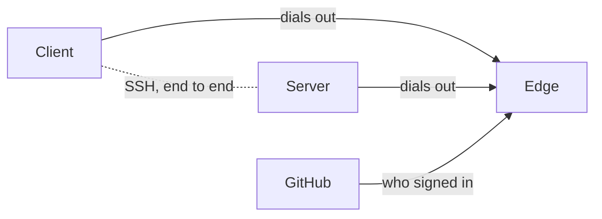

# Edge remote access

An **edge** is a relay that lets members reach a server through a public host
name with a GitHub sign-in. The server and the client both dial out to it, so
a laptop reaches a server with no Tailscale, no open router port and no SSH
key to copy. The project runs one at `https://edge.onaether.dev`, and
`aether-edge` runs your own.

This guide has two halves:

- [Using an edge](#using-an-edge) is for members and server administrators.
- [Running your own edge](#running-your-own-edge) is for operators.

For the other ways to reach a server, see [networking.md](networking.md).

## Using an edge

### How it works



The edge splices two outbound connections. SSH runs end to end between the
client and the server, so the edge cannot read it. The edge says who signed
in. The server alone decides what that person may do: roles, membership and
device status are always the server's own decision. Tailnet identities,
member SSH keys, invite codes and `aether gui` keep working beside the edge.

Terms used below:

- An **account** is a person signed in to the edge with GitHub. It is keyed by
  GitHub's numeric user id, so a login or email does not identify an account.
- A **device** is one client install. It holds its own device key (not your
  `~/.ssh` key) and a device token from the edge.
- The **server id** is 26 characters derived from the server's SSH host key.
  Clients check the host key against it on every connection.
- The **owner** is the account that claimed the server at the edge.
- The **access policy** is the server's `edge-access` setting
  ([Access policies](#access-policies)).
- An **invitation** names a GitHub account that may join with a role. Its
  **join link** carries a secret the server checks and the edge never sees.

The edge answers on two host names. On the project's edge,
`https://auth.onaether.dev` serves sign-in pages and the Devices, Servers and
Account pages. `https://edge.onaether.dev` serves the relay. Clients and
servers are configured with the relay name. A path asked for on the wrong host
gets `421 Misdirected Request`.

### Turning it on

The edge is off until you turn it on. `aether-server setup` offers it. If the
host has no tailscaled, or you answer that people will not reach the server
over the tailnet, setup turns on `https://edge.onaether.dev` and prints what
the edge can see. On a tailnet it asks, defaulting to no. Otherwise use
`aether-server install --edge-url <url> --edge-access <policy>` or the config
keys:

```sh
sudo aether-server config set edge-url https://edge.onaether.dev
sudo aether-server config set edge-access approved-devices
sudo aether-server config set edge-url ""     # off
sudo systemctl restart aether-server          # apply the change
```

| Setting | Default |
| --- | --- |
| `edge-url` | Empty: the edge is off |
| `edge-access` in interactive setup | None: setup asks until you answer `1` or `2` |
| `edge-access` missing from the config | `approved-devices` |
| `aether-server install --edge-url <url>` without `--edge-access` | Refused: `--edge-url turns the edge on and needs --edge-access: account (...) or approved-devices (...)` |

The server keeps one outbound connection to the edge and reconnects on its
own. It honours `HTTPS_PROXY` from `/etc/aether/aether-server.env`.

The server trusts an edge by its signing key, not its host name. It pins the
key on first connection. A new host name for the same edge keeps the pin and
the owner. An edge with another key is refused with `edge key changed` until
you run `sudo aether-server edge trust`. To move to another edge:

```sh
sudo aether-server edge leave                 # unenroll at the old edge, forget its owner
sudo aether-server config set edge-url https://<edge-host>
sudo aether-server edge trust                 # compare the key with the one the edge's operator publishes, type yes
sudo systemctl restart aether-server
sudo aether-server edge claim-code --admin <member id>   # or, from an admin's linked terminal: aether edge connect
```

### Server id and claiming

The server id comes from `<data-dir>/ssh/host_ed25519_key`. Back that file up:
a new host key is a new server that must be claimed and linked again.

Until an account claims it, the edge relays nothing for a server except claim
connections. Setup ends with a claim link:

```
edge: https://edge.onaether.dev
edge access: approved-devices
server id: <server id>
edge key: pinned when the server first connects; `aether-server edge status` shows it
claim link: aether://claim?edge=https%3A%2F%2Fedge.onaether.dev&server=<server id>#<secret> (valid until 3:04PM, 5 attempts)

next:
  1. start the server on this machine:
       sudo systemctl daemon-reload && sudo systemctl enable --now aether-server
  2. on your computer, open the claim link above with the Aether app, or paste it
     into the app's Connect page; in a terminal:
       aether link --claim <server id>-<secret>
  3. to run agents from ChatGPT or Claude, on that computer:
       aether mcp
```

The claim code is `<server id>-<secret>`. It lasts 30 minutes and 5 attempts.
`sudo aether-server edge claim-code` prints a new one, and is refused while
the server has an owner, and without `--admin` while it has members.

1. Start the server first. The claim opens an SSH connection through the edge
   and presents the code only after the server's host key has proved the id.
2. On your computer, open the claim link (the desktop app opens it at the
   Connect step, which also accepts it pasted), or run
   `aether link --claim <code>`.

The claiming account becomes the server's owner and an admin, and its device
is approved under either policy, because the code came from the machine's
console. Before it dials, the command prints the account the claim is for.
A claim from a device that signed in as another account is refused with
`this device claims as github account <subject>, but the edge signed the
connection in as github account <login>; the claim was not attempted`.

**A server that already has members** (its first admin joined with an SSH key
or over the tailnet) is claimed by one of its admins. In the dashboard use
**Settings → Remote access → Connect my GitHub account**, or from a linked
terminal:

```sh
aether login --edge <edge url>   # if this machine is not signed in there
aether edge connect
```

```
connecting server <server id> as <login> (github), the account <edge host> reported when this device signed in
connected server <server id> to <edge host> as <login> (github); this device is approved
linked to server <server id> at <addr>, then through <edge host> as <name> (admin)
git remote aether -> <git url>
```

This binds the signed-in GitHub account to your own member. It adds no member
and changes no role. `aether edge connect` keeps the current link, adds the
edge to it and moves the clone's `aether` remote to the edge host. If the
remote cannot be moved, the command ends with `the link is saved, but the
clone's aether remote was not updated: ...`. On a server that already has an
owner it prints `this server is already connected to <edge url> as github
<login>` and changes nothing. Any other claim on a server with members is
refused with `server is already claimed`.

While the edge has not recorded the server, `aether invite --github|--email`,
the Invite dialog and `aether member link` are refused, because no invitation
could be used:

```
member.invitation.create: the edge has not recorded this server yet, so it relays nothing for it and keeps no directory; connect your GitHub account first: Settings › Remote access › Connect my GitHub account in the dashboard, or aether edge connect
```

If the edge cannot record a claim, it closes the connection with `ownership
report refused: <reason>`, which `sudo aether-server edge status` shows. The
server reconnects and learns whether the edge holds it as claimed.

### Checking the connection

`sudo aether-server edge status` prints the edge, policy, server id,
[connector](#mcp-connectors) URL, pinned edge key, owner and connection state:

```
edge         https://edge.onaether.dev
edge access  approved-devices
server id    <server id>
connector    https://edge.onaether.dev/mcp/<server id>  (add it to ChatGPT or Claude; get a code: aether mcp)
edge key     SHA256:<fingerprint>
owner        github <login> (subject <user id>)
connection   connected since <time>; the edge last answered 12s ago
measures     the server->edge control connection; it does not prove clients can reach the server
```

`connection` also reads `stale: ...` when the server process is gone or the
edge has not answered for 40 seconds, and `never connected: ...` when the
service has not started since `edge-url` was set. In both cases run `sudo
systemctl status aether-server` and `sudo journalctl -u aether-server -n 50
--no-pager`. A server that is connected can still be unreachable for a
client. Only a connection a client opens through the edge tests the whole
path.

An edge whose key changed is refused and retried, with this in the log and in
`edge status`. Run `edge trust` only after the edge's operator confirms the
new fingerprint:

```
edge key changed: pinned SHA256:<old>, edge presents SHA256:<new>; if the edge's operator rotated its key, or edge-url now names another edge, run `aether-server edge trust`
```

The server has no owner under a key it was not claimed with. When the edge
still records one, the server reports itself ownerless as it reconnects, and
an admin's **Connect my GitHub account**, or `edge claim-code --admin
<member id>`, gives it an owner again. An edge operator can also block a
server id, which `edge status` shows as `server is blocked by this edge's
operator`.

### Signing in and linking

```sh
aether login              # prints an address and a code; confirm the code in the browser
aether servers            # servers your account reaches
aether logout             # revokes this device's token at the edge and deletes it here
```

```
auth.onaether.dev signs you in for the edge edge.onaether.dev
open https://auth.onaether.dev/device and enter the code ABCD-EFGH
waiting for you to confirm the code...
signed in to edge.onaether.dev as <login> (github); this device is "<host name>"
```

Confirm only a code you started. The page shows where the sign-in began.
`--edge <url>` takes the relay origin. Without it commands use the one edge
this machine is signed in to, else `https://edge.onaether.dev`. The device key
`edge-device-key` and the token file `edge-tokens.json` live in the config
directory with mode 0600. A file that others can read is refused with the
`chmod 600 <path>` to run.

`aether servers` lists what your account reaches:

```
ID                          NAME  ROLE   ONLINE  KIND         ACCESS
<server id>                 prod  admin  yes     self-hosted  approved-devices: a new device waits for approval
<server id>                 solo  admin  yes     self-hosted  account: signing in is enough
```

`KIND` and `ACCESS` are what the edge reports. The server enforces its own
policy. Servers you are only invited to are listed too.

Only a 26-character server id goes through the edge. Any other argument,
such as `my-server`, is an SSH address. Ways to link, from safest:

| Command | Where the id comes from | Who you trust |
| --- | --- | --- |
| `aether link <join link>` | The invitation link an admin sent | The admin and the channel they used |
| `aether link --claim <code>` | The claim link printed on the server's console | Whoever handed it to you |
| `aether link <server id>` | The admin, from Settings → Remote access or `sudo aether-server edge status` | The admin and the channel. The edge cannot substitute another server |
| `aether link --from-edge <server id>` | `aether servers`, which the edge supplies | The edge. One that lists a false id can send your first link to another server |

A link pins the server id: every later connection, direct or through the
edge, must present a host key that derives it. `--from-edge` reads the host
key first and shows it before it asks to pin:

```
server "prod"
  id:       <server id>
  host key: SHA256:<fingerprint>
  access:   approved-devices: a new device waits for approval
This id comes from edge.onaether.dev. From now on aether accepts only this host key for the link, directly
and through the edge. An edge that lists a false id can send a first link to another server: compare the
id with the one the server's admin gives you, or that aether-server edge status prints on the server.
link and pin this server? [y/N]:
```

Without a terminal it refuses unless you pass `--yes`. Compare the host key
on the server with `sudo ssh-keygen -lf /var/lib/aether/ssh/host_ed25519_key`.

To also try a direct address first (3-second timeout) and fall back to the
edge:

```sh
aether link <server id> --addr host:2222
```

When only the address fails, `aether: reached server <id> through <edge>
instead` goes to stderr. The direct path accepts approved devices only, so
under `account` a new device works through the edge but not directly until it
is approved.

A linked repository's `aether` remote uses the host
`<server id>.edge.aether.invalid`, which never resolves. `aether link` sets
the repository's `core.sshCommand` to `aether edge-ssh` so `git push aether`
works. An existing `core.sshCommand` is overwritten only when it is exactly
that command from an earlier link. Otherwise `aether link` prints the line to
add. Linking another server over a default link that has a server id keeps
the old one as a saved link named by its server id.

#### Device refusals

When the server refuses a device because it is pending, or was registered under
`account` and the server now requires approval, the command fails with the
server's text:

```
device "dana-laptop", signed in as github account dana, is waiting for approval. An admin approves it from the dashboard's Needs you card, or you do, from an approved device of yours, or with:
  aether device approve <device id>
or on the server:
  sudo aether-server device review
```

If the device would be the server's only admin and that admin has no approved
device, nobody can approve it in the app, and the refusal carries an approval
code for `sudo aether-server device approve <code>` instead.

### Members, invitations and devices

Invitations by GitHub login or email, device approval and revocation are in
[teams.md](teams.md#through-an-edge). Commands for admins:

| Command | Does |
| --- | --- |
| `aether device list` | Every device, with the account it signed in as (an admin sees every member's) |
| `aether device approve <code or device id>` | From an approved device, member SSH key or tailnet connection: show what approving admits, and approve after `y`. An argument shaped `XXXX-XXXX` is a code |
| `aether device revoke <device id>` | Revoke a device and close its connections |
| `sudo aether-server device approve <code>` | The machine's administrator approves a device after `y` |
| `sudo aether-server device review` | Approve, revoke or skip each registered and pending device, then list member SSH keys and tailnet logins |
| `aether member identities <id>` and `aether member unlink <id> github:<user id>` | List or remove a member's GitHub accounts |

An invitation's link is `https://<relay host>/join/<server id>/<invitation
id>#<secret>`. Opening it shows a page that opens the desktop app and offers
the link to copy (**Open in Aether**, **Copy**), or run `aether link <link>`.
The secret is the link's fragment, which a browser never sends, so no request
to the edge carries it. There is no claim page, so no claim secret passes
through the edge.

### Access policies

Each server chooses its policy and enforces it itself. Setup asks, and
repeats the question until you answer `1` or `2`:

```
Who may reach this server through the edge?

  1) Account access
     Signing in with GitHub is enough. People you invite start on a new
     device by signing in, and Aether creates and manages the device key.
     Access is as strong as each person's GitHub account and the edge that
     vouches for it.

  2) Approved devices
     Signing in says who someone is. It does not admit a device. Each new
     device waits until it is approved: by that person from a device they
     already use, by an admin, or by you on this machine. A taken-over
     account, or a compromised edge, cannot add a device on its own.
     Recommended for a team workspace holding code or credentials that
     must stay protected.
```

| Policy | Who gets in | What must be compromised for an attacker to get in |
| --- | --- | --- |
| `account` | Any invited member who signs in with GitHub, from any new device, with their role | One of: that member's GitHub account, or the edge (its host, database or signing key). A compromised edge reaches every member of every server on it that chose `account` |
| `approved-devices` | A member whose device was approved by a person: an admin, the member from an approved device, or the machine's administrator | One of those, and also a person who approves the attacker's device. The Needs you card shows the device label, account, key fingerprint and the member and role it admits as |

Choose `account` for one person, or a team that already relies on its GitHub
accounts for source access. Choose `approved-devices` for a server holding
code or credentials that must stay protected even if a GitHub account or the
edge is taken over.

Under both policies the server maps the account to a member, roles are the
usual ones, every device is listed and revocable, and the server checks the
device key on every connection. A new device under `approved-devices` is
`pending` until approved. Approve it with **Approve** on the dashboard's
**Needs you** card, with `aether device approve`, or on the machine with
`sudo aether-server device approve <code>`. If you lose every device, under
`account` sign in on a new one. Under `approved-devices` an admin approves the
new one from Needs you; an admin with no approved device left gets the code
and the machine's administrator approves it.

#### Changing the policy

Only on the server's host. No dashboard action or client command changes it.

```sh
sudo aether-server config set edge-access approved-devices
sudo systemctl restart aether-server
```

Switching changes no device's status. A device registered under `account` is
refused under `approved-devices` with `device "<label>" was admitted by
signing in alone and is waiting for approval: this server now admits approved
devices only`. See what a switch affects before you restart:

```sh
sudo aether-server device review
```

It asks `approve, revoke or skip? [a/r/S]` for each device (Enter skips), then
lists what reaches the server whatever `edge-access` says:

```
These reach the server whatever edge-access says; an admin removes them with `aether member remove <id>`:
  SSH key SHA256:<fingerprint> of <name> (<member id>), admin
  tailnet login <login> of <name> (<member id>), collaborator
```

Member SSH keys and tailnet identities do not depend on the edge or the
policy. Turning the edge off (`edge-url ""`) leaves them working.

#### What an attacker can do

Neither policy rests on OAuth being weaker or SSH keys stronger. The
difference is how many parties must fail. A stolen device key reaches the
server's direct address once that device is approved, like a member SSH key;
through the edge it also needs the device token or the edge. A stolen device
token alone authenticates nothing, because the server also requires the
device key.

| An attacker with | `account` | `approved-devices` |
| --- | --- | --- |
| A member's GitHub account | Signs in and lists the member's servers. Reaches a workspace with the member's role. Can invite accounts, change roles and transfer ownership if the member is an admin. Cannot approve a device or link an account | Signs in and lists servers. The new device is pending, so reaches nothing |
| The same, plus the join link sent to that account | Completes the join with the invited role | A pending device that waits for an admin's click |
| The same account, without the join link | Refused: `<account> is invited to this server; open the invitation link the admin sent, or run: aether link <link>` | The same |
| A compromised edge or its signing key | Forges a grant for any account and reaches every `account` server's workspace as any member | Forged grants yield pending devices. It cannot admit a device |
| Either, reading SSH sessions | Cannot. SSH is end to end | Cannot |
| Either, impersonating a server to a linked client | Cannot. The host key must derive the linked id | Cannot |
| Either, learning who connects to which server and when, or denying service | Can | Can |

A compromised edge can send a client that is linking for the first time to
another server, by listing a false id. A join or claim link, or an id from the
server's admin, prevents that. It cannot take a claim, because the code
travels inside SSH and the server refuses a claim whose grant names another
account. A compromised edge can also serve a join page whose script reads the
link's fragment. It could then accept that one invitation: under `account` with
its role, under `approved-devices` as a pending device. A forged account deletion
removes access and gains none.

[MCP connector](#mcp-connectors) traffic is the exception to end-to-end
encryption, under both policies.

### Revoking access

| Action | Relayed connections | Direct connections with the device key |
| --- | --- | --- |
| `aether member remove <id>` | Closed at once | Closed at once |
| `aether device revoke <id>` | Closed at once | Closed at once |
| Revoking in `sudo aether-server device review` | Closed at the server's next check, within 3 seconds | The same |
| `aether logout`, or revoking on the edge's Devices page | Closed at once | Stay open, and new ones are admitted: the device is still approved on the server |
| Deleting the account ([Deleting an account](#deleting-an-account)) | Closed at once | Closed: each server removes the account's edge devices, or does when it next connects to the edge |
| `aether-edge accounts block` or `delete` by the edge's operator | Stay open until they end or the edge restarts | `delete` reaches each server at its next enrollment |

A revocation made on a server takes effect without the edge. Revoke on both
the edge and the server to end a device completely. A relayed connection the
edge closes ends with the edge's reason in the client's error, such as
`received close frame: status = StatusPolicyViolation and reason = "not a
member of this server"`.

Credentials and their lifetimes:

| Credential | Lifetime | Ended by |
| --- | --- | --- |
| Device key | Until you delete `edge-device-key` | Nothing in Aether deletes it. A new key is a new device |
| Device token | No expiry | `aether logout`, the Devices page, deleting the account, or the operator blocking it |
| Sign-in code from `aether login` | 10 minutes | Confirming or refusing it |
| Edge session (browser cookie) | 30 days after last use | Signing out, deleting the account, a block |
| Claim code | 30 minutes, 5 attempts | Its use, or a new code |
| Invitation | 7 days | `aether invite revoke`, its use, or a demotion of its creator |

`aether logout` revokes the token at the edge, then deletes it locally. If the
edge cannot be reached it keeps the token and says so, so you can retry. It
never deletes the device key or a link. A link survives a revoked token:
through the edge it fails with `device token revoked`, but a link's `--addr`
still works with the approved device key. After an account is deleted both
fail. SSH keys and tailnet identities are unaffected.

### During an edge outage

- Servers keep running and reconnect on their own. Running work is untouched.
- Relayed connections drop. Links with `--addr`, tailnet members, member SSH
  keys, invite codes, `aether gui` and the tailnet dashboard work as before.
- Every revocation and approval made on a server works, from a direct or
  tailnet connection or the machine.
- `aether login`, `aether servers`, `aether logout` and account deletion fail
  with the edge's error. `aether logout` keeps the token so you can retry.

A failed connection names the layer that failed. When the edge has no live
registration for the linked id but sees other servers of your account online,
it lists them:

```
connect to server <old id>: edge.onaether.dev refused: server is not connected to the edge (HTTP 503)
  this link names server <old id>, but edge.onaether.dev sees these servers of github account dana online: <new id> (prod)
  if one is this server under a new id, link it with: aether link --from-edge <id>
```

A server reinstalled with a new data directory has a new host key and so a new
id. Compare it with `sudo aether-server edge status` before linking again.

### Recovering a GitHub account

Recovering a GitHub account ends the attacker's use of it for new sign-ins and
nothing else. Devices the attacker signed in keep their tokens, which do not
expire, and stay on every server until revoked. After recovery:

1. Sign in on the edge's Devices page (`https://auth.onaether.dev/devices` on
   the project's edge) and revoke every device you do not recognize.
2. On each server, run `aether device list` and `aether device revoke
   <device-id>` for each unknown device. On the machine,
   `sudo aether-server device review` shows each device with the account it
   signed in as and when it was first seen.
3. Under `account`, if the account was an admin's, check what an admin could
   have done: `aether member list`, `aether invite list`, and the SSH keys and
   tailnet logins `device review` lists. Revoke invitations with `aether invite
   revoke <id>` and remove unknown members with `aether member remove <id>`.
   An invite code minted by an approved device is a file in the server's
   invites directory until redeemed or expired, and no command lists it.
4. If the account was linked to a member while someone else held it, remove
   the account without removing the member:

   ```sh
   aether member identities <member-id>
   aether member unlink <member-id> github:<user id>
   ```

   ```
   unlinked github:<user id> from member <member id>; revoked 2 device(s) that signed in with it
   ```

   The member, its role, its other accounts, SSH keys and tailnet identity
   stay. The member or an admin may do it, but under `approved-devices` not
   from a pending or registered device.

Under `approved-devices` the attacker's devices are pending and had no
access. Revoke them anyway so nobody approves one by mistake.

### Console recovery

An admin who reached the server only through the edge and lost that account
is restored on the machine. The server must have no owner, as after the owner
deletes their account:

```sh
sudo aether-server edge claim-code --admin <member id>
```

```
claim link: aether://claim?edge=https%3A%2F%2Fedge.onaether.dev&server=<server id>#<secret> (valid until 3:04PM, 5 attempts)
open it on your computer with the Aether app, or paste it into the app's Connect page; in a terminal:
  aether link --claim <server id>-<secret>
the claim binds the claiming account to admin <name> (<member id>) and approves the claiming device; it creates no member and changes no role
```

The admin opens the link signed in with the account they now use, or runs
`aether link --claim <code>`. The server binds the account to that member,
approves the device and becomes owned by that account. It never creates a
member or raises a role. A member who is not an admin is refused
(`is collaborator, not an admin; the claim was refused`), as is an account
bound to another member. Find the member id in `aether member list`. An id
that names no member is refused with `--admin: no member <id>; the admins are:
<member id> (<name>)`.

### Ownership and deleting an account

An admin hands ownership at the edge to another admin who has a linked GitHub
account:

```sh
aether member transfer <member-id>
```

```
member <member id> now owns this server at its edge, as github account <login>
```

An admin with two linked GitHub accounts is refused until one is removed with
`aether member unlink`. The command fails with `ownership report refused:
<reason>` when the edge refuses, or after 10 seconds without an answer. The
server then keeps its previous owner. It is refused while the server is not
connected to the edge or has no owner. A transfer never creates an admin or
changes a role.

When the owner's identity leaves the server, because the member was removed
or the account deleted, the server forgets the owner and is **ownerless**. It
stays enrolled and keeps relaying for its members. Give it an owner again with
**Connect my GitHub account** or `aether edge connect` (an admin with an
approved device, SSH key or tailnet connection), or with
[Console recovery](#console-recovery). `aether member link` links an admin's
account without claiming, and gives the server no owner.

#### Deleting an account

Only the Account page deletes an account (`https://auth.onaether.dev/account`
on the project's edge). It lists the servers the account owns and belongs to,
and needs:

- A sign-in with GitHub in this browser in the last 5 minutes. Otherwise it is
  refused with `deleting an account needs a sign-in in this browser from the
  last 5m0s: sign in again at <url>, then delete it within 5m0s`.
- The account's GitHub login typed back (or its email, or account id when it
  has no verified email, for an account that lost its login here).

`aether logout --delete-account` lists the same servers and where to delete:

```
account <login> (github) at edge.onaether.dev
servers it owns (each becomes ownerless: transfer first with `aether member transfer <member id>` on that server):
  prod  <server id>  admin
servers it is a member of: none
deleting it ends its sign-ins and device tokens, and each server above removes this account's identity and
its edge devices. No server loses a member, a role or data: an SSH key or tailnet identity of yours keeps
working there until an admin removes it. A server left without an owner is claimed again with a code from
`aether-server edge claim-code` on its machine.
delete it in a browser at https://auth.onaether.dev/account: sign in with GitHub there and type <login>. Then run `aether logout` here to
delete this machine's token.
```

The edge deletes the account, its tokens and sessions, and closes its relayed
connections. Every server the account touched is told at once, or when it
next connects. The server removes that identity and its edge devices and
closes their connections. It removes no member, changes no role and deletes no
data. The member with its runs and role stays, as do its SSH keys, tailnet
identity and invitations to the login or email until an admin revokes them.
Signing in again creates a new account that no server knows: link it to the
member with `aether member link`, or an admin invites it, which creates a new
member.

Before deleting an account that is the only way an admin reaches a server,
make sure another admin exists or that the admin also has an SSH key or
tailnet identity there. Otherwise only the machine's administrator can
restore them ([Console recovery](#console-recovery)).

### The dashboard

The edge serves no dashboard. A dashboard that reaches a server through an
edge is the local gateway's: `aether gui` on a computer, or the
[Android app](install.md#android-app) in Edge mode
([local-gateway.md](local-gateway.md)). A phone without the app's Edge mode
reaches a dashboard over a tailnet ([networking.md](networking.md#the-dashboard)).
The desktop app and the Android app in Edge mode open `aether://join` and
`aether://claim` links at onboarding's Connect step.

### MCP connectors

A server's **MCP connector** lets ChatGPT or Claude list, launch, message and
stop runs as a member. Setup, pairing codes and tokens are in
[connectors.md](connectors.md). The edge forwards connector requests at
`https://<relay host>/mcp/<server id>`, which `aether mcp` and `sudo
aether-server edge status` print. The server authenticates every request
itself.

TLS ends at the edge, because ChatGPT and Claude connect only to a host with a
public certificate. Connector traffic is therefore not end to end. A
compromised edge, while it runs, reads and can alter every connector request
and answer, including access and refresh tokens and the pairing code typed on
the consent page, and acts as that connector's member. No approval stands in
the way, under either policy.

| Answer | Cause |
| --- | --- |
| `404 unknown server` | An id of the wrong shape, or no server claimed under it |
| `503 server is not connected to the edge` | Server offline |
| `409 server is connected to the edge but not claimed` | Claim recorded but not yet applied. Retry |
| `501 server <name> (<id>) runs aether-server <version>, which has no MCP endpoint; upgrade it: sudo aether-server update` | An old server |
| `403 this server does not serve MCP connectors` | The server has connectors off |
| `503 this server already has 8 MCP connector requests in progress through the edge; retry shortly` | Too many at once |
| `413 request body is over the edge's limit of 1048576 bytes` | Body over 1 MiB |

### Limits

| Limit | Value |
| --- | --- |
| Concurrent SSH connections per server | 48 |
| Concurrent MCP connector requests per server | 8 |
| Connections per device | 16 |
| Unclaimed servers per client address | 3, each dropped after 30 minutes |
| Open connections per client address | 1024 |
| Server attaching a connection | 10 seconds, then `server did not attach` |
| Claim connections | 5 at once then 1 a minute per address and per account |
| Members and open invitations per server directory | 1000 |
| Login and email invitations match | Only within 24 hours of the account's last GitHub sign-in |

An idle relayed terminal is never cut off.

Every server today is user-operated, and `aether servers` shows it as
`self-hosted`. The `hosted` kind is reserved for a workspace Aether would run
for you. No edge produces it and the feature does not exist.

### Troubleshooting

| Symptom | Fix |
| --- | --- |
| `edge key changed: ...` in the server log | Confirm the new fingerprint with the edge's operator, then `sudo aether-server edge trust` and claim again |
| `device token revoked` | `aether login` again |
| `server is not connected to the edge (HTTP 503)` | `sudo aether-server edge status` on the server; the id may have changed after a reinstall |
| `upgrade required: <minimum>` | The server or client is too old for this edge. Update it |
| `this edge serves <signin origin> and <relay origin>, not the host "<host>"` | Use one of the two names |
| `server is blocked by this edge's operator` | The operator blocked this server id. Ask them |
| A claim or join fails with `server is already claimed` | Use **Connect my GitHub account** or [Console recovery](#console-recovery) |
| Edge lost its data (every server drops its owner, every client signs in again) | Claim servers again; members, roles and devices live on the servers and survive |

## Running your own edge

`aether-edge serve` is one static Linux binary (amd64 or arm64) with an
embedded SQLite database. Install it with a systemd unit
([Installing](#installing)) or run the image `ghcr.io/3xdevops/aether-edge`
([In a container](#in-a-container)). It answers on two host names, the sign-in
host and the relay host, in one of two modes:

- Behind a reverse proxy (`--proxy-listen`): plain HTTP on a loopback port,
  with nginx on the same machine terminating TLS with certbot certificates.
  The packaged unit and environment file are set up for this.
- Without a reverse proxy (`--listen`, the default): the edge terminates TLS
  on `:443` itself, with Let's Encrypt certificates for exactly its two names.

Placeholders: `<signin-host>` and `<relay-host>` are your two public names,
such as `auth.example.com` and `edge.example.com`.

### Requirements

- A Linux host with systemd 248 or newer, or a container runtime, and a public
  IPv4 address (IPv6 optional). The edge limits requests by client address, so
  no other proxy or load balancer may stand between clients and the edge's own
  proxy.
- Outbound HTTPS to `github.com`, `api.github.com` and Let's Encrypt.
- Two DNS names and a GitHub OAuth app (below).
- Egress bandwidth. Relaying is byte copying, so bandwidth runs out first
  ([Egress budget](#egress-budget)).

### GitHub OAuth app

In the account or organization that should own it, open **Settings →
Developer settings → OAuth Apps → New OAuth App**. Name it `Aether`, so
GitHub's authorization page stays accurate if other Aether services share the
sign-in. The edge asks for the scope `user:email`.

| Field | Value |
| --- | --- |
| Application name | `Aether` |
| Homepage URL | `https://<signin-host>` |
| Authorization callback URL | `https://<signin-host>/signin/github/callback` |
| Enable Device Flow | Off: the edge runs its own device flow |

The callback URL must match exactly. Generate a client secret and keep it for
[Installing](#installing).

### DNS

| Name | Type | Value |
| --- | --- | --- |
| `<signin-host>` | A (and AAAA for IPv6) | The edge's address |
| `<relay-host>` | A (and AAAA for IPv6) | The edge's address |
| `<signin-host>`, `<relay-host>` | CAA | `0 issue "letsencrypt.org"` |

- No wildcard record. The edge answers only its two names.
- DNS only, never proxied by a CDN. A proxying CDN terminates TLS itself, so
  it would see sign-in cookies, device tokens and OAuth codes in plain text.
  It also replaces the client address the edge limits by, and its timeouts
  would cut the relay's long-lived WebSockets.
- Leave `accounturi` out of CAA.

### Behind a reverse proxy

With `--proxy-listen 127.0.0.1:8443` (`AETHER_EDGE_PROXY_LISTEN`) the edge
serves plain HTTP and obtains no certificate. The origins stay `https://`.
[`packaging/nginx/aether-edge.conf.example`](../packaging/nginx/aether-edge.conf.example)
has one `server` block per host name passing requests to `127.0.0.1:8443`:

| Line | Why |
| --- | --- |
| `proxy_set_header Host $host` | The edge picks the origin by the host name |
| `proxy_set_header X-Forwarded-For $remote_addr` | Gives the edge the address nginx accepted, discarding any value the client sent |
| `Upgrade` and `Connection` headers (relay host) | Servers and clients hold WebSockets there |
| `proxy_read_timeout 7d`, `proxy_send_timeout 7d` (relay host) | A relayed terminal may be quiet for hours. nginx's 60 seconds would cut it |
| `proxy_buffering off`, `proxy_request_buffering off` (relay host) | Relayed bytes pass through as they arrive |

Never forward the client's own header (`$http_x_forwarded_for`): a client
could then choose its address. The edge reads the right-most
`X-Forwarded-For` entry and only from a loopback peer. A request without the
header is refused with `400`:

```
the proxy in front of this edge sent no X-Forwarded-For header; configure the proxy with `proxy_set_header X-Forwarded-For $remote_addr`
```

A local `curl http://127.0.0.1:8443/healthz` is refused for want of the
header. Add `-H 'Host: <relay-host>' -H 'X-Forwarded-For: 127.0.0.1'`, or
probe through nginx. Every relayed connection holds two nginx connections, so
raise `worker_connections` in `/etc/nginx/nginx.conf` above the 768 Debian and
Ubuntu ship with when the edge serves more than a few hundred.

A proxy that is not on this host (another container) reaches the edge from its
own address. Name it with `--trusted-proxies` (`AETHER_EDGE_TRUSTED_PROXIES`),
a comma-separated list such as `10.0.0.5/32`. `--proxy-listen` may then be any
address, such as `:8443`. A request from any other peer, loopback included, is
refused with `403`:

```
this edge serves requests only through its reverse proxy, and 198.51.100.7 is not in the edge's --trusted-proxies
```

Every listed peer can set the client address the edge rate-limits by. List
each proxy's own address as a `/32` or `/128`, and let nothing but the proxies
reach `--proxy-listen`. In a container, do not publish it. `0.0.0.0/0` and
`::/0` are refused. Without `--trusted-proxies`, a `--proxy-listen` address
that is not loopback is refused: `--proxy-listen "0.0.0.0:8443" must be a
loopback address such as 127.0.0.1:8080, or name the proxies' networks with
--trusted-proxies`.

### Without a reverse proxy

Delete `AETHER_EDGE_PROXY_LISTEN` from the environment file and set
`AETHER_EDGE_ACME_EMAIL`. The edge obtains a certificate for each name with
TLS-ALPN-01 on `:443` at the first handshake and caches them in
`<data>/acme/`. Leave port 80 closed. The packaged unit grants no
capability, so give it the one that binds `:443`:

```sh
sudo systemctl edit aether-edge
```

```ini
[Service]
AmbientCapabilities=CAP_NET_BIND_SERVICE
CapabilityBoundingSet=CAP_NET_BIND_SERVICE
```

Renewal happens 30 days before expiry and a failed renewal is reported
nowhere. Probe the expiry from outside ([Monitoring](#monitoring)).

### Installing

Download the binary for the host's architecture from a release, check it, and
install it with the unit and the environment file. `<release-tag>` is a tag
such as `/releases/latest` redirects to; `<arch>` is `amd64` or `arm64`.

```sh
base=https://github.com/3xDevOps/Aether/releases/download/<release-tag>
curl -fLO "$base/aether-edge-linux-<arch>"
curl -fLO "$base/checksums.txt"
sha256sum --check --ignore-missing checksums.txt
sudo install -m 0755 aether-edge-linux-<arch> /usr/local/bin/aether-edge
aether-edge version

src=https://raw.githubusercontent.com/3xDevOps/Aether/<release-tag>/packaging
sudo curl -fsSL -o /etc/systemd/system/aether-edge.service "$src/systemd/aether-edge.service"
sudo useradd --system --home-dir /var/lib/aether-edge --no-create-home --shell /usr/sbin/nologin aether-edge
sudo install -d -m 0700 /etc/aether-edge
sudo curl -fsSL -o /etc/aether-edge/aether-edge.env "$src/edge/aether-edge.env.example"
sudo chmod 0600 /etc/aether-edge/aether-edge.env
```

Edit `/etc/aether-edge/aether-edge.env` and replace every `<...>`. Then put
the GitHub client secret in a root-only file. Paste it, then press Ctrl-D, so
it lands in no shell history:

```sh
sudo sh -c 'umask 077 && cat > /etc/aether-edge/github-client-secret'
```

The unit runs the edge as the `aether-edge` user with no capabilities, a
read-only system and `/var/lib/aether-edge` as its only writable path. It
passes the secret file in with systemd credentials. If the file is missing the
start fails:

```
aether-edge: --github-client-id is set but /run/credentials/aether-edge.service/github-client-secret, named by --github-client-secret-file, holds no secret
```

### In a container

The release publishes `ghcr.io/3xdevops/aether-edge` for linux/amd64 and
linux/arm64: the binary and CA certificates on a distroless base with no
shell. It runs as uid and gid 65532 and carries no configuration. Tags:

| Tag | Moves to | Use |
| --- | --- | --- |
| `<release-tag>`, the commit SHA, `sha-<short-sha>` | Never moves | Pinning |
| `latest` | Every release, alphas included | Trying a release. Never production |
| `stable` | A release an admin promoted after it qualified and soaked ([Promoting an edge release to stable](install.md#promoting-an-edge-release-to-stable)) | Production |

`latest` can migrate the database schema on an unattended restart. In
production pin `stable` by digest and change the digest deliberately:

```
ghcr.io/3xdevops/aether-edge:stable@sha256:<digest>
```

`docker buildx imagetools inspect ghcr.io/3xdevops/aether-edge:stable` prints
the digest as `Digest:`.

Run it behind a proxy on a shared container network. Publish only the proxy's
ports and trust the proxy's own address, not the network's subnet, because
every container on a trusted network could set the client address. Give the
proxy a fixed address:

```sh
docker volume create aether-edge-data
docker run -d --name aether-edge --network <network> \
  --restart unless-stopped --stop-timeout 30 --read-only \
  -v aether-edge-data:/var/lib/aether-edge \
  -v <secret-file>:/run/secrets/github-client-secret:ro \
  -e AETHER_EDGE_SIGNIN_ORIGIN=https://auth.example.com \
  -e AETHER_EDGE_RELAY_ORIGIN=https://edge.example.com \
  -e AETHER_EDGE_PROXY_LISTEN=:8443 \
  -e AETHER_EDGE_TRUSTED_PROXIES=<proxy-address>/32 \
  -e AETHER_EDGE_GITHUB_CLIENT_ID=<github-client-id> \
  -e AETHER_EDGE_GITHUB_CLIENT_SECRET_FILE=/run/secrets/github-client-secret \
  ghcr.io/3xdevops/aether-edge:<release-tag>@sha256:<digest>
```

The proxy passes both host names to `http://aether-edge:8443` with the headers
and timeouts above. With the edge's own certificates, replace the proxy
variables with `-e AETHER_EDGE_LISTEN=:8443 -e AETHER_EDGE_ACME_EMAIL=<email>
-p 443:8443`. The published port must keep the client's source address. A
userland port forwarder, as some rootless runtimes use, replaces it, and every
client then shares one address's limits.

| Topic | How |
| --- | --- |
| Data directory | `/var/lib/aether-edge`, a volume. It must outlive every container. Use a named volume, or a directory owned by uid 65532 (`chown -R 65532:65532 <dir> && chmod 0700 <dir>`) |
| Client secret | A file mounted read-only from your secret store, named by `AETHER_EDGE_GITHUB_CLIENT_SECRET_FILE`, readable by uid 65532. Never put it in an image layer, a build argument or a committed file. `AETHER_EDGE_GITHUB_CLIENT_SECRET` works, but `docker inspect` shows it |
| Stop | `SIGTERM`; the edge exits within 20 seconds. Docker's 10-second default grace period is too short: use `--stop-timeout 30` or `stop_grace_period: 30s` |
| Health | The image's `HEALTHCHECK` runs `aether-edge healthcheck`. Keep `healthcheck --ready` out of it ([Monitoring](#monitoring)) |
| Metrics | Loopback only, inside the container. Scrape from a container that shares its network (`--network container:aether-edge`) |
| Root filesystem | May be read-only |
| Operator commands | `docker exec <container> aether-edge servers list` |

The edge refuses a data directory it cannot use:

```
aether-edge: data directory /var/lib/aether-edge (uid 0, gid 0, mode 0755) is not writable by uid 65532, the user aether-edge runs as: permission denied; give that user write access as the directory's owner or through its group, or name another with --data or AETHER_EDGE_DATA
aether-edge: data directory /var/lib/aether-edge has mode 0775, which lets every user on this machine into the directory of the edge's signing key; run chmod o-rwx /var/lib/aether-edge
aether-edge: /var/lib/aether-edge/edge_key belongs to uid 1000 and aether-edge runs as uid 65532; the edge opens only files it created, so run chown -R 65532 /var/lib/aether-edge
```

A replacement container without the data directory makes a new signing key and
an empty database. Every server then refuses the edge with `edge key changed`
until its operator runs `sudo aether-server edge trust`, and every client runs
`aether login` again.

A secret that is mounted unreadable is refused with its reason:

```
aether-edge: --github-client-secret-file: open /run/secrets/github-client-secret: permission denied; make it readable by uid 65532, the user aether-edge runs as
```

#### Verifying an image

The release signs each image digest in `aether-release.json`
([Verified releases](install.md#verified-releases)). Before you run a new
digest, ask the edge you already run whether a release signed it and whether
an upgrade from your release needs manual steps:

```sh
docker exec <container> aether-edge release-check \
  --tag <release-tag> --digest sha256:<digest> --from <running-tag>
```

It exits 0 when the upgrade may go ahead, or 3 with each reason on stderr
(`aether-edge: hold: ...`) when it must wait: a blocking manual step, a `--from`
below the release's `min_upgrade_from`, or a `--from` newer than the release.
`--json` prints the report. It does not decide whether you can roll back; see
[Upgrades](#upgrades).

Every image also carries a GitHub build attestation. Check one with:

```sh
gh attestation verify oci://ghcr.io/3xdevops/aether-edge@sha256:<digest> \
  --repo 3xDevOps/aether \
  --signer-workflow 3xDevOps/aether/.github/workflows/release.yml \
  --source-ref refs/tags/<release-tag> --deny-self-hosted-runners
```

A digest that `stable` names also carries a promotion attestation from
`promote-edge.yml` on `main`. A host that follows `stable` requires it, since
repository write access alone can move a tag:

```sh
cosign verify-attestation --new-bundle-format \
  --type https://github.com/3xDevOps/aether/edge-promotion/v1 \
  --certificate-oidc-issuer https://token.actions.githubusercontent.com \
  --certificate-identity https://github.com/3xDevOps/aether/.github/workflows/promote-edge.yml@refs/heads/main \
  ghcr.io/3xdevops/aether-edge@sha256:<digest>
```

Check that the printed predicate names `stable`, the digest and the tag
`release-check` verified.

### Configuration

Every option is a flag whose default comes from the environment variable
beside it. The unit starts `aether-edge serve` with no flags, so the
environment file
([`packaging/edge/aether-edge.env.example`](../packaging/edge/aether-edge.env.example))
is the whole configuration.

| Flag | Environment | Default |
| --- | --- | --- |
| `--signin-origin` | `AETHER_EDGE_SIGNIN_ORIGIN` | Required: `https://<signin-host>` |
| `--relay-origin` | `AETHER_EDGE_RELAY_ORIGIN` | Required: `https://<relay-host>`, another host than the sign-in origin's |
| `--proxy-listen` | `AETHER_EDGE_PROXY_LISTEN` | None; `127.0.0.1:8443` in the environment file |
| `--trusted-proxies` | `AETHER_EDGE_TRUSTED_PROXIES` | None: the proxy is on loopback |
| `--listen` | `AETHER_EDGE_LISTEN` | `:443`, with the edge's own certificates. Unused with `--proxy-listen` |
| `--data` | `AETHER_EDGE_DATA` | `/var/lib/aether-edge` |
| `--metrics-listen` | `AETHER_EDGE_METRICS_LISTEN` | `127.0.0.1:9464`, loopback only |
| `--acme-email` | `AETHER_EDGE_ACME_EMAIL` | None |
| `--acme-directory` | `AETHER_EDGE_ACME_DIRECTORY` | `https://acme-v02.api.letsencrypt.org/directory` |
| `--egress-budget` | `AETHER_EDGE_EGRESS_BUDGET` | `0`: bytes per UTC month, a plain integer. 0 means no budget |
| `--github-client-id` | `AETHER_EDGE_GITHUB_CLIENT_ID` | Required |
| `--github-client-secret-file` | `AETHER_EDGE_GITHUB_CLIENT_SECRET_FILE` | None; the unit sets it |
| `--dev-listen` | `AETHER_EDGE_DEV_LISTEN` | None. Plain HTTP on a loopback address for local testing |
| none | `AETHER_EDGE_GITHUB_CLIENT_SECRET` | None. The secret itself, instead of a file; setting both is refused |

The client secret is never a flag, because a flag shows in the process list.
Go's standard `HTTPS_PROXY` and `NO_PROXY` apply to requests to GitHub and
Let's Encrypt. The edge checks its options before it binds anything. Among
the errors:

```
aether-edge: edge: no GitHub OAuth app is configured; set --github-client-id and its client secret
aether-edge: --github-client-id is set but its secret is not; name a file holding it with AETHER_EDGE_GITHUB_CLIENT_SECRET_FILE (--github-client-secret-file), or set AETHER_EDGE_GITHUB_CLIENT_SECRET
aether-edge: --relay-origin must be https://host[:port], not "edge.example.com"; for a local plain-HTTP edge use --dev-listen
aether-edge: --signin-origin https://edge.example.com and --relay-origin https://edge.example.com must name different hosts, such as auth.example.com and edge.example.com
aether-edge: --dev-listen and --proxy-listen are two ways to serve plain HTTP; set one
```

### Firewall

Allow inbound TCP 443 on IPv4 and IPv6, TCP 80 for certbot's HTTP-01 challenge
behind nginx, and SSH on TCP 22. Refuse everything else. The metrics listener
is loopback only. With `ufw`:

```sh
sudo ufw default deny incoming
sudo ufw allow 22/tcp
sudo ufw allow 80/tcp
sudo ufw allow 443/tcp
sudo ufw enable
```

> [!WARNING]
> Never limit port 22 to a source address in `ufw`. When your address changes,
> SSH times out for you and for the provider's browser SSH, and the way back in
> is a rebuild from a snapshot. Limit port 22 in the provider's firewall
> instead, such as an AWS security group.

With port 22 open to every address, SSH must refuse passwords. Both lines must
end in `no`:

```sh
sudo sshd -T | grep -E '^(password|kbdinteractive)authentication'
```

Before you close the session that ran `ufw enable`, open a second SSH
connection to check port 22 still answers. Without a reverse proxy, leave
port 80 closed.

### First start and checks

```sh
sudo systemd-analyze verify /etc/systemd/system/aether-edge.service   # prints nothing when the unit is valid
sudo systemctl daemon-reload
sudo systemctl enable --now aether-edge
journalctl -u aether-edge -f
```

Behind a proxy the start prints:

```
INFO aether-edge: behind a reverse proxy: plain HTTP, client addresses from X-Forwarded-For listen=127.0.0.1:8443 proxies=loopback
INFO aether-edge: serving signin=https://<signin-host> relay=https://<relay-host> metrics=127.0.0.1:9464
```

Check from another machine:

1. `curl -fsS https://<signin-host>/healthz` and `curl -fsS
   https://<relay-host>/healthz` each print `ok`.
2. `curl -sS https://<relay-host>/signin` prints
   `{"error":"/signin is served on https://<signin-host>, not on this host"}`.
3. `curl -sS -H 'Aether-Edge-Version: 1' https://<relay-host>/v1/edge`
   prints the signing key and its fingerprint. On the edge, `sudo ssh-keygen
   -lf /var/lib/aether-edge/edge_key` prints the same fingerprint. That is the
   key servers pin: publish it where server operators compare it during
   `aether-server edge trust`, and back the key up now.
4. `curl -sS -o /dev/null -D - https://<signin-host>/signin/github` answers
   `302` with a `Location` on `github.com` whose `redirect_uri` is your
   callback URL.
5. Open `https://<signin-host>/signin` and sign in with GitHub. On a laptop,
   run `aether login --edge https://<relay-host>`, confirm the code, then
   `aether servers --edge https://<relay-host>`.
6. On a separate server machine, enroll a canary server:

   ```sh
   sudo aether-server install --edge-url https://<relay-host> --edge-access approved-devices
   sudo systemctl daemon-reload && sudo systemctl enable --now aether-server
   sudo aether-server edge status        # edge key matches step 3; connection: connected since ...
   sudo aether-server edge claim-code
   ```

   On the laptop, `aether link --claim <code> --edge https://<relay-host>`,
   then `aether runs`. Keep this server running.
7. On the edge, `curl -sS http://127.0.0.1:9464/metrics | grep refusals` shows
   no `no forwarded client address` refusals.

### Monitoring

The metrics listener serves Prometheus text at `/metrics`. It is never
exposed: scrape from the edge host or over an SSH tunnel.

| Metric | Meaning |
| --- | --- |
| `aether_edge_servers{state="claimed"}`, `{state="unclaimed"}` | Servers holding a control connection |
| `aether_edge_splices` | Relayed connections with both ends attached |
| `aether_edge_egress_month_bytes` | Bytes relayed this UTC month, the figure the budget counts |
| `aether_edge_throttled` | `1` once the monthly egress budget is spent |
| `aether_edge_github_errors_total` | Failed calls to GitHub during sign-in |
| `aether_edge_refusals_total{reason="..."}` | Refused connections by reason |

The same listener serves two checks. `/healthz` (`aether-edge healthcheck`) is
liveness: the process serves. `/readyz` (`aether-edge healthcheck --ready`)
answers 200 when the database answers a read within a second, the public
listener serves and the edge is not stopping, and 503 otherwise;
`healthcheck --json` prints the detail. Neither asks GitHub or the ACME
authority, so an edge that cannot reach them still relays every enrolled
server. Watch `aether_edge_github_errors_total` and certificate expiry instead.

Alert on `aether_edge_throttled` equal to 1, on a fall in
`aether_edge_servers{state="claimed"}` to near zero (servers cannot enroll),
and on a sustained rise in one refusal reason. Probe from outside the edge's
network, so DNS and routing are tested too:

```sh
for host in <signin-host> <relay-host>; do
  curl -fsS "https://$host/healthz"
  # fails when fewer than 21 days remain, a week after renewal should have happened
  echo | openssl s_client -connect "$host:443" -servername "$host" 2>/dev/null |
    openssl x509 -noout -checkend 1814400 || echo "certificate for $host expires within 21 days"
done
```

The edge logs to standard error, which the unit sends to the journal:
`journalctl -u aether-edge`. Logs carry server ids and, for refused
enrollments and failed TLS handshakes without a proxy, client addresses. Client
addresses are personal data. journald keeps entries until its size limits push
them out, which can be months, so set a retention period and state it in your
privacy notice. What the database keeps is in
[privacy.md](privacy.md#what-an-edge-stores).

```sh
sudo install -d /etc/systemd/journald.conf.d
printf '[Journal]\nMaxRetentionSec=<retention such as 14day>\n' |
  sudo tee /etc/systemd/journald.conf.d/retention.conf
sudo systemctl restart systemd-journald
```

nginx keeps its own access log in `/var/log/nginx/access.log`, rotated by
`/etc/logrotate.d/nginx`.

### Egress budget

`--egress-budget` counts the bytes the relay copies, in both directions, per
UTC month. Once the count reaches the budget, all relayed connections together
are paced to 256 KiB/s until the next month. Nothing is cut off, and the count
survives restarts. At that rate a 31-day month adds at most about 650 GiB. It
does not count TLS framing, the edge's pages or certificate traffic, so a
provider meters more than `aether_edge_egress_month_bytes` shows. For a
provider ceiling of C bytes a month, set the budget below C minus 700 GiB
(751619276800 bytes), with margin. MCP connector traffic counts too.

### Backup and recovery

The data directory, `/var/lib/aether-edge`:

| Path | Holds |
| --- | --- |
| `edge.db` (with `-wal`, `-shm`) | Accounts, sessions, devices, claimed servers with owners and policies, deletions owed to servers, egress counters and blocks. Bearer secrets are stored only as SHA-256 hashes |
| `edge_key` | The Ed25519 key grants are signed with, mode 0600. The edge refuses to start if group or others can read it |
| `backups/` | Mode 0700. Database copies taken before each migration (newest 5 kept) and the files a restore replaced (never removed) |
| `edge.lock`, `edge.db.lock` | Held by the running edge. Keep the directory on a local filesystem: `flock` does not lock across NFS |
| `acme/` | Without a proxy: certificates, their keys and the ACME account key |

What to keep:

- **`edge_key`, once, offline**, right after the first start. It never
  changes. A copy is a secret: whoever holds it can act as the edge. Encrypt
  backups. If it is lost while `edge.db` holds accounts or servers, the edge
  does not start:

  ```
  aether-edge: edge: signing key /var/lib/aether-edge/edge_key is missing, and edge.db holds accounts or servers that pin it, so the edge does not make a new one: put the key back with aether-edge restore --key <key file> <database backup>, or copy it to /var/lib/aether-edge/edge_key with mode 0600, or move edge.db aside to start a new edge identity
  ```

  Without the key, start over with a new data directory. The edge makes a new
  key, and every server refuses it with `edge key changed` until its operator
  runs `sudo aether-server edge trust`.
- **`edge.db`, daily.** `aether-edge backup` copies a consistent snapshot while
  the edge runs and checks it. Name a directory, a new file, or `-` for
  standard output. `--with-key` copies `edge_key` too:

  ```sh
  sudo install -d -o aether-edge -m 0700 /var/backups/aether-edge
  sudo -u aether-edge aether-edge backup /var/backups/aether-edge/
  docker exec aether-edge aether-edge backup - > edge-$(date -u +%Y%m%d).db
  ```

  `backup` never removes old copies, and a full volume stops the next upgrade.
  Rotate them (for example `find /var/backups/aether-edge -name 'edge-v*'
  -mtime +14 -delete`) and copy them off the machine. A lost `edge.db` forgets
  every account, device token and owner. Each client runs `aether login` again.
  Each server drops its owner when it reconnects and logs ``edge: the edge does
  not know this server's owner; claim it again with a code from `aether-server
  edge claim-code` ``. Members, roles and devices live on the servers and
  survive. Restoring an older backup brings back device tokens revoked since;
  a device revoked on a server stays revoked there.
- **`/etc/aether-edge/`** and, behind nginx, `/etc/letsencrypt/` and
  `/etc/nginx/conf.d/aether-edge.conf`, or the steps to recreate them.

To restore, stop the edge and run `aether-edge restore` as its user:

```sh
sudo systemctl stop aether-edge
sudo -u aether-edge aether-edge restore /var/lib/aether-edge/backups/<backup>.db
sudo systemctl start aether-edge

docker compose stop edge
docker compose run --rm --no-deps edge restore /var/lib/aether-edge/backups/<backup>.db
docker compose start edge
```

`restore` checks the copy, saves the current database to
`backups/edge-before-restore-<UTC time>.db` and puts the copy in place.
`--key <file>` restores `edge_key` too. A restore is refused while the edge
runs:

```
aether-edge: another aether-edge process holds the lock: /var/lib/aether-edge/edge.lock; an edge is running on /var/lib/aether-edge: stop it first (docker compose stop, or sudo systemctl stop aether-edge), then restore
```

### Upgrades

```sh
sudo -u aether-edge aether-edge backup /var/lib/aether-edge/backups/
# download and check the new binary as in Installing, then:
sudo install -m 0755 aether-edge-linux-<arch> /usr/local/bin/aether-edge
sudo systemctl restart aether-edge
```

In a container, back up with `docker exec <container> aether-edge backup
/var/lib/aether-edge/backups/`, then start the new tag's container with the
same volume. Fetch the new release's unit and environment example too, and
compare them with yours.

On `SIGTERM` the edge asks every server to reconnect, then closes within 20
seconds. Relayed connections drop, servers reconnect a few seconds later and
runs are unaffected. The database schema migrates forward on start. Before it
migrates, the edge copies `edge.db` to `backups/edge-v<from>-v<to>-<UTC
time>.db`. Without a good copy it does not migrate and exits:

```
aether-edge: edgestore: back up /var/lib/aether-edge/edge.db to /var/lib/aether-edge/backups/edge-v1-v2-20261017T051604.402617Z.db before migrating schema 1 to 2: edgestore: copy /var/lib/aether-edge/edge.db to /var/lib/aether-edge/backups/edge-v1-v2-20261017T051604.402617Z.db.3829104755.tmp: database or disk is full (13); the edge does not migrate without a verified backup: make /var/lib/aether-edge/backups writable by uid 65532 with room for a copy of the database, then start the edge again
```

An older binary can refuse a migrated database and names the backup to
restore:

```
aether-edge: edgestore: database schema version 2 is newer than this binary supports (1); run a binary that supports schema 2 or later, or stop the edge and restore the backup taken before the upgrade: aether-edge restore --data /var/lib/aether-edge /var/lib/aether-edge/backups/edge-v1-v2-20261017T050000.000000Z.db
```

To roll back, stop the edge, restore that backup with the new binary or image
(older releases have no `restore`), then start the older one. Writes made
since the upgrade are lost. To check first, ask the old image whether it can
run the current database:

```sh
docker run --rm -v <data>:/var/lib/aether-edge <old image> schema --json
```

Restore the backup when `supported` is below `compat_floor`.

The edge accepts servers and clients at or above its minimum protocol version.
An older one is refused with `upgrade required: <minimum>`. Upgrade the edge
before its servers.

### Automatic updates

`aether-edge-update` ([`scripts/edge-update.sh`](../scripts/edge-update.sh))
updates an edge that runs in Docker Compose to the newest release on a channel
and rolls back when the new release fails its checks. A systemd timer runs it
once a day. It never downgrades and never runs a digest that a signed release
does not name. Each run:

1. Pulls the channel's image. It exits 0 if the digest is already running or
   failed before (`skipping <digest>, which failed before`), and exits 1 if the
   version is not newer.
2. Verifies with `cosign verify-attestation` that `promote-edge.yml` on `main`
   promoted this digest to the channel (`latest` skips this).
3. Runs `aether-edge release-check` from the running image. A blocking manual
   step, or a running release older than `min_upgrade_from`, holds the update
   and exits 3 with nothing changed.
4. Backs up the database to `/var/lib/aether-edge/backups/pre-update-<version>-<UTC time>.db`
   and records the key fingerprint and claimed-server count.
5. Writes the new digest to `.env`, runs `docker compose up -d --wait`, and
   checks that the edge reports the new version, is ready, serves the same key
   fingerprint through the proxy and that the claimed servers come back (within
   a 10% tolerance).
6. If a check fails, rolls back to the old digest, restoring the backup only
   when the old release cannot run the migrated database. The failed digest is
   recorded so it is not tried again, except when only the server count failed.

Logs: `journalctl -u aether-edge-update`.

#### Installing the updater

It needs Docker with the Compose plugin, `curl`, `flock`, `jq` 1.6 or later
and [cosign](https://github.com/sigstore/cosign) 3 on the host, outbound HTTPS
to `ghcr.io`, `github.com` and `tuf-repo-cdn.sigstore.dev`, and the edge
running from [`packaging/edge/compose.yaml`](../packaging/edge/compose.yaml)
in `/opt/aether-edge`. That file pins the image by digest with `pull_policy:
never`, so a reboot never moves it. Traefik on the external network `proxy`
routes both host names to port 8443. Give Traefik a fixed address and put it in
`AETHER_EDGE_TRUSTED_PROXIES`. Keep `forwardedHeaders.trustedIPs` and
`forwardedHeaders.insecure` unset on the entry point the edge uses, so Traefik
replaces a client's `X-Forwarded-For`.

Install cosign (`<arch>` is `amd64` or `arm64`):

```sh
v=v3.1.3
curl -fLO "https://github.com/sigstore/cosign/releases/download/$v/cosign-linux-<arch>"
curl -fLO "https://github.com/sigstore/cosign/releases/download/$v/cosign_checksums.txt"
sha256sum --check --ignore-missing cosign_checksums.txt
sudo install -m 0755 cosign-linux-<arch> /usr/local/bin/cosign
```

Then the edge and the updater:

```sh
src=https://raw.githubusercontent.com/3xDevOps/Aether/<release-tag>
sudo install -d -m 0755 /opt/aether-edge
sudo install -d -m 0700 -o 65532 -g 65532 /opt/aether-edge/data
sudo curl -fsSL -o /opt/aether-edge/compose.yaml "$src/packaging/edge/compose.yaml"
sudoedit /opt/aether-edge/compose.yaml
sudo sh -c 'umask 077 && cat > /opt/aether-edge/github-client-secret'   # paste, then Ctrl-D
sudo chown 65532 /opt/aether-edge/github-client-secret
sudo chmod 0400 /opt/aether-edge/github-client-secret

sudo curl -fsSL -o /usr/local/sbin/aether-edge-update "$src/scripts/edge-update.sh"
sudo chmod 0755 /usr/local/sbin/aether-edge-update
sudo curl -fsSL -o /etc/aether-edge-update.env "$src/packaging/edge/aether-edge-update.env.example"
sudoedit /etc/aether-edge-update.env
sudo curl -fsSL -o /etc/systemd/system/aether-edge-update.service "$src/packaging/systemd/aether-edge-update.service"
sudo curl -fsSL -o /etc/systemd/system/aether-edge-update.timer "$src/packaging/systemd/aether-edge-update.timer"
sudo curl -fsSL -o /etc/systemd/system/aether-edge-update-recover.service "$src/packaging/systemd/aether-edge-update-recover.service"

docker pull ghcr.io/3xdevops/aether-edge:stable                        # prints Digest: sha256:<digest>
echo 'AETHER_EDGE_DIGEST=sha256:<digest>' | sudo tee /opt/aether-edge/.env
sudo aether-edge-update --check                                         # verified the running <version> (sha256:<digest>)
(cd /opt/aether-edge && sudo docker compose up -d --wait aether-edge)

sudo systemctl daemon-reload
sudo systemctl enable --now aether-edge-update.timer
sudo systemctl enable aether-edge-update-recover.service
systemctl list-timers aether-edge-update.timer
```

`--check` verifies the digest in `.env` the way an update verifies a new one,
prints `verified the running <version> (<digest>)`, then resolves the channel's
release and prints `up to date` or `would update ...`. It changes nothing. Run
it before the first `up`. Without cosign or jq it fails with `cosign not
found` or `jq not found`.

The timer runs at 04:00 UTC with a random delay up to an hour, and catches up
at boot after a missed window. Change it with `sudo systemctl edit
aether-edge-update.timer`; start an `OnCalendar=` drop-in with an empty
`OnCalendar=` line to replace the packaged one. To be told about failures,
holds and rollbacks, add `OnFailure=` to the service.

An edge that already runs from an image older than these commands needs the
first upgrade by hand once.

#### First upgrade

The updater runs `version --json`, `release-check`, `backup` and `schema` from
the image the edge runs now, which is already trusted. An older image makes
every run exit 1 with `<image>@<digest> predates aether-edge version --json,
release-check, backup and schema`. Do this once, in `/opt/aether-edge`:

```sh
docker pull ghcr.io/3xdevops/aether-edge:stable                        # prints Digest: sha256:<digest>
cosign verify-attestation --new-bundle-format \
  --type https://github.com/3xDevOps/aether/edge-promotion/v1 \
  --certificate-oidc-issuer https://token.actions.githubusercontent.com \
  --certificate-identity https://github.com/3xDevOps/aether/.github/workflows/promote-edge.yml@refs/heads/main \
  ghcr.io/3xdevops/aether-edge@sha256:<digest> | jq -r .payload | base64 -d | jq .predicate
sudo docker compose stop aether-edge
sudo cp -a data data.pre-update
sudo sed -i 's/^AETHER_EDGE_DIGEST=.*/AETHER_EDGE_DIGEST=sha256:<digest>/' .env
sudo docker compose up -d --wait aether-edge
```

The predicate must name `stable`, the digest and the release tag. The edge
migrates the database on its first start, and `data.pre-update` is the copy to
restore if the release fails. From then on the updater does the rest.

#### Updater configuration

`aether-edge-update` reads `/etc/aether-edge-update.env` on every run
(`AETHER_EDGE_UPDATE_CONFIG` names another file)
([`packaging/edge/aether-edge-update.env.example`](../packaging/edge/aether-edge-update.env.example)).

| Variable | Default | Meaning |
| --- | --- | --- |
| `AETHER_EDGE_UPDATE_RELAY_URL` | Required | The relay origin, such as `https://edge.example.com` |
| `AETHER_EDGE_UPDATE_CHANNEL` | `stable` | The image tag to follow. `latest` takes every release, pre-releases included, with no promotion check |
| `AETHER_EDGE_UPDATE_COMPOSE_DIR` | `/opt/aether-edge` | The directory of `compose.yaml` |
| `AETHER_EDGE_UPDATE_STATE` | `/var/lib/aether-edge-update` | The state directory, mode 0700 |
| `AETHER_EDGE_UPDATE_PUBLIC_WAIT` | `300` | Seconds `<relay>/v1/edge` has to answer through the proxy |
| `AETHER_EDGE_UPDATE_SERVER_WAIT` | `120` | Seconds the claimed servers have to reconnect |
| `AETHER_EDGE_UPDATE_SERVER_TOLERANCE` | `10%` | Claimed servers that may stay away, as a count or percentage; `0` requires every one |

#### When an update stops

The updater keeps its state in `/var/lib/aether-edge-update/state`.

- **`held`**: the release needs a manual step. Read it in the journal (the
  `aether-edge: hold: <reason>` lines). Each run holds again and exits 3 until
  you take it, then run `sudo aether-edge-update --manual-steps-done`. It
  applies only to the digest that was held. A hold because the running release
  is older than `min_upgrade_from` is refused with `--manual-steps-done passes
  only blocking manual steps`: upgrade by hand to a release at or above it
  first.
- **`broken`**: the rollback failed. Every run exits 1 with `state is broken
  since <time>: <reason>`. Run the edge on a release you trust (put its digest
  in `.env`, restore a backup first if `schema --json` asks for it, run
  `docker compose up -d --wait aether-edge`), then `sudo rm
  /var/lib/aether-edge-update/state` so the next run starts over.
- **A digest in `failed`** is skipped on every run. Delete its line in the
  `failed` file to try it again.
- A `state` file that is empty or invalid makes every run exit 1 with `has no
  valid state= line`. Check which digest the edge runs, then delete the file.
- A host that reboots mid-update is recovered at boot by
  `aether-edge-update-recover.service`, or by `sudo aether-edge-update
  --recover`.

To go back to the previous release by hand:

```sh
sudo aether-edge-update --rollback
```

It backs up the database and starts the older digest with the same checks. If
the older release cannot run the database, it changes nothing and exits 1
with the backup's age, because restoring would lose every account, device and
server change since that backup. To roll back anyway, add `--restore-backup`.
The digest it leaves goes into `failed`.

### Operator commands

Run them as the edge's user: they refuse any other user than the owner of
`edge.db`. `--data` (default `AETHER_EDGE_DATA`, else `/var/lib/aether-edge`)
goes before the argument. While an edge runs they never migrate, so run them
with the running edge's binary or image, as `docker exec <container>
aether-edge servers list` does. Otherwise they are refused:

```
aether-edge: edgestore: /var/lib/aether-edge/edge.db is at schema version 2 with compat floor 2, and this binary supports 1; an edge is running on /var/lib/aether-edge, so run this command with the same image or binary as the running edge, as in docker exec <container> aether-edge servers list
```

The commands list, remove, block and delete. None grants anything: no command
approves a device, records an owner or admits an account to a server.

```sh
sudo -u aether-edge aether-edge servers list
sudo -u aether-edge aether-edge servers remove <server id>
sudo -u aether-edge aether-edge servers block <server id>
sudo -u aether-edge aether-edge servers unblock <server id>
sudo -u aether-edge aether-edge accounts list
sudo -u aether-edge aether-edge accounts block github:<user id>
sudo -u aether-edge aether-edge accounts unblock github:<user id>
sudo -u aether-edge aether-edge accounts delete github:<user id>
```

| Command | Effect |
| --- | --- |
| `servers remove` | Forgets the server's claim and directory and refuses new connections. The server learns it is unclaimed when it next connects, and its administrator claims it again with a new code |
| `servers block` | Does what `remove` does, and refuses the id at enrollment with `server is blocked by this edge's operator` |
| `servers unblock` | The id can enroll and be claimed again |
| `accounts block` | Deletes the account's sessions, device tokens and pending sign-ins, and refuses its sign-ins with `account is blocked by this edge's operator`. Servers it owns stay claimed |
| `accounts unblock` | The account can sign in again. Its devices sign in anew |
| `accounts delete` | What the person's own deletion does, except that it closes no live connection and each server receives the deletion at its next enrollment. It prints every server owed the deletion. A block stays |

Connections already open stay up until they end or the edge restarts. `sudo
systemctl restart aether-edge` ends them, and each server reconnects and
receives the deletions it is owed.

A server id comes from a host key anyone can generate, so blocking an id stops
that one server, and a blocked person can sign in with another GitHub account.
Anyone who signs in can claim a server and relay SSH to it. When a server or an
account misuses the relay, block it.

### Files

The edge's data directory is listed under [Backup and recovery](#backup-and-recovery).
Each server keeps its edge state in `<data-dir>/edge/` (directories 0700, files
0600), independent of the edge's host names:

| Path under `<data-dir>/edge/` | Holds |
| --- | --- |
| `edge_key.json` | The pinned edge signing key |
| `keys/sha256-<fingerprint>/owner.json` | The account that owns the server at the edge holding that key |
| `keys/sha256-<fingerprint>/edge_state.json` | Whether that edge last reported the server `claimed` or `unclaimed`. While `unclaimed`, invitations and account links are refused |
| `claim.json` | The claim code's hash, expiry, attempts left and the admin `--admin` named. Never the code |
| `status.json` | Last connection state, for `edge status` |
| `access_policy.json` | The policy of the last start, to log a change |

`aether-server edge` commands run as root leave every file they write here
owned by the data directory's owner.

### Setting up the project's own edge

The checklist for `auth.onaether.dev` and `edge.onaether.dev`, behind nginx on
Debian or Ubuntu. Every value you supply is a placeholder: `<vps-ipv4>`,
`<vps-ipv6>`, `<arch>`, `<release-tag>`, `<admin-address>`, `<certbot-email>`,
`<github-owner>`, `<github-client-id>`, `<egress-budget-bytes>`,
`<worker-connections>` (at least twice the relayed connections and servers you
expect) and `<retention>` (such as `14day`).

1. Check `systemctl --version` prints 248 or newer, then install the tools:
   `sudo apt-get install nginx certbot python3-certbot-nginx curl`.
2. Firewall ([Firewall](#firewall)). Limit 22 to `<admin-address>` in the
   provider's firewall, never in `ufw`. On a host that already serves other
   sites, check `sudo ufw status` and add only what is missing:
   `ufw default deny incoming` cuts off every service the rules do not name.
3. DNS ([DNS](#dns)) in Cloudflare with proxy status **DNS only** on every
   record: A and AAAA for `auth` and `edge` pointing to the host, and CAA
   `0 issue "letsencrypt.org"` on both. Check that `dig +short
   auth.onaether.dev A` prints `<vps-ipv4>`, not a Cloudflare address.
4. GitHub OAuth app in `<github-owner>`, as above, with the callback
   `https://auth.onaether.dev/signin/github/callback`. Store the client secret
   only in step 8.
5. Certificates, one per name, reloading nginx after each renewal:

   ```sh
   sudo certbot certonly --nginx --email <certbot-email> --agree-tos -d auth.onaether.dev --deploy-hook "systemctl reload nginx"
   sudo certbot certonly --nginx --email <certbot-email> --agree-tos -d edge.onaether.dev --deploy-hook "systemctl reload nginx"
   sudo certbot renew --dry-run
   ```

6. nginx. Install the server blocks, then check and reload:

   ```sh
   src=https://raw.githubusercontent.com/3xDevOps/Aether/<release-tag>/packaging
   curl -fsSL "$src/nginx/aether-edge.conf.example" |
     sed -e 's/<signin-host>/auth.onaether.dev/g' -e 's/<relay-host>/edge.onaether.dev/g' |
     sudo tee /etc/nginx/conf.d/aether-edge.conf >/dev/null
   sudo nginx -t
   sudo systemctl reload nginx
   ```

   The edge listens on `127.0.0.1:8443`. Check nothing else does with `sudo ss
   -ltnp 'sport = :8443'`. For another port, change `proxy_pass` in both
   `server` blocks and `AETHER_EDGE_PROXY_LISTEN`. Set `worker_connections
   <worker-connections>;` in the `events` block of `/etc/nginx/nginx.conf`, run
   `nginx -t` again and reload.
7. Install the binary, unit, user and environment file as in
   [Installing](#installing). In `/etc/aether-edge/aether-edge.env`:

   ```sh
   AETHER_EDGE_SIGNIN_ORIGIN=https://auth.onaether.dev
   AETHER_EDGE_RELAY_ORIGIN=https://edge.onaether.dev
   AETHER_EDGE_PROXY_LISTEN=127.0.0.1:8443
   AETHER_EDGE_EGRESS_BUDGET=<egress-budget-bytes>
   AETHER_EDGE_GITHUB_CLIENT_ID=<github-client-id>
   ```

8. Put the secret in `/etc/aether-edge/github-client-secret`, as in
   [Installing](#installing).
9. First start and checks 1 to 7 ([First start and checks](#first-start-and-checks)),
   with a canary server claimed by a project account.
10. Record the fingerprint from `sudo ssh-keygen -lf
    /var/lib/aether-edge/edge_key`, publish it, and store `edge_key` offline.
11. Schedule `sudo -u aether-edge aether-edge backup /var/backups/aether-edge/`
    daily, rotate the copies and copy them off the machine.
12. Set log retention for the journal (`<retention>`) and nginx's access log,
    and put the period in [privacy.md](privacy.md#what-an-edge-stores). Privacy
    requests go to `team@onaether.dev`.
13. Set up the external probes and alerts in [Monitoring](#monitoring).
