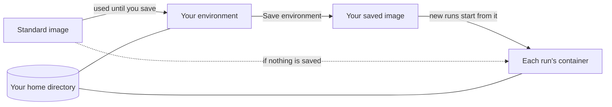

# Member environments

Every member has an environment: their own container on the server where agent
CLIs and system tools are installed, and from which every run they launch
starts. Read this to install tools for your agents, save them, and understand
the limits on what a run can use. Terms such as member, run and workspace are
in the [glossary](README.md#concepts).



Your **home directory** is a folder on the server, mounted as `$HOME` in your
environment and in every run you launch ([environment-home.md](environment-home.md)).
Before you save, only the home is shared. After **Save environment**, new runs
also get the software you installed outside it. A run on another member's
shared agent account still starts from the image of the member who launches
it ([teams.md](teams.md#agent-accounts)).

## The standard image

When you have saved nothing, your environment and your runs start from the
server's standard image. It is Ubuntu 24.04 and its contents are defined in
[`images/standard/Dockerfile`](../images/standard/Dockerfile). It includes bash,
build-essential, curl, Docker, Git, the GitHub CLI (`gh`), `ssh-keygen`, jq,
Python 3, ripgrep, sudo, Go, Node and npm (via fnm), uv and Rust (via rustup).
It does not include `rsync`.

Your environment and your runs run as uid `1000`, with your home at `/root`.
In your environment `sudo` needs no password; in a run it depends on the run's
[permission tier](security.md#permission-tiers).

The server uses the image tagged for its own release, from
`ghcr.io/3xdevops/aether-standard:<tag>`. An admin can point it elsewhere with
`--standard-image`. A team image should keep `gh` 2.81.0 or newer, `ssh-keygen`,
`/bin/sh`, and glibc with bash, curl and tar (editors need them, see
[terminal.md](terminal.md#editors)).

### Git in run environments

Aether commits for a run with the Git in the run's container. Stock Ubuntu
24.04 Git is enough. These commits do not run commit hooks, so if your
repository needs hooks, run `git commit` in the run's terminal. A custom image
whose Git lacks prepared reference transactions (`git update-ref --stdin`
with `prepare`) fails the commit with Git's own error and no fallback. Install
a newer Git in your environment and save it, or
[reset to the standard image](#reset-to-standard).

### Updating the standard image

`aether server update` brings the matching standard image
([install.md](install.md#upgrading)). It reaches you only after two steps:

1. A saved environment wins over the standard image. Run `aether env reset`
   (this discards what you installed outside the home), or update the tool
   yourself in your environment and save again.
2. Stop and reopen your environment and start a new run. A container keeps the
   image it started from.

An admin who set `--standard-image` has to move it to a newer tag or digest. A
reused tag such as `:latest` also needs `docker pull` on the host.

```sh
sudo aether-server config set standard-image <a newer image> && sudo systemctl restart aether-server
```

## Install tools in your environment

Open your environment with `aether terminal`, or select **Environment** in the
dashboard header (under **More navigation** on a narrow screen). It is a
persistent shell where you install system tools and language runtimes, for
example:

```sh
sudo apt-get install -y postgresql-client
```

Tools under `$HOME` (for example `~/.local/bin`) are available to runs at once.
Anything installed elsewhere in the container reaches runs only after you save
the environment. The header reads **Installs here reach agents after you
save.** until you do. `/tmp` is scratch space that saving never captures
([environment-home.md](environment-home.md#what-persists)).

The workspace's setup script and variables apply to runs, not to this terminal
([Workspace environment](#workspace-environment)). See
[terminal.md](terminal.md) for the terminal itself.

## Save the environment

Select **Save environment** on the **Environment** page, or run:

```sh
aether env save
```

Saving pauses the terminal for a few seconds while Docker commits it. The
command prints `saved <tag>`, then `new runs and terminals start from this
environment`. The image is stored on the server's Docker daemon and is never
pushed to a registry.

- New runs, workspace shells and the next environment open use the saved image.
  Running containers keep theirs.
- Each save replaces the previous one. To fix a bad save, repair it and save
  again, or reset.
- Saving needs a running terminal. If it is stopped, `aether env save` fails
  with `environment terminal is not running`. Open it with `aether terminal`,
  check your changes are there, then save.
- The environment container survives a stop, a shell exit and a server
  restart, so unsaved changes stay until you reset. Aether recreates the
  container, and the unsaved changes are lost, when the next open finds
  different settings than the container was created with (the standard image,
  environment variables, mounts, user or resource limits). Save before an
  admin changes them.
- Upgrading to the release that moved the assistant into its own container
  changes the environment's mounts (it no longer mounts the assistant's tool
  socket), so each environment is recreated once at its next open after it
  stops. Save first to keep unsaved changes.
- Upgrading to the release with [permission tiers](security.md#permission-tiers)
  changes the environment's user from root to uid `1000`, so each environment
  is recreated once at its next open. Save first to keep unsaved changes.

## Reset to standard

Open **Environment actions**, then **Reset to standard…** (offered once you
have saved an image), or run `aether env reset`. Reset destroys the container,
forgets your saved image and removes it from the server. Files outside your
home are lost. The next open and all new runs use the standard image.

On a terminal the command asks
`This destroys your Environment's container, unsaved changes and saved image. Your home stays. Reset? [y/N]: `.
Anything but `y` or `yes` prints `aether: aether env reset: nothing was reset`
and exits 1. Without a terminal it needs `--yes`, or it fails with
`aether: --yes is required because aether env reset destroys your Environment's container, unsaved changes and saved image: aether env reset --yes`.

**Stop environment…** (`aether terminal stop`) only stops the container. Your
home, saved image and unsaved changes stay.

### When a saved image is missing

Saved images live only in the server's Docker. If an operator removes yours,
your runs and terminal fail with an error that names the missing tag:

```
scheduler: saved environment image "<tag>" is missing from the runtime; run aether env reset to return to the standard image
```

Aether does not fall back to the standard image silently. Run `aether env reset`.

## Docker inside runs

The standard image has the `docker` CLI, `dockerd`, `docker compose` and
`docker buildx`. When the server host has the
[Sysbox](https://github.com/nestybox/sysbox) container runtime, each run except
an Isolated one, and each environment terminal, starts its own `dockerd`. It
needs no `--privileged` and no host Docker socket, so `docker run`,
`docker build` and `docker compose up` work as on a laptop.

An admin turns it on with the **Install** button under **Settings → Server**
(admins only), by accepting the Docker-inside-runs question in `aether-server
setup`, or on the server host:

```sh
sudo aether-server sysbox install
aether-server sysbox status     # prints on or off
```

The host must be Ubuntu or Debian on amd64 or arm64, run Docker, and have Linux
5.19 or newer or the `shiftfs` module. Otherwise the install stops and changes
nothing with `Docker inside runs is unavailable on this host: <reason>`.
[install.md](install.md) covers the server side.

`--container-runtime` (config key `container-runtime`) defaults to `auto`: use
`sysbox-runc` when Docker has it, checked once a minute. `runc` never uses
Sysbox. Any other value names a runtime registered in Docker. To opt out:

```sh
sudo aether-server config set container-runtime runc
sudo systemctl restart aether-server
```

What to expect:

- Existing containers keep their runtime. After Sysbox is installed, new runs
  and terminals get Docker within a minute. Reopen an open environment
  terminal.
- Images, containers and volumes inside a run are deleted with its container,
  and `aether env save` does not keep them.
- A port published by an inner container is on the run's own network. Reach it
  at `127.0.0.1`.
- Inner containers resolve names through `8.8.8.8`: the run's own resolver,
  `127.0.0.11`, answers only inside the run. Where `8.8.8.8` is blocked, pass
  `docker run --dns <your resolver>`. With [egress control](#egress-control)
  on, inner containers need the proxy variables instead.
- If `dockerd` cannot start, the launch fails with `runtime: dockerd did not
  become ready (exit 1): <last lines of the log>`. The full log is
  `/var/log/aether-dockerd.log` in the container.
- Without Sysbox the CLI has no daemon: `Cannot connect to the Docker daemon at
  unix:///var/run/docker.sock. Is the docker daemon running?`
- A saved image from before Docker joined the standard image has no CLI.
  Install it with `sudo apt-get install -y docker.io docker-compose-v2
  docker-buildx` and `aether env save`, or `aether env reset`.

How the boundary differs from the host is in
[security.md](security.md#the-agent-container).

## Resource limits and launch admission

Each new run and environment container gets a ceiling on CPU, memory and
processes. An admin changes the defaults with `aether-server serve` flags:

| Flag | Default (`0`) | What it limits |
| --- | --- | --- |
| `--run-cpus` | Up to 8 cores, capped at the host's CPU count | CPU |
| `--run-memory` | 8 GiB (`8589934592` bytes) | Memory. A ceiling, not a reservation. |
| `--run-pids` | 4096 | Processes and threads |

```sh
sudo aether-server config set run-memory 12884901888   # 12 GiB
```

An admin can also set the limits from **Settings → Server → Run limits**,
which calls `server.run_limits`. Limits saved there replace the flags for
containers created afterwards, one field at a time; clear a field to fall
back to the flag or the default. A single run overrides both under
**Resource limits** in the launch dialog's **Run** tab (`limits` on
`run.launch`; CPUs, memory in GiB, processes). An empty field follows the
server limit.

A new limit applies to containers created afterwards. Docker must report
support for CPU quotas, memory and swap limits, and PID limits, or new
containers are refused.

Before it creates a run, environment, browser or agent-updater container,
Aether checks that the host has free disk and memory. Otherwise the launch
fails with `scheduler: insufficient disk headroom`, `scheduler: insufficient
host memory headroom` or `scheduler: host capacity unavailable`. Aether never
stops a running agent to make room, and reopening a retained run needs no
check. [Recover from disk pressure](failure-handling.md#recover-from-disk-pressure)
has the thresholds and what to do.

## After a run closes

Reporting success or failure leaves an interactive run open for follow-up, and
quiet runs do not expire. **Close** keeps the run's container for seven days
(`--run-container-ttl`) so you can **Relaunch** it, unless disk runs low first. The seven days pause
while the run is relaunched and start over at its next close.
[What stays after a run ends](failure-handling.md#what-stays-after-a-run-ends)
covers Close, Kill, **Free container…** and Delete.

## Workspace environment

A workspace is a repository you run agents against. Its environment applies
to every new run in it, whoever launches it: a **setup script** that runs
before the agent, **variables** set in the run's container, and optional
**egress control**, which limits the hosts runs can reach. A variable can be
marked **secret**.

An admin edits both under **Environment** on the workspace's Repository page
(workspace switcher → **Environment**), or with `aether workspace env`. Every
member can read the script, the variable names and the non-secret values.

A change applies to runs launched afterwards. An existing container keeps its
variables and never reruns the script, so pausing, reopening or switching the
mode of a run changes nothing. The egress host list is the exception: it
applies at once. Your own environment terminal
does not.

### Setup script

```sh
aether workspace env script                    # print it
aether workspace env script --file setup.sh    # replace it; - reads stdin
aether workspace env script --clear
```

The script (for a Node project, one line: `npm ci`) runs once in each new
run's container, after it starts and before the agent. It runs as `/bin/sh -ec`
(POSIX `sh`, stops at the first failing command, stderr merged into stdout) in
`/workspace` as the run's user, which is never root. A run with
extra repos (`aether run --repo`) runs it in the primary one; the others are at
`/repos/<workspace name>`. It sees the
workspace variables, your `$HOME` and tool caches, `AETHER_RUN_ID` and
`AETHER_WORKSPACE_ID`.

Install system packages with `sudo`, for example `sudo apt-get install -y
libpq-dev`. In a Default run that `sudo` runs without asking anyone, since no
agent has started yet; a Root run's is the image's own. An Isolated run's
fails with `sudo: an isolated run cannot run commands as root`, and so does
its launch.

There is no time limit. The launch waits for it, and so does another launch by
the same member or on the same agent account; other launches do not. Install
dependencies here and leave builds and tests to the agent.

If the script exits non-zero, the container is removed and the launch fails:

```
aether: rpc error -32603: provisioning: start container: runtime: setup script exited 1
setup script output:
npm error code E401
```

The last 16 KiB of output goes only to whoever launched (`aether run` prints it,
the launch dialog shows it) and is not stored with the run. Secrets in it are
replaced with `***`.

### Variables

```sh
aether workspace env list
aether workspace env set NODE_ENV=test API_URL=https://api.example.test
aether workspace env unset NODE_ENV
```

A name cannot be empty or contain `=`. The server sets some variables after the
workspace's, including `HOME`, `TERM`, `SSH_AUTH_SOCK` (the commit signing
agent, [security.md](security.md#github-credentials-and-signing-keys)), the
`AETHER_*` identifiers and the `GIT_AUTHOR_*` and `GIT_COMMITTER_*` identity,
so a workspace variable with one of those names has no effect. A `PATH`
variable is kept, with `~/.local/bin` put in front.

### Secrets

A secret is a variable whose value the server stores and never returns. Its
value is read from stdin, so it stays out of your shell history:

```sh
aether workspace env set --secret NPM_TOKEN < token.txt
aether workspace env set --secret NPM_TOKEN     # on a terminal: prompts, input hidden
```

`aether workspace env list` and the dashboard show only the name, to admins as
well. To change a secret, set it again.

Import a `.env` file to add many at once. Values are stored as secrets unless
you pass `--plain`. The dashboard's **Import .env…** previews each line first.

```sh
aether workspace env import .env
aether workspace env import --plain .env
```

A project that needs the `.env` file, not just the variables, can import them
as secrets and have the [setup script](#setup-script) write the file:

```sh
printf 'DATABASE_URL=%s\nSTRIPE_KEY=%s\n' "$DATABASE_URL" "$STRIPE_KEY" > .env
```

Keep `.env` in the repository's `.gitignore` so the run never commits it. The
file is readable by anyone who can view the run, in its **Files**. For a
one-off file in one run, upload it in that run's **Files**.

> [!WARNING]
> A secret is hidden from the settings, not from a run. Inside the container it
> is an ordinary environment variable, so the agent can read it, and so can
> anyone who can launch a run in the workspace or message one.
> [security.md](security.md#workspace-secrets) lists where the value is kept.

### Egress control

Off by default. When an admin turns it on, the workspace's new runs reach only
the hosts on its list, which starts as the hosts agents need (below):

```sh
aether workspace env egress on
aether workspace env egress allow pypi.example.com '*.mirror.example.com'
aether workspace env egress deny raw.githubusercontent.com
aether workspace env egress list
aether workspace env egress off
```

The dashboard has the same switch and list under **Environment**. A host is an
exact name, or `*.` and a domain, which matches every subdomain but not the
domain itself. On and off apply to runs launched afterwards; the host list
applies at once to runs started with egress control on, and their open
connections to a removed host close within 10 seconds. Agent runs are the only
containers it limits: environment terminals and agent
installs connect directly.

An [Isolated run](security.md#permission-tiers) goes through the proxy whether
egress control is on or off, and reaches only the agent rows of the table
below (Claude Code through OpenCode), whatever the workspace's list says.

Such a run starts on `aether-egress`, a Docker network with no route out. Its
one way out is a proxy inside `aether-server` on that network's gateway, port
3128, which the run finds in `HTTP_PROXY`, `HTTPS_PROXY`, `http_proxy`,
`https_proxy`, `NO_PROXY` and `no_proxy` (`localhost,127.0.0.1,::1`), plus
`NODE_USE_ENV_PROXY=1` for Node's `fetch`. These replace workspace variables of
the same names, and the setup script gets them too. HTTPS passes through
`CONNECT` untouched; plain HTTP, such as apt, is forwarded. A tool that ignores
the proxy variables cannot connect, and the run's browser companion, which
shares its network without a proxy, reaches only the run's own servers.

The proxy resolves each name itself and never connects to a loopback, private,
link-local, tailnet (`100.64.0.0/10`) or cloud metadata address, or to the
server's own, so an allowed name cannot lead to the host or your LAN. A refused
request gets a 403 that reads, in its body and, for `CONNECT`, its status line:

```
aether: egress to example.org denied; allow it with aether workspace env egress allow --workspace <workspace-id> example.org
```

The run's timeline gets the same line once per host, for up to 20 hosts.

Until an admin edits it, the list is the hosts below. Agent telemetry, update
checks and error reports are left out. pi, oh-my-pi and OpenCode need the host
of whichever provider they sign in to. A
[model gateway](harnesses.md#per-agent-setup) needs its host allowed, and one
on a private or tailnet address is out of reach.

| For | Hosts |
| --- | --- |
| Claude Code | `api.anthropic.com`, `claude.ai`, `claude.com`, `platform.claude.com` |
| Codex | `api.openai.com`, `auth.openai.com`, `chatgpt.com` |
| GitHub Copilot CLI | `api.githubcopilot.com`, `*.individual.githubcopilot.com`, `*.business.githubcopilot.com`, `*.enterprise.githubcopilot.com`, `copilot-proxy.githubusercontent.com` |
| Gemini CLI, Antigravity CLI | `generativelanguage.googleapis.com`, `cloudcode-pa.googleapis.com`, `accounts.google.com`, `oauth2.googleapis.com`, `www.googleapis.com` |
| Cursor CLI | `*.cursor.sh`, `cursor.com` |
| OpenCode | `opencode.ai`, `models.dev` |
| GitHub | `github.com`, `api.github.com`, `codeload.github.com`, `objects.githubusercontent.com`, `release-assets.githubusercontent.com`, `raw.githubusercontent.com` |
| npm | `registry.npmjs.org` |
| PyPI | `pypi.org`, `files.pythonhosted.org` |
| Go modules and toolchains | `proxy.golang.org`, `sum.golang.org`, `storage.googleapis.com` |
| crates.io | `crates.io`, `index.crates.io`, `static.crates.io` |
| Docker Hub | `registry-1.docker.io`, `auth.docker.io`, `production.cloudflare.docker.com`, `production.cloudfront.docker.com`, `docker-images-prod.6aa30f8b08e16409b46e0173d6de2f56.r2.cloudflarestorage.com` |
| Ubuntu packages | `archive.ubuntu.com`, `security.ubuntu.com`, `ports.ubuntu.com` |

With [Docker inside runs](#docker-inside-runs), the run's `dockerd` has the
proxy variables, so image pulls work. Containers and builds you start need
them passed in:

```sh
docker run -e http_proxy -e https_proxy -e no_proxy ubuntu apt-get update
docker build --build-arg http_proxy --build-arg https_proxy --build-arg no_proxy .
```

Without them they have no way out, and apt fails with `Temporary failure
resolving 'archive.ubuntu.com'`.

> [!WARNING]
> An allowed host receives whatever the agent sends it. With `github.com`
> allowed, the agent can push anything to any repository your gh token can
> write. [security.md](security.md#limits) lists what else egress control does
> not stop.
