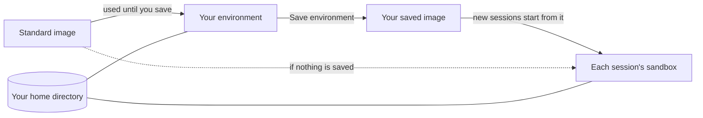

# Member environments

Every member has an environment: their own sandbox on the server where agent
CLIs and system tools are installed, and from which every session they launch
starts. Read this to install tools for your agents, save them, and understand
the limits on what a session can use. Terms such as member, session and workspace are
in the [glossary](README.md#concepts).



Your **home directory** is a folder on the server, mounted as `$HOME` in your
environment and in every session you launch ([environment-home.md](environment-home.md)).
Before you save, only the home is shared. After **Save environment**, new sessions
also get the software you installed outside it. A session on another member's
shared agent account still starts from the image of the member who launches
it ([teams.md](teams.md#agent-accounts)).

## The standard image

When you have saved nothing, your environment and your sessions start from the
server's standard image. It is Ubuntu 24.04 and its contents are defined in
[`images/standard/Dockerfile`](../images/standard/Dockerfile). It includes bash,
build-essential, curl, Docker, Git, the GitHub CLI (`gh`), `ssh-keygen`, jq,
Python 3, ripgrep, sudo, Go, Node and npm (via fnm), uv and Rust (via rustup).
It does not include `rsync`.

Your environment and your sessions run as uid `1000`, with your home at `/root`.
In your environment `sudo` needs no password; in a session it depends on the session's
[permission tier](security.md#permission-tiers).

The server uses the image tagged for its own release, from
`ghcr.io/3xdevops/aether-standard:<tag>`. An admin can point it elsewhere with
`--standard-image`. A team image should keep `gh` 2.81.0 or newer, `ssh-keygen`,
`/bin/sh`, and glibc with bash, curl and tar (editors need them, see
[terminal.md](terminal.md#editors)).

### Git in session environments

Aether commits for a session with the Git in the session's sandbox. Stock Ubuntu
24.04 Git is enough. These commits do not run commit hooks, so if your
repository needs hooks, run `git commit` in the session's terminal. A custom image
whose Git lacks prepared reference transactions (`git update-ref --stdin`
with `prepare`) fails the commit with Git's own error and no fallback. Install
a newer Git in your environment and save it, or
[reset to the standard image](#reset-to-standard).

### Updating the standard image

`aether server update` brings the matching standard image
([install.md](install.md#upgrading)). It reaches you only after two steps:

1. A saved environment wins over the standard image. Run `aether env reset`
   (this discards what you installed outside the home), or update the tool
   yourself in your environment and save again.
2. Stop and reopen your environment and start a new session. A container keeps the
   image it started from.

An admin who set `--standard-image` has to move it to a newer tag or digest. A
reused tag such as `:latest` also needs `docker pull` on the host, except with
`session-runtime vm`: the VM image store fetches a reference once and keeps
it, so only a new tag or digest reaches VMs.

```sh
sudo aether-server config set standard-image <a newer image> && sudo systemctl restart aether-server
```

## Install tools in your environment

Open your environment with `aether terminal`, or select **Environment** in the
dashboard header (under **More navigation** on a narrow screen). It is a
persistent shell where you install system tools and language runtimes, for
example:

```sh
sudo apt-get install -y postgresql-client
```

Tools under `$HOME` (for example `~/.local/bin`) are available to sessions at once.
Anything installed elsewhere in the container reaches sessions only after you save
the environment. The header reads **Installs here reach agents after you
save.** until you do. `/tmp` is scratch space that saving never captures
([environment-home.md](environment-home.md#what-persists)).

The workspace's setup script and variables apply to sessions, not to this terminal
([Workspace environment](#workspace-environment)). See
[terminal.md](terminal.md) for the terminal itself.

## Save the environment

Select **Save environment** on the **Environment** page, or run:

```sh
aether env save
```

Saving pauses the terminal for a few seconds while Docker commits it. The
command prints `saved <tag>`, then `new sessions and terminals start from this
environment`. The image is stored on the server's Docker daemon and is never
pushed to a registry.

- New sessions, workspace shells and the next environment open use the saved image.
  Running containers keep theirs.
- Each save replaces the previous one as your saved image. The new image
  records a previous image: the saved image your environment was created
  from, or, when it runs the standard image, the image new sessions started
  from until then. Aether keeps that one on the server and removes older
  ones. To fix a bad save, repair it and save again, or reset.
- Every save is checked before it becomes your saved image
  ([Saved image checks](#saved-image-checks)).
- Saving needs a running terminal. If it is stopped, `aether env save` fails
  with `environment terminal is not running`. Open it with `aether terminal`,
  check your changes are there, then save.
- The environment survives a stop, a shell exit and a server
  restart, so unsaved changes stay until you reset. Aether recreates the
  container, and the unsaved changes are lost, when the next open finds
  different settings than the container was created with (the standard image,
  environment variables, mounts, user or resource limits). Save before an
  admin changes them.
- Upgrading to the release that moved the assistant into its own container
  changes the environment's mounts (it no longer mounts the assistant's tool
  socket), so each environment is recreated once at its next open after it
  stops. Save first to keep unsaved changes.
- Upgrading to the release with [permission tiers](security.md#permission-tiers)
  changes the environment's user from root to uid `1000`, so each environment
  is recreated once at its next open. An environment still running as root
  through the upgrade is stopped and recreated at the first open after a
  session of yours holds your home as uid `1000`, since both cannot write it
  under different users. Save first to keep unsaved changes.

### Saved image checks

After the commit, Aether reads every file of the new image. An owner uid or
gid above 65535 has no owner inside a container, and under Sysbox no
container starts from such an image. If any file has one, the save fails,
for example:

```
scheduler: save environment: nothing was saved, because the committed image would not start: 3 paths are owned by a uid or gid above 65535, which no container can map (3 owned by 231072:231072; for example /etc, /etc/passwd, /usr). Your environment and its unsaved changes are kept, and new sessions still start from your saved image <tag>. Run aether env save again; if it fails the same way, see "Saved image checks" in docs/environments.md
```

The rejected image is removed. Your saved image does not change, and your
environment keeps running with its unsaved changes. Such owners are host
uids, not ones a container sets: in this example `231072` is the host uid
Sysbox maps container root to. If saving again fails the same way, report it to
an admin. On the server host they can list such paths in any image, such as
a saved image from before these checks:

```sh
c=$(docker create <tag> true)
docker export "$c" | tar tvf - --numeric-owner | awk '{split($2,a,"/"); if (a[1]>65535||a[2]>65535) print}'
docker rm "$c"
```

The check reads the whole image, so a large environment takes longer to
save, up to 10 minutes before the check gives up. Your environment keeps
running meanwhile, and sessions can launch. If the check itself fails, the
save fails with `could not be checked` and the check's error, and nothing
changes.

On a host where every commit captures such owners, every save fails this
way: the check stops a broken image from replacing your working one, but it
does not fix the host.

### When a saved image cannot start

An image saved before these checks may still hold such owners. A container
from it then fails to start with `value too large for defined data type`, or
with a `mkdirall` `permission denied` on one of the image's own directories.
Aether then starts that session, or your environment terminal, from your
previous image, or from the standard image when there is none or it fails
the same way. A session's status names the images that failed; the
terminal shows nothing, and only the server log records its fallback:

```
Saved image <name> cannot start (value too large for defined data type); this session uses your previous saved image <name>. Save your environment again to replace it.
```

Open your environment, which now runs the same fallback image, and save it
again. Aether skips a failed image only after another image started, and
remembers it until the server restarts. When the standard image fails the
same way, the image was not the cause: the launch fails with the runtime's
own error and Aether forgets the failed images. A `permission denied` under
a directory mounted into the container, such as your home, is never blamed
on the image.

The status shows from the session's start until the agent reports its own
state.

## Reset to standard

Open **Environment actions**, then **Reset to standard…** (offered once you
have saved an image), or run `aether env reset`. Reset destroys the container,
forgets your saved image and removes it and your previous image from the server. Files outside your
home are lost. The next open and all new sessions use the standard image.

On a terminal the command asks
`This destroys your Environment's sandbox, unsaved changes and saved image. Your home stays. Reset? [y/N]: `.
Anything but `y` or `yes` prints `aether: aether env reset: nothing was reset`
and exits 1. Without a terminal it needs `--yes`, or it fails with
`aether: --yes is required because aether env reset destroys your Environment's sandbox, unsaved changes and saved image: aether env reset --yes`.

**Stop environment…** (`aether terminal stop`) only stops the container. Your
home, saved image and unsaved changes stay.

### When a saved image is missing

Saved images live only in the server's Docker. If an operator removes yours,
your sessions and terminal fail with an error that names the missing tag:

```
scheduler: saved environment image "<tag>" is missing from the runtime; run aether env reset to return to the standard image
```

Aether does not fall back to the standard image silently. Run `aether env reset`.

## Docker inside sessions

The standard image has the `docker` CLI, `dockerd`, `docker compose` and
`docker buildx`. When the server host has the
[Sysbox](https://github.com/nestybox/sysbox) container runtime, each session except
an Isolated one, and each environment terminal, starts its own `dockerd`. It
needs no `--privileged` and no host Docker socket, so `docker run`,
`docker build` and `docker compose up` work as on a laptop.

An admin turns it on with the **Install** button under **Settings → Server**
(admins only), by accepting the Docker-inside-sessions question in `aether-server
setup`, or on the server host:

```sh
sudo aether-server sysbox install
aether-server sysbox status     # prints on or off
```

The host must be Ubuntu or Debian on amd64 or arm64, run Docker, and have Linux
5.19 or newer or the `shiftfs` module. Otherwise the install stops and changes
nothing with `Docker inside sessions is unavailable on this host: <reason>`.
[install.md](install.md) covers the server side.

`--container-runtime` (config key `container-runtime`) defaults to `auto`: use
`sysbox-runc` when Docker has it, checked once a minute. `runc` never uses
Sysbox. Any other value names a runtime registered in Docker. To opt out:

```sh
sudo aether-server config set container-runtime runc
sudo systemctl restart aether-server
```

What to expect:

- Existing containers keep their runtime. After Sysbox is installed, new sessions
  and terminals get Docker within a minute. Reopen an open environment
  terminal.
- Images, containers and volumes inside a session are deleted with its container,
  and `aether env save` does not keep them.
- A port published by an inner container is on the session's own network. Reach it
  at `127.0.0.1`.
- Inner containers resolve names through `8.8.8.8`: the session's own resolver,
  `127.0.0.11`, answers only inside the session. Where `8.8.8.8` is blocked, pass
  `docker run --dns <your resolver>`. With [egress control](#egress-control)
  on, inner containers need the proxy variables instead.
- If `dockerd` cannot start, the launch fails with `runtime: dockerd did not
  become ready (exit 1): <last lines of the log>`. The full log is
  `/var/log/aether-dockerd.log` in the container.
- Without Sysbox the CLI has no daemon: `Cannot connect to the Docker daemon at
  unix:///var/run/docker.sock. Is the docker daemon running?`
- A saved image from before Docker joined the standard image has no CLI.
  Install it with `sudo apt-get install -y docker.io docker-compose-v2
  docker-buildx` and `aether env save`, or `aether env reset`.

How the boundary differs from the host is in
[security.md](security.md#the-agent-container).

## Resource limits and launch admission

Each new session and environment gets a ceiling on CPU, memory and
processes. An admin changes the defaults with `aether-server serve` flags:

| Flag | Default (`0`) | What it limits |
| --- | --- | --- |
| `--run-cpus` | Up to 8 cores, capped at the host's CPU count | CPU |
| `--run-memory` | 8 GiB (`8589934592` bytes) | Memory. A ceiling, not a reservation. |
| `--run-pids` | 4096 | Processes and threads |

```sh
sudo aether-server config set run-memory 12884901888   # 12 GiB
```

An admin can also set the limits from **Settings → Server → Session limits**,
which calls `server.run_limits`. Limits saved there replace the flags for
containers created afterwards, one field at a time; clear a field to fall
back to the flag or the default. A single session overrides both under
**Resource limits** in the launch dialog's **Session** tab (`limits` on
`run.launch`; CPUs, memory in GiB, processes). An empty field follows the
server limit.

A new limit applies to containers created afterwards. Docker must report
support for CPU quotas, memory and swap limits, and PID limits, or new
containers are refused.

Before it creates a session, environment, browser or agent-updater container,
Aether checks that the host has free disk and memory, and that the server is
not stalling on memory (its cgroup's `memory.pressure`, `some avg60` below
10%). Otherwise the launch fails with `scheduler: insufficient disk headroom`,
`scheduler: insufficient host memory headroom` or `scheduler: host capacity
unavailable`. Aether never stops a running agent to make room, and reopening a
retained session needs no check. [Recover from disk
pressure](failure-handling.md#recover-from-disk-pressure) and [Recover from
memory pressure](failure-handling.md#recover-from-memory-pressure) have the
thresholds and what to do.

## Sessions in virtual machines

`--session-runtime` (config key `session-runtime`) defaults to `docker`. With
`vm`, each new session runs in its own [Cloud
Hypervisor](https://github.com/cloud-hypervisor/cloud-hypervisor) virtual
machine instead of a container, and so do each member's environment
terminal, assistant and agent updater, and the
[dictation](dictation.md#the-engine-container) engine. The development
browser runs inside the session's VM.
This is work in progress; [the plan](plans/2026-11-13-microvm-sessions.md)
lists what is still to come.

```sh
sudo aether-server config set session-runtime vm
sudo aether-server vm install
sudo systemctl restart aether-server
```

The server must run as root: it starts each VM in a systemd unit and sets up
its network, and it removes the files sessions leave behind itself rather than
through a root container. The host needs `/dev/kvm` and systemd, besides
Docker; `aether-server vm install` checks for KVM and installs the rest: Cloud
Hypervisor, the tools VM disks and the VM firewall need, and the release's
guest kernel at `/usr/local/lib/aether/vmlinux` (`--vm-kernel`, config key
`vm-kernel`, names another path). [Hosts for VM
sessions](install.md#hosts-for-vm-sessions) lists what it installs and which
cloud instances work.

What changes:

- Each VM runs in the systemd unit `aether-vm-<run id>.service` in
  `aether.slice`, so it keeps running through a server restart or update.
  The unit is sandboxed ([security.md](security.md#the-agent-container)): a
  tmpfs hides the data directory and only the VM's own paths are bound back.
  Its disks and logs are in `<data dir>/vm/<run id>/`: `monitor.log` holds the
  VM monitor's output and `console.log` the guest's serial console, at most
  1 MiB, with the 1 MiB before it in `console.log.1`.
- The VM gets the CPU limit rounded up to whole vCPUs, held to the exact
  limit by the unit's `CPUQuota`, and the memory limit as its memory; the
  unit's `MemoryMax` allows 512 MiB more for the VM monitor and the file
  service. The process limit applies inside the guest.
- The checkout and each extra repository live on disks of their own, made
  in constant time from a prepared disk per workspace and base commit, and
  git work on them runs inside the VM ([vm-guest.md](vm-guest.md#checkouts)).
  The home, the login files and the other host files a session mounts go
  through the VM's file service
  ([vm-guest.md](vm-guest.md#the-file-service)): writes show in the
  member's other sessions within a second, and read-only mounts stay
  read-only.
- `/tmp` is on the session's data disk. `/aether-cache` is the session's own
  copy of the member's newest caches, made when the session is created. A
  session's caches become the member's newest when its VM stops for good:
  it is stopped, or deleted while stopped or saved. An idle sleep does not
  promote them. Caches over 20 GiB are dropped, and the next session starts
  empty. An Isolated session's caches never go back.
- No ownership pass runs over the home: every file in it shows as the
  session user's.
- Agents' SQLite databases cannot be shared between VMs. Codex, OpenCode and
  Cursor get their own per session; oh-my-pi, Copilot and Antigravity run in
  one VM session at a time per home
  ([harnesses.md](harnesses.md#agents-in-session-vms)).
- Starting a stopped session builds a fresh root disk from its image and runs
  the setup script again: packages installed outside the mounts are gone.
  Docker images inside the session stay on its data disk.
- Each VM has its own address in `10.200.0.0/16` and a tap device
  `aethervm<n>`. It reaches the server host, and the internet only through
  the host's default-route interfaces and the DNS servers it was given. It
  reaches no other VM, no Docker container, nothing in the link-local range
  `169.254.0.0/16` (which holds the cloud metadata, credential and resolver
  endpoints), not the `100.100.100.200` or `168.63.129.16` metadata
  addresses, and nothing over IPv6, and cannot send from another address. A
  DNS server it was given stays reachable on port 53 even when it is a
  link-local address. Nothing outside
  starts a connection into it.
- A session with [egress control](#egress-control) gets the tap
  `aethervme<n>`, no DNS servers, and reaches only the egress proxy at
  `10.200.0.1:3128`. That address is on the dummy link `aether-vmproxy`; the
  proxy knows the session by its VM's address. Sessions with egress control
  started on Docker before the switch keep their proxy on `aether-egress`.
- The server keeps these rules in the nftables table `inet aether_vm`,
  loaded from `<data dir>/vm/firewall.nft` and rebuilt whole at every start
  and VM boot; `sudo nft list table inet aether_vm` shows them live. An
  `iptables` rule at the top of `FORWARD` and of `INPUT` lets what the table
  allows, marked `0x1000000`, past a `DROP` policy such as Docker's on
  `FORWARD` or ufw's on `INPUT`, so egress-controlled VMs reach the proxy
  behind ufw. While the table is gone, the `FORWARD` policy drops all
  traffic VMs send through the host, and what they send to the host itself
  is unfiltered. A change of default route applies when the next VM boots.
- The environment terminal runs in `aether-vm-terminal-<member id>.service`
  and keeps its root disk across a stop and start, as its container did.
  When the server starts with `vm`, it stops a member's terminal container
  still running in Docker and leaves it there, so its unsaved changes come
  back if you set `session-runtime` back to `docker`; the next open creates
  the VM from the saved image. Save first to keep unsaved changes in the VM.
  A terminal VM the host cannot start, as when its VM monitor fails, keeps
  its disk for the next open; one whose root disk no longer mounts is
  replaced, as a container that fails to start is.
- The assistant runs in `aether-vm-assistant-<member id>.service`, its
  install step in `aether-vm-assistant-install-<member id>.service` and the
  agent updater in `aether-vm-harness-update-<member id>-<agent>.service`,
  each from a fresh root disk. The server stops their containers still
  running in Docker when it starts with `vm`, as it does the terminal's.
- **Save environment** freezes the terminal's root filesystem while it
  copies the root disk, well under a second on a host whose filesystem can
  share blocks (XFS, Btrfs), then builds a new base disk from the copy while
  the terminal goes on. A session started from a saved image gets a raw copy
  of it, made the same way. Writes to `/` wait meanwhile; the home and
  `/tmp` stay writable. A copy that takes longer than 5 minutes fails the
  save, and the terminal thaws by itself then even if the server died. The
  check boots the new image in a VM with no network, which systemd stops
  after 10 minutes at most, and runs a shell in it as your terminal's user;
  an image it cannot boot fails the save with `would not start` and the boot
  error. Saved images live in `<data dir>/vm/images`, not in Docker; one
  saved in Docker before still works and is copied over at its first use. A
  session whose saved image no longer boots starts from the previous one, as
  in [When a saved image cannot start](#when-a-saved-image-cannot-start).
- The development browser runs inside the session's VM, from a read-only disk
  built from the browser image that every session VM gets when it boots ([The
  development browser](vm-guest.md#the-development-browser)). Its memory comes
  out of the session VM's, under the companion's own cap, and a stopped
  browser gives it back. Its pages survive a save and restore of the VM, so a
  session that sleeps keeps them. A session VM that started while the server
  was still building that disk, as just after an install, has no browser
  until it next starts from its disk; every such cold start also takes the
  current browser image, so a VM running across an upgrade keeps its older
  browser until then.
- An idle session's VM is saved to disk with every process, and closing a
  session saves its VM too
  ([Sessions in VMs](failure-handling.md#sessions-in-vms)). Closing a
  session while it is asleep wakes it first, so its final commit has its
  uncommitted changes.
- Switching to `vm` moves no running session: a session already in a
  container keeps it, through the restart and its sleeps and relaunches, and
  gets a VM only when it needs a new container.
- Close or kill every session that runs in a VM before you set
  `session-runtime` back to `docker`: a Docker server does not manage VMs,
  so their units would keep running unattended.

## After a session closes

Reporting success or failure leaves an interactive session open for follow-up, and
quiet sessions do not expire; an idle Enhanced Claude Code session sleeps
instead ([Idle sleep](failure-handling.md#idle-sleep)). **Close** keeps the session's container for seven days
(`--run-container-ttl`) so you can **Relaunch** it, unless disk runs low first. The seven days pause
while the session is relaunched and start over at its next close. Close
removes the session's browser companion, the Chromium container behind its
Browser tab; a relaunched session creates a new companion when its Browser
tab is next used.
[What stays after a session ends](failure-handling.md#what-stays-after-a-session-ends)
covers Close, Kill, **Free sandbox…** and Delete.

## Workspace environment

A workspace is a repository you run agents against. Its environment applies
to every new session in it, whoever launches it: a **setup script** that runs
before the agent, **variables** set in the session's sandbox, and optional
**egress control**, which limits the hosts sessions can reach. A variable can be
marked **secret**.

An admin edits both under **Environment** on the workspace's settings page
(workspace switcher → **Workspace settings**, or the workspace's **Settings**
in **Manage workspaces**), or with `aether workspace env`. Every
member can read the script, the variable names and the non-secret values.

A change applies to sessions launched afterwards. An existing container keeps its
variables and never reruns the script, so pausing, reopening or switching the
mode of a session changes nothing. The egress host list is the exception: it
applies at once. Your own environment terminal
does not.

### Setup script

```sh
aether workspace env script                    # print it
aether workspace env script --file setup.sh    # replace it; - reads stdin
aether workspace env script --clear
```

The script (for a Node project, one line: `npm ci`) runs in each new
session's sandbox, after it starts and before the agent. It runs as `/bin/sh -ec`
(POSIX `sh`, stops at the first failing command, stderr merged into stdout) in
`/workspace` as the session's user, which is never root. A session with
extra repos (`aether session --repo`) runs it in the primary one; the others are at
`/repos/<workspace name>`. It sees the
workspace variables, your `$HOME` and tool caches, `AETHER_RUN_ID` and
`AETHER_WORKSPACE_ID`.

Install system packages with `sudo`, for example `sudo apt-get install -y
libpq-dev`. In a Default session that `sudo` runs without asking anyone, since no
agent has started yet; a Root session's is the image's own. An Isolated session's
fails with `sudo: an isolated session cannot run commands as root`, and so does
its launch.

There is no time limit. The launch waits for it, and so does another launch by
the same member or on the same agent account; other launches do not. Install
dependencies here and leave builds and tests to the agent.

If the script exits non-zero, the container is removed and the launch fails:

```
aether: rpc error -32603: provisioning: start container: runtime: setup script exited 1
setup script output:
npm error code E401
```

The last 16 KiB of output goes only to whoever launched (`aether session` prints it,
the launch dialog shows it) and is not stored with the session. Secrets in it are
replaced with `***`.

### Variables

```sh
aether workspace env list
aether workspace env set NODE_ENV=test API_URL=https://api.example.test
aether workspace env unset NODE_ENV
```

A name cannot be empty or contain `=`. The server sets some variables after the
workspace's, including `HOME`, `TERM`, `SSH_AUTH_SOCK` (the commit signing
agent, [security.md](security.md#github-credentials-and-signing-keys)), the
`AETHER_*` identifiers and the `GIT_AUTHOR_*` and `GIT_COMMITTER_*` identity,
so a workspace variable with one of those names has no effect. A `PATH`
variable is kept, with `~/.local/bin` put in front.

### Secrets

A secret is a variable whose value the server stores and never returns. Its
value is read from stdin, so it stays out of your shell history:

```sh
aether workspace env set --secret NPM_TOKEN < token.txt
aether workspace env set --secret NPM_TOKEN     # on a terminal: prompts, input hidden
```

`aether workspace env list` and the dashboard show only the name, to admins as
well. To change a secret, set it again.

Import a `.env` file to add many at once. Values are stored as secrets unless
you pass `--plain`. The dashboard's **Import .env…** previews each line first.

```sh
aether workspace env import .env
aether workspace env import --plain .env
```

A project that needs the `.env` file, not just the variables, can import them
as secrets and have the [setup script](#setup-script) write the file:

```sh
printf 'DATABASE_URL=%s\nSTRIPE_KEY=%s\n' "$DATABASE_URL" "$STRIPE_KEY" > .env
```

Keep `.env` in the repository's `.gitignore` so the session never commits it. The
file is readable by anyone who can view the session, in its **Files**. For a
one-off file in one session, upload it in that session's **Files**.

> [!WARNING]
> A secret is hidden from the settings, not from a session. Inside the container it
> is an ordinary environment variable, so the agent can read it, and so can
> anyone who can launch a session in the workspace or message one.
> [security.md](security.md#workspace-secrets) lists where the value is kept.

### Egress control

Off by default. When an admin turns it on, the workspace's new sessions reach only
the hosts on its list, which starts as the hosts agents need (below):

```sh
aether workspace env egress on
aether workspace env egress allow pypi.example.com '*.mirror.example.com'
aether workspace env egress deny raw.githubusercontent.com
aether workspace env egress list
aether workspace env egress off
```

The dashboard has the same switch and list under **Environment**. A host is an
exact name, or `*.` and a domain, which matches every subdomain but not the
domain itself. On and off apply to sessions launched afterwards; the host list
applies at once to sessions started with egress control on, and their open
connections to a removed host close within 10 seconds. Sessions are the only
containers it limits: environment terminals and agent
installs connect directly.

An [Isolated session](security.md#permission-tiers) goes through the proxy whether
egress control is on or off, and reaches only the agent rows of the table
below (Claude Code through OpenCode), whatever the workspace's list says.

Such a session starts on `aether-egress`, a Docker network with no route out. Its
one way out is a proxy inside `aether-server` on that network's gateway, port
3128, which the session finds in `HTTP_PROXY`, `HTTPS_PROXY`, `http_proxy`,
`https_proxy`, `NO_PROXY` and `no_proxy` (`localhost,127.0.0.1,::1`), plus
`NODE_USE_ENV_PROXY=1` for Node's `fetch`. These replace workspace variables of
the same names, and the setup script gets them too. HTTPS passes through
`CONNECT` untouched; plain HTTP, such as apt, is forwarded. A tool that ignores
the proxy variables cannot connect, and the session's browser companion, which
shares its network without a proxy, reaches only the session's own servers.

The proxy resolves each name itself and never connects to a loopback, private,
link-local, tailnet (`100.64.0.0/10`) or cloud metadata address, or to the
server's own, so an allowed name cannot lead to the host or your LAN. A refused
request gets a 403 that reads, in its body and, for `CONNECT`, its status line:

```
aether: egress to example.org denied; allow it with aether workspace env egress allow --workspace <workspace-id> example.org
```

The session's timeline gets the same line once per host, for up to 20 hosts.

Until an admin edits it, the list is the hosts below. Agent telemetry, update
checks and error reports are left out. pi, oh-my-pi and OpenCode need the host
of whichever provider they sign in to. A
[model gateway](harnesses.md#per-agent-setup) needs its host allowed, and one
on a private or tailnet address is out of reach.

| For | Hosts |
| --- | --- |
| Claude Code | `api.anthropic.com`, `claude.ai`, `claude.com`, `platform.claude.com` |
| Codex | `api.openai.com`, `auth.openai.com`, `chatgpt.com` |
| GitHub Copilot CLI | `api.githubcopilot.com`, `*.individual.githubcopilot.com`, `*.business.githubcopilot.com`, `*.enterprise.githubcopilot.com`, `copilot-proxy.githubusercontent.com` |
| Gemini CLI, Antigravity CLI | `generativelanguage.googleapis.com`, `cloudcode-pa.googleapis.com`, `accounts.google.com`, `oauth2.googleapis.com`, `www.googleapis.com` |
| Cursor CLI | `*.cursor.sh`, `cursor.com` |
| OpenCode | `opencode.ai`, `models.dev` |
| GitHub | `github.com`, `api.github.com`, `codeload.github.com`, `objects.githubusercontent.com`, `release-assets.githubusercontent.com`, `raw.githubusercontent.com` |
| npm | `registry.npmjs.org` |
| PyPI | `pypi.org`, `files.pythonhosted.org` |
| Go modules and toolchains | `proxy.golang.org`, `sum.golang.org`, `storage.googleapis.com` |
| crates.io | `crates.io`, `index.crates.io`, `static.crates.io` |
| Docker Hub | `registry-1.docker.io`, `auth.docker.io`, `production.cloudflare.docker.com`, `production.cloudfront.docker.com`, `docker-images-prod.6aa30f8b08e16409b46e0173d6de2f56.r2.cloudflarestorage.com` |
| Ubuntu packages | `archive.ubuntu.com`, `security.ubuntu.com`, `ports.ubuntu.com` |

With [Docker inside sessions](#docker-inside-sessions), the session's `dockerd` has the
proxy variables, so image pulls work. Containers and builds you start need
them passed in:

```sh
docker run -e http_proxy -e https_proxy -e no_proxy ubuntu apt-get update
docker build --build-arg http_proxy --build-arg https_proxy --build-arg no_proxy .
```

Without them they have no way out, and apt fails with `Temporary failure
resolving 'archive.ubuntu.com'`.

> [!WARNING]
> An allowed host receives whatever the agent sends it. With `github.com`
> allowed, the agent can push anything to any repository your gh token can
> write. [security.md](security.md#limits) lists what else egress control does
> not stop.
