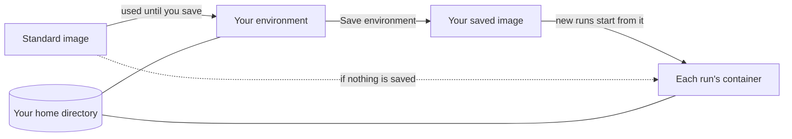

# Member environments

Every member has an environment: their own container on the server where agent
CLIs and system tools are installed, and from which every run they launch
starts. Read this to install tools for your agents, save them, and understand
the limits on what a run can use.



Your **home directory** is a folder on the server, mounted as `$HOME` in your
environment and in every run you launch ([environment-home.md](environment-home.md)).
It is the only thing shared before you save. After **Save environment**, new
runs also get the software you installed outside the home.

A run on another member's shared agent account still starts from the image of
the member who launches it. Sharing an account never lends your image
([teams.md](teams.md#agent-accounts)).

## The standard image

When you have saved nothing, your environment and your runs start from the
server's standard image. It is Ubuntu 24.04 and its contents are defined in
[`images/standard/Dockerfile`](../images/standard/Dockerfile). It includes bash,
build-essential, curl, Docker, Git, the GitHub CLI (`gh`), `ssh-keygen`, jq,
Python 3, ripgrep, sudo, Go, Node and npm (via fnm), uv and Rust (via rustup).
It does not include `rsync`.

The server uses the image tagged for its own release, from
`ghcr.io/3xdevops/aether-standard:<tag>`. An admin can point it elsewhere with
`--standard-image`. A team image should keep `gh` 2.81.0 or newer, `ssh-keygen`,
`/bin/sh`, and glibc with bash, curl and tar (editors need them, see
[terminal.md](terminal.md#editors)).

### Git in run environments

Aether commits for a run with Git inside the run's container. The stock Git in
Ubuntu 24.04 is enough. These commits do not run commit hooks. If your
repository needs hooks, run `git commit` in the run's terminal instead. A
custom image whose Git lacks prepared reference transactions fails the commit
instead of falling back. See
[install.md](install.md#git-inside-run-environments) for the diagnostics.

### Updating the standard image

A server update brings the new standard image with it
([install.md](install.md#upgrading)). The image reaches you in two more steps:

1. If you saved an environment, it takes precedence over the new standard
   image. Run `aether env reset` to go back to standard (this discards what you
   installed outside the home), or install the update yourself in your
   environment and save again.
2. A container keeps the image it started from. Stop and reopen your
   environment, and start a new run. Running containers are never changed.

An admin who set `--standard-image` has to move it to a newer tag or digest:

```sh
sudo aether-server config set standard-image <a newer image> && sudo systemctl restart aether-server
```

A reused tag such as `:latest` keeps whatever the server's Docker already has
until an admin pulls it again on the host (`docker pull <image>`).

## Install tools in your environment

Open your environment with `aether terminal`, or select **Environment** in the
dashboard header (under **More navigation** on a narrow screen). It is a
persistent shell where you install system tools and language runtimes, for
example:

```sh
sudo apt-get install -y postgresql-client
```

Tools under `$HOME` (for example `~/.local/bin`) are available to runs at once.
Anything installed elsewhere in the container reaches runs only after you save
the environment. The header reads **Installs here reach agents after you
save.** until you do. `/tmp` is scratch space that saving never captures
([environment-home.md](environment-home.md#what-persists)).

The workspace's setup script and variables apply to runs, not to this
terminal ([Workspace environment](#workspace-environment)). The terminal
itself is covered in [terminal.md](terminal.md).

## Save the environment

Select **Save environment** on the **Environment** page, or run:

```sh
aether env save
```

Saving pauses the terminal for a few seconds while Docker commits it. The
command prints `saved <tag>`, then `new runs and terminals start from this
environment`. The image is stored on the server's Docker daemon and is never
pushed to a registry.

- New runs, workspace shells and the next environment open use the saved image.
  Runs that are already running keep their containers.
- Each save replaces the previous one. There is no history. To fix a bad save,
  repair the installation and save again, or reset.
- Saving needs a running terminal. Open the environment first.
- The environment container survives a stop, a shell exit and a server
  restart, so unsaved changes stay until you reset. Aether recreates the
  container, and the unsaved changes are lost, when the next open finds
  different settings than the container was created with (the standard image,
  environment variables, mounts, user or resource limits). Save before an
  admin changes them.

## Reset to standard

Open **Environment actions**, then **Reset to standard…** (offered once you
have saved an image), or run:

```sh
aether env reset
```

Reset destroys the environment container, forgets your saved image and removes
it from the server. Files outside your home are lost. The next open and all
new runs use the standard image. The command prints `environment reset to the
standard image`.

**Stop environment…** (`aether terminal stop`) is different: it stops the
container but keeps your home, your saved image and the container's unsaved
changes.

### When a saved image is missing

Saved images live only in the server's Docker. If an operator removes yours,
your runs and terminal fail with an error that names the missing tag:

```
scheduler: saved environment image "<tag>" is missing from the runtime; run aether env reset to return to the standard image
```

Aether does not fall back to the standard image silently. Run `aether env reset`.

## Docker inside runs

The standard image has the `docker` CLI, `dockerd`, `docker compose` and
`docker buildx`. When the server host has the
[Sysbox](https://github.com/nestybox/sysbox) container runtime, each run and
each environment terminal starts its own `dockerd`. It needs no `--privileged`
and no host Docker socket, so `docker run`, `docker build` and `docker compose
up` work as on a laptop.

An admin turns it on with the **Install** button under **Settings → Server**
(admins only), by accepting the Docker-inside-runs question in `aether-server
setup`, or on the server host:

```sh
sudo aether-server sysbox install
aether-server sysbox status     # prints on or off
```

The host must be Ubuntu or Debian on amd64 or arm64, run Docker, and have Linux
5.19 or newer or the `shiftfs` module. Otherwise the install stops and changes
nothing:

```
Docker inside runs is unavailable on this host: <reason>
```

The installer adds a missing `bip` or `default-address-pools` key to
`/etc/docker/daemon.json`, because Sysbox refuses to install otherwise. It picks
a free private range, prints each value it writes and does not restart Docker.
If no free range is left it stops without changing the file. Set the key
yourself and run it again.

`--container-runtime` (config key `container-runtime`) picks the runtime:

| Value | Meaning |
| --- | --- |
| `auto` (default) | `sysbox-runc` when Docker has it registered, otherwise Docker's default. Checked once a minute. |
| `runc` | Never use Sysbox. Docker is unavailable inside runs. |
| any other name | That runtime, as registered in Docker. |

To opt out:

```sh
sudo aether-server config set container-runtime runc
sudo systemctl restart aether-server
```

What to expect:

- Existing containers keep the runtime they were created with. After Sysbox is
  installed, new runs and terminals get Docker within a minute. Close and
  reopen an open environment terminal.
- Images, containers and volumes inside a run are deleted with the run's
  container. `aether env save` does not keep them. Pull or build again in each
  run.
- A port published by an inner container is on the run's own network. Reach it
  from the run at `127.0.0.1`.
- If `dockerd` cannot start, the launch fails with the log tail. The full log is
  `/var/log/aether-dockerd.log` in the container.

  ```
  runtime: dockerd did not become ready (exit 1): <last lines of the log>
  ```
- Without Sysbox the CLI is present but has no daemon:

  ```
  Cannot connect to the Docker daemon at unix:///var/run/docker.sock. Is the docker daemon running?
  ```
- A saved image from before Docker joined the standard image has no Docker CLI.
  In the environment run `sudo apt-get install -y docker.io docker-compose-v2
  docker-buildx`, then `aether env save`. Or `aether env reset`.

How the boundary differs from the host is in
[security.md](security.md#the-agent-container).

## Resource limits and launch admission

Each new run and environment container gets a ceiling on CPU, memory and
processes. An admin changes the defaults with `aether-server serve` flags:

| Flag | Default (`0`) | What it limits |
| --- | --- | --- |
| `--run-cpus` | Up to 8 cores, capped at the host's CPU count | CPU |
| `--run-memory` | 8 GiB (`8589934592` bytes) | Memory. A ceiling, not a reservation. |
| `--run-pids` | 4096 | Processes and threads |

```sh
sudo aether-server config set run-memory 12884901888
sudo systemctl restart aether-server
```

A new limit applies to containers created afterwards. Existing containers keep
theirs. Each container also gets swap of a quarter of its memory limit. Docker
must report support for CPU quotas, memory and swap limits, and PID limits, or
new containers are refused.

Before it creates a run, environment, browser or agent-updater container,
Aether checks that the host has room. It refuses the launch when:

- A filesystem Aether or Docker uses has less free space than
  `max(5 GiB, min(5% of its size, 20 GiB))`. `--min-free-disk` sets the reserve
  in bytes; `0` is automatic and a negative value disables the check.
- Available host memory is below `max(2 GiB, 10% of host RAM)`.
- Fewer than 1 GiB of disk and 512 MiB of memory remain for the container
  being created, counting other launches in progress.

The launch fails with a message such as:

```
scheduler: insufficient disk headroom
scheduler: insufficient host memory headroom
scheduler: host capacity unavailable
```

Aether never stops a running agent to make room. Reopening a paused or live
retained run does not need admission. A remote Docker daemon, an unsupported
storage driver or a failed probe also refuses new containers with a capacity
error. [failure-handling.md](failure-handling.md#picking-a-disk-floor) covers
diagnosis and the disk floor.

## After a run closes

Reporting success or failure leaves an interactive run open for follow-up and
starts no cleanup timer. Quiet runs do not expire.

**Close** on an interactive run, or completion of a swarm worker, keeps its
container for **seven days** by default so you can **Reopen** the same live
processes. An admin changes this with `--run-container-ttl` (`0` is seven days,
a negative value releases at once).

- When free disk nears the `--min-free-disk` floor, Aether removes closed
  runs' containers early, oldest first, and adds a note to the run. Such a run
  cannot be reopened. Its branch, evidence and history stay.
- Reopen works only while the exact container still exists and is within its
  deadline. It does not restart stopped processes. Finished swarm workers
  cannot be reopened.
- A paused container still holds its memory. Pausing stops execution only.
- **Free container…** releases the container early without deleting history.
  **Delete** removes the run.
- The finished checkout is cleaned up after about 72 hours (`--checkout-ttl`)
  unless evidence still needs it. Terminal recordings, session logs and diff
  history survive until you delete the run. Published branches are never
  removed by this cleanup.

## Workspace environment

A workspace is a repository you run agents against. Its environment applies
to every new run in it, whoever launches it: a **setup script** that runs
before the agent, and **variables** set in the run's container. A variable can
be marked **secret**.

An admin edits both under **Environment** on the workspace's Repository page
(workspace switcher → **Environment**), or with `aether workspace env`. Every
member can read the script, the variable names and the non-secret values.

A change applies to runs launched afterwards. An existing container keeps its
variables and never reruns the script, so pausing, reopening or switching the
mode of a run changes nothing. Candidate verification containers
([integration.md](integration.md)) also get it. Your own environment terminal
does not.

### Setup script

```sh
aether workspace env script                    # print it
aether workspace env script --file setup.sh    # replace it; - reads stdin
aether workspace env script --clear
```

For a Node project, `setup.sh` can be one line:

```sh
npm ci
```

The script runs once in each new run's container, after it starts and before
the agent:

| Property | Value |
| --- | --- |
| Shell | `/bin/sh -ec '<script>'`, POSIX `sh`, stops at the first failing command, not a login shell. Stderr goes to stdout. |
| Directory | `/workspace`, the run's checkout |
| User | The container's user: root in the standard image |
| Environment | The workspace variables, your `$HOME` and tool caches, `AETHER_RUN_ID` and `AETHER_WORKSPACE_ID` |
| Time limit | None. The launch waits for it, and launches are admitted one at a time, so a slow script delays every other launch on the server. Install dependencies here and leave builds and tests to the agent. |

If the script exits non-zero, the container is removed and the launch fails:

```
aether: rpc error -32603: provisioning: start container: runtime: setup script exited 1
setup script output:
npm error code E401
```

The run is listed as failed. The last 16 KiB of the script's output goes only
to whoever launched: `aether run` prints it and the launch dialog shows it. It
is not stored with the run. Secrets in it are replaced with `***`.

### Variables

```sh
aether workspace env list
aether workspace env set NODE_ENV=test API_URL=https://api.example.test
aether workspace env unset NODE_ENV
```

A name cannot be empty or contain `=`. The server sets some variables after the
workspace's, including `HOME`, `TERM`, the `AETHER_*` identifiers and the
`GIT_AUTHOR_*` and `GIT_COMMITTER_*` identity, so a workspace variable with one
of those names has no effect. A `PATH` variable is kept, with `~/.local/bin`
put in front.

### Secrets

A secret is a variable whose value the server stores and never returns. Its
value is read from stdin, so it stays out of your shell history:

```sh
aether workspace env set --secret NPM_TOKEN < token.txt
aether workspace env set --secret NPM_TOKEN     # on a terminal: prompts, input hidden
```

`aether workspace env list` and the dashboard show only the name, to admins as
well. To change a secret, set it again.

Import a `.env` file to add many at once. Values are stored as secrets unless
you pass `--plain`. The dashboard's **Import .env…** reads the same format and
lists what each line adds or replaces before it saves anything.

```sh
aether workspace env import .env
aether workspace env import --plain .env
```

> [!WARNING]
> A secret is hidden from the settings, not from a run. Inside the container it
> is an ordinary environment variable, so the agent can read it, and so can
> anyone who can launch a run in the workspace or message one.
> [security.md](security.md#workspace-secrets) lists where the value is kept.

## Limits

- One saved image per member. No history, no undo.
- Saved images exist only on the server. Nothing is pushed to a registry.
- A running container never picks up a new image, a new limit or a new
  workspace variable.
- Docker inside a run needs Sysbox, and its images do not survive the run.
