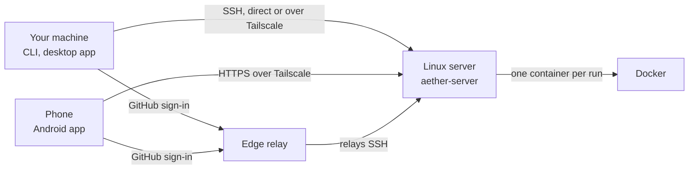

# Install, upgrade and remove Aether

This guide installs, upgrades and removes Aether on every platform. For the
shortest path to a first run, follow [quickstart.md](quickstart.md), then come
back here for other platforms, options and errors. Aether's terms are defined
in the [glossary](README.md#concepts).

## What gets installed where

Aether has two parts. The server, `aether-server`, runs on one Linux machine:
it keeps your repositories and runs each agent in its own Docker container. A
client is any machine you work from: the `aether` CLI, the desktop app and the
Android app all connect to that server.

| Component | Runs on | What it is | Install it with |
| --- | --- | --- | --- |
| `aether-server` | Linux, x64 and arm64 | The server. Needs Docker. | [The install script](#the-install-script), answering `server` |
| `aether` | Linux, macOS and Windows, x64 and arm64 | The CLI. `aether gui` also serves the dashboard on your machine. | [The install script](#the-install-script) or the [Windows install script](#windows-install-script) |
| Desktop app | Linux, macOS, Windows | A window around the dashboard. Needs the CLI. | [`aether gui build`](#desktop-app) |
| Android app | Android | The dashboard on a phone. | [`aether-android.apk`](#android-app) |

Clients reach the server over SSH, port 2222 by default. Without a direct or
Tailscale route they go through the edge, a relay at `https://edge.onaether.dev`
that both sides dial out to after a GitHub sign-in ([edge.md](edge.md)).



## Server prerequisites

- Linux; a headless server is fine. Windows and macOS run only clients.
- Docker Engine, running
  ([install Docker Engine](https://docs.docker.com/engine/install/)). Every run
  and member environment is a container. Sharing an agent account between
  members ([teams.md](teams.md#agent-accounts)) needs Docker Engine 26.0 or
  newer; `docker version --format '{{.Server.Version}}'` prints yours.
- git, and `ssh-keygen` (package `openssh-client` on Debian and Ubuntu), which
  git uses to sign the commits Aether makes for members who connected GitHub.
- Disk for the images the server pulls on first use. New runs are refused
  below 5% free space, at least 5 GiB and at most 20 GiB
  ([environments.md](environments.md#resource-limits-and-launch-admission)).
- Optional: Sysbox, so agents can run Docker inside their runs. Setup offers
  it on Ubuntu and Debian
  ([environments.md](environments.md#docker-inside-runs)).
- Optional: Tailscale. Without it the server needs only outbound HTTPS to the
  edge ([networking.md](networking.md)).

## The install script

On Linux or macOS:

```sh
curl -fsSL https://raw.githubusercontent.com/3xDevOps/Aether/main/scripts/install.sh | sh
```

The script needs `curl`, and `sha256sum` or `shasum`. It downloads the
binaries for your OS and CPU, checks each one before replacing anything, then
asks `What is this machine?`:

| Answer | Installs | Into | Then runs |
| --- | --- | --- | --- |
| `server` | `aether-server` and `aether` | `/usr/local/bin`, using `sudo`; `~/.local/bin` on a machine without `sudo` | `sudo aether-server setup` ([First boot](#first-boot)) |
| `client` | `aether` | `~/.local/bin` | `aether gui build` ([Desktop app](#desktop-app)) |
| `none` | The same as `server` | `/usr/local/bin` | Nothing |

macOS gets only `aether`. Enter takes `server` on Linux and `client` on
macOS; with no terminal, as in CI, the script acts like `--role none`. A
client goes in `~/.local/bin` so the dashboard's **Update now** can replace it.
If the directory is not on your `PATH`, the script prints the line to add (it
never edits a profile), and it prints the `sudo rm -f` for an older `aether`
in `/usr/local/bin` that would run first.

| Flag | Variable | Effect |
| --- | --- | --- |
| `--version <tag>` | `AETHER_VERSION` | Install exactly this release, or stop. |
| `--bin-dir <dir>` | `AETHER_BIN_DIR` | Install into this directory, whatever the role. |
| `--client` or `--server` | `AETHER_COMPONENTS=client` or `server` | Install only `aether`, or only `aether-server`, and answer to match. |
| `--role <role>` | `AETHER_ROLE` | Answer the question in advance: `server`, `client` or `none`. |
| | `AETHER_REPO`, `AETHER_BASE_URL` | Download from a fork, or release assets from an HTTPS mirror. |

Flags passed through a pipe need `sh -s --`, as in
`curl -fsSL <install.sh URL> | sh -s -- --client --bin-dir ~/bin`.

Without `--version`, the script installs the newest release that has
published `checksums.txt`, the signed manifest (`aether-release.json` and
`aether-release.json.sig`) and every binary you need. While the latest one is
still uploading or has failed, it takes the one before and says why.
`--version <tag>` installs exactly that tag, prereleases included, or stops.
With OpenSSL 3 on `PATH` the script verifies the signature; without it (macOS
ships LibreSSL) it warns and checks SHA-256 and size only. Any failure stops
the install before an installed binary is replaced, so rerunning is safe.

## Windows install script

In Windows PowerShell 5.1 or PowerShell 7, download the installer, review it,
then run it:

```powershell
Invoke-WebRequest -UseBasicParsing -Uri https://raw.githubusercontent.com/3xDevOps/Aether/main/scripts/install.ps1 -OutFile "$env:TEMP\aether-install.ps1"
& "$env:TEMP\aether-install.ps1"
```

Windows runs only the client, so the script asks nothing. It downloads the
x64 or ARM64 CLI from the newest complete release, checks its SHA-256 and size
against `checksums.txt` and `aether-release.json`, installs it as
`%LOCALAPPDATA%\Programs\Aether\aether.exe`, and adds that directory to your
user `PATH`. Then it runs `aether gui build`, which installs the
[desktop app](#desktop-app) and adds **Aether** to the Start Menu. It does not
ask for administrator rights or change the execution policy or Defender
settings. Open a new terminal afterwards: open ones keep their old `PATH`.

It takes `-Version <tag>`, `-BinDir <dir>` and `-Role client|none` (`none`
installs only the CLI), or `AETHER_VERSION`, `AETHER_BIN_DIR`, `AETHER_ROLE`,
`AETHER_REPO` and an `https` `AETHER_BASE_URL`. The desktop app needs
`v0.5.1-alpha.4` or newer, so an older `-Version` needs `-Role none`.
PowerShell cannot check the manifest's signature, so the script checks SHA-256
and size only.

To reinstall or upgrade, close Aether and rerun the script with the same
`-BinDir`. If Aether still runs, the script prints the `Stop-Process -Id
<pids>` (and `schtasks /End /TN aether-daemon`) to run, and changes nothing.
If only the desktop step fails, it prints the `gui build` command to rerun.

### The Windows client

Windows runs only the client. It keeps its config in `%APPDATA%\aether\` and
uses the keys in `%USERPROFILE%\.ssh\`. Differences from Linux and macOS:

- `aether init` refuses to run. It prepares a server data directory, so run
  it on the Linux server.
- `scripts/install.sh` does not run on Windows. Use `install.ps1`.
- `aether update` works, but Windows cannot overwrite a running `aether.exe`:
  the update renames it to `aether.exe.old`, and the next `aether` command
  deletes that copy. If Smart App Control, AppLocker or an antivirus blocks
  the new build, the update restores the old one and fails with
  `replace <path>: the new build does not start, so the previous build was
  restored: <Windows error>`.

For a passphrase-protected key, start the Windows OpenSSH agent, which is
stopped by default (as admin: `Start-Service ssh-agent` and
`Set-Service ssh-agent -StartupType Automatic`), then `ssh-add` your key.

### Windows Defender and SmartScreen

Aether's Windows binaries and locally built desktop apps are not code-signed,
so SmartScreen, Smart App Control or an antivirus may warn about or block them.

| What you see | What it is | What to do |
| --- | --- | --- |
| The browser blocks the download, or "Windows protected your PC" when it starts | Download or SmartScreen reputation | Check the file's SHA-256 against `checksums.txt` ([Manual install](#manual-install)), then follow your organization's policy. |
| The file disappears, or "virus detected" | Antivirus detection | Read the detection name in **Windows Security → Virus & threat protection → Protection history**, then report it. |
| "Smart App Control blocked an app that may be unsafe", or `An Application Control policy has blocked this file` | Smart App Control, which runs only signed or already trusted apps | See **Windows Security → App & browser control → Smart App Control**. The installer does not bypass it. |

Do not turn protection off, add an exclusion or restore a quarantined file:
a matching checksum proves the download is intact, not that it is safe. To
report a detection on a file whose checksum matches, submit it at
[microsoft.com/wdsi/filesubmission](https://www.microsoft.com/en-us/wdsi/filesubmission)
as a software developer, and open an issue with the detection name.

## Manual install

Every [release](https://github.com/3xDevOps/Aether/releases) publishes
`checksums.txt` and these assets, where `<arch>` is `amd64` or `arm64`: the
CLI as `aether-linux-<arch>`, `aether-darwin-<arch>` and
`aether-windows-<arch>.exe`; `aether-server-linux-<arch>`;
`aether-edge-linux-<arch>`; `aether-desktop-windows-<arch>.zip`; and
`aether-android.apk` and `.aab`. `aether-edge` also ships as the image
`ghcr.io/3xdevops/aether-edge:<tag>` ([edge.md](edge.md#in-a-container)).

On Linux or macOS, download the binary and `checksums.txt`, check it, and put
it on your `PATH`. Install a server binary as `/usr/local/bin/aether-server`,
the path the systemd unit runs.

```sh
grep ' aether-linux-amd64$' checksums.txt | sha256sum -c -   # macOS: shasum -a 256 -c -
mkdir -p ~/.local/bin && install -m 0755 aether-linux-amd64 ~/.local/bin/aether
```

On Windows, in PowerShell, from the directory you downloaded into:

```powershell
# 1. Verify. Compare this against the matching line in checksums.txt.
Get-FileHash -Algorithm SHA256 .\aether-windows-amd64.exe
# 2. Put it somewhere on PATH under the name aether.exe.
$dir = "$env:LOCALAPPDATA\Programs\Aether"
New-Item -ItemType Directory -Force -Path $dir
Copy-Item -Force .\aether-windows-amd64.exe "$dir\aether.exe"
# 3. Add that directory to your user PATH (once), then open a new terminal.
[Environment]::SetEnvironmentVariable(
  "Path", "$([Environment]::GetEnvironmentVariable('Path','User'));$dir", "User")
```

Use `aether-windows-arm64.exe` on an Arm device. `& "$dir\aether.exe" gui build`
then adds the desktop app; from a zip you downloaded, verify the zip the same
way and add `--zip <zip>`, because `--zip` checks only its layout. To check the
release signature too, see [Verify a release by hand](#verify-a-release-by-hand).
To build from source, see [CONTRIBUTING.md](../CONTRIBUTING.md#build-from-source).

## Desktop app

The desktop app is a window around the dashboard. It starts `aether gui`, the
dashboard server built into the CLI, with the same access the CLI has. While
open, it notifies you when a run needs attention and opens `aether://run/<id>`
and edge join and claim links ([edge.md](edge.md#the-dashboard)). Both install
scripts can install it; to install or rebuild it yourself:

```sh
aether gui build
```

On Windows this downloads the release's prebuilt
`aether-desktop-windows-<arch>.zip` (about 100 MB), checks it against the
signed `aether-release.json`, and unpacks it. On Linux and macOS it builds the
app with Electron, using `node` 22 or newer from `PATH` or a pinned Node.js 22
it downloads into its cache. The first build also downloads Electron (about
100 MB). `--source` builds on Windows too, `--zip <path>` installs a Windows
app zip you already have, `--build-dir <dir>` replaces the cache directory,
and `--json` prints one JSON line per build phase.

| OS | App | Launcher |
| --- | --- | --- |
| Linux | `~/.local/share/aether/desktop/` | `~/.local/share/applications/aether-desktop.desktop` |
| macOS | `/Applications/Aether.app`, or `~/Applications/Aether.app` without administrator rights | Applications folder and Spotlight |
| Windows | `%LOCALAPPDATA%\Programs\Aether Desktop\` | Start Menu → **Aether** |

The app does not contain the CLI: `gui build` records the path of the CLI
that ran it, and the app starts that one (`AETHER_BIN` overrides it). If that
CLI is moved or deleted, the app's error names the path; restore it, set
`AETHER_BIN`, or rerun `gui build`. The dashboard ships inside the CLI, and
`aether update` rebuilds the app ([Upgrading](#upgrading)). On Windows, close
Aether before rebuilding by hand.

## Android app

The Android app shows the dashboard full screen on a phone. It is not on
Google Play yet; every release carries `aether-android.apk`. What it stores and
sends is in [privacy.md](privacy.md), its licences in [notices.md](notices.md).

1. On the phone, download `aether-android.apk` from the
   [latest release](https://github.com/3xDevOps/Aether/releases/latest).
2. When Android asks, allow your browser to install apps, then open the file.
3. Choose how the app reaches your server: **Aether Edge** or **Tailscale**.

| Mode | You need | How it works |
| --- | --- | --- |
| **Aether Edge** | A GitHub account the server lets in | The app runs its own copy of the `aether` CLI. Sign in with GitHub in the browser, pick your server, check its host key and tap **Link and pin**. A server that admits only approved devices makes the phone wait for approval ([teams.md](teams.md#through-an-edge)). |
| **Tailscale** | The phone on the server's tailnet, and the server's dashboard on (`web-port`, see [networking.md](networking.md#the-dashboard)) | Type the server's MagicDNS name, such as `my-server.tailnet-name.ts.net`. The app opens the server's HTTPS dashboard; your tailnet login identifies you. |

In **Aether Edge** mode SSH runs end to end; the edge relays encrypted bytes.
The app keeps a device key and edge tokens in private storage, excluded from
backups. Uninstalling the app or clearing its storage deletes the key, so the
phone signs in as a new device and may need approval again. To switch mode or
check for updates, long-press the app icon and choose **Connection**.

About once an hour, when you bring it to the front, the app checks for a
release and shows a banner. **Download update** fetches the new APK; open it
and Android installs it over the app, keeping your data. A Google Play install
gets **Open Google Play** once the release is 7 days old. In **Aether Edge**
mode the server refuses an older app: a screen such as `This app (v0.7.0) is
too old for the server (v0.8.0 needs v0.8.0 or newer).` stays until you
install the update it links.

Android installs an APK over the app only when both carry the same signing
key; uninstall an APK you built from a checkout first. The release key's
certificate SHA-256, as `apksigner verify --print-certs` prints it, is
`2d7e0777aa8a24ac0090dcdd4c620910c9ef13c7775b1576ed69230f1dd37c3a`.

## First boot

`aether-server setup` sets the server up as a systemd service. The install
script runs it when you answer `server`; to run it yourself:

```sh
sudo aether-server setup
```

It asks these questions in order, and shows `/etc/aether/server.conf` for you
to confirm before the last one. Enter takes the default, or on a rerun the
current value.

| Question | Default | What it decides |
| --- | --- | --- |
| `Continue without Docker` | no | Asked only when Docker does not answer. No stops with `nothing written; install or start Docker, then run setup again`. |
| `SSH listen address` | `:2222` | The address and port clients connect to. |
| `Data directory` | `/var/lib/aether` | Where the server keeps everything ([data directory](#what-lives-in-the-data-directory)). |
| `Will people reach this server over <tailnet>` | no | Asked only when Tailscale runs on the host. Yes signs people in by their tailnet login, then asks whether to auto-approve tailnet logins, whether to also require an SSH key, and the dashboard's HTTPS port on the tailnet ([networking.md](networking.md#the-dashboard)). No turns tailnet sign-in off. |
| `Reach this server through the edge too` | no | Asked after a tailnet yes. Without a tailnet, setup turns the edge on without asking. |
| `Who may reach this server through the edge?` | no default | `1`, account access: a GitHub sign-in is enough. `2`, approved devices: each new device waits for approval ([edge.md](edge.md#access-policies)). |
| `Let agents use Docker inside their runs? This installs the Sysbox runtime (Ubuntu/Debian)` | yes | Skipped when Docker already has Sysbox or does not answer. |

With the edge on and no owner yet, setup prints a claim link holding a code
valid for 30 minutes (`sudo aether-server edge claim-code` prints a new one).
Setup starts nothing; it ends on `next:`: start the service, then link from
your machine with the claim link, `aether link --claim <code>`, or
`aether link <this-host>:2222`.

```sh
sudo systemctl daemon-reload && sudo systemctl enable --now aether-server
sudo journalctl -u aether-server -f
```

On first start the server creates its database, repositories and SSH host
key. Do not delete the key: clients pin it, and the edge knows the server by
it. The first identity to link becomes the admin: the SSH key or tailnet login
of whoever runs `aether link` first, or the account that uses the claim code.

For automation, `aether-server install` writes the same files from flags,
such as `--edge-url https://edge.onaether.dev --edge-access approved-devices`.
It installs Sysbox unless you pass `--sysbox=false`, turns the edge on only
with `--edge-url`, and issues no claim code. With Tailscale on the host, the
first tailnet login becomes the admin unless you pass `--tailnet-require-key`.

### Server options

Options live in `/etc/aether/server.conf`. Updates never rewrite it, and a
rerun of `setup` or `install` keeps it unless you pass `--force`.
`aether-server config show` prints each option's value and source, and
`aether-server serve -h` describes them. Change one with
`sudo aether-server config set <key> <value>` (or `config edit`), then
`sudo systemctl restart aether-server`.

| Option | Default | What it does |
| --- | --- | --- |
| `web-port` | `0` (off) | Serve the dashboard over HTTPS on the tailnet at this port ([networking.md](networking.md#the-dashboard)). |
| `edge-url`, `edge-access` | off, `approved-devices` | The edge the server enrolls with, and who may reach it through the edge: `account` or `approved-devices`. |
| `tailnet-auto-join` | off | Tailnet logins join as approved members instead of pending. |
| `tailnet-require-key` | off | Tailnet connections must also present a registered SSH key. Cannot be combined with `web-port`. |
| `run-cpus`, `run-memory`, `run-pids` | 8 CPUs (at most the host's), 8 GiB, 4096 | Ceilings per run and member environment, not reservations. |
| `min-free-disk` | `0` (5% of the filesystem, 5 to 20 GiB) | Free-space reserve below which new runs are refused. Negative turns the check off. |
| `checkout-ttl` | `72h` | How long a finished run's checkout is kept after the run ends. It also stays while the run's container is kept. Negative keeps it forever. |
| `run-container-ttl` | `168h` | How long a closed run's container is kept so the run can be reopened. |
| `browser-image` | `ghcr.io/3xdevops/aether-browser:<release>` | The image a run's **Browser** tab starts from. Set it and updates stop moving it. |
| `conflict-coordination` | on | Let overlapping runs message each other ([coordination.md](coordination.md)). Swarms need it. |

API keys for key-based agents go in `/etc/aether/aether-server.env`, which the
unit loads; subscription logins live in each member's home
([harnesses.md](harnesses.md)). The unit runs the server as root, since Docker
access is root-equivalent anyway. Its header comment explains how to run
unprivileged; then every image needs a root user and self-update is off.

## The client-side sync daemon

The sync daemon keeps a local clone current without `git fetch`: it fetches
run branches as agents commit to them, and in a workspace without a source
mirror it pushes your local base branch to the server. It is optional and runs
once per clone.

```sh
aether daemon install --server <server-host>:2222 --repo ~/code/myproject
systemctl --user daemon-reload && systemctl --user enable --now aether-daemon
```

`daemon install` writes a user service (a systemd unit, a launchd agent
`com.aether.daemon`, or the Scheduled Task `aether-daemon`) and prints the
command that starts it; the second line is for Linux. Through the edge, pass
`--server-id <id> --edge-url <edge>` instead of `--server`. `aether daemon run`
runs in the foreground.

A workspace's base branch is whatever members push, unless an admin gives it
a source mirror: a read-only repository the server fetches from, with a deploy
key under `mirrors/`. The daemon's base push is then refused
([teams.md](teams.md#source-mirror)).

## Upgrading

Update the server first, then its clients. A server refuses clients older
than itself, and a client newer than its server gains nothing.

### Update the server

A server admin can update from any client or from the dashboard's
**Updates** dialog ([dashboard-frontend.md](dashboard-frontend.md#update-prompts)),
and root can update on the server host:

```sh
aether server update [--version <tag>]        # from any client, as an admin
sudo aether-server update [--version <tag>]   # on the server host
```

Both check the signature, replace `aether-server` and the `aether` beside
it, and restart the service. The old binaries stay as `aether-server.prev` and
`aether.prev`, and the database is copied first when its schema changes. If
the new server does not finish starting, it restores both and records why.
Runs keep going; `aether attach` and `aether sync --live` reconnect.

`aether server update --when idle` waits until no run is working, no terminal
is attached and no SSH session into a run is open; `--cancel` clears that
pending update. `--allow-downgrade` allows an older release, `--yes` skips the
confirmation, and `--status`, which any member can run, shows the versions,
any pending update and the last update's outcome and error.

The server refuses a release missing any client binary or the Android app,
and names the asset. `sudo aether-server update` needs an `aether-server`
systemd unit that runs as root, and `aether server update` refuses when the
server cannot replace its own binary. On such hosts, run `sudo aether update`
and restart the server yourself.

After a rollback, `sudo journalctl -u aether-server -n 50` shows why. If the
new binary cannot start far enough to roll back, restore the old one by hand,
running the two database lines only if
`/var/lib/aether/server-update/aether.db.pre-update` exists:

```sh
sudo systemctl stop aether-server
sudo mv /usr/local/bin/aether-server.prev /usr/local/bin/aether-server
sudo mv /usr/local/bin/aether.prev /usr/local/bin/aether
sudo rm -f /var/lib/aether/aether.db-wal /var/lib/aether/aether.db-shm
sudo mv /var/lib/aether/server-update/aether.db.pre-update /var/lib/aether/aether.db
sudo systemctl start aether-server
```

The server checks for releases every 6 hours and prompts admins;
`AETHER_NO_UPDATE_CHECK=1` in `/etc/aether/aether-server.env` turns that off.

### Update a client

```sh
aether update
```

It installs the latest release when it is newer, after checking its
signature, then rebuilds the desktop app if one is installed (`--no-app` skips
that). `--version <tag>` picks a release, and `--check`, with `--json` for a
script, only reports whether a newer one exists. When this CLI is behind its
server, it installs the server's release instead. When the server is behind
and you are its admin, it refuses unless you pass `--force`:

```
aether: update the server first: aether server update (the server runs v0.8.0 and this installs v0.9.0; --force skips this check)
```

It never asks for privileges. A CLI in a directory you cannot write, such as
`/usr/local/bin`, fails before anything downloads with
``/usr/local/bin is not writable by this user; re-run as `sudo aether update` ``.
`sudo` resets `HOME`, so `sudo aether update` cannot see your link; pass the
server's version (from `aether server update --status`) with `--version`. On a
server host it also replaces `aether-server` and prints the restart to run;
with a root unit, `sudo aether update` runs `sudo aether-server update`.

The dashboard's **Update now** runs the same update and relaunches the app.
For a CLI in a directory you cannot write, macOS asks once for an administrator
password (a dialog titled `osascript`); Linux shows `sudo aether update`.

A running sync daemon restarts onto the new binary within about a minute.
One from `v0.7.0-alpha.12` or older needs one restart by hand:
`systemctl --user restart aether-daemon` (macOS:
`launchctl kickstart -k gui/$(id -u)/com.aether.daemon`; Windows:
`schtasks /End /TN aether-daemon`, then `schtasks /Run /TN aether-daemon`).
`AETHER_NO_UPDATE_CHECK=1` turns off release checks in the CLI and dashboard.

### What an update does not change

- `/etc/aether/`, and a browser image pinned with `browser-image`.
- The systemd unit. When the release ships a different one, the journal warns
  with the command that applies it:
  `sudo aether-server install --sysbox=false && sudo systemctl daemon-reload && sudo systemctl restart aether-server`.
  Keep your own changes in a drop-in (`sudo systemctl edit aether-server`).
- Sysbox's settings: rerun `sudo aether-server sysbox install`. With
  containers running, it prints `sudo systemctl restart sysbox` for later.
- An open member environment, which keeps its image until it is stopped and
  reopened ([environments.md](environments.md#the-standard-image)).
- A run's open **Browser** tab, which keeps its image until you stop and reopen
  the run. A browser action it lacks fails with an error that says so.

### When the server refuses an older client

A server refuses any client older than itself. The CLI prints this and exits 1:

```
aether: rpc error -32005: this aether is v0.7.0-alpha.11 and the server runs v0.8.0; update this client first: run `aether update` (desktop: Update in the app; Android: install the latest aether-android.apk), then retry
```

Run `aether update`, or **Update now** on the dashboard's update screen, then
retry; both install the server's release. Updating and git fetch and push keep
working meanwhile. Rerun a refused `aether link --repo` afterwards to set the
git remote. Development builds (`dev` or a bare commit) are never refused.

### Verified releases

Each release publishes `aether-release.json`, listing every asset's SHA-256
and size, and `aether-release.json.sig`, an ed25519 signature over it. The
updaters install a release only when the signature verifies against a key
built into the running binary, the manifest names the tag, and each binary
matches; otherwise they print the error and change nothing. Releases from
before signing have no manifest, so install those with the install script.
The manifest also signs image digests ([edge.md](edge.md#verifying-an-image)).

#### Verify a release by hand

You need OpenSSL 3 and `jq`. In a directory holding the downloaded asset and
the same release's `aether-release.json` and `aether-release.json.sig`:

```sh
cat > aether-release.pub <<'EOF'
-----BEGIN PUBLIC KEY-----
MCowBQYDK2VwAyEAJ+AIq6GUVbRtEQ1ORqKJe3uh9JhvZkEQJQtYpxKbxD8=
-----END PUBLIC KEY-----
EOF
base64 -d aether-release.json.sig > aether-release.sig.bin
openssl pkeyutl -verify -pubin -inkey aether-release.pub -rawin \
  -in aether-release.json -sigfile aether-release.sig.bin
jq -r '.assets["aether-linux-amd64"].sha256' aether-release.json
sha256sum aether-linux-amd64
```

`openssl` must print `Signature Verified Successfully`, and the two digests
must match. On macOS use `shasum -a 256` in place of `sha256sum`.

## What lives in the data directory

The server keeps all its state in `/var/lib/aether`, or the `data-dir` you set.

| Path | Contents |
| --- | --- |
| `aether.db` | The SQLite database: members, workspaces, runs and their history. |
| `ssh/`, `edge/`, `push/` | The SSH host key, which clients pin and the edge knows the server by; edge enrollment; and the push notification key, without which every device must turn notifications off and on again. |
| `repos/` | One bare git repository per workspace. |
| `checkouts/` | One git worktree per run, and each run's recorded diff history in `<run-id>.diffsnap/`. |
| `transcripts/` | Terminal recordings and Enhanced conversation logs, kept until you delete the run. |
| `homes/<member>/` | Each member's persistent home: installed agents, agent logins, uploaded configuration, and their GitHub token and commit signing key. |
| `workspace-secrets/` | Secret workspace variables in plain text, readable only by the server's user. |
| `mirrors/`, `profiles/` | Source mirror settings and deploy keys, and agent profile snapshots. |
| `server-update/` | Update state, and the database copy taken before an update that changes its schema. |
| `home-caches/`, `scratch/` | Package caches and each container's `/tmp`. Rebuildable; no backup needed. |

The other directories hold internal server state. To recover a server, back
up `aether.db`, `repos/`, `checkouts/*.diffsnap/`, `transcripts/`, `homes/`,
`profiles/`, `mirrors/` and `workspace-secrets/`.

> [!WARNING]
> These backups hold every member's agent logins, GitHub tokens and signing
> keys, the mirror deploy keys and the workspace secrets. Encrypt them,
> restrict who can read them, and never attach them to an issue
> ([security.md](security.md#github-credentials-and-signing-keys)).

Recordings and diff history stay until you delete the run, so watch the disk.
Keep the path short: one too deep for Unix sockets under `coord/` (about 100
characters) logs `coordination unavailable for this run`. For agents you do
not trust, mount the data directory `nosuid,nodev` ([security.md](security.md)).

## Uninstalling

There is no uninstall script, because removing a server deletes agent logins
and git history. Follow the steps in order.

### Server

```sh
# 0. With the edge on: unenroll, so the edge stops listing the server.
sudo aether-server edge leave
# 1. Stop the service.
sudo systemctl disable --now aether-server
sudo rm -f /etc/systemd/system/aether-server.service
sudo systemctl daemon-reload
# 2. Containers. Stopping the server does NOT remove them.
sudo docker rm -f $(sudo docker ps -aq --filter label=aether.managed=true)
# Volumes for shared agent accounts. Removing one does not delete a home.
sudo docker volume rm $(sudo docker volume ls -q --filter label=aether.managed=true)
# Remove the standard image and saved member images according to your Docker
# image retention policy.
# 3. State, config, binary.
sudo rm -rf /var/lib/aether /etc/aether
sudo rm -f /usr/local/bin/aether-server
sudo rm -rf /tmp/aether-patch-*
```

Step 2 is the one people miss: containers outlive the service so a restarted
server can reattach to them. Every container and volume the server creates
carries `aether.managed=true`. The server writes no log files.

### Client

Sign out of every edge first: deleting the config does not revoke this
device's tokens. `aether logout` signs out of one edge; with several, run
`aether logout --edge <url>` for each origin under `edges` in
`edge-tokens.json`. If an edge is unreachable, logout keeps the token and says
so. Retry, or revoke it later on that edge's Devices page.

```sh
# The sync daemon, if you installed it. On macOS instead:
# launchctl unload -w ~/Library/LaunchAgents/com.aether.daemon.plist, then delete it.
systemctl --user disable --now aether-daemon
rm -f ~/.config/systemd/user/aether-daemon.service
systemctl --user daemon-reload
# The client.
rm -rf ~/.config/aether ~/.config/aether-desktop
ssh-keygen -R '[<server-host>]:2222'
rm -f ~/.local/bin/aether       # the client default
# sudo rm -f /usr/local/bin/aether if you installed there instead
# only if you ran `aether gui build`:
rm -rf ~/.local/share/aether/desktop ~/.local/share/applications/aether-desktop.desktop
rm -rf ~/.cache/aether ~/.cache/electron ~/.cache/electron-builder
```

On macOS the client's files are in `~/Library/Application Support/aether`
and `~/Library/Application Support/aether-desktop` instead. Remove those, the
app (`/Applications/Aether.app` or `~/Applications/Aether.app`) and
`~/Library/Caches/{aether,electron,electron-builder}`. Run `ssh-keygen -R` for
every address you linked through: a reinstalled server has a new host key, and
a stale entry makes `aether link` fail with a host key mismatch. Keep your SSH
keys: `~/.ssh/id_ed25519` is yours, even when `aether link` created it because
you had none.

### Windows client

Sign out of every edge as under [Client](#client) (`edge-tokens.json` is in
`%APPDATA%\aether`), close Aether, and run this in PowerShell. A line for
something you never installed prints an error; the rest still run:

```powershell
schtasks /End /TN aether-daemon
schtasks /Delete /TN aether-daemon /F
Remove-Item "$env:USERPROFILE\aether-daemon.xml"
Remove-Item -Recurse -Force "$env:LOCALAPPDATA\Programs\Aether Desktop", "$env:LOCALAPPDATA\Programs\.aether-*"
Remove-Item (Join-Path ([Environment]::GetFolderPath('Programs')) 'Aether.lnk')
Remove-Item -Recurse HKCU:\Software\Classes\aether
Remove-Item -Recurse -Force "$env:LOCALAPPDATA\Programs\Aether"
Remove-Item -Recurse -Force "$env:APPDATA\aether", "$env:APPDATA\aether-desktop"
Remove-Item -Recurse -Force "$env:LOCALAPPDATA\aether"
# only if you ran `aether gui build --source`:
Remove-Item -Recurse -Force "$env:LOCALAPPDATA\electron", "$env:LOCALAPPDATA\electron-builder"
ssh-keygen -R '[<server-host>]:2222'
rundll32 'sysdm.cpl,EditEnvironmentVariables'
```

- The Scheduled Task goes first because it runs `aether.exe`.
- `.aether-*` are app copies an update set aside while the app was running.
- `Aether.lnk` is the Start Menu entry. Folder redirection can move the
  Programs folder, so `GetFolderPath('Programs')` finds it.
- `HKCU:\Software\Classes\aether` is the `aether://` link handler.
- `%LOCALAPPDATA%\Programs\Aether` is the default CLI directory, with the
  `aether.exe.old*` copies updates leave. With a custom `-BinDir`, delete
  `aether.exe` and `aether.exe.old*` there; `Get-Command aether -All` lists
  every copy on `PATH`.
- `%APPDATA%\aether` holds `config.json`, the device key and the edge tokens;
  `%APPDATA%\aether-desktop` the app's saved settings; `%LOCALAPPDATA%\aether`
  its build directory.
- `ssh-keygen -R` edits `%USERPROFILE%\.ssh\known_hosts`. Keep
  `%USERPROFILE%\.ssh\id_ed25519` ([Client](#client) says why for both).
- In the Environment Variables dialog `rundll32` opens, edit `Path` under
  **User variables** and delete the CLI directory. Open terminals keep the old
  `PATH`.

### Linked repositories

Each linked repository has an `aether` remote and a branch per run you
pulled. Repoint the base branch, which `aether link` set to the `aether`
remote, before removing it, or `git push` on it fails. This runs in PowerShell
too:

```sh
cd ~/code/myproject
git branch --set-upstream-to=origin/main main
git branch -D $(git branch --format='%(refname:short)' --list 'aether/run-*')
git remote remove aether
```

An interrupted `aether sync --live` can leave `*.aether-conflict` files next
to your originals, holding local edits from when it paused.

## Limits

- The server runs only on Linux, and setup installs Sysbox only on Ubuntu and
  Debian. The Windows client has no `aether init`.
- Release binaries and locally built desktop apps are not code-signed
  ([Windows Defender and SmartScreen](#windows-defender-and-smartscreen)).
- The Windows install script, and the install script without OpenSSL 3, do
  not check the release signature.
- The Android app is not on Google Play, shows no push notifications (add the
  dashboard to the home screen from Chrome for those,
  [networking.md](networking.md#add-it-to-your-home-screen)) and has no port
  forwarding. Join and claim links open only in **Aether Edge** mode.
- On Linux the desktop app runs Electron with `--no-sandbox`; the dashboard
  page still has no Node.js access.

## Troubleshooting

| Error or symptom | Fix |
| --- | --- |
| `runtime: docker engine API "1.44" cannot mount a path beneath a member home; that needs API 1.45 (Docker Engine 26.0) or newer` | Upgrade Docker Engine to 26.0 or newer. If `DOCKER_API_VERSION` is set below 1.45 in the server's environment, unset or raise it. |
| `aether link` fails with `knownhosts: key mismatch` after the server was reinstalled | The server has a new host key. Run `ssh-keygen -R '[<server-host>]:2222'` for every address you linked through, then link again. |
| The sync daemon fails with exit status 2 after an upgrade | Its service passes a flag that no longer exists, such as `--sync-origin`. Rerun both commands in [The client-side sync daemon](#the-client-side-sync-daemon). |

### Aether is missing from the Windows Start Menu

`-Role none` and a manual install add no shortcut. Check what Windows has:

```powershell
$link = Join-Path ([Environment]::GetFolderPath('Programs')) 'Aether.lnk'
Test-Path "$env:LOCALAPPDATA\Programs\Aether Desktop\aether-desktop.exe"
if (Test-Path $link) { (New-Object -ComObject WScript.Shell).CreateShortcut($link).TargetPath }
```

It must point at `aether-desktop.exe`, not the CLI. If not, close Aether and
run `& "$env:LOCALAPPDATA\Programs\Aether\aether.exe" gui build`, which prints
`launcher <path>` for the shortcut it writes. A missing entry alone is not a
Defender quarantine (check **Protection history**). If it still fails, open an
issue with the CLI version and path, the `gui build` output, the shortcut's
target and your Windows version.
