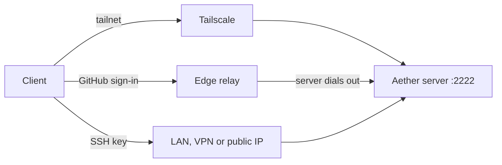

# Networking and identity

A client (the `aether` CLI or the dashboard) must reach the server's SSH port,
`:2222` by default. Git, the control channel, terminals and `ssh` into a run
([terminal.md](terminal.md#ssh-and-editors)) all travel over that one
connection. The server opens no HTTP port unless you set `web-port`
([The dashboard](#the-dashboard)). Through an edge it opens no port at all.

How clients reach that port also decides how people prove who they are. Terms
such as server, member and edge are in the [glossary](README.md#concepts).



## Which path to use

| Path | You need | Who can join | Each person installs | Trade-offs |
| --- | --- | --- | --- | --- |
| [Tailscale](#tailscale) | The server on a tailnet | Anyone on the tailnet, once an admin approves | Tailscale and `aether` | No keys or invite codes. Enables the dashboard for phones. Identity is the device owner |
| [An edge](#through-an-edge) | A GitHub account. No open port | Anyone invited by GitHub account | `aether` | Works behind any NAT. A third party relays traffic but cannot read SSH. No server-hosted dashboard |
| [LAN, VPN or public IP](#plain-lan-vpn-or-a-cloud-box) | A reachable `host:2222` | Anyone with an invite code | `aether` | You manage SSH keys and invite codes. Keep the port behind a firewall |

All paths feed one member list, so a tailnet server can also hand an invite
code to someone outside the tailnet. With no preference, use Tailscale. When
neither side can reach the other (a hotel network, a server behind home NAT),
use an edge.

## Tailscale

[Tailscale](https://tailscale.com) is a private network between your devices.
With the server on your tailnet, joining needs no SSH key, `authorized_keys`
or invite code.

1. On the server box, join the tailnet and print its host name:

   ```sh
   curl -fsSL https://tailscale.com/install.sh | sh
   sudo tailscale up
   tailscale status --self
   ```

   Give your team the name it prints, such as `my-server.tailnet-name.ts.net`.

2. Run `sudo aether-server setup` ([install.md](install.md#first-boot)). It
   finds tailscaled and asks `Will people reach this server over the tailnet
   <name>`. Answer `yes`. The default, no, turns tailnet sign-in off.

3. On each client, join the same tailnet and link:

   ```sh
   sudo tailscale up
   aether link my-server
   ```

   A bare host name uses port `:2222`. The first link saves the host key in
   `~/.ssh/known_hosts`, so `git push aether main` works afterwards.

> [!WARNING]
> The server looks for the tailscaled socket once, at startup. Start
> Tailscale before the server, and run `sudo systemctl restart aether-server`
> if you add it later. Without it the server accepts SSH keys only.

### Who is let in

The server asks the local Tailscale daemon who is on the other end of each
connection, as Tailscale SSH does. The tailnet login becomes the member, and the
part before the `@` becomes the display name.

- The first tailnet identity to link a fresh server becomes its admin.
- Everyone after that joins as a pending collaborator. They cannot act until an
  admin runs `aether member approve <member-id>`; until then commands fail with
  `membership pending admin approval`. Roles change with `aether member role`
  ([teams.md](teams.md)).
- `--tailnet-auto-join` skips approval, for teams whose tailnet already is the
  team boundary.
- Removing someone from the tailnet, or denying them the server in your
  Tailscale ACLs, locks them out. `aether member remove <member-id>` does the
  same inside Aether.

### What an attacker can and cannot do

The lookup names the owner of the device, not the person at the keyboard. Any
process or OS user on a tailnet machine can connect as its owner. That is fine
for a single-user laptop and wrong for a shared box. Two guards:

- A tagged node (CI runners, shared machines) gets no identity. It is refused
  with `tagged tailnet node; key authentication required` and must use an SSH
  key.
- `--tailnet-require-key` demands a registered SSH key on top of the tailnet
  identity. Use it when you cannot guarantee single-user devices.

When the lookup fails, the server falls back to SSH keys instead of locking
anyone out. A member with only a tailnet identity cannot open new connections
while tailscaled is down.

| Message on the client | What happened |
| --- | --- |
| `tailnet identity unavailable; key authentication required` | The connection did not arrive over the tailnet, or tailscaled is down. Routine on LAN connections |
| `tailnet login <x> must also present a registered SSH key` | `--tailnet-require-key` is on, as `aether-server setup` leaves it when you answer no to its tailnet question. To undo: `sudo aether-server config set tailnet-require-key false`, then `sudo systemctl restart aether-server` |

The server's user must be able to read `/var/run/tailscale/tailscaled.sock`.
The shipped unit runs as root. For another user, run `sudo tailscale set
--operator=<user>`.

## Through an edge

An edge is a relay on the public internet. The server and the client both dial
out to it, so neither needs an open port, a tailnet or a copied SSH key, and
people sign in with GitHub. The project runs one at
`https://edge.onaether.dev`. `aether-server setup` turns it on when the host has
no tailscaled or you answer no to its tailnet question. You can also
[run your own](edge.md#running-your-own-edge).

```sh
aether login                      # sign in with GitHub
aether link --claim <code>        # the owner, with the claim code aether-server setup printed
aether link '<invite link>'       # anyone an admin invited, with the link the admin sent
```

A bare name such as `my-server` is always an SSH address. Only a server id, a
claim code or a join link goes through the edge.

The server's owner sets who is let in with `edge-access`: `account` (a GitHub
sign-in is enough) or `approved-devices` (the default; each new device waits for
a person to approve it). SSH is end to end, so the edge cannot read it, but it
sees who connects to which server and when. The [edge guide](edge.md) covers
the policies, what an attacker needs under each, and claiming. Invitations and
device approval are in [teams.md](teams.md#through-an-edge).

## Plain LAN, VPN, or a cloud box

With no tailnet and no edge, SSH keys and invite codes identify people.

### The first admin

```sh
aether link 192.168.1.50:2222
```

The first key to link a fresh server becomes the admin. The CLI offers
`~/.ssh/id_ed25519` and any key in your ssh-agent, and creates
`~/.ssh/id_ed25519` if it finds none. For another key:

```sh
aether link 192.168.1.50:2222 --key ~/.ssh/aether_ed25519
```

`link` saves the path in `~/.config/aether/config.json`. `git push aether`
calls the system `ssh` instead, so add an `IdentityFile` line for the server
host in `~/.ssh/config`. The CLI never asks for a passphrase: run `ssh-add` on
a protected key first. Without a usable key the handshake fails with
`attempted methods [none]`, followed by why the key was rejected.

### Everyone else

An unknown key is refused with `no Aether member for this key`. An admin
creates a one-time code (`--ttl` is in seconds, default 24 hours):

```sh
aether invite --ttl 3600
```

```
<invite-code>
expires <expiry-time>
```

The teammate redeems it once, which registers their key as a collaborator and
burns the code:

```sh
aether link <server-host> --invite <invite-code> --name "Example"
```

```
linked to <server-host> as Example (collaborator)
```

### What an attacker can and cannot do

Every connection is authenticated by key, and a member can run code in
containers on the host. Keep the port behind a firewall or a VPN, and do not
open it to the whole internet on a cloud box. Treat invite codes and member
keys as secrets.

## The dashboard

There are two dashboards, and they are independent.

| | `aether gui` | Server-hosted |
| --- | --- | --- |
| Runs on | Your own machine, on `127.0.0.1` | The server |
| Reaches the server | Over the same SSH link as the CLI | Directly, over HTTPS |
| Works with | Every path above | Tailscale only |
| Good for | Computers: has the directory picker and other local actions ([local-gateway.md](local-gateway.md)) | Phones and borrowed laptops: open a URL, already signed in |

`aether gui` changes nothing about the server's network shape. The
server-hosted dashboard is the server's only HTTP port, and it listens on the
host's tailnet addresses only. It needs tailscaled running before the server,
MagicDNS and HTTPS certificates enabled for the tailnet (Tailscale admin
console, DNS page), and root or the tailscaled operator to fetch the
certificate. Plain HTTP is never offered. Turn it on:

```sh
sudo aether-server config set web-port 443
sudo systemctl restart aether-server
```

Any device on the tailnet then opens the server's MagicDNS name, already signed
in, with no token or install: `https://my-server.tailnet-name.ts.net/` (other
ports append `:<port>`). `web-port` defaults to `0`, SSH only.
`aether-server setup` offers `443` after you answer yes to its tailnet
question, and `aether-server install --web-port 443` sets it without questions.

Requests are identified by the same tailnet lookup as SSH, on every request
with no session or token. The joining, approval and role rules above apply, and
the same trust boundary: the lookup names the device owner, and tagged nodes
are refused. `--tailnet-require-key` and `web-port` exclude each other, because
a browser cannot present an SSH key. A server with no tailscaled, including
one reached through an edge, has no server-hosted dashboard. The
[Android app](install.md#android-app) in Tailscale mode wraps this URL and
cannot receive [notifications](#notifications). Its Edge mode needs no tailnet
and no `web-port`: it runs the local gateway on the phone and reaches the server
through the [edge](edge.md).

### Add it to your home screen

A phone can keep the dashboard as an app that opens full screen.

- **Android.** Open the server URL in Chrome and pick **Install app** from the
  ⋮ menu.
- **iPhone.** Open the server URL in Safari and pick **Share > Add to Home
  Screen**.

Install the server URL, not an `aether gui` one. An `aether gui` URL carries a
per-process token that the home-screen icon drops, so the app opens
unauthenticated. There is no offline mode: away from the tailnet the app shows
the same connection error as the browser.

### Notifications

The server-hosted dashboard can notify a device when a run of yours needs you.
On that device open **Settings** and turn on **Notify this device when a run
needs me**. The browser asks for permission once. **Send test notification**
tests the whole path and shows the push service's own error when it fails.

A notification goes to a run's owner when the run starts needing them, by the
rule behind **Needs you** ([failure-handling.md](failure-handling.md#run-activity)):

| The run | The notification says |
| --- | --- |
| asks for a permission | `Permission: <action>`, or `Permission requested` |
| asks a question | `Question from the agent` |
| reports that it is blocked | `Blocked: <summary>` |
| asks you with `report --outcome needs-input` | the question |
| needs you another way | `Waiting for your reply`, or the usage-limit reason |
| loses its Enhanced session | `Enhanced could not start: <error>` or `Agent disconnected: <cause>` |
| fails a turn or reports failure | `Turn failed: <error>`, `Agent failed` or `Agent reported failure, review the result` |
| reports success | `Agent reported success, review the result` |
| ends `failed` with a result nobody has seen | `Failed, review the result` |

A working, waiting or stalled run does not notify. A Background run does not
notify for a question, and a swarm worker notifies only when blocked. One
notification per run: a newer one replaces the older, and tapping it opens the
run. While you use a dashboard on any device, notifications wait until you have
left every dashboard alone for a minute and the run still needs you. Runs the
[assistant](assistant.md#notifications) launched for you also notify you when
they finish.

It needs:

- The server-hosted dashboard. `aether gui` does not offer the switch. The
  [desktop app](install.md#desktop-app) shows its own notification while open.
- A browser with Web Push: Chrome, Edge and Firefox on a computer or Android,
  Safari on a Mac. On an iPhone or iPad it works only in the dashboard added to
  the home screen, on iOS 16.4 or later. The
  [Android app](install.md#android-app) cannot receive notifications: install
  the dashboard from Chrome instead.
- Outbound HTTPS from the server on port 443 to the browser vendors' push
  services: `fcm.googleapis.com` (Chrome), `updates.push.services.mozilla.com`
  (Firefox), `web.push.apple.com` (Safari) and `*.notify.windows.com` (Edge).
  The server connects directly, ignoring `HTTPS_PROXY`, and only to public
  addresses.

The server signs messages with a key it creates on first start,
`<data-dir>/push/vapid_key.pem`. If that file is lost, turn the switch off and
on again on each device. A refused message is logged as `push: notification not
delivered` with the service's answer. What the push service receives is in
[privacy.md](privacy.md#push-notifications).

### Android DNS

Android has no `/etc/resolv.conf`. The Android app in Edge mode writes the
network's DNS servers to a file in its private directory and starts the bundled
CLI with `AETHER_RESOLV_CONF` pointing at it. The CLI reads the variable only
when `/etc/resolv.conf` is absent.

### When it does not start

If the dashboard cannot identify or encrypt, it does not start. The server keeps
serving SSH and the edge, and says why in `journalctl -u aether-server`
(`server: the tailnet dashboard is not serving; the server runs without it`)
and in **Settings > Server** of a dashboard opened another way. The first two
reasons are checked once at startup: fix them, then `sudo systemctl restart
aether-server`. For the others the server retries, up to every 5 minutes, so a
server that starts before tailscaled or before HTTPS certificates are on starts
the dashboard by itself.

| Message | What to do |
| --- | --- |
| `the dashboard identifies members by tailnet WhoIs and tailscaled was not running when the server started (no /var/run/tailscale/tailscaled.sock); start Tailscale before the server, or set web-port to 0` | Start tailscaled, then restart the server |
| `tailnet-require-key demands an SSH key on every tailnet connection and the dashboard cannot present one; set one of tailnet-require-key and web-port off` | Pick one |
| `tailscaled did not report this node: status has no DNS name` | Enable MagicDNS |
| `servergw: tailscaled reports no tailnet address for <name>` | The node is not up. Run `tailscale status --self` |
| `servergw: HTTPS certificate for <name>: <error>; enable MagicDNS and HTTPS certificates for the tailnet in the Tailscale admin console (DNS page), or set web-port to 0` | Enable HTTPS certificates, or run as root or the tailscaled operator |
| `servergw: listen: no tailnet address could be bound: <errors>` | The port is taken on every tailnet address, or binding needs privileges the server lacks. One address that will not bind (IPv6 on a host with IPv6 off) is only a warning |

Once it serves, a request it cannot identify is refused with a JSON error:
`403` `tagged tailnet node; the dashboard identifies members by their tailnet
login and a tagged node has none` (tagged nodes use a key over SSH), or `503`
`tailnet identity unavailable: <error>` (tailscaled is down, or the source is
not on the tailnet).

`web-port` is off by default because it needs tailscaled, MagicDNS and HTTPS
certificates that an existing install may lack. On a fresh config `aether-server
setup` checks that tailscaled answers, that HTTPS certificates are on, that the
host holds its tailnet addresses (tailscaled with `--tun=userspace-networking`
does not) and that nothing listens on port 443. If a check fails it offers `0`
and prints the fix. Typing `443` anyway still sets it, and the dashboard starts
once the tailnet is ready.

## Limits

- Tailnet identity names a device owner, not a person.
- A server without tailscaled, or reached through an edge, has no
  server-hosted dashboard.
- Any other tunnel that gets a TCP port to the server works, but only Tailscale
  and the edge bring identity with them.

Next: [teams.md](teams.md) for roles, invitations and approval.
