# Mobile: a phone-first Aether

Status: approved by the owner on 2026-11-03. Phases 1–7 are being built.

## Recommendation

1. **Keep one web UI. Don't go native.** Give it a separate phone layout
   below 768px instead of squeezing the desktop shell into a narrow column.
2. **Navigation.** Bottom tabs: **Needs you** (home) · **Sessions** (list and
   lanes) · **+ New** · **Assistant** · **More**. A session opens full screen
   with **Chat / Terminal / Changes** tabs and a composer pinned to the bottom.
   Chat is the first tab and the default for Enhanced sessions; only a
   Standard (TUI) session, whose agent runs only in the terminal, opens on Terminal.
3. **Approve where you look.** Approve, Decline and Reply sit on the Needs you
   cards. The terminal fits the phone's width instead of panning across 80
   columns.
4. **The Android app gets notifications** through UnifiedPush. The app
   registers that endpoint with the server's existing Web Push sender, so the
   push levels (#717) and push actions (#722) work in the app unchanged.
5. **iOS uses the home-screen web app** (Web Push needs iOS 16.4 or later).
   Build a native iOS shell only if real use shows that web push is not
   enough.

Size: about 11 PRs over 7 phases. Phases 1–4 are web only and ship to every
phone, including iPhones, the day they merge.

## Before and after (390px wide)

| Job | Before (today) | After (mockup) |
| --- | --- | --- |
| What needs me, approve | 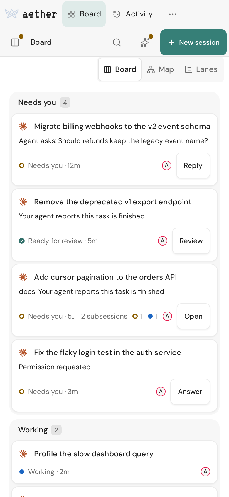 | 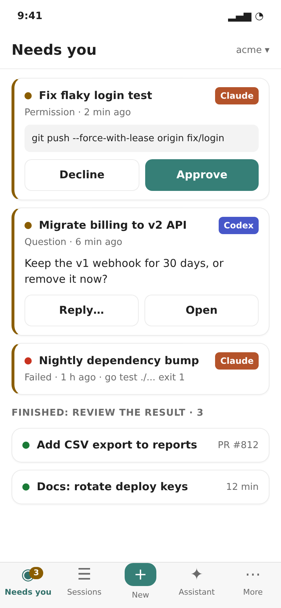 |
| A session: read, approve, reply | 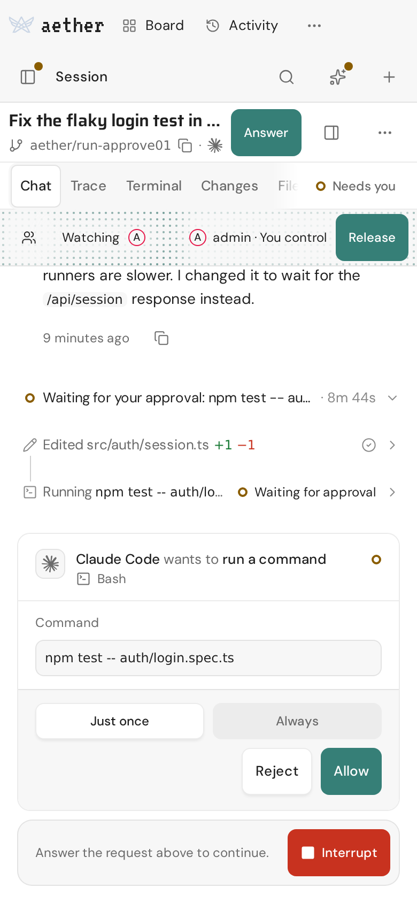 | 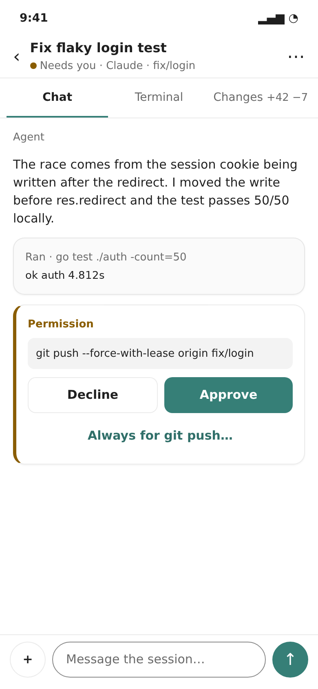 |
| Terminal | 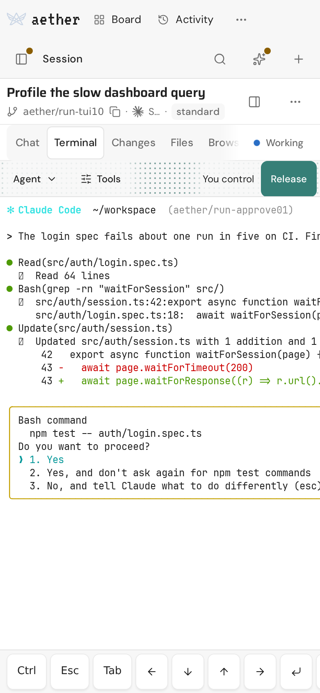 | 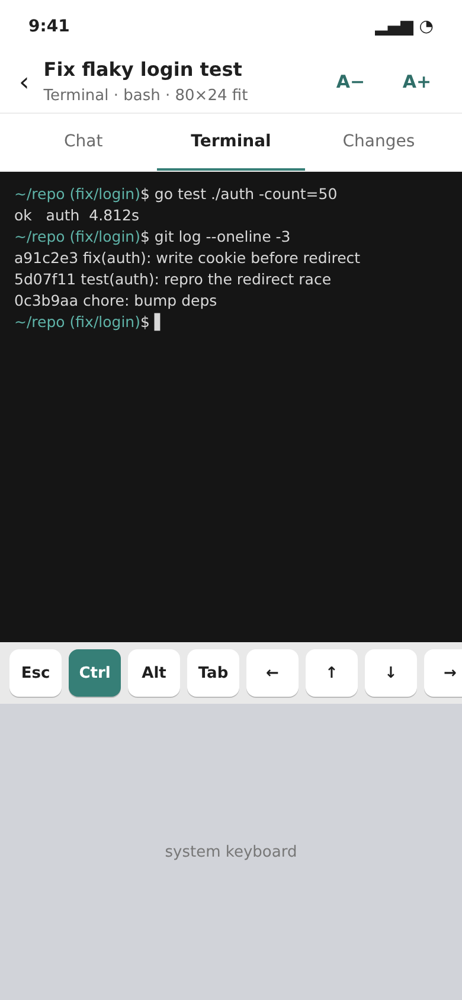 |
| Launch a quick task | 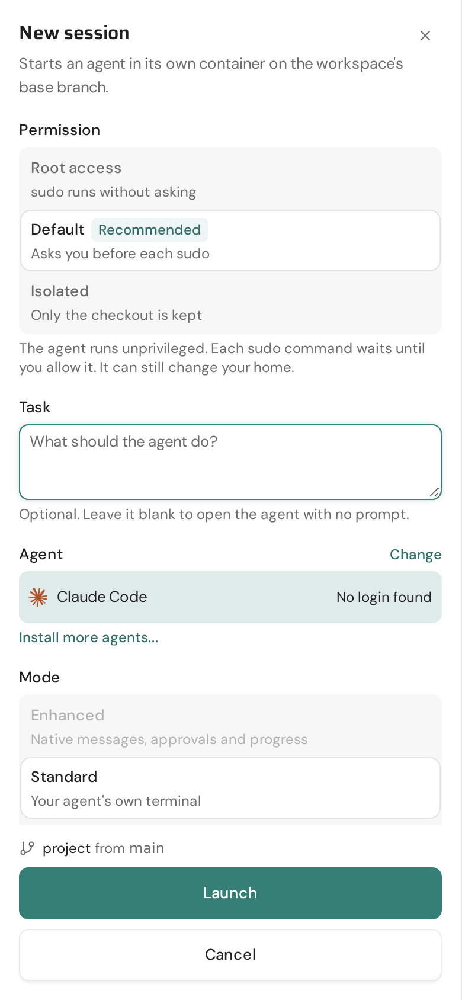 | 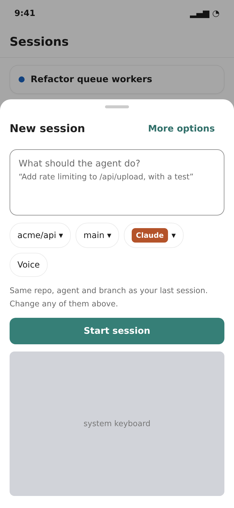 |
| Glance at lanes | 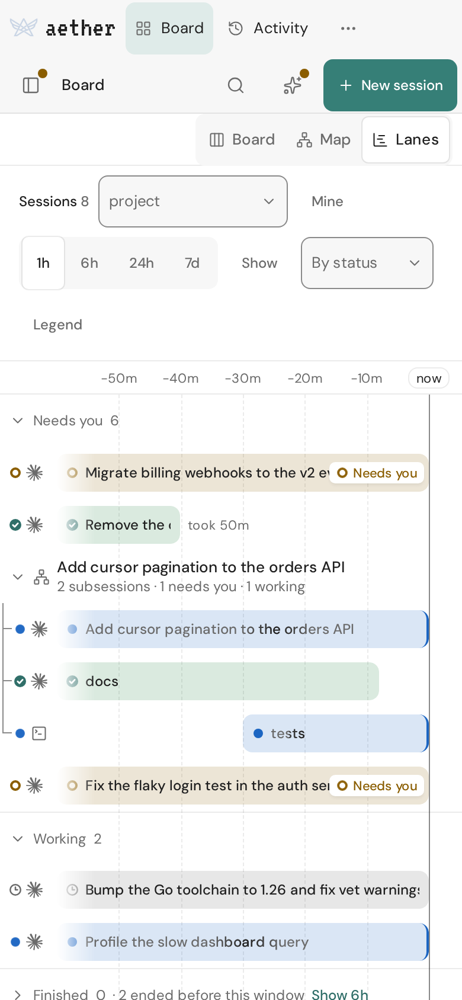 | 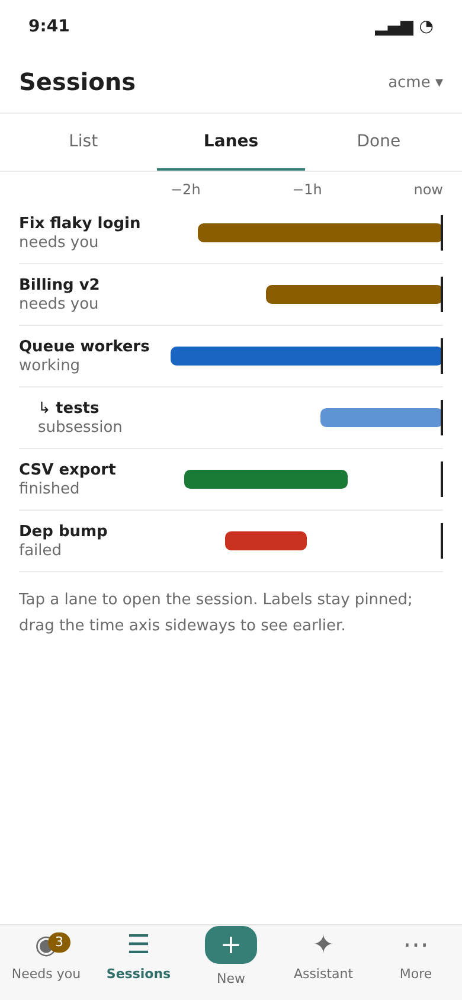 |
| Android notification | none: the app cannot receive push | 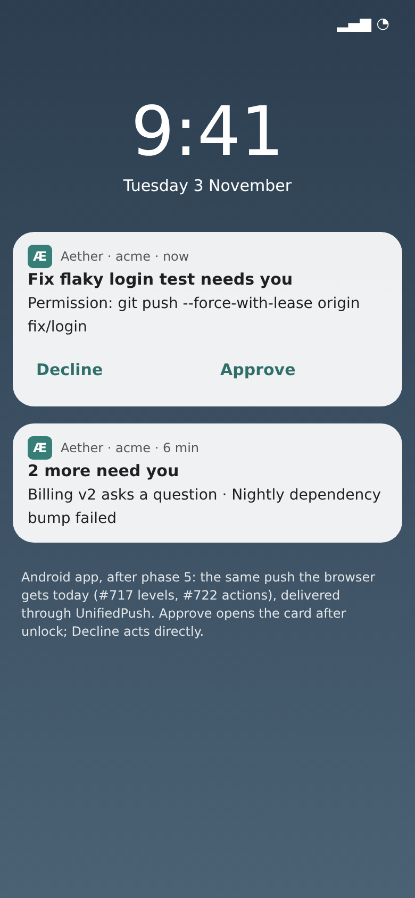 |

"Before" shots are the current dashboard in a real local server and gateway
with synthetic sessions. "After" shots are static HTML mockups in Aether's
own colors, not product code. More "before" shots are in `mobile/before/`:
sidebar sheet, map, Changes, assistant, settings, the composer with the
keyboard open, and subsessions.

## What's wrong today

Measured at 390px in a real local server and gateway, with synthetic sessions.

- **Chrome eats the screen.** A session page spends 244px (29%) on chrome
  before the first transcript line: a two-row top bar, the title, the view
  tabs and the room bar. At 360px wide that grows to 37%. With the keyboard
  open, about 98px of transcript is left.
- **Needs you is not a place.** It is the first board column plus a sidebar
  group, with only a dot on the sidebar toggle. The board can persist in Map
  mode, whose cards run off both screen edges.
- **The terminal does not fit.** The 80-column screen is 560px wide in a
  374px pane, so you pan sideways, and only about 5 rows show with the
  keyboard open. The key row exists but scrolls, and its arrows and Enter are
  40px wide.
- **Tap targets are too small.** Card titles are 20px tall. Just once and
  Always are 34px. Segmented tabs are 38px. The lanes range buttons are 35px
  wide. Changes has 20px line-comment targets. Launch has 16px links.
- **The views overflow.** In a session, Files and Browser hide behind a
  fade. The lanes filters take about 165px before the chart starts.
- **The Android app is a bare WebView.** It has no push, no share target, no
  download handling, no pull-to-refresh, and no offline view: a dead network
  shows the WebView's error page.

Taps today, from the board: approve **2**, reply **2** plus typing, launch
**2** plus typing (Task sits below the permission choice), terminal **1**
for a Standard session, or **3–4** for an Enhanced one, which opens on "No
agent terminal" with no shell yet. After phase 1, approve is **1** tap, and
from an Android notification Decline is **1** tap.

## Phases

S = 1 PR, M = 2 PRs, L = 3 or more. Every phase ships on its own.

| # | What you get | Size | Needs |
| --- | --- | --- | --- |
| 1 | **Phone shell.** Bottom tab bar under 768px, with Needs you as home. Cards carry inline Approve, Decline and Reply, and a "Finished: review the result" group. The sidebar sheet moves under **More**. | M | #706 status rule, #716 cards |
| 2 | **Session screen.** Full-screen stack, Chat / Terminal / Changes tabs (Chat first; an Enhanced session opens on Chat, a Standard one on Terminal), composer pinned above the keyboard (`visualViewport`), queued prompts shown with their origin (#719), close warnings (#709). | M | 1 |
| 3 | **Terminal on a phone.** Fit to width: A−/A+ and pinch. Size the PTY to the phone while no wider client is attached; that needs a spike, because the PTY is shared. Read-first: the keyboard opens only on tap. The existing key row stops scrolling: sticky Ctrl/Alt, 44px keys, and a "more keys" sheet. An Enhanced session opens a shell instead of "No agent terminal". | M | 2 |
| 4 | **Launch, lanes, assistant.** New-session bottom sheet: prompt plus repo, branch and agent chips, which default to your last session. Lanes become a Sessions tab with pinned labels. The assistant opens full screen. | M | 1, #723 |
| 5 | **Android notifications.** A UnifiedPush endpoint goes to `push.subscribe` and becomes a native notification with the #722 actions. Adds back-gesture per tab and "Share to Aether" (text or a link becomes a new-session prompt). | M + spike | #717, #722 |
| 6 | **Reconnect.** Paint the last snapshot at once, reconnect on `visibilitychange` and network change, show the real error on one line, and show a "phone app too old / server too old" gate. | S | — |
| 7 | **iOS.** Home-screen install guide, standalone safe areas, app badge from push (`setAppBadge`), and a check on a real iPhone. | S | 1–6 |
| later | **Native iOS shell** (WKWebView plus APNs) only if phase 7 shows web push is not enough. Needs an Apple developer account and App Store review. | L | owner decision |

## Orca: what we take and what we leave

[Orca](https://github.com/stablyai/orca) is **MIT** (© 2026 Lovecast Inc.),
so we could copy code with its notice kept. The plan copies patterns only, no
code. The mobile app is in the same repo, under `mobile/`; its relay and push
gateway are under `cloud/`.

**Their approach, in five lines:**

1. A native **React Native 0.83 + Expo 55** app for iOS, Android and iPad,
   plus an xterm.js terminal inside a WebView.
2. The phone talks to the **desktop app** over WebSocket RPC: directly
   (Tailscale or LAN address) or through Orca's relay, with their own
   end-to-end encryption (X25519 key exchange) on top.
3. Pairing is a **QR code** that carries the endpoint, a one-time device
   token and the desktop's public key.
4. Push goes **desktop → Orca's hosted push gateway → APNs/FCM**. The gateway
   stores no content. The notifications have **no action buttons**; tapping
   one deep-links to the pane.
5. One stack with no tab bar: a "Jump back in" home ranked by attention, and
   per-host screens for session, files, review and PR. Released by GitHub
   Actions with fastlane (TestFlight) and an APK on GitHub; no OTA updates.

**Patterns we take:**

| Pattern | Orca file | In Aether |
| --- | --- | --- |
| Attention ranking: permission or failure first, then unread finished, then working (which stays quiet) | `mobile/src/worktree/home-jump-back-in.ts` | Needs you home (phase 1), on the server's own `NeedsAttention` rule |
| Approvals carry `{itemId, expectedRevision}`, so a stale tap cannot approve the wrong prompt | `native-chat/input/mobile-native-chat-permission.ts` | Already the shape of #716 cards (first decision wins). Keep it for agent permission cards too. |
| Terminal: input only after a tap, sticky modifiers, arrow pad, "more keys" sheet, never auto-open the keyboard, grid fitted to the screen | `src/session/MobileSessionAccessoryKeys.tsx`, `terminal-sticky-modifiers.ts`, `terminal-grid-fit.ts` | Phase 3, on the key row Aether already has |
| Composer that queues follow-ups while the agent works | `MobileQueuedMessageComposer.tsx` | Phase 2, on #719's queue |
| Paint a cached snapshot while reconnecting; a watchdog that tolerates suspension; reconnect on app and network changes | `src/cache/home-snapshot-cache.ts`, `connection-revival-triggers.ts` | Phase 6 |
| Version and minimum-compatible checks in both directions, with an explicit "too old" screen | `src/shared/protocol-version.ts`, `HostProtocolGate.tsx` | Phase 6, next to the existing update gate |
| Push is the only path to a banner; the socket only reconciles; a silent "dismiss" push clears the notification elsewhere | `push-background-dismissal.ts` | Phase 5; matches #722's "No longer needs you" replacement |
| A redacted connection log and a troubleshoot screen with the real error | `app/connection-log.tsx` | Phase 6 |
| QR pairing that carries the endpoint, a one-time token and the pinned key | `src/shared/pairing.ts` | Later: replaces typing the server address in the Android setup |

**What we leave, and why:**

- **A second UI in React Native.** `mobile/` has about 4,400 files plus
  hundreds of react-native-web overrides. Aether's dashboard *is* the product,
  and one team cannot keep two UIs equal.
- **Their own encryption over plain `ws://`.** Aether already has SSH end to
  end through the edge, and TLS over the tailnet.
- **A vendor-run push gateway as the only route.** Aether is self-hosted, so
  push must work without a service we operate. UnifiedPush lets the user
  pick the distributor.
- **No notification actions.** Approving is the main reason to pick up the
  phone, so Aether keeps #722's actions.
- **A likely debug-signed APK with no store.** Aether already signs its APK
  and builds the `.aab`.

## Why not native

| | Phone layout in the web UI (chosen) | Native app (React Native or Kotlin/Swift) |
| --- | --- | --- |
| Ships to | Android app, Android Chrome, iPhone home screen, tablets | Each store, after review |
| Cost | ~11 PRs on existing components and stores | A second UI and protocol client to keep in step with every server change (Orca guards this with ~770 recorded RPC fixtures) |
| Push | Web Push today; UnifiedPush in the Android app | APNs/FCM, which need a publisher-held key and a relay for self-hosted servers |
| Terminal | xterm.js, already shipped | xterm.js in a WebView anyway (Orca does this) |
| What we lose | Live Activities, widgets, guaranteed iOS action buttons | — |

Revisit if, after phase 7, people still say the phone feels "not native":
scroll and gesture feel, or iOS push reliability.

## Android notifications in detail (phase 5)

Today the app is a WebView, and a WebView has no Push API
([networking.md](../networking.md#notifications)). In Edge mode the dashboard
is served on loopback by the bundled CLI, so browser push could not work
there either.

1. The app asks a UnifiedPush distributor for an endpoint, using the
   connector library with Web Push keys. The distributor is the ntfy app or
   any other.
2. The app sends `{endpoint, keys: {p256dh, auth}}` to the existing `push.subscribe`,
   tagged as an Android app device.
3. The server encrypts and signs exactly as it does for Chrome
   (`internal/push/webpush.go`). The distributor sees only ciphertext, the
   same as FCM does today.
4. The app decrypts the push and posts a native notification with #722's
   rules: **Decline** acts directly, **Approve** opens the card, and private
   or long cards get no buttons.

Limits to state in the docs:

- The server posts only to public addresses, so an ntfy server reachable
  only on the tailnet will not work.
- Without a distributor, the app says so and names the fix: install ntfy, or
  use Chrome's installed dashboard.

The spike settles three things first:

- whether a Decline action can reach the server without opening the UI;
- battery use with ntfy;
- whether the embedded FCM distributor is worth offering.

## Coordination with in-flight work

| Session | What the phone UI must respect |
| --- | --- |
| run-8cwcr762q2 (#716–#722) | Cards stay decidable for 10 min (24 h for connector turns); the first decision wins. A web-push Approve opens the card and Decline acts directly; no buttons over 240 runes or on private cards; "Always" never appears in a push. Don't change the push payload's card or action fields without telling run-8cwcr762q2 or run-emevkytbn0. |
| run-r9fpw3gz6d (#706, #709, #711) | Read the server's Needs you and awaits-review rules; don't re-derive them. Finished is passive and never in the badge. No one-tap Mark complete before the result is opened. Close surfaces show `run.close_check` warnings and need "Close anyway". Protected sessions show a lock. |
| run-z50f22rwm3 (#723) | The lane arrow needs about 60px of track left of "now" and an overlay over the lanes. The phone lanes view keeps that room. |

## Owner decisions

Approved on 2026-11-03:

1. Web first; no native app now.
2. UnifiedPush in the Android app (the user installs a distributor such as
   ntfy).
3. Tab order: Needs you · Sessions · + New · Assistant · More.
4. Most people run Enhanced sessions, so a session opens on Chat, the first
   tab. Terminal is a secondary tab and never the landing view for an
   Enhanced session. Only a Standard (TUI) session, whose agent runs only in the terminal, opens
   on Terminal.
