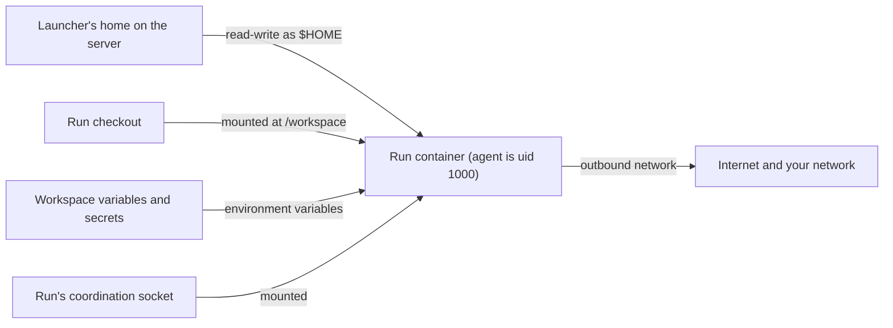

# Security model

What Aether isolates, what it leaves exposed, and who can see or act on what.
Read it before you run Aether for other people or let someone join your
server.

The Aether server runs on your Linux host and starts every agent in a Docker
container. A member is a person admitted to the server. Each member has a home
directory on the server and an environment, a long-lived container where they
install and sign in to agent CLIs. A run is one agent task in its own
container, with the launching member's home mounted into it. A workspace is a
repository and its runs. [Concepts](README.md#concepts) has the full glossary.

## Report a vulnerability

Do not open a public issue for a security problem. Follow
[Security](../CONTRIBUTING.md#security) in CONTRIBUTING.md, and leave live
credentials out of the report.

## At a glance

| Surface | What it protects | What it does not protect |
| --- | --- | --- |
| [Run container](#the-agent-container) | Keeps agents off the host, out of the host Docker daemon and out of other members' homes. Runs and environments cannot connect to each other. Agents run unprivileged. | It is not a VM. A run can read and change everything mounted into it: your home, the checkout and the workspace secrets. |
| [Permission tiers](#permission-tiers) | A Default run's `sudo` waits for its owner or an admin. Isolated keeps every change outside the checkout inside the run. | Root access runs sudo without asking. Docker inside a Default run gives root in the container without asking. |
| [Egress control](environments.md#egress-control) | Off by default. When on, a workspace's runs reach only its listed hosts, through the server's proxy, and never a private, loopback or metadata address. | An allowed host receives whatever the agent sends: with `github.com` allowed, the launcher's gh token can push anywhere it can write. Runs still reach the server host. |
| [Member home and environment](#the-agent-container) | Your home is mounted only into your own environment and your own runs. | Every run you launch can read and replace your agent logins and gh token, and sign with your commit signing key. |
| [Who can act on a run](#who-can-see-and-act-on-a-run) | Viewers can only watch. Every action is attributed on the workspace timeline. | By default every collaborator can type into, message and kill your runs, which hold your home. |
| [Account sharing](#account-sharing) | A recipient's run gets your agent login, not your home. | The recipient's run can copy, overwrite or log out your login. Revoking does not stop running runs. An `omp` share is as broad as sharing your home. |
| [GitHub credentials](#github-credentials-and-signing-keys) | The gh token stays in your home and the private signing key on the server, out of the database and out of saved images. Runs sign through an agent and cannot copy the key. | Any of your runs can act as you on GitHub within the token's scopes, including registering a signing key of its own. |
| [Workspace secrets](#workspace-secrets) | Hidden in settings, never returned by the API, masked in setup script output. | Every process in every run of the workspace reads them, and anyone who can launch or message a run can make it print one. |
| [Assistant](#the-assistant) | Its own container, home and sign-in, which your runs and account share recipients cannot see or change. Launching, messaging and stopping runs and saving the environment wait for your click. | A prompt that steers it can redirect the rest of its running session. Starting it needs the vendor's sign-in service. Auto-approve removes the click. |
| [Remote development and browser companion](#remote-development-and-browser-isolation) | Terminals, the app browser and captures need permission to steer the run. Chromium mounts none of your files. | Pages and captures can contain secrets. Anyone who can view the run can read a retained capture. |
| [Workspace mirrors](#workspace-source-mirrors) | Nobody can push to a mirrored base. A failed refresh blocks the launch instead of using stale code. | The configuring admin's gh token or the deploy key sits on the server, readable by the server administrator. |
| [Dashboard gateways](#the-dashboard-gateways) | `aether gui` listens on loopback with a per-process token. The server's dashboard is tailnet-only HTTPS with per-request identity. | Any process on the server host that connects to the host's own tailnet address is served as the node's owner. |
| [Push notifications](#push-notifications) | The server posts only to public HTTPS endpoints, and the payload is encrypted to your browser. | A notice shows run text (title and reason) on your device. |
| [Agent configuration and Files](#agent-configuration-and-files) | `aether config push` skips credential files and leaves out files with secrets. Files will not show a known credential file. | Files acts on your whole home. A credential under an unrecognized name is not locked. |
| [SSH into a run and port forwarding](#ssh-into-a-run) | Same admission as a run shell. Forwards reach only the run's own loopback. | Sessions are not recorded. Attaching an editor lets the run's agent reach your computer through the editor. |
| [Edge](#edge-remote-access) | SSH stays end to end. The server decides membership. By default a person approves every new device. | Under `edge-access account`, a taken-over GitHub account or edge admits a device. The edge sees connection metadata. |
| [Connectors](#chatgpt-and-claude-connectors) | A connector acts as one member through the tools of the scopes they granted, with that member's permissions. | TLS ends at the edge, so a compromised edge sees connector traffic and tokens. Under `edge-access account` a GitHub sign-in at the edge authorizes one without a code. |
| [Slack](#slack) | The bot connects out to Slack and acts as one linked member: it messages runs and answers requests once, with that member's permissions. | Whoever controls the linked Slack account acts as you on your runs. Slack keeps the messages it was sent. |
| [Coordination](#coordination-between-runs) | Runs message only allowed peers in their workspace. A message grants no control. | Runs in one workspace share a repository and can influence each other through files. |
| [Team memory](#team-memory) | Only members pin notes into briefs. Notes with secrets are refused. Agents cannot delete. | A note can be wrong or planted. It is data, never an instruction. |
| [Sysbox](#the-agent-container) | Docker inside a run without the host socket. Container root maps to an unprivileged host user. | Installing it from the dashboard runs a root script on the host. |
| [Release signing](#release-signing) | Updaters install only binaries listed in a signed manifest for that exact tag. | `aether gui build --zip` checks only the app layout of a local zip. |
| [Self-update](#server-and-client-updates) | Only signed `v*` releases of `3xDevOps/Aether`. A failed download replaces nothing. | An admin chooses which release the server runs. |
| [Vulnerability scanning](#vulnerability-scanning) | `govulncheck` runs on every pull request that changes code. | It is advisory: a finding does not fail the build. |

## The agent container

The container is the only isolation boundary. It is not a VM: every run
shares the host's kernel, and Aether builds no second sandbox inside it.

- Agents run as uid `1000`, or as an image's own non-root user. What they may
  do as root depends on the run's [permission tier](#permission-tiers).
  Treat root in a run as able to do anything the container can reach.
- A run is never `--privileged` and never gets the host Docker socket. With
  [Sysbox](environments.md#docker-inside-runs) installed, runs and
  environments get their own Docker daemon, and root in the container maps to
  an unprivileged host user. Without Sysbox a run has no Docker.
- Runs and environments start on `aether-agents`, a Docker bridge network the
  server creates with inter-container traffic off
  (`com.docker.network.bridge.enable_icc=false`). They reach the host and the
  internet but not each other. To set its subnet or MTU, create it yourself
  with that option before the first launch; a launch fails on a network of
  that name without it.
- A run of a workspace with [egress control](environments.md#egress-control)
  on starts on `aether-egress` instead: the same, but `--internal`, so its one
  way out is the server's egress proxy on the network's gateway.
- The packaged systemd unit runs `aether-server` as root. Docker socket access
  is root-equivalent anyway, and root lets the server hand homes and
  checkouts to the agent's user. An unprivileged server runs every container
  as its own uid and gid, the only owner it can hand files to.

What a run container is given decides what it can do:



Your home is mounted only into your environment and the runs you launch; an
[account share](#account-sharing) is the one exception. Your git name and
email (set with `aether member git`) are the author and committer in those
runs, and `/run/aether/co-authors` holds a `Co-authored-by: Name <email>` line
for each other member who messaged or typed into the run.

> [!WARNING]
> If you run agents you do not trust, put the server's `--data-dir` on a
> filesystem mounted `nosuid,nodev`. Docker has no per-mount switch for this,
> so otherwise root in a run or environment can plant a setuid binary through
> a writable mount and have it survive on the host.

## Permission tiers

Every run has a permission tier. Pick it under **Permission** at the top of
the launch form, which remembers your last choice, or with
`aether run --permission root|default|isolated`. Everything else launches at
Default: the CLI without the flag, the assistant, connectors, Slack and swarm
workers. A child run gets its parent's tier.

| | Root access | Default | Isolated |
| --- | --- | --- | --- |
| `sudo` | Runs without asking | [Asks you first](#sudo-in-a-default-run) | Refused |
| Your home and tool caches | Read-write | Read-write | A throwaway copy |
| Network | As the workspace allows | As the workspace allows | The agents' own hosts |
| Docker inside the run | With Sysbox | With Sysbox | None |
| Messages to other runs, team memory notes | Yes | Yes | Refused |

- In every tier the agent runs as uid `1000`, or as the image's own user when
  that is not root. An image whose user is root, such as an environment you
  saved, still runs as `1000:1000`, with your home at `/root` so paths saved
  in it keep working. The server hands your home and the checkout to that uid
  before each container starts, and gives the uid a passwd entry whose home
  is `/root`: git, `ssh` and `ssh-keygen` refuse to run without one, and
  `ssh` reads `~/.ssh` from it rather than `$HOME`.
- Default and Isolated runs get Docker's `no-new-privileges`, so no setuid
  binary raises the agent.
- A Root access run and your environment terminal get a sudoers entry for
  their uid before anything else starts in them.
- Docker inside a Default run puts the agent in the daemon's group, so it can
  reach root inside the container through Docker without asking. With Sysbox
  that root maps to an unprivileged host user.
- In every tier the run's checkout and run branch are its result. Runs
  launched before tiers existed show as Root access.

An Isolated run mounts your home and `/aether-cache` as overlays: the agent
reads them as they are, and its writes land in the run's scratch directory,
which is deleted with the container. Changes made to your home elsewhere while
it runs may not show inside it. Its network reaches only the agent hosts in the
[egress list](environments.md#egress-control), through the egress proxy, and
everything else is refused with
`aether: egress to <host> denied; an isolated run reaches only the agents' own hosts`.
`sudo` fails with `sudo: an isolated run cannot run commands as root`, in the
workspace setup script too, which then fails the launch. `aether-internal
send`, `ask`, `reply` and `memory add` fail with
`<method>: an isolated run cannot message other runs or write team memory`.

Two things in an Isolated run still reach outside it:

- Your agent's login file stays mounted read-write from your home. Claude
  Code and Codex replace the refresh token whenever they refresh, so a
  refresh kept only in the copy would leave your real login revoked. A login
  that is a whole directory, such as oh-my-pi's `~/.omp/agent`, stays in the
  copy, so its refreshes are lost with the run. On another member's shared
  account such a login cannot stay in a copy, so the launch fails with
  `scheduler: an isolated run cannot use another member's omp login: ~/.omp/agent is a whole directory the run could change for their later sessions; launch it at Default, or on your own account`.
- The run can read your gh token and sign with your commit signing key. With
  GitHub unreachable it cannot use the token, and a signature only covers
  commits in its own checkout.

### Sudo in a Default run

A Default run's `sudo` is Aether's shim at `/usr/local/bin/sudo`, ahead of
the image's on `PATH`. Docker's `no-new-privileges` stops the image's own:
`/usr/bin/sudo` fails with `sudo: The "no new privileges" flag is set, which
prevents sudo from running as root.`

The shim sends the command to the server and waits. The run shows **Needs
you** with `Run as root in <directory>: <command>` wherever permission requests show: the
run's **Needs you** panel, the Needs you list, push and Slack notifications,
`aether answer` and the connectors' `aether_decide_approval`. The command text
is the agent's: read it before you allow it.

- Only the run's owner or a server admin may allow it, because root in the
  container acts on the owner's home and credentials. Anyone who can steer the
  run may deny it. Anyone else gets `run.input.respond: permission denied:
  allowing a command to run as root requires the run's owner or an admin`.
- Allowed, the command runs once as root (with `-u <user>`, as that user) in
  the run's container, with the same arguments, the shim's working directory,
  the container's environment with sudo's fixed `PATH`
  (`/usr/local/sbin:/usr/local/bin:/usr/sbin:/usr/bin:/sbin:/bin`, never the
  agent-writable `~/.local/bin`) and up to 1 MiB of piped standard input. A
  terminal's input is not sent, so a command that prompts reads end of input:
  pass `-y`. The shim prints the output and exits with the command's status.
- Denied, the shim prints `sudo: <member> denied this command` and exits 1.
  Unanswered after 10 minutes, it prints `sudo: nobody allowed this command
  within 10 minutes` and exits 1. Each decision is a timeline note naming who
  decided and the command.
- When the shim goes away (the agent's tool timed out, Ctrl-C), a waiting
  request is withdrawn and a running command's process group is killed.
  Processes a command leaves behind when it ends by itself keep running.
- The shim accepts `sudo [-u user] [-E] [-H] [-n] [--] command [args...]`.
  `-E` and `-H` change nothing. `-n` fails instead of asking, with `sudo: a
  person must allow this command; -n cannot wait for one`. Any other flag
  fails, for example `sudo: -i is not supported in an Aether Default run`.
- While the workspace [setup script](environments.md#setup-script) runs,
  before the agent starts, `sudo` runs without asking: an admin wrote the
  script.

## Who can see and act on a run

The default role, collaborator, can view, steer (type into the terminal,
message, approve, pause) and kill every other member's run. A viewer can only
watch ([roles](teams.md#roles)). A run's container mounts its launcher's home,
so steering someone's run acts with their home, gh login and signing key. A
handoff (`aether handoff`) changes the owner but not the home.

To narrow it, `aether workspace settings --message-others admins-only` limits
messaging, steering and killing others' runs to owners and admins. `aether
protect <run>` does the same for one run; `aether unprotect <run>` lifts it.

Development terminals, the app browser, captures and SSH into a run need
permission to steer it even to read, because an app session can already be
signed in. Role changes reach open connections within seconds: a write attach
that loses that permission drops to read-only.

## Account sharing

Sharing your agent account lets another member run tasks on your agent
subscription. Share under **Profile → Agent account sharing → Share account**
or with `aether account share <member-id>`; revoke with **Revoke access** or
`aether account revoke <member-id>`. The other member picks your account in
the launch dialog's **Account** picker, or with `aether run --account
<your-member-id>`. They stay the run's owner; usage and cost count against your
account.

Their run uses their own image and home plus your agent login file, mounted
read-write because a token refresh rewrites it. The server checks the mounted
file is yours before their agent starts. Their own login is mounted in place in
all their containers, so a refresh in another of their runs cannot replace the
file yours is mounted over and detach it. For `claude` that is
`~/.claude/.credentials.json`;
[harnesses.md](harnesses.md#per-agent-setup) gives each agent's path. When
they have no installation of the agent in their own `~/.local/bin`, they also
get yours, read-only, with your whole `~/.local/bin` on their `PATH` after
their own entries.

- Root in their run can copy your login, refresh token included, and revoking
  does not recall a copy. Log out and in again to rotate it.
- Their run can end or replace your login: `/logout` in Claude Code and
  `codex logout` revoke it at the vendor, and `/login` writes their login into
  your file. For every agent except `omp`, that costs the login and nothing
  else in your home.
- Revoking blocks later launches and reopens and removes their control of runs
  on your account, but does not stop a running container. Kill those runs
  first: **Kill run** in the run header's **More** menu, or `aether kill
  <run-id>`.
- [Usage fallback](teams.md#usage-fallback) can move their run onto your
  account when theirs runs out, without them picking it: your share is the
  consent. It never picks an account not shared with the launcher.
- A launch checks every account it names, fallback included, when it is
  created, so a member cannot queue a run on an account nobody shared with them:
  `permission denied: member <member-id> has not shared their account with you`.
- Sharing and revoking are recorded in the
  [audit history](connectors.md#audit-history), readable by the sharing member
  and admins.

> [!WARNING]
> An `omp` share mounts your whole `~/.omp/agent` read-write, because omp
> keeps its login in a database there. The recipient's run can plant an
> extension or MCP server command that runs in your next omp session with
> your whole home, gh token and signing key. Share `omp` only with someone
> you would give your home to.

A member's own agent definition (`aether agent add`) is refused on a shared
account:

```
scheduler: harness "<name>" is your own agent definition, which runs only on your own account; on a shared account, only a server-wide definition (aether-server --agent-definitions) can declare the login it shares
```

Sharing needs Docker Engine 26.0 or newer. An older engine refuses every
launch that mounts a path inside a member home:

```
runtime: docker engine API "1.44" cannot mount a path beneath a member home; that needs API 1.45 (Docker Engine 26.0) or newer
```

After you first share a `claude` or `gemini` account, restart your environment
(**Stop environment** in **Profile**, then **Open** on **Environment**, or
`aether terminal stop` and `aether terminal`) so recipients get your refreshes.

## GitHub credentials and signing keys

Connecting GitHub, from the dashboard or with `gh auth login` and `aether
github connect` in your environment
([environment-home.md](environment-home.md#connect-github)), creates an
ed25519 signing key and leaves three files in your home on the server. None is
in the database, and `aether env save` never captures the home.

| File | Holds |
| --- | --- |
| `~/.config/gh/hosts.yml` | The gh token, in plain text. |
| `~/.ssh/aether_signing.pub` | The public half of the signing key, the one registered on GitHub. |
| `~/.gitconfig` | gh's credential helper for `https://github.com` and the commit-signing settings, with `user.signingkey = key::<public key>`. |

The private key is never in your home. The server keeps it in
`signing-keys/<member-id>` in its data directory (mode 0600) and lends it to
your runs and environment through a read-only SSH agent mounted at
`/run/aether-signing/agent.sock`, which `SSH_AUTH_SOCK` names. git signs
through it with `ssh-keygen`. The agent lists and signs with your key and
refuses to add, remove, lock or unlock keys. Aether signs its end-of-run
commits with the same key, read from the data directory.

Root in any of your runs can read and replace the token and `~/.gitconfig`, and
can sign anything with your key while the run lives. It cannot copy the key or
make Aether sign with another one. The token carries gh's default scopes
(`repo`, `read:org`, `gist`) plus the `admin:ssh_signing_key` scope Aether
needs to register the key, so an agent can push to the workspace's origin,
open pull requests, and add or remove signing keys on your account: a key it
registers signs commits that GitHub shows as Verified. It can also plant
`~/.local/bin/gh`, which then runs on your next `aether github connect`.

`SSH_AUTH_SOCK` names the signing agent in every run and environment. A
workspace variable of that name has no effect, and neither `aether ssh` nor an
editor's Remote-SSH session forwards your local agent. A shell that starts its
own `ssh-agent` replaces it, and `git commit` there fails with `error: Couldn't
find key in agent?`.

Releases before the server-held key kept it at `~/.ssh/aether_signing`. On its
first start after the upgrade the server moves each such key into
`signing-keys/`, deletes it from the home and rewrites `user.signingkey`, so
the key already registered on GitHub keeps signing. Runs and the environment
started before the upgrade have no agent, so `git commit` in them fails with
`error: Couldn't get agent socket?`. Restart the environment (`aether terminal
stop`, then `aether terminal`); such a run's end-of-run commit is still
signed.

To revoke the connection:

1. Revoke the GitHub CLI authorization in
   [GitHub's application settings](https://github.com/settings/applications).
   `gh auth logout` alone does not revoke a copied token.
2. Remove the signing key at
   [github.com/settings/keys](https://github.com/settings/keys), and any
   signing key there you did not add yourself.
3. Delete `~/.config/gh/hosts.yml` and `~/.ssh/aether_signing.pub` from your
   home. To retire the private key, a server admin deletes
   `signing-keys/<member-id>` from the data directory; the next `aether github
   connect` creates a new one.
4. Clear the signing settings in your environment terminal. Without the
   private key, every `git commit` in a run fails with `error: Couldn't find
   key in agent?` until you do:

   ```sh
   git config --global --unset commit.gpgsign
   git config --global --unset user.signingkey
   git config --global --unset gpg.format
   ```

`aether env reset` does none of this; it leaves the home alone.

## Workspace secrets

A workspace variable marked secret ([environments.md](environments.md#secrets))
is hidden in the settings and is an ordinary environment variable inside a
run. That protects the value from someone reading the settings, not from
someone who can run code in the workspace.

- Values are stored in `<data-dir>/workspace-secrets/<workspace-id>.json`,
  plain text, mode `0600`. The server administrator can read the file, and a
  backup of it is a credential backup. Deleting the workspace deletes it.
- Plain variables and the setup script are readable by every member, so keep
  credentials out of them. A variable marked secret later stays in old
  database backups: change its value too.
- Every new run container gets the secrets as
  environment variables, readable by every process in it and by anyone with
  Docker access on the host (`docker inspect`). Anyone who can launch or
  message a run in the workspace can make it print a secret into the
  transcript.
- A container keeps the values it was created with, so rotate a leaked
  credential at its issuer.
- Setup script output has every exact occurrence of a secret replaced with
  `***`. An encoded or split value is not recognized, and nothing masks what
  the agent prints later.

## The assistant

The [assistant](assistant.md) is an agent that runs in a container of its own
per member, driven from the dashboard. Its Aether tools act as you, with your
permissions, and it uses the account you signed it in to.

- Its home is `<data>/assistant/<member>/home` and its instructions are
  read-only. No run, environment or other member's container mounts either,
  and only the assistant's container mounts its tool socket. It mounts nothing
  from any member's home, so a run that changes your `CLAUDE.md`, `~/.claude`
  settings and hooks, `~/.codex/config.toml`, `.bashrc`, `~/.local/bin` or
  agent login does not change the assistant.
- Its sign-in is its own, made in its container and kept in its home. Your
  runs, and the runs of members you share your account with, cannot read or
  replace it. A login file carries more than tokens: Claude Code also reads a
  gateway URL that receives every prompt, MCP tokens and plugin secrets from
  `.credentials.json`.
- The one remaining writer of that home is the assistant's own agent. Each
  start therefore runs a new container, deletes everything in the home but the
  sign-in and the session files, rewrites the sign-in file to the keys a
  sign-in writes, and refuses the start if it removed any. Then the server
  refreshes the sign-in with the vendor itself and asks the vendor which
  account it belongs to, and refuses the start unless it is the account you
  signed in with. The account is recorded at the first start of either
  agent after you sign in, before any agent session runs, so neither agent's
  session can rewrite the other's sign-in first. A sign-in the agent swapped
  for another account's, in any field, is caught at the next start.
- What a steered agent can still do, within the one session it runs in:
  change what that session reads again (Claude Code rereads
  `.credentials.json` and `~/.claude/settings.json`) and so point the rest of
  the session at another endpoint or account, and write text into the session
  files, which the same conversation reads back when it resumes, until
  **New conversation**.
- The assistant does not start when the server cannot reach the vendor's
  sign-in service.
- Reading runs and pausing or resuming them happen at once. Launching,
  messaging or stopping a run and saving your environment wait for you to
  approve a card. An unanswered card fails after 10 minutes.
- **Let the assistant act without asking** (auto-approve, off by default)
  skips the card for your own runs. Messaging or stopping another member's run
  always asks. The assistant cannot turn auto-approve on or approve a card
  itself.
- Its shell and file tools never ask, inside its own container.
- Transcripts it reads can carry injected instructions. With auto-approve off,
  a steered assistant still needs your click. With it on, a steered assistant
  can launch, message and stop your runs.

Every write call the assistant makes, such as a launch, message, pause or stop,
is recorded in the [audit history](connectors.md#audit-history) as `assistant`.

Never sign the `aether` CLI in inside a run or your environment terminal. Its
client key would sit in your home, where every run can read it and act as you,
including approving the assistant's cards.

## Remote development and browser isolation

A run can have development terminals, a shared app browser (a headless Chromium
companion container) and captures of both. All need permission to steer the run,
reads included. A terminal runs in the live run container with the run owner's
home and credentials. Taking control of a terminal or the browser only decides
whose input goes in; other processes keep running. A human can take control from
an agent, never the reverse.

The browser companion runs as UID `1000` with a read-only root filesystem,
every capability dropped, `no-new-privileges` and Chromium's sandbox on. It
mounts none of the checkout, your home, keys, agent logins or the Docker
socket. It shares the run's network, so it reaches the app's loopback ports
and everything else the run can. Chromium is driven over a pipe, not a port.

Page content is not protected: cookies, tokens, customer data, console output,
URLs and anything on screen can end up in a capture. Use test accounts, never
production credentials, and review a capture before you keep it. **Annotate**
leaves out form values and redacts attributes that look like credentials, but
sends visible text as it is, and only after you press **Send to agent**.

Retaining a capture makes it workspace evidence that anyone who can view the run
can read, without permission to steer it. Notes are at most 4096 bytes; a run
keeps at most 64 captures and 128 MiB, and a capture is at most 8 MiB. Retention
periods are in [privacy.md](privacy.md#remote-development-data).

## Workspace source mirrors

A mirror is an admin-configured, read-only fetch of an upstream branch into a
workspace's base branch. It is separate from the publish destination, where
run branches and pull requests go. A source URL must not contain credentials.

| Mode | Credential | Where it lives |
| --- | --- | --- |
| `github` | The configuring admin's own gh login, with all its scopes. | The admin's home. |
| `public` | None. | None. |
| `deploy-key` | An ed25519 key Aether generates for the mirror. | `<data-dir>/mirrors/<workspace>/private_key.<generation>`, mode `0600`. |

- Mirroring private source shares its code with every member and run in the
  workspace. It does not lend them the admin's GitHub login.
- The server administrator can copy the deploy key, and a backup of `mirrors/`
  is a credential backup. On GitHub, install only the printed public key and
  leave **Allow write access** off.
- Reconfiguring replaces the local key but cannot remove the old one at
  GitHub; revoke it there. Disabling a mirror does not log out the admin's gh.
- Pushes to a mirrored base are refused. Only a forward refresh, or an admin
  adopting a new revision by its full commit SHA, moves it.
- A failed refresh blocks the launch instead of starting from stale code
  ([Launch and mirror failures](failure-handling.md#launch-and-mirror-failures)).

## The dashboard gateways

The dashboard reaches the server through one of two gateways
([local-gateway.md](local-gateway.md)). An edge serves no dashboard.

`aether gui` runs on your own machine. It listens on `127.0.0.1` only, with no
flag to expose it, and every API and WebSocket request must carry a token
minted for that process, which dies with it. It acts with your SSH key's
authority on the server and with your own file and git access locally.

The server's own listener (`web-port`, see
[networking.md](networking.md#the-dashboard)) serves tailnet devices. It binds
the host's tailnet addresses only, over HTTPS with tailscaled's certificate,
and has no cleartext port. It issues no token: each request is identified by
its tailnet address, a tagged node is refused with `403`, and requests from
another site's page are refused.

> [!WARNING]
> Any process on the server host that connects to the host's own tailnet
> address is served as the node's owner, usually the admin, with no
> credential. A device behind a Tailscale subnet router is served as the
> router's owner. SSH on port `2222` has the same boundary.

On both, every API call is checked, and open connections again every few
seconds, so removing or demoting a member reaches sockets already open.

The [Android app](install.md#android-app) is a WebView locked to one HTTPS
origin. It refuses `http://` addresses and certificate errors, opens other
sites in the phone's browser, stays out of cloud backup and holds no
credential. Safe Browsing is off because it only loads your server and the
phone's browser checks every other link ([privacy.md](privacy.md)).

### Push notifications

A push subscription comes from a member's browser and names a URL the server
posts to ([networking.md](networking.md#notifications)). The server keeps only
`https` endpoints, at most 16 per member, and connects only to public
addresses, never its own host, LAN or tailnet. The payload is encrypted to the
browser and signed with the key in `<data-dir>/push/vapid_key.pem`, which
grants nothing on the server. A notice carries the run's title and a reason
from the run.

### Terminal image uploads

You upload only bytes you pick or paste; the server never reads a path on your
computer. Images (PNG, JPEG, GIF or WebP, at most 8 MiB) go to
`~/.aether/terminal-images/` and other attachments (at most 64 MiB) to
`~/.aether/terminal-files/`, mode `0600`, in the home the target container
mounts. Uploading to a run needs permission to steer it and writes into its
launcher's home. The files stay until removed or the member is deleted, every
container that mounts the home can read them, and saved images leave them out.

### Run file uploads

**Upload files…** in a run's **Files** needs permission to steer the run and
writes into its checkout. An uploaded file is part of the run's changes, and
so of what it commits and publishes, unless the repository ignores it. Files
lists ignored files too, and anyone who can view the run can read any file in
its checkout, a `.env` included. Keep a value viewers must not see as a
workspace secret and out of files.

## Agent configuration and Files

`aether config push` uploads agent configuration from your computer
([environment-home.md](environment-home.md#upload-and-edit-configuration)). It skips
credential files, `*.pem`, `.env` and `.env.*`, symlinks and files over
64 MiB, and leaves out any file the secret scanner flags, with no override.
The server applies the same rules again. Replacing a server file that differs
needs `--overwrite`.

**Files** in the dashboard reaches your whole home. Credential files are
listed but cannot be read, downloaded, edited, renamed or moved: each shipped
agent's login files, `.env` and `.env.*`, anything ending in `.pem`,
everything in `~/.ssh` except `*.pub`, `~/.config/gh/hosts.yml`,
`~/.git-credentials` and `~/.netrc`. You can still delete one or upload over
it. The lock keeps credential bytes out of the browser. It is not a boundary
against you, since your terminal reads the same home, and a credential under
another name is not recognized. Whatever you upload or edit is visible to your
environment and every run you launch.

## SSH into a run

`ssh <run-id>.aether` ([terminal.md](terminal.md#ssh-and-editors)) gives you
a shell, file transfer and port forwarding inside a run's container.

- Admission is the run shell's: membership, permission to steer the run, and a
  `running` or `needs-attention` run that is not paused. It is checked again
  every three seconds, and the connection closes when you fail it.
- The container has no SSH daemon, port or key; the server speaks SSH itself
  and picks the container. `-L`, `-D` and `-W` forwards reach only loopback
  inside the run. Remote, agent and X11 forwarding are refused.
- Sessions are not recorded: teammates see that you connected, not what you
  did. A run takes 16 connections (8 per member), each with 10 sessions and
  64 forwards.
- Processes you start stop when the session ends. For a paused run the stop
  waits for resume, and a server restart in between forgets it, leaving them
  running. Only **Free container…** on a finished run is certain to end them.
- Your `ssh` must be OpenSSH 9.6 or a build patched for CVE-2023-51385. Older
  clients can run a command on your computer when they open a crafted
  `*.aether` host name, for example from a git submodule URL.

> [!WARNING]
> An editor attached over SSH (VS Code, Cursor, Zed) trusts the machine it
> attaches to, and the run's agent controls that machine. A compromised remote
> can use the connection to run code on your computer. Attach only to runs
> whose task and repository you would run on your own machine; use plain `ssh`
> for the rest.

The desktop app opens only exact editor links to a run, such as
`vscode://vscode-remote/ssh-remote+<run-id>.aether/workspace`.

### SSH port forwarding

`aether forward` and the dashboard's OAuth sign-in forwards reach only a run
(`run:<run-id>`, which needs permission to steer it) or your own environment
(`terminal`). Other hosts and reverse forwarding are refused. For an OAuth link that
redirects to a loopback address, the local dashboard binds that port on your
machine and forwards it only to the terminal the link appeared in.

## Edge remote access

The [edge](edge.md) relays SSH for members with no tailnet or direct route to
the server. It vouches for who signed in with GitHub; the server decides who
is a member.

- A server uses an edge only when its config names one. `aether-server setup`
  turns on the project's edge on a host without tailscaled, and says so.
- Until it has a member, a server with an edge takes its first admin by SSH
  key only from a loopback address: the server itself or an SSH tunnel.
  Everyone else claims it with `sudo aether-server edge claim-code`, so a scan
  that finds port 2222 open cannot take admin first. A forwarder on the host
  that connects outside clients to `127.0.0.1:2222`, such as `socat`, defeats
  this. Without an edge, a server with tailnet sign-in takes that first key
  only over the tailnet or from loopback, and one with neither takes it from
  any address.
- SSH is encrypted end to end. The edge cannot read it or pose as your server.
- The server pins the edge's signing key. A different key is refused until you
  compare fingerprints and run `sudo aether-server edge trust`.
- `edge-access`, set only on the server host, decides what a GitHub sign-in
  is worth. Under `approved-devices` (the default) a person must also approve
  each new device. Under `account` a member's GitHub sign-in is enough, so a
  taken-over GitHub account or a compromised edge gets in
  ([what an attacker can do](edge.md#what-an-attacker-can-do)).
- Approve only a code read from a device you are holding. `aether device
  approve` first shows the device, the GitHub account, and the member and role
  it would join as. Refuse a code that would admit someone as you or an admin.
  An approved device key also works on the direct SSH port, without the edge.
- Device tokens do not expire. After you recover a taken-over GitHub account,
  revoke the devices it signed in
  ([edge.md](edge.md#recovering-a-github-account)).
- Linking a second GitHub account to a member, or merging two members, needs
  proof from both sign-ins and a person's approval. A merged member keeps the
  lower role. Do not enter a merge code you did not ask for.
- `sudo aether-server edge claim-code --admin <member-id>` recovers access for
  an existing admin and nothing else.
- The first link pins the server's identity. A server id from `aether servers`
  comes from the edge: before you confirm, compare the id and fingerprint the
  CLI shows with `sudo aether-server edge status` on the server.

The edge operator sees server ids and host names, account identities, device
labels, client addresses, timing and byte counts
([privacy.md](privacy.md#what-an-edge-stores)).

## ChatGPT and Claude connectors

A [connector](connectors.md) lets ChatGPT or Claude act as one member through
the tools of the scopes they granted. Calls get that member's role checks;
there is no terminal, file, settings or git-writing tool.

- Identity: a connector's calls carry the device its pairing code was minted
  on, so a method that needs an approved device refuses a connector minted on
  a registered or pending one, under either `edge-access` policy. Audit
  records name the connector, such as `ChatGPT connector con-7k2m9q4xbd`.
- Scopes: the member picks them on the consent page, not the client. `read` is
  always granted, and every member can read every run on the server, so a
  connector can read all of them. `write` (launch runs, message,
  pause and resume runs, answer questions, mark runs reviewed) is checked by
  default; `control` (decide permission requests, stop and close runs) is not, because text an agent wrote could talk the assistant into
  approving or ending work. A connector serves only its scopes' tools, and the
  server checks every call's method against its scopes, a permission decision
  against `control`, and refuses every method outside its table
  ([connectors.md](connectors.md#scopes)). It can make 30 write calls at once,
  then one every 2 seconds.
- Audit history: a connector's write calls, refused ones included, and its
  creation and revocation are recorded with the member, connector, method,
  target and outcome, never the parameters
  ([connectors.md](connectors.md#audit-history)). A member reads their own
  entries; an admin reads all.
- A connector minted over a member SSH key or a tailnet connection has no
  device: revoking a device does not cut it off. `aether mcp revoke` does.
- TLS ends at the edge, because ChatGPT and Claude need a public certificate.
  A compromised edge sees every tool call, result and token it relays, and can
  act as the member until the token expires (an hour), a refresh rotates it, or
  you revoke the connector. It cannot mint codes or tokens: your server makes
  them and stores only their hashes.
- Pairing needs a single-use 40-bit code, valid for 10 minutes, from a device
  you already use. Wrong codes are limited to 10 a minute per client address
  (IPv6 /64), so one address cannot lock other members out of pairing, and to
  300 a minute server-wide, which someone guessing from many addresses can
  reach to pause pairing for everyone while they guess. Revoking that device,
  removing the member or tightening `edge-access` cuts off their connectors.
  Only clients on `chatgpt.com` and `claude.ai` can connect. Claude Code's
  client id alone may return to `http://localhost` or `http://127.0.0.1` on
  any port; PKCE keeps a code another local program catches unusable.
- The universal URL `https://<relay host>/mcp` is one OAuth issuer for every
  server on the edge, but each server still mints, stores and checks its own
  codes and tokens. The edge only routes by their `<server id>.` prefix, so a
  token from one server sent with another's prefix reaches that other server,
  which holds no hash for it and refuses it. The edge-signed assertion the
  choose page posts names the GitHub account, the server, the client, its PKCE
  challenge and redirect URI, and lasts 5 minutes. It travels in a form body,
  never a URL. The server binds it to the first browser that brings it, by a
  hash of an edge cookie on the relay host, and only that browser's consent
  form can take it, once. The server remembers assertions only in memory, so
  it refuses one issued before it last started, or within the 30 seconds of
  clock skew it allows the edge after, and with it any consent form carrying
  one. Behind an edge at protocol 3 the assertion still arrives in
  the URL and is bound to no browser
  ([edge.md](edge.md#mcp-connectors)). On the universal paths the edge
  forwards a server's redirects and forms only to itself, `chatgpt.com`,
  `claude.ai` and Claude Code's loopback callback, `/callback` on
  `http://localhost` or `http://127.0.0.1` at any port. Under
  `edge-access account` it replaces the pairing code: the trust is the same as
  a GitHub sign-in admitting a new device, so a taken-over GitHub account or a
  compromised edge (or its key) can authorize a connector as that member.
  Under `approved-devices` the server ignores it and requires the code. A
  connector authorized this way is cut off when `edge-access` becomes
  `approved-devices`, its GitHub account is unbound from the member
  (`member.identity.remove`, or deleting the account at the edge), or the
  member is removed. It has no device and is judged as an edge device no
  person approved: a method that needs an approved device refuses it, and it
  cannot mint a pairing code or a Slack link code that would outlive these
  cut-offs.
- An edge given `--reviewer-account-file` offers one password sign-in, the
  [reviewer account](edge.md#reviewer-account), for an app directory's
  review. Anyone holding its password authorizes a connector as the member it
  is bound to, so a server takes it only with `edge-reviewer` on, under
  `edge-access account`, and only for a member who is no admin; it gets no
  edge session. Ten wrong passwords in a row for its login lock it for 15
  minutes, which also lets anyone who knows the login keep it locked, and
  the `429` confirms a guessed login, so keep the login as private as the
  password. A new password stops only new sign-ins; unlinking the login
  deletes its connectors, and binding it again does not revive them. Bind it to a member of a server kept for the review: every
  member reads every workspace.
- Under `edge-access account` the consent page has no code, so an
  authorization link someone started in their own ChatGPT or Claude, opened
  by a member signed in at the edge, is one **Allow** away from connecting
  that person's assistant as the member. The page says to allow only a
  connection you started yourself just now.
- Refresh tokens rotate on every use and lapse after 30 days unused. A rotated
  refresh token used again a minute or more later deletes the connector.
- Results contain text agents and other people wrote: run titles, reasons,
  reports, history, questions, PR titles, comments and failing
  check names, memory notes. Tools put it under an `untrusted` field, and the
  server's instructions tell the assistant never to follow it. Outside that
  field are only fixed labels, ids, states, counts, times, links, workspace
  and agent names, branch names, file paths and the server's own errors.
  ChatGPT and Claude ask you before each write tool; Aether adds no
  confirmation of its own. A permission request is only ever allowed or
  denied once: the connector never picks an "always" option, refuses a
  decision whose `action` text differs from the pending request's, and
  refuses any request too long to show whole, so the confirmation shows
  everything that is decided.
- No tool takes a member id. Every agent starts on that member's account, falling back to
  accounts the member may launch on exactly as the member's own launches do.
- `write` cannot end a live run: `aether_mark_reviewed` completes only a run
  whose agent reported success and awaits review.

## Slack

The [Slack bot](slack.md) acts as the member who linked a Slack account, the way
a connector does: with that member's role checks, judged by the device `aether
slack link` ran on, and with audit records naming `Slack connector <Slack user
id>`. It holds all three [scopes](connectors.md#scopes), since deciding a
permission request takes `control`, and calls only the methods its buttons and
replies need. Its write calls enter the
[audit history](connectors.md#audit-history) as a connector's do.

- It messages runs and answers requests once. It launches, stops and closes
  nothing, posts in no channel, and never picks an "always" option. A request
  longer than 600 characters gets no buttons, so a press never decides text
  Slack cut.
- Whoever controls the linked Slack account acts as you on your runs.
  `aether slack unlink`, revoking the device the code was minted on, or
  removing the member cuts the link off.
- Linking takes a one-use 40-bit code, valid for 10 minutes, sent to the bot in
  a direct message.
- Agent text in its messages is escaped, so it cannot mention anyone or
  disguise a link.
- The tokens sit in 0600 files under `<data-dir>/slack`, readable by the server
  administrator. The app holds `chat:write` and `im:history`, and reads no
  channel.
- A link makes 30 actions at once, then one every 2 seconds.

## Coordination between runs

Each run gets its own socket for messaging other runs
([coordination.md](coordination.md)). The socket is the run's identity, so no
token enters the container.

- A run can message its parent and child runs, runs editing the same files, and live
  runs in its workspace that its owner may message. Never across workspaces. A
  viewer's runs message nobody.
- A message is an attributed inbox item. It gives the sender no steer, kill,
  terminal, git, transcript or secret access to the recipient.
- Messages are capped at 4 KiB, 100 unread per inbox and 8 new correspondents
  per run outside its parent and children. Runs in one workspace share a repository, so they
  can still steer each other through file contents.
- `aether-server config set conflict-coordination false` turns off messages
  between runs and outcome reports; overlap warnings stay.
- Each container holds a read-only copy of the server binary for the optional
  MCP bridge. It carries no credentials.

## Team memory

[Team memory](memory.md) holds short notes that runs and members share in a
workspace. A note is an attributed claim that can be stale, wrong or planted,
never an instruction.

- Only members pin notes (`aether memory pin`, which needs permission to push).
  Pinned notes go into every run's launch brief; other notes reach an agent only
  when it searches.
- Agents can add, search and read notes, and replace only another agent's
  unpinned note. They cannot pin, unpin or delete. A viewer's runs only read.
  A note that gitleaks flags is refused, and a flagged report is withheld.
- `aether memory rm <id>` deletes a note and `aether memory rm --run <run>`
  every note a run wrote. Every change shows in the activity feed.

## Updates and releases

### Release signing

Anyone who can write to the repository's GitHub releases can replace their
files, so updaters trust a signature instead. Each release carries
`aether-release.json`, listing every file's SHA-256 and size, and an ed25519
signature over it. `aether update`, the dashboard's **Update now** and
`aether server update` check the signature against keys built into the binary,
require the manifest's version to match the tag, and check every download
against it. [install.md](install.md#verified-releases) shows the check by hand.

`aether gui build` on Windows checks the desktop app zip the same way, but
`aether gui build --zip <path>` checks only a local zip's layout: compare it
with `checksums.txt` first.

When the signing key changes, one bridge release trusts both keys. A client
older than the bridge rejects every later release: install the bridge first
with `aether update --version <bridge-tag>` (or `aether server update
--version <bridge-tag>`), or reinstall with the install script. A client that
has not installed a release past a leaked key still trusts that key.

### Server and client updates

`aether server update` lets an admin replace the server's binaries without a
shell on the host. That adds no power, since an admin can already run any code
on the server's Docker daemon. The version must be a `v` semver tag from the
`3xDevOps/Aether` releases; a client never supplies a URL. Both binaries are
verified before either is replaced.

**Install** in the **Docker inside runs** row of **Settings → Server** (admins
only) runs the Sysbox installer built into the server binary as root, the same
one `sudo aether-server sysbox install` runs; the dashboard sends no script or
URL. A server that is not root refuses with `the server does not run as root;
on the host run: sudo aether-server sysbox install`.

### Client self-update on macOS

When the `aether` CLI lives in a directory only root can write, such as
`/usr/local/bin`, the dashboard's **Update now** asks for your password in a
macOS dialog titled `osascript`. It authorizes one fixed command that copies
the download, staged in `~/Library/Caches/aether/update` (mode `0700`), into
place as root after checking its SHA-256. Your password goes to macOS, never
through Aether. A same-user process can make the update fail or stall, not
install other bytes: the digest is part of the command. A mismatch afterwards
reports `installed <path> does not match the release checksum; do not run it`.
Where Aether cannot offer the dialog, the banner shows `sudo aether update`
([local-gateway.md](local-gateway.md#localv1-verbs)).

## Vulnerability scanning

CI runs `govulncheck` (`make vulncheck`) on every pull request that changes
code. It is advisory: a finding does not fail the build. A reachable
vulnerability it reports gets a fix, and `go.mod` pins a patched Go
`toolchain` for release builds.

## Limits

- Containers share the host kernel. A kernel or Docker escape reaches the
  host.
- Outbound traffic is limited only for runs of a workspace with egress
  control on. Other runs and environment terminals
  reach the internet, your network and ports the server host listens on.
- An egress-limited run still reaches services on the server host, and every
  allowed host can receive data. A client that ignores the proxy variables
  cannot connect at all.
- The egress proxy tells runs apart by source address. Root in a run with
  Docker inside can claim another egress-limited run's address and get that
  workspace's host list.
- On Docker older than 26.0 (25.0.4 and 23.0.11 on older lines), an internal
  network still resolves names through the host (CVE-2024-29018), so an
  egress-limited run can send data out in DNS queries.
- Containers created before the `aether-agents` network existed keep Docker's
  default bridge, where they can reach each other's ports, until they are
  removed.
- Every run trusts `/workspace`, and each extra repo's `/repos/<name>`, for git
  through `GIT_CONFIG_COUNT`. An image
  with git older than 2.31 ignores that and can refuse the checkout when its
  owner differs from the agent's user. An image's own `ENV GIT_CONFIG_*`
  entries are replaced, so set them as workspace variables.
- **Commit selected** in a run's changes view does not run commit hooks. Use
  `git commit` in the run's terminal when hooks must run.
- An account share's login mount can be redirected by the owner's own
  containers to another file in the owner's home, never outside it.
