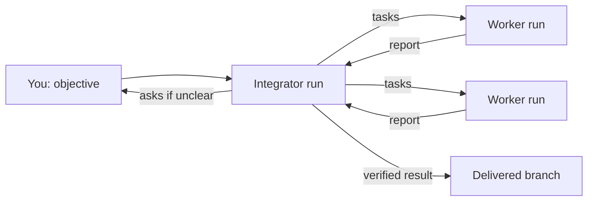

# Running Aether with a team

One Aether server can serve several people. Each person is a **member** with a
**role**, and everyone's agents run side by side in the same **workspaces** (a
workspace is one repository plus its settings). A solo setup is a team of one,
so there is nothing to switch on: you add members.

You need a running server and a first member, who is the admin. See
[quickstart.md](quickstart.md). New terms are in the
[glossary](README.md#concepts).

## Join the server

There are three ways to join. Pick the one that matches how your team reaches
the server.

| Method | Use it when | Who approves |
| --- | --- | --- |
| Tailnet | Everyone is on your Tailscale network | An admin, once per person |
| Edge | People sign in with GitHub through an [edge](edge.md) (a relay that lets people reach the server without sharing a network) | The invitation, then a device approval |
| Invite code | A person has neither, and you can send a code | Nobody: the code is the approval |

### Over a tailnet

The server must have tailnet sign-in on. `aether-server setup` turns it on when
you answer yes to its tailnet question ([install.md](install.md#first-boot)).
The teammate joins your tailnet and runs:

```sh
aether link my-server
```

Tailscale proves who they are, and the server adds them as a pending
collaborator. `aether link` prints `linked to <server> as <name> (collaborator,
pending); an admin runs: aether member approve <member-id>`. Until an admin
does, their commands fail with `membership pending admin approval; ask an admin
to run: aether member approve <member-id>`.

```sh
aether member list              # the PENDING column marks who waits
aether member approve mem-rbekp4h6fx
```

Start the server with `--tailnet-auto-join` to skip approval when your tailnet
already is your team. [networking.md](networking.md) covers tailnet identity and
revocation.

### Through an edge

An admin invites a teammate by GitHub login, or by the verified primary email of
their GitHub account:

```sh
aether invite --github dana --role collaborator
aether invite --email dana@example.com --role viewer
```

`--role` is `viewer`, `collaborator` (the default) or `admin`. The command prints
an invite link of the form `https://<edge host>/join/<server id>/<invitation
id>#<secret>`. It is shown once. In the dashboard, **Members → Invite…** shows it
with **Copy link**. Send it to the teammate, who opens it and selects **Join** in
the desktop app, or in a terminal runs:

```sh
aether login            # or aether login --json, for a script or coding agent
aether link '<invite link>'
```

What happens next depends on the server's `edge-access` policy
([edge.md](edge.md#access-policies)). Under `approved-devices` (the default), the
teammate's device waits until an admin approves it from a **Needs you** card or
[the commands below](#approve-devices), and `aether link` prints `waiting for an
admin of <server> to approve this device (<label>, <fingerprint>)…`. Under
`account`, signing in admits the device and creates the member at once.

An invitation expires after 7 days, and an invited login or email matches only
within 24 hours of the teammate's last GitHub sign-in at the edge. If you see
`open this edge in a browser to confirm them`, open any edge page to sign in
again. List and revoke invitations with `aether invite list` and `aether invite
revoke <invitation-id>`.

| Error | Meaning |
| --- | --- |
| `<account> is invited to this server; open the invitation link the admin sent, or run: aether link <link>` | They ran `aether link <server id>` instead of using the link |
| `the invitation link is not valid for this server: wrong, revoked or expired; ask the admin for a new one` | The link was used, revoked or expired |

### Approve devices

Each client install is a **device** with its own key. Under `approved-devices`,
every new device waits for approval, a member's own second laptop included.
Approve from the dashboard's **Needs you** card, or:

```sh
aether device list                         # yours; an admin sees everyone's
aether device approve <code or device-id>
aether device revoke <device-id>
sudo aether-server device review           # on the server
```

`aether device approve` shows who the device would be admitted as and asks
`approve it? [y/N]`. Check the member and role first: whoever holds an approved
device gets that member's access. There is no flag that skips the question.
Any answer other than `y`, or no answer on stdin, fails with `device approve:
not approved; a person must check the device shown above and confirm with y in
their own terminal: aether device approve <code or device-id>, or approve it
from the dashboard's Needs you card`. If the only admin has no approved device,
the refusal includes a code, and the admin runs `sudo aether-server device
approve <code>` on the server. At most 10 devices wait per account.

### By invite code

For someone with neither a tailnet nor a GitHub sign-in. An admin mints a
one-time code, and the teammate redeems it, which registers their SSH key:

```sh
aether invite --ttl 3600      # seconds; default 86400
aether link my-server:2222 --invite <code> --name "Dana"
```

The member is a collaborator at once, because the code was the approval. A code
stops working when the admin who minted it stops being an admin.

### Link or merge sign-ins

One person can reach the server through a tailnet login, an SSH key and GitHub
accounts. They join one member only through an explicit step, never by matching
emails or names. Add a GitHub account to your own member with **Profile →
Sign-ins → Link a GitHub account** or `aether member link --github dana`. Open the
link it prints while signed in with that account, then approve the new device
from your existing sign-in.

Someone who already became two members can merge them. Run `aether member merge
start` on one sign-in, which prints a code valid for 10 minutes. On the other,
run `aether member merge <code>` (options `--keep <member id>`, `--keep-admin`,
`--yes`), then `aether member merge accept` back on the first. Both show what is
discarded before you confirm. The survivor takes the other member's runs,
schedules, devices and accounts, and the lower of the two roles. The absorbed
member's home moves to `<data-dir>/merged/<merge id>/home` and their private
signing key to `signing-key` beside it. Both hold credentials, so remove the
directory with `sudo rm -r` once nothing in it is needed. A merge is
refused, with the reason, when either member is pending or has an unfinished run,
terminal or swarm role. Nothing undoes a merge.

### Remove access

`aether member remove <id>` deletes a member, their environment and their
private signing key, and closes their connections. `aether device revoke <id>` refuses a device key everywhere.
`aether member unlink <member-id> github:<user id>` unbinds one GitHub account
and revokes the devices that signed in with it. `aether invite revoke <id>` kills
a link.

`aether member remove` fails with `in use` while runs or schedules still belong
to the member. Delete those first. `aether member transfer <member id>` makes
another admin the server's owner at its edge.

### Single sign-on

Aether has no identity provider settings of its own: sign your tailnet in
through yours, such as Okta, Google Workspace, Microsoft Entra ID or GitHub
([Tailscale's providers](https://tailscale.com/docs/integrations/identity)), and
have people join [over the tailnet](#over-a-tailnet). Each such member is a
login from your provider, and the `tailnet-auto-join` setting
([install.md](install.md#server-options)) admits them without approval. A user
you [share](https://tailscale.com/docs/features/sharing) the server's machine
with signs in through their own provider.

Removing someone in your provider stops new sign-ins, not devices already
signed in. Those reach the tailnet until the user is suspended in Tailscale or
their keys expire. Suspend them in the Tailscale admin console, or let [user and
group provisioning](https://tailscale.com/docs/features/user-group-provisioning)
do it when you deactivate them in Okta, delete them in Microsoft Entra ID, or
suspend them in Google Workspace.

That closes the tailnet path only. Their SSH key, approved devices (which also
work on the direct SSH port), GitHub sign-ins at the edge and ChatGPT or Claude
connectors stay open. Remove the member to close them all:

```sh
aether member list                 # their member id
aether member remove <member-id>   # deletes their SSH key, devices, GitHub sign-ins and connectors
```

It fails with `in use` until their runs and schedules are gone
([Remove access](#remove-access)).

## Roles

| Role | Own runs | Other members' runs | Workspace |
| --- | --- | --- | --- |
| viewer | Cannot launch | View | Read the feed |
| collaborator (default) | Everything | View, message, steer, stop | Launch runs, push, use templates, set schedules, add memory notes |
| admin | Everything | Everything | Also members, workspaces and their settings, budgets, saving templates, `aether server update` |

Steering a run means typing into its terminal, messaging its agent, answering
its permission prompts and pausing or resuming it. Pushing means writing to the
workspace's git repository. Everyone who joins is a collaborator, so teammates
can message and stop each other's agents with no setup. Every such act is
recorded in the workspace timeline with who did it. Change a role with
`aether member role <id> viewer|collaborator|admin`. It applies to connections
that are already open: a demoted member's live attach drops with
`detached: you can no longer control this run`.

The last admin cannot be removed or demoted: `refusing to delete the last admin`
or `refusing to demote the last admin`. Admin-only commands fail for others with
`aether: rpc error -32001: workspace.add requires the admin role`.

To limit who can control runs:

```sh
aether protect <run>                                    # owner and admins only
aether workspace settings --message-others admins-only  # every member's runs
aether workspace settings --message-others everyone     # the default
```

A refused member sees `workspace restricts steer of others' runs to their owner
and admins`. `aether unprotect <run>` lifts a protection.

## Workspaces

A workspace is a repository plus its settings. Runs, the activity feed,
templates, schedules, costs and the budget all belong to one. A
run and its shells use the launching member's saved image, or the server's
standard image ([environments.md](environments.md)).

An admin creates a workspace. In the dashboard, open **Manage workspaces** from
the workspace selector, select **Add workspace**, choose **GitHub**, pick a
repository you can read and accept its first revision. From the CLI:

```sh
aether workspace import ~/code/myproject
aether workspace import https://github.com/acme/myproject
aether workspace add myproject [--base <branch>]
```

`import` and `add` refuse a name already in use and print its id.

Each member links their own clone, which adds an `aether` git remote.
`aether workspace import <path>` links a clone whose `origin` matches the
workspace's publish destination; otherwise run
`aether link my-server --repo ~/code/myproject --workspace myproject`. The
client keeps one linked clone per workspace: linking another clone of it
replaces the first, and `aether status` lists them.

Branches named `aether/run-*` belong to the server and cannot be force-pushed or
deleted. Every other branch behaves like a normal git remote. `aether pull <run>`
brings a run's branches into the linked clones.

| Setting | Default | What it does |
| --- | --- | --- |
| Base branch | `main` | New runs branch from it. Set with `--base` at creation |
| Publish destination (**Publish changes to**) | The `origin` of the first clone linked | The git URL each run checkout gets as `origin`, where run branches are pushed for review |
| Source mirror | Off (local-only) | Follows an upstream repository read-only |
| Message-others policy | `everyone` | Whether collaborators can message and stop each other's runs |

A run can also check out other workspaces beside its own; see [Working across
repos](quickstart.md#working-across-repos).

A later clone that points elsewhere does not overwrite the publish destination.
Change it on purpose; a change reaches new runs only:

```sh
aether workspace origin --workspace myproject https://github.com/acme/myproject.git
aether workspace origin --workspace myproject --clear
```

A `git@github.com:` address is stored as its HTTPS form, because runs can
authenticate over HTTPS only.

### Source mirror

A local-only workspace lets collaborators push the base branch directly. A
mirror makes an upstream repository own it instead. An admin configures one:

```sh
aether workspace mirror configure --workspace myproject \
  --source https://github.com/acme/myproject.git --branch main --auth github
aether workspace mirror refresh --workspace myproject
```

`--auth` is `public`, `github` (your own GitHub login on the server, read access
is enough) or `deploy-key` (Aether prints a public key to add as a read-only
deploy key). A new mirror starts pending: verify it and adopt its first revision
before the first run. Fast-forward updates apply on their own. If upstream
rewrote history, the base stays put until an admin reviews the candidate and runs
`aether workspace mirror adopt --workspace myproject --generation <n> --commit
<reviewed-sha> --yes`. `aether workspace mirror status` shows where it stands.

Pushing a mirrored base branch is rejected. Update the upstream and refresh:

```
aether: rejected write to protected ref refs/heads/<base>: this mirrored base is owned by the upstream; use the configured upstream to update it
```

A scheduled run refreshes the mirror first and creates no run if that fails. See
[security.md](security.md#workspace-source-mirrors).

### Delete a workspace

`aether workspace delete myproject --yes` removes the workspace with its runs,
checkouts, transcripts, swarms, templates, budget and costs. Member accounts,
local clones and the upstream repository stay. It never stops work: stop active
runs and remove schedules first. The error names what blocks it.

## Work together

Commands that depend on a workspace take `--workspace <name-or-id>` and default
to the only workspace. With several, they insist: `--workspace is required when
more than one workspace exists`. `aether runs` lists runs from every workspace.

| Command | What it does |
| --- | --- |
| `aether runs` | Every run you can see, colored by owner, with an overlap column. `--needs-you` lists only runs that need you |
| `aether who` | Who is online and which runs they watch |
| `aether attach [--read-only] <run>` | Attach to a run's terminal. Several people can attach at once |
| `aether message <run> "..."` | Message a run's agent. It shows as a banner in your color |
| `aether pause`, `resume`, `kill <run>` | Suspend, thaw or stop a run. The checkout and transcript survive a kill |
| `aether runs --needs-you` | Runs waiting on you. `aether runs <run-id>` shows what one needs and the command that answers it |
| `aether timeline` | The workspace history. `aether timeline <run-id>` shows one run's. Filter with `--member`, `--type`, `--limit`. `--jsonl` exports |
| `aether cost --runs` | Token spend per member and run |

The dashboard shows each run as **Needs you**, **Working**, **Paused**, **Done**
or **Failed**. **Needs you** means something blocks the run that you can
resolve, such as a permission or question, a stalled run of yours, an unreviewed
finish or a swarm question. Everyone else sees that run as **Working** with
"Waiting for Alice" ([failure-handling.md](failure-handling.md#needs-you)).

Answer an agent's plan or permission prompt in the run's Session view
(Enhanced) or its terminal (Standard).

### Hand off and finish runs

`aether handoff <run> <member>` changes the run's owner and notifications at
once, with no acceptance step. The agent account, cost attribution and the
container's home stay the launcher's.

When a run is handed off or finishes, Aether saves an **evidence packet**: the
objective, base and final git revisions, changed files and a transcript copy. It
records what Aether observed and does not prove a command succeeded or that
anyone reviewed the result. Packets expire after 30 days, and a run whose
checkout exceeds 64 MiB gets no finish packet. If saving fails, Aether keeps the
checkout and transcript instead of deleting them.

```sh
aether close <run> --outcome merged|abandoned   # clear a finished run off Needs you
aether archive <run>                            # hide a finished run; unarchive restores it
aether delete <run>                             # stop it and remove its checkout and records
```

These need the same permission as stopping a run. A published run branch stays in
the workspace repository after `delete`.

### Task templates and schedules

A template is a saved launch: agent, task, mode, model and parameters. An admin
saves and deletes templates. Any collaborator launches them and sets schedules.

```sh
aether template save nightly-triage --agent claude --task "triage new issues" \
  [--mode standard|enhanced|background] [--model <model>] [--param key=value] \
  [--budget <usd>]
aether run --template nightly-triage [--param key=value]
aether schedule set nightly-triage "0 6 * * *"
```

`--mode` defaults to `background`, and `--budget` is an advisory per-run cost
hint in USD. Use `{{name}}` in the task for a parameter. Cron is five-field
syntax or an `@descriptor`, in UTC. A schedule that was due while the server was
down waits for its next occurrence. `aether template list|delete` and `aether
schedule list|delete` manage the rest. A `--model` the agent has no flag for
fails with `scheduler: agent "<agent>" has no model flag; launch it without a
model`.

### Attribution

Each member has a color, shown on run rows, message banners and timeline dots.
Change yours with `aether member color <#rrggbb>` and your display name under
**Profile → Display name**. Every privileged act (message, stop, approve, hand
off, change settings) is recorded in the timeline with who did it.

Set your git identity under **Profile → Git identity**, or `aether member git
--name "Dana Lee" --email dana@example.com`. The agent in a run commits as the
member who launched it, fixed when the container starts. Aether's own commits
(when a run finishes, is stopped or is recovered) use the run's current owner.
With no identity set, commits use your display name and `<member-id>@aether.local`,
which matches no GitHub account. Signed commits show **Verified** on GitHub only
if the commit email is verified there
([security.md](security.md#github-credentials-and-signing-keys)).

Anyone who messages a run is added to its co-authors. Aether's commits end with a
`Co-authored-by:` line for each, and the run's agent finds the list in
`/run/aether/co-authors` ([coordination.md](coordination.md)).

### Conflict radar

When two runs change the same file, `aether runs` shows it in the `OVERLAP`
column and the dashboard puts a warning on both cards that opens the shared
files. It warns and does not block. Changes merged in from `main` do not count.

Agents in one workspace can also message each other. `aether-internal status`
inside a run lists the runs it can reach, and protection and the message-others
policy limit this the same way. Every message appears in **Activity** as an
**Agent message** ([coordination.md](coordination.md#seeing-agent-messages)).

### Budgets

```sh
aether budget                                  # show
aether budget set --limit 25 --warn 20         # hard cap and soft warning, in USD
aether budget set --override                   # admit new runs past the cap
aether budget set --override=false             # and stop again
```

An omitted flag keeps its value, and `--limit 0` clears the budget. At the cap,
new runs are refused and running runs finish. Claude Code reports spend in
Background and Enhanced runs, and OpenCode and omp in Enhanced runs and
Background runs over ACP. An Enhanced run's spend counts as each turn ends.
Every other run is unmetered, so totals are a floor. Deleting a run or a member
keeps their spend in the totals. Only an admin sets a budget.

### Team memory

Runs and members keep shared notes, and every new run is given the pinned ones.
See [memory.md](memory.md).

## Agent accounts

Each member signs in to each agent once, in their own environment (`aether agent
add <name>`, then `aether terminal`). That home is mounted into every run they
launch. A member's **agent account** is that vendor login and the subscription
behind it. One member can let a collaborator launch runs on theirs.

The owner shares under **Profile → Agent account sharing → Share account**. The
recipient selects **New run → Options → Account** and picks `<name> (shared)`
(**Integrator account** on the **Swarm** tab). From the CLI:

```sh
aether account share <member-id>      # owner
aether account list
aether run "triage the failures" --agent codex --account <owner-member-id>   # recipient
aether account revoke <member-id>     # owner
```

A run on a shared account belongs to whoever launched it and uses their image,
home, git identity and GitHub login. The shared account supplies the agent login,
the vendor quota and the cost attribution. The recipient needs neither the agent
nor a login of their own, but must connect their own GitHub first, because the
run pushes and opens pull requests as them. [security.md](security.md#account-sharing)
lists exactly what is shared.

> [!WARNING]
> `omp` shares the owner's whole `~/.omp/agent` directory. A recipient's run can
> plant code that runs in the owner's own omp sessions with the owner's home, gh
> token and signing key. Share an `omp` account only with someone you would give
> your home to.

- Sharing is one-way. Admins get no implicit access to anyone's account.
- Revoking blocks new launches, but runs already going continue. Stop them with
  **Kill run** in the run header's **More** menu, or `aether kill <run-id>`.
- An agent you defined with `aether agent add` runs only on your own account. A
  shared account shows it disabled as **Your account only**.
- An owner with no login shows **Not logged in**. A CLI launch fails with `Grace
  is not logged in to claude: no login at ~/.claude/.credentials.json in their
  home; Grace logs in to claude in their own environment terminal`.
- A refreshed Claude Code login reaches recipients only if the owner's environment
  started after the first share. Use **Stop environment** in **Profile**, or
  `aether terminal stop`, then reopen it.
- Shared accounts need Docker Engine 26.0 or newer on the server, or the launch
  fails with `runtime: docker engine API "1.44" cannot mount a path beneath a
  member home; that needs API 1.45 (Docker Engine 26.0) or newer`.

### Usage fallback

When a `claude` or `codex` launch's account has used 95% or more of its
subscription quota, Aether starts the run on another account with usage left.
Other agents always launch as requested, and so does an account whose usage
cannot be read (an API-key login, signed out, or a vendor read over 3 seconds).

Candidates are your own account and every account shared with you whose owner is
logged in to the agent. The one with the most usage left wins. In the launch
dialog, **Options → Fall back to another account** turns it off and lists
**Fallback accounts**, which you untick or reorder. From the CLI:

```sh
# If Grace's account is exhausted, try Lin's, then your own
aether run "triage the failures" --agent claude --account <grace-member-id> \
  --fallback <lin-member-id>,<your-member-id>

# Launch on the requested account even when it is exhausted
aether run "triage the failures" --agent claude --no-fallback
```

Passing both flags fails with `--fallback and --no-fallback cannot be used
together`. `aether swarm create` takes the same flags. With no qualifying account
the run launches on the requested one. A run that fell back stays owned by its
launcher. Its header reads **On `<name>`'s account (fallback)**, and `aether
runs` appends ` (fallback)` to the `ACCOUNT` column.

A run also moves to another account mid-run when its agent reports the usage
limit. Aether starts a new container on the next account and resumes the agent's
session there. The run keeps its ID, checkout and branch, but processes in the
old container, terminals included, end. This works for Enhanced and Background
runs of `claude` and `codex` and Standard `claude` runs
([harnesses.md](harnesses.md#usage-limit-signals)). Cost stays with the account
that spent it. A run that cannot move parks or fails with a reason that says
why ([Usage limit mid-run](failure-handling.md#usage-limit-mid-run)).

## Swarms

A **swarm** is one objective handed to an **integrator** run. The integrator asks
you clarifying questions only if it needs answers, splits the objective into
tasks, starts **worker** runs for them, combines and verifies their results, and
reports success. No human approves the plan or the delivery.



### Launch a swarm

In the dashboard, open **New run** and use the **Swarm** tab. Set the objective,
the **Integrator agent**, **Integrator mode** (Standard or Enhanced, since
Background exits after one turn), the **Integrator model**, **Agents for
workers** with a model on each, and **Worker mode** (Enhanced by default). A
worker whose agent cannot use that mode runs in the mode its row names. Swarm
agents run only in a mode Aether can wake when mail arrives, so an agent with no
idle wake ([Agents](harnesses.md#supported-agents)) is refused Standard, with
for example `copilot in Standard mode has no idle wake; start it in Enhanced`. The
CLI does the same:

```sh
aether swarm create "add a health check endpoint and document it" \
  --agent claude --model opus --worker claude:background \
  --worker codex:background:gpt-5-codex
```

`--idempotency-key <key>` makes a retried create return the same swarm.
`--worker agent[:mode[:model]]` allows workers on an agent and repeats. An empty
model keeps the agent's default. `-` as the objective reads it from stdin. The
integrator runs on your account, or the one named by `--account`, in `--mode
standard` or `enhanced` ([enhanced-runs.md](enhanced-runs.md)). A mode left out of
`--mode` or a `--worker` is `enhanced` where the agent's Enhanced mode is
installed on that account, and `standard` otherwise. If the server stored the
swarm but could not start the integrator, the command prints the error
([failure-handling.md](failure-handling.md#integrator-launch-failures)).

### Follow a swarm

**Swarms** in the dashboard lists each swarm with its phase and run counts, swarms
that need you first. A swarm's page shows **Questions for you**, **Tasks**,
**Agent messages** and **Integration**. `aether swarm list` and `aether swarm show
<swarm-id>` print the objective, integrator, open questions, tasks with their
blockers and each worker attempt.

A swarm is `planning` while the integrator asks questions and proposes tasks,
`active` while it runs workers and delivers, `completed` after it reports success
(prompting it again moves the swarm back to `active`), or `cancelled`. A task is
**Done** only when its accepted submission has the required evidence. A worker's
report or a clean exit is not enough.

### Answer, cancel or replace the integrator

The integrator's questions are the only thing that waits for you. Only the
swarm's accountable human (the member who created it) or an admin can act on a
swarm, and they need the collaborator role at that moment.

```sh
aether swarm answer <swarm-id> --question <question-id> "net/http, no framework"
aether swarm cancel <swarm-id>
aether swarm replace-integrator <swarm-id> --agent codex
```

`answer` takes `-` to read from stdin. `cancel` stops every run of a swarm in
`planning` or `active`. `replace-integrator` starts a new integrator when the old
run exited or reported failure, and takes `--mode` as `create` does. In the dashboard these are under **More swarm
actions**. The server rechecks your role and account grants on every action.

### Combine several runs into one result

A **candidate** combines the retained results of several runs, applied in order in
an isolated checkout on the server. Conflicts wait for explicit file resolutions,
and a frozen candidate cannot be edited. The server then runs verification
commands against it. A pass is evidence, not proof the code is correct. A swarm's
**Integration** section shows its candidate read-only.

Delivery is a human decision over the exact candidate and verification results.
In a swarm, the integrator delivers its verified candidate on behalf of the
accountable human. The delivering member must still be allowed to push. In a
local-only workspace, delivery moves the branch, only if it has not moved since
the candidate was prepared. In a mirrored workspace it creates
`refs/heads/aether/proposal-<request-id>`, which you fetch and push through your
normal upstream review. **Proposed** does not mean landed.

A candidate lives 30 days, and a passing verification is valid for 24 hours. See
[integration.md](integration.md) and [failure-handling.md](failure-handling.md).

## Limits

- Roles are viewer, collaborator and admin. There are no custom roles.
- The permissive default lets any collaborator stop any run. Use `aether protect`
  or `--message-others admins-only` to narrow it.
- A run's extra repos (`aether run --repo`) share its primary workspace's
  environment, account and budget. Swarms and templates take one workspace.
- Evidence packets and candidates expire after 30 days.
- A merge of two members cannot be undone.
