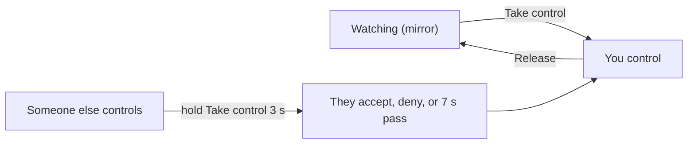
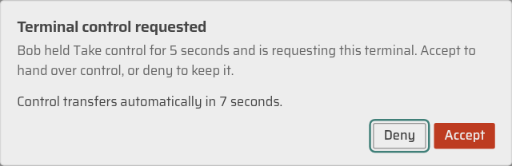

# Terminals

Aether shows three kinds of terminal in the dashboard. A run is one agent
working on one task in its own container; other terms are in the
[glossary](README.md#concepts).

| Terminal | What it is |
| --- | --- |
| **Environment** | Your own persistent shell on the server, with your home mounted at `$HOME` ([environments.md](environments.md)) |
| A run's **Terminal** view | The agent's own terminal in a Standard run |
| Run shells | Extra shells in a run's container |

You can also reach a run over SSH from your own editor.

## Open your environment

```sh
aether terminal                # open the main tab
aether terminal --tab t2       # open or create another tab
aether terminal status
aether terminal stop
```

In the dashboard, select **Environment** in the header (under **More
navigation** on a narrow screen), or press `g` then `e`. The first open reads
**Starting your environment container** until the shell attaches, and shows the
server's error if the start fails. **Add terminal tab** (`+`) opens another tab,
up to six. Closing a tab only detaches it. A shell that exits closes its tab.
When the `main` shell exits, the container stops, and opening the environment
starts the same container again.

**Stop environment…** stops the container and every tab process. Your home,
saved image and unsaved changes remain. Saving, resetting and installing tools
are in [environments.md](environments.md).

### Run one command

`aether terminal exec` runs one command in your environment without opening a
tab. Use it from a script or a coding agent on your machine:

```sh
aether terminal exec claude --version
aether terminal exec 'echo "$HOME"; uname -sm'
```

The arguments are joined with spaces and run by a login shell in your home, so
`$HOME` and `PATH` match a tab. Quote the command so your local shell does not
expand it. A stopped environment is started. The command has no terminal and no
input. When it ends, its output is written to yours and `aether` exits with its
exit code. If `aether` itself fails it exits 1 and prints `aether: <error>`.

Two limits apply. Passing either fails the call and returns none of the
output:

| Limit | Error |
| --- | --- |
| 10 minutes. The command and its children are killed. | `aether: rpc error -32603: terminal exec: the command passed the 10m0s time limit` |
| 1 MiB of stdout and stderr together. The command may keep running. Redirect long output to a file. | `aether: rpc error -32603: terminal exec: exec output: output passed the 1048576 byte limit` |

Output is returned as text. Bytes that are not valid UTF-8 arrive as U+FFFD.
Interrupting `aether` does not stop the command.

## Run control

Open a run from the sidebar, the board or the palette and pick **Terminal** in
the view switch (`[` and `]` cycle the views). A Standard run opens on it. The
**Session** view lists messages, notes and tool calls, and while the agent works
it shows what the agent is doing with **Open terminal**.

An [Enhanced run](enhanced-runs.md) has no agent terminal. Its Terminal view
says **No agent terminal** and offers run shells.



Only one session controls a run's agent terminal at a time. You need permission
to steer the run ([roles](teams.md#roles)) to take it. Viewing a run, or owning
it, does not give you input.

- On a desktop, the owner's terminal takes control automatically when the
  Terminal view first opens. Opening on Session or Changes keeps it a mirror.
- Phones, other members and swarm workers start as read-only mirrors. A swarm
  worker is a run an integrator assigned work to. Tap or click **Take control**
  to type, and **Release** to go back to watching.
- A second tab of your own is a different session, not a second writer. The
  toolbar reads **You control in another tab**.
- `aether attach <run>` asks for control. `aether attach --read-only <run>`
  only watches.

To take an occupied run, hold **Take control** for three seconds (pointer,
touch, Space or Enter). Releasing early, moving off the button or pressing
Escape cancels. The holder gets a dialog naming you. **Deny** keeps control and
**Accept** hands it over. With no answer, control transfers after seven
seconds. A plain click on an occupied run reports `run control is held by
another session`.



If a controller disconnects, its lease is held for 15 seconds. Only the same
tab can reclaim it in that time. After that, anyone with permission can take it.

The run owner or an admin can turn on protection. It immediately removes the
current controller and cancels every queued message. While protected, other
members cannot message the run.

On a swarm worker, taking control also sets a hold: the integrator cannot steer
the worker until you select **Release control** on its task in the swarm page.
Releasing the terminal alone does not clear it.

### The Terminal toolbar

The toolbar shows who controls the agent terminal (**You control**, **Alice
controls**, **Nobody controls**) with **Take control** or **Release**. A name
marked **(last known)** is stale. The connection word (**Connecting**,
**Reconnecting**, **Offline**) shows while the attach is down. A finished run
reads **Container removed · read-only**, or **Container stopped · read-only**
when the container is kept. Without permission to steer, the line under the
toolbar reads **You can watch this run but not type in it.**

The **Tools** menu has **Find**, **Smaller text**, **Larger text**, **Reset
text size**, **Copy selection**, **Copy screen**, **Paste** and **Upload
image…**. Runs add **Captures…**. **Copy screen** copies the visible rows, which
is how to copy on a touch screen.

### Messages and notes

Talk to the agent in the **Session** view's composer. Press **Enter** or
**Send**, and **Shift+Enter** for a newline. **Attach files** (**+**) adds up to
eight files per message.

- A message from the current controller reaches the agent's terminal at once
  (**Sends to the agent's terminal.**). The owner of an uncontrolled run takes
  the lease first, then sends; on a swarm worker it sends without
  the lease, so sending never sets a hold. A message you send without the lease, from the
  assistant, `aether message` or a connector, also arrives at once while you
  are the controller.
- A message from anyone else waits 45 seconds (**Delivers in 45 s unless the
  controller decides sooner.**). The controller sees it in **Details → Needs
  you** with **Approve** and **Deny**.
- The row ends as **Sent**, **Not sent**, **Delivery uncertain**, **Denied** or
  **Cancelled**. **Sent** means the terminal accepted the write, not that the
  agent read it.
- If the agent has turned on bracketed paste, the message arrives as one paste
  and Enter follows 200 ms later, so a multi-line message is sent whole and
  once. Otherwise it is typed as written, then Enter.
- Standard Codex takes the message through its app-server instead, as a new
  turn when idle or a steer added to the running turn
  ([Codex](harnesses.md#codex)). **Sent** then means Codex accepted it.
- **Send to agent** in the **Changes** view sends your diff comments as one such
  message.
- `aether message <run-id> "<text>"` (or `-` for stdin) prints the receipt:
  `delivered`, `queued for the member in control` with when it is delivered,
  or the denial reason.
- If you cannot message the agent, the composer says why: **This run has
  finished.**, **The agent is still starting.**, **This run is protected: only
  its owner or an admin can message the agent.** or **You can watch this run but
  not message the agent.**

A reported outcome leaves an interactive run open, so send a follow-up or type
into its terminal. **Close** ends the session. Notes are for people only: the
agent never sees them. Add one under **Details → Add a note for people on this
run**.

Attachments (images up to 8 MiB, other files up to 64 MiB, eight per message)
are stored under `$HOME/.aether/terminal-images/` and
`$HOME/.aether/terminal-files/`, and the agent receives their path.

## Run shells

A run shell is an extra shell in the run's container, started by a person or by
the agent. **+ Shell** in the Terminal toolbar opens one as a tab after
**Agent** and gives you control. Shells are named **Shell 1**, **Shell 2** and
keep their number until they end. A shell the agent started carries the agent's
glyph, and its tab says **Started by the agent**.

At most four shells started by people and four started by the agent run at
once. At the limit, **+ Shell** is dimmed and reads **At most 4 shells**, and
the server refuses with:

```
shell limit reached: people have 4 shells running in this run; stop one to start another
```

Shells open only in a running or needs-attention run that is not paused.
Otherwise you see **You can view this run but not open a shell in it**.

### Who can type in a shell

Each shell has its own controller. Watching takes nothing, so the agent can
keep driving a shell you only read.

- A shell you open is yours. In a shell nobody controls, your first keystroke
  takes control.
- When the agent or a teammate controls it, the toolbar names them beside
  **Take control**. **Take control of this shell?** asks first. The agent can
  take a free shell but never one from a person.
- **Release** releases only that shell. Leaving the Terminal view releases it
  for you. Switching tabs or closing the page lets it lapse after 15 seconds.
- On a swarm worker, shell control also sets the hold described above, so the
  shell stays a mirror until **Take control**.

### Close a shell

Use the tab's close button, or Delete or Backspace on a focused tab. A running
shell asks:

- **Hide, keep running** detaches the tab. The process keeps running and counts
  toward the limit. The toolbar shows **1 hidden** with **Show Shell 1**.
- **Stop shell** ends the process and removes the tab. If someone else controls
  it, **Stop Shell 1?** names them and asks first.

A shell that ends while open stays as **Shell 1 · exited**, with its exit code
under the toolbar.

## SSH and editors

A live run is also an SSH host. Run this once on your computer:

```sh
aether ssh-config
```

```
wrote /home/you/.ssh/aether_config
added an Include line for it at the top of /home/you/.ssh/config
ssh <run-id>.aether now opens a shell in that run. scp, sftp, rsync and editors take the same host name.
```

`~/.ssh/aether_config` holds one block that the command rewrites each time. It
names the `aether` binary by path, so run it again after moving the binary. The
only change to `~/.ssh/config` is an `Include` line at the top. The host name
is the run id plus `.aether`, for example `run-gejd5cbk74.aether`. It reaches
the server your CLI is linked to. Without the config, `aether ssh [ssh options]
<run-id> [command]` takes the same options.

> [!WARNING]
> Use OpenSSH 9.6 or later, or a build patched for CVE-2023-51385 (`ssh -V`
> prints the version). Older builds run a crafted `*.aether` host name from a
> link or submodule URL as a command on your computer. See
> [security.md](security.md#ssh-into-a-run).

| You run | In the run's container |
| --- | --- |
| `ssh <host>` | A login shell in `/workspace` |
| `ssh <host> <command>` | The command through `bash -c` (or `sh -c`), output and exit status unchanged |
| `scp`, `sftp` | Aether's own SFTP server. Relative paths are in the checkout. |
| `ssh -L`, `-D`, `-W` | A port on the run's own loopback (`localhost`, `127.0.0.1`, `::1`) only |

`scp -O` and `rsync` run those programs inside the container. The standard
image has `scp` and no `rsync`. Agent, X11 and remote (`-R`) forwarding are
refused.

A session's processes end with it. When the command exits or the connection
drops, everything it started is stopped, including background processes. Start
long-lived work from a run shell or through the agent. Pausing the run freezes
its SSH sessions, and new sessions are refused until it resumes.

One run takes 16 SSH connections, at most 8 from one member. One connection
takes 10 sessions and 64 forwarded connections.

### Editors

**Open in editor…** in a live run's **More** menu has a button per editor. It is
not offered on a phone or for a finished run.

| Editor | Connect from the editor |
| --- | --- |
| VS Code (Remote - SSH) | **Remote-SSH: Connect to Host…**, then `<run-id>.aether` |
| Cursor | **Remote-SSH: Connect to Host…**, then `<run-id>.aether` |
| Zed | **Connect New Server**, then `ssh <run-id>.aether` |

The editor installs its own server in the container on first connection, so the
run needs a glibc Linux image (the standard image is one; Alpine is not),
outbound network, and a writable home. The server (`~/.vscode-server`,
`~/.cursor-server`, `~/.zed_server`) lands in the launcher's home and is reused
by later runs. A teammate who attaches installs theirs in your home. If the
connection drops, the editor restarts its server on reconnect, and processes in
its own terminals are gone.

### Who can connect

You can connect if you may open a writable shell in the run: you may steer it,
you own or were given the run's agent account
([security.md](security.md#account-sharing)), and the run is running or needs
attention and is not paused. The server rechecks every three seconds and closes
the connection when that stops being true. **Activity** shows **Connected over
SSH** beside your avatar.

A refusal comes from `aether ssh --stdio` before ssh's own `Connection closed
by UNKNOWN port 65535`:

| Message | What to do |
| --- | --- |
| `aether: ssh into <run-id>: run not found` | Check the id and the server you are linked to. |
| `... permission denied: run is protected: only its owner or an admin may steer` | Ask the owner or an admin. |
| `... permission denied: member <member-id> has not shared their account with you` | The run uses that member's agent account. |
| `... scheduler: the run has no live environment: the run is paused` | Resume the run. A finished run says its container is gone. |
| `... you already have 8 SSH connections open to run <run-id>, the most one member takes` | Close one of yours. |
| `... run <run-id> already has 16 SSH connections open, the most one run takes` | Close one, or ask a teammate to. |
| `aether: "<host>" does not name a run: a run id holds only lowercase letters, digits and hyphens` | Use `<run-id>.aether`. |
| `start the port forwarding relay: the helper exited 125: dev-exec: expected ...` | The run was created before this server version. Launch a new run. |
| `aether: not linked; run aether link <host:port>, or aether login and then aether link --claim <code>` | Link this computer first. |
| `ssh: Could not resolve hostname <run-id>.aether` | Run `aether ssh-config`. |

### Swarm workers over SSH

A shell, command or file transfer in a swarm worker takes control of it and
sets the hold described under [Run control](#run-control). Port forwarding
alone does not. Disconnecting does not release the hold. `ssh` prints this
first:

```
aether: this run is a swarm worker: a shell, command or file transfer here takes control of it, and its integrator cannot steer it until control is released on the swarm page
```

## Sign in to agents and set up GitHub

The Agents page and onboarding embed the environment terminal with the agent's
login command typed in. Press Enter to run it. Login state lives in your home,
so you do not save the environment. See
[environment-home.md](environment-home.md#set-up-an-agent) and
[GitHub](environment-home.md#connect-github).

For a login that opens a browser, click the OAuth URL printed in the terminal.
In the CLI, first run `aether forward terminal <callback-port>` in a second
terminal on your computer: the environment has no `aether` command. Device-code
logins, `gh auth login --web` among them, need no forward.

Install tools in the environment, then **Save environment** (or `aether env
save`) so new runs get them. See
[environments.md](environments.md#save-the-environment).

## Keys and touch screens

These work in every terminal Aether draws, when it has focus:

| Key | What it does |
| --- | --- |
| `Ctrl+Shift+C` | Copy the selection. Plain `Ctrl+C` copies when text is selected and interrupts otherwise. |
| `Ctrl+Shift+V`, `Ctrl+V` (`Cmd+V` on macOS) | Paste |
| `Ctrl+Shift+F` | Find. `Enter` next, `Shift+Enter` previous, `Esc` closes. |
| `Ctrl+=` / `Ctrl+-` | Larger or smaller font, 8 to 32 px, kept across terminals and reloads |
| `Ctrl+0` | Default 12 px font |

On a touch screen, a key bar below the terminal has **Ctrl**, **Esc**, **Tab**,
the arrows, **Enter** and **Ctrl+C**. **Ctrl** applies to the next key only:
tap **Ctrl**, then `d` sends `Ctrl+D`. A phone opens every run as a read-only
mirror, so tap **Take control** before the keyboard can send input. Phones keep
the session's size: swipe to reach parts of a larger grid.

## Paste or upload an image

Paste an image straight into a terminal that accepts input, or choose **Tools →
Upload image…**. The **Upload image to terminal** dialog previews it. Select
**Upload and insert**. Aether stores the file in your home and types its path,
quoted, without pressing Enter. Review the path, then press Enter yourself.

Only real image bytes work: PNG, JPEG, GIF or WebP up to 8 MiB. The server
checks the decoded bytes, not the filename. Some clipboard managers copy only a
path such as `C:\Screenshots\shot.png`. That is text, and a remote container
cannot read your local disk, so choose the file in the chooser instead.
Failures read **Upload failed:** or **Pasting image failed:** with the detail.

**Upload image…** is disabled while the terminal is a read-only mirror,
connecting, reconnecting or offline, or the run is starting. Take control first.

To delete an uploaded file, use the exact generated name and no wildcard:

```sh
rm -- "$HOME/.aether/terminal-images/image-<random>.<ext>"
rm -r -- "$HOME/.aether/terminal-files/<random>"
```

Stopping or resetting the environment keeps these files. Nothing cleans them up
automatically.

## Scrollback and history

Scroll up in a run terminal to read older output in the same pane (`PageUp`,
`Home`, or `Shift+PageUp` inside a full-screen app). Arrows, `PageUp`, `PageDown`
and `Home` navigate while reading. Scroll to the bottom or press `End` to
return to live output. While reading, typing and paste are off and Find searches
the pages loaded so far. Older pages are recorded text, not the original screen
layout, so some lines can appear on both sides of the boundary.

The server keeps a run's terminal recording until you delete the run or
terminal. Closing the container, reclaiming the checkout and archiving do not
remove it. If earlier output has expired, history is marked truncated and
cannot be recovered. `aether logs <run-id> [--limit N]` prints the recorded
terminal lines as plain text, and an Enhanced run's messages and tool calls,
one line each. `aether attach` is a raw stream that replays retained
output and discards keystrokes typed before the replay finishes.

## Reconnects and server updates

The terminal reconnects and restores its output when the page or network comes
back. If it cannot continue where the screen left off, you get the current
screen instead. A finished run opens from its final screen and stays read-only
unless you reopen the run.

The environment container survives a server restart or update, and unsaved
changes stay. A run keeps the Aether helper it was created with, so SSH
features added by a later server need a new run.

## Limits

- Six environment tabs, and four people's plus four agent shells per run.
- `aether terminal exec`: 10 minutes and 1 MiB of output.
- SSH: 16 connections per run, 8 per member.
- Images up to 8 MiB, other message files up to 64 MiB, eight per message.
